**Before you begin, click to expand the box below to review the process for importing a dataset.**

::: {#Importing-GSS2024-to-Rguroo .callout-note appearance="simple" collapse="true" icon="none" title="{width=22px style='vertical-align:middle;'}  Importing Data to Rguroo"} 

1. Open the **Data** toolbox in Rguroo.
2. From the [Data Import]{.dpd} dropdown, select [Dataset Repository]{.fun}.
3. In the [Quick Filter]{.des} textbox, type [stats with rguroo]{.typein}, followed by a space. Then begin typing the dataset name. The results update as you type, so you can stop typing as soon as the dataset appears in the results panel.
4. Select the dataset from the results panel.
5. Click [Import]{.button} to import the dataset into your Rguroo account.
6. Click [Close]{.button} to exit the dialog.
7. To view the dataset, double-click its name in the **Data** toolbox list.
:::

Analysis of variance (ANOVA) is a statistical method used to compare the population means of three or more groups. In @sec-mean-independent, we learned how to compare two means using two-sample tests or confidence intervals for the difference between means. When we have three or more groups, one approach would be to compare the means of each pair of groups. For example, suppose that a researcher wants to know whether mean quiz scores differ among students randomly assigned to study with an AI tutor, use only a textbook, or use only class notes. In this example, we have three groups, and comparing each pair of means would require three comparisons, namely, AI tutor vs. textbook, AI tutor vs. class notes, and textbook vs. class notes. As another example, suppose that a researcher wants to know whether mean body weight at 21 days of age differs among chicks receiving four different protein diets. In this example, we have four groups, and comparing each pair of means would require six comparisons, namely, diet 1 vs. diet 2, diet 1 vs. diet 3, diet 1 vs. diet 4, diet 2 vs. diet 3, diet 2 vs. diet 4, and diet 3 vs. diet 4.

As you can see from the examples above, as the number of groups increases, the number of pairwise comparisons increases rapidly. In general, with $k$ groups there are

$$
\frac{k(k-1)}{2}
$$

pairwise comparisons. For example, if there are 5 groups, there are 10 pairwise comparisons, and if there are 6 groups, there are 15 pairwise comparisons. Conducting many separate tests without accounting for multiple comparisons increases the chance of making at least one Type I error—rejecting a true null hypothesis. Specifically, if we conduct tests each at the 5% level of significance, each test has a 5% chance of rejecting its null hypothesis when that hypothesis is true. Across several tests, however, the probability of making at least one Type I error can be greater than 5%.

For example, suppose that all the null hypotheses are true and the tests are independent. Under these assumptions, if we conduct $m$ tests, each at the 5% significance level, the probability of making at least one Type I error is

$$
1 - (0.95)^m.
$$

So, for 3 tests this probability is about 14%, for 6 tests it is about 26%, and for 15 tests it is about 54%. Pairwise comparisons involving the same groups are not independent, so these percentages do not apply directly to our examples. Nevertheless, they illustrate how conducting many tests can substantially increase the overall chance of a Type I error. Thus, setting a 5% significance level for each individual test does not keep the overall chance of a Type I error at 5%.

ANOVA addresses the overall question with a single test of whether all the population means are equal. If the ANOVA test is significant, we have evidence that not all the population means are equal. We can then use multiple comparison procedures to investigate which means differ while controlling the overall chance of a Type I error. In this chapter, we focus on one-way ANOVA, which compares means across groups defined by one categorical variable, such as study method or diet. In @sec-one-way-anova we will learn how to conduct a one-way ANOVA test, and in @sec-multiple-comparisons we will learn how to use multiple comparison procedures to investigate which means differ.

## Comparing Means with One-Way ANOVA {#sec-one-way-anova}

In this section we introduce one-way ANOVA, a method for testing whether the population means of three or more groups are equal. The null and alternative hypotheses are

$$
\begin{cases}
H_0: & \text{All population means are equal.} \\
H_a: & \text{Not all population means are equal.}
\end{cases}
$$

Using the notation $\mu_1, \mu_2, \ldots, \mu_k$ to represent the population means of the $k$ groups, we can write the hypotheses as

$$
\begin{cases}
H_0: & \mu_1 = \mu_2 = \cdots = \mu_k \\
H_a: & \text{not all population means are equal}
\end{cases}
$$

Note that the alternative hypothesis does **not** say that all the population means are different from one another. $H_a$ is true if even one population mean differs from the others.

To introduce the concepts of one-way ANOVA, we will use the [PlantGrowth]{.data} dataset, which compares dried plant weights under a control condition and two treatment conditions. The dataset contains 30 observations, with 10 observations in each group. This dataset is available in the Rguroo dataset repository [Intro to Stats with Rguroo]{.repo}, with the dataset name [PlantGrowth]{.data}.

One-way ANOVA examines a quantitative response variable across groups defined by one categorical explanatory variable. In this dataset, the two variables are:

- [group]{.var}: The categorical explanatory variable, indicating the experimental condition under which each plant was grown. The groups are labeled as "ctrl" for the control group, "trt1" for treatment 1, and "trt2" for treatment 2.
- [weight]{.var}: The quantitative response variable, giving the dried weight of each plant.

For a compact display, @tbl-plant-growth presents the observations in three pairs of columns, one pair for each group. The actual dataset has only two columns, [group]{.var} and [weight]{.var}, with one row for each of the 30 plants.

```{r}
#| label: tbl-plant-growth
#| tbl-cap: "Dried plant weights under a control and two treatment conditions."
#| echo: false

Plant_Growth <- read.csv("FJK_datasets/Plant_Growth.csv", header = TRUE)

# Arrange the observations in three blocks of 10.
plant_display <- cbind(
  Plant_Growth[1:10, c("group", "weight")],
  spacer1 = "",
  Plant_Growth[11:20, c("group", "weight")],
  spacer2 = "",
  Plant_Growth[21:30, c("group", "weight")]
)

knitr::kable(
  plant_display,
  col.names = c(
    "group", "weight", "",
    "group", "weight", "",
    "group", "weight"
  ),
  row.names = FALSE,
  digits = 2,
  align = c("l", "r", "c", "l", "r", "c", "l", "r")
)
```

The following is a codebook for the [PlantGrowth]{.data} dataset, which provides a description of the variables and their values.

::: {#code-book-plant-growth .callout-tip .codebook collapse="true"}

## Code book for Dataset PlantGrowth

Dataset Name: [PlantGrowth]{.data}

This dataset contains results from an experiment comparing plant yields, measured by dried plant weight, under a control condition and two treatment conditions. The dataset includes $n = 30$ observations, with 10 observations in each group.

The variables included in this dataset are described below.

[group]{.var}: Experimental condition under which the plant was grown

- ctrl: Control
- trt1: Treatment 1
- trt2: Treatment 2

[weight]{.var}: Dried weight of the plant (measurement units are not specified in the original documentation)

Source

Dobson, A. J. (1983). *An Introduction to Statistical Modelling*. Springer. Available through the R dataset [PlantGrowth](https://stat.ethz.ch/R-manual/R-devel/library/datasets/html/PlantGrowth.html).

:::

For this example, $\mu_1$, $\mu_2$, and $\mu_3$ represent the population mean dried weights of plants grown under the control condition, treatment 1, and treatment 2, respectively. The hypotheses are

$$
\begin{cases}
H_0: & \mu_1 = \mu_2 = \mu_3 \\
H_a: & \text{not all three population means are equal}
\end{cases}
$$

We computed the sample size, mean, and standard deviation of dried weight for each group using the Rguroo [Numerical Summary]{.fun} function. The results are shown in @tbl-plant-growth-summary. Rounded to two decimal places, the sample mean weight is 5.03 for the control group, 4.66 for treatment 1, and 5.53 for treatment 2. These sample means are different, but we need a formal test to determine whether the differences are statistically significant.

```{r}
#| label: tbl-plant-growth-summary
#| tbl-cap: "Summary of dried plant weights by experimental group."
#| fig-alt: "Rguroo summary table for weight. Each group has 10 observations. Control: mean 5.032, standard deviation 0.5831. Treatment 1: mean 4.661, standard deviation 0.7937. Treatment 2: mean 5.526, standard deviation 0.4426."
#| out-width: "100%"
#| echo: false
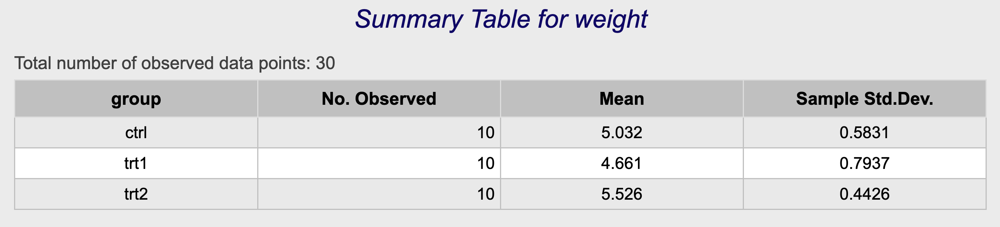
```

To visualize the data, we can create side-by-side boxplots of the dried plant weights for each group. These plots help us compare the centers and spreads of the three groups. @fig-boxplot-plant-growth shows the boxplots for the control (ctrl), treatment 1 (trt1), and treatment 2 (trt2) groups. The red diamond in each boxplot represents the mean dried plant weight for that group, and the horizontal line inside each box represents the median.

```{r}
#| label: fig-boxplot-plant-growth
#| fig-cap: "Side-by-side boxplots of dried plant weights for each group. Red diamonds mark the group means; the open circle marks an outlier."
#| fig-alt: "Side-by-side boxplots of dried plant weight for the control, treatment 1, and treatment 2 groups. Treatment 2 has the highest center and treatment 1 the lowest. Treatment 1 has the largest spread and one outlier near 6.0. Red diamonds show the means: about 5.03 for control, 4.66 for treatment 1, and 5.53 for treatment 2."
#| out-width: "80%"
#| echo: false
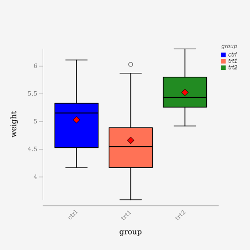
```

The mean markers show that treatment 2 has the highest sample mean weight, followed by the control group and then treatment 1. Notice that the mean and median are not the same within a group. In the control group the mean is below the median, while in treatment 1 the mean is above the median. Treatment 1 also has one unusually large observation, shown as an open circle, which pulls its mean upward. We will return to outliers when we discuss the ANOVA assumptions in @sec-anova-assumptions.

The boxplots also show that individual plant weights vary within each group. To understand how ANOVA evaluates the differences among the sample means, we need to distinguish two sources of variation:

- **Variation between groups** refers to differences among the group means.
- **Variation within groups** refers to differences among individual observations in the same group. Standard deviations summarize this variation.

Differences among group means are easier to detect when the observations within each group are tightly clustered. When observations within each group are widely spread, differences among the means are harder to distinguish from chance variation. ANOVA therefore considers how far apart the group means are in relation to how much observations vary within the groups.

In the plant growth example, the differences among the sample means of 5.03, 4.66, and 5.53 reflect variation between groups. The sample standard deviations of 0.58 for the control group, 0.79 for treatment 1, and 0.43 for treatment 2 describe variation in individual plant weights within each group. Treatment 1 has the largest spread, which agrees with its taller box and longer whiskers in @fig-boxplot-plant-growth.

The sample means alone do not tell us whether the differences are statistically significant. We will use a one-way ANOVA test to assess whether the differences among the means, relative to the variation within groups, provide evidence that not all population means are equal.

One-way ANOVA compares variation between groups with variation within groups using a statistic called the **$F$-statistic**. The $F$-statistic is a ratio:

$$
F=\frac{\text{Mean square between groups}}{\text{Mean square within groups}}.
$$

The two quantities in this ratio, called **mean squares**, summarize the variation between group means and the variation among observations within each group. Their calculations account for the number of groups and observations, putting the two measures on a comparable scale. We will rely on Rguroo to compute these quantities and the $F$-statistic.

To see why the $F$-statistic is useful, suppose the ANOVA assumptions hold (see @sec-anova-assumptions) and let $\sigma^2$ denote the common population variance within the groups.

- The **mean square within groups** estimates $\sigma^2$ whether or not the null hypothesis is true, because it is based only on how observations vary around their own group mean.
- The **mean square between groups** also estimates $\sigma^2$ when the null hypothesis is true. When the population means differ, however, it tends to be larger than $\sigma^2$, because it also reflects the differences among the population means.

Because both mean squares estimate the same variance under the null hypothesis, an $F$-statistic near 1 is consistent with equal population means. A large $F$-statistic indicates that the differences among sample means are greater than we would expect from the variation within groups alone, providing evidence against the null hypothesis.

Because large values provide evidence against the null hypothesis, the p-value for the ANOVA test is the area to the **right** of the observed $F$-statistic under the $F$ distribution. We use Rguroo to calculate the p-value and compare it with the significance level to decide whether to reject the null hypothesis.

The following example presents a complete one-way ANOVA analysis of the plant growth data using Rguroo, from stating the hypotheses to making a decision and interpreting the results in context.

:::{#exm-anova-plant-growth .callout-example}
## Comparing mean dried weights of plants under three experimental conditions

Consider the [PlantGrowth]{.data} dataset, which contains dried plant weights under a control condition and two treatment conditions. The dataset includes 30 observations, with 10 observations in each group. We want to determine whether there is evidence that the mean dried weight differs among the three experimental conditions. Denoting the population mean dried weights of plants grown under the control condition, treatment 1, and treatment 2 as $\mu_1$, $\mu_2$, and $\mu_3$, respectively, we stated the null and alternative hypotheses as
$$
\begin{cases}
H_0: \mu_1 = \mu_2 = \mu_3 \\
H_a: \text{not all means are equal.}\end{cases}
$$

a. Use Rguroo to test the hypotheses at the 5% significance level. Report the mean square between groups, the mean square within groups, the F-statistic, and the p-value.

b. Based on the p-value, state your conclusion in context.

<div tabindex="0" style="width:85%; margin:auto;">

 The dataset for this exercise is available in the Rguroo dataset repository [Intro to Stats with Rguroo]{.repo}, with the dataset name [PlantGrowth]{.data}.

**Codebook for Dataset PlantGrowth is given [here](#code-book-plant-growth).**

</div>

:::

:::: {.callout-tip .solution-callout collapse="true" icon=false}
## 🔎 Solution

a\. Click to expand the box below to see how to use the [ANOVA]{.fun} function in Rguroo to answer this question.

::: {#anova-plant-growth .callout-note appearance="simple" collapse="true" icon="none" title="{width=22px style='vertical-align:middle;'} ANOVA - Plant Growth example"}

Before you begin, make sure to import the [PlantGrowth]{.data} dataset from the [Intro to Stats with Rguroo]{.repo} repository.

1. Open the **Analytics** toolbox in Rguroo.  

2. From the [Analysis]{.dpd} dropdown, select [ANOVA]{.fun}. This opens the [ANOVA]{.dialog} dialog.

3. From the [Dataset]{.dpd} dropdown, select the [PlantGrowth]{.data} dataset.

4. From the [Response]{.dpd} dropdown, select the variable [weight]{.var}.

5. In the [One-Way]{.tab} tab, from the [Factor]{.dpd} dropdown select the categorical variable [group]{.var}.

6. Enter [0.05]{.typein} in the [Significance level]{.des} textbox.

7. Click the preview icon  to view the output.

8. Click the  button and save the result as [ANOVA_PlantGrowth]{.typein}.

::: {.callout-tip .inner-callout collapse="false" title="Rguroo ANOVA dialog"}

```{r,echo=FALSE}
#| fig-alt: "Rguroo ANOVA dialog configured for a one-way analysis of the PlantGrowth dataset, with weight as the response, group as the factor, and a significance level of 0.05."
#| fig-cap: "Rguroo setup for the ANOVA test for PlantGrowth data."
#| out-width: "100%"
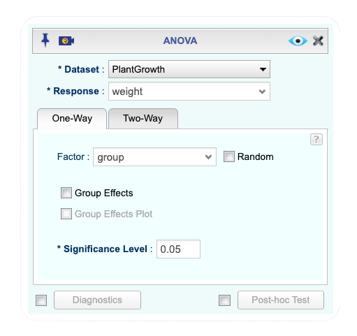
```

:::
:::

::: {.callout-tip .inner-callout collapse="true" title="Rguroo Output: Plant Growth ANOVA"}
<div tabindex="0" class="rg-iframe-wrapper">
  <iframe
    src="Rguroo_html_output/ANOVA/ANOVA_PlantGrowth_docx/ANOVA_PlantGrowth.html"
    class="rg-iframe"
    title="Rguroo output: ANOVA - Plant Growth Example">
  </iframe>
</div>
:::

@tbl-plant-growth-anova shows the ANOVA table from the Rguroo output:

```{r}
#| label: tbl-plant-growth-anova
#| tbl-cap: "ANOVA table for dried plant weights by experimental group."
#| fig-alt: "One-way ANOVA table for plant weight by group. The F-statistic is 4.84609 with 2 and 27 degrees of freedom, and the p-value is 0.01591, indicating a statistically significant difference among population mean weights at the 5% significance level."
#| out-width: "100%"
#| echo: false
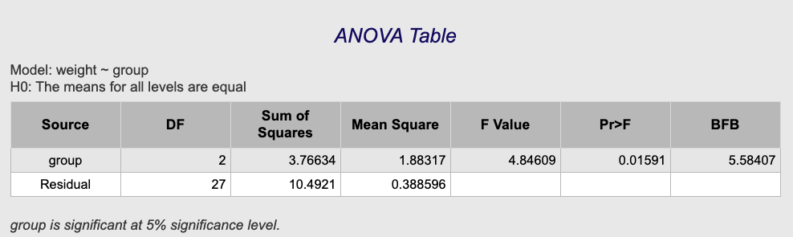
```

In the Rguroo output, the mean square between groups appears in the row labeled
_group_, and the mean square within groups appears in the row labeled _Residual_.
Rounded to two decimal places, these values are 1.88 and 0.39, respectively. The
$F$-statistic is the ratio of these two mean squares, $F = 4.85$, with 2 and 27
degrees of freedom. (Rguroo computes $F$ from the unrounded mean squares, so
dividing the rounded values gives a slightly different result.) The mean square
between groups is almost five times the mean square within groups, much larger
than the value near 1 we would expect if $H_0$ were true. Rounded to three decimal
places, the p-value is 0.016.

b\. Since the p-value of 0.016 is less than the significance level
$\alpha = 0.05$, we reject $H_0$. At the 5% significance level, there is evidence
that not all three experimental conditions have the same population mean dried
weight. This conclusion does not mean that all three population means differ
from one another; it means that at least one population mean differs from the
others. 

Because the [PlantGrowth]{.data} data come from an experiment, if the
plants were randomly assigned to the three conditions, this result would support
the conclusion that the experimental conditions *caused* differences in mean dried
weight. Note that the ANOVA test does not tell us which population means differ.
In @sec-multiple-comparisons, we will use multiple comparison procedures to
investigate this question.

::::

The following example uses Rguroo to compare the mean body mass of Adélie penguins across three islands, from exploring the data to conducting a one-way ANOVA test and interpreting the results.

::: {#exm-anova-adelie .callout-example}
## Comparing mean body mass of Adélie penguins across three islands

Consider the [palmerpenguins_Adelie]{.data} dataset, available in the [Intro to Stats with Rguroo]{.repo} repository. This dataset contains measurements of Adélie penguins observed on Biscoe, Dream, and Torgersen islands near Palmer Station, Antarctica. The variables [body_mass_g]{.var} and [island]{.var} give each penguin's body mass in grams and the island where it was observed.

We want to investigate whether the population mean body mass of Adélie penguins differs among the three islands. 

a. Use the Rguroo [Numerical Summaries]{.fun} function to obtain the sample size, mean, and standard deviation of body mass for each island.

b. Use the Rguroo [Boxplot]{.fun} function to create side-by-side boxplots of body mass by island. Describe the centers and variation of the three distributions.

c. State the null and alternative hypotheses for testing whether the population mean body mass is the same on all three islands.

d. Use the Rguroo [ANOVA]{.fun} function to perform a one-way ANOVA test at the 5% significance level. Report the mean square between groups, the mean square within groups, the $F$-statistic, and the p-value.

e. Based on the p-value, state your conclusion in the context of the problem.

<div tabindex="0" style="width:85%; margin:auto;">

 The dataset for this exercise is available in the Rguroo dataset repository [Intro to Stats with Rguroo]{.repo}, with the dataset name [palmerpenguins_Adelie]{.data}.

**Code book for Dataset palmerpenguins_Adelie is given [here](mean inference.qmd#code-book-palmerpenguins-adelie).**

</div>

:::

:::: {.callout-tip .solution-callout collapse="true" icon=false}
## 🔎 Solution

Before you begin, import the [palmerpenguins_Adelie]{.data} dataset from the [Intro to Stats with Rguroo]{.repo} repository.

a\. In the Rguroo [Numerical Summary]{.fun} function, select [body_mass_g]{.var} as the numerical variable and [island]{.var} from the [Factor]{.dpd} dropdown. Then click the [Univariate]{.tab} button and select [Mean]{.des} and [Sample Std. Dev.]{.des} to obtain summaries separately for each value of [island]{.var}. 

@tbl-adelie-summary shows the resulting summaries.

```{r}
#| label: tbl-adelie-summary
#| tbl-cap: "Summary statistics for Adélie penguin body mass, in grams, by island."
#| fig-alt: "Body mass summaries for 151 Adélie penguins. Biscoe: 44 penguins, mean 3709.659 grams, standard deviation 487.7337 grams. Dream: 56 penguins, mean 3688.393 grams, standard deviation 455.1464 grams. Torgersen: 51 penguins, mean 3706.373 grams, standard deviation 445.1079 grams."
#| out-width: "100%"
#| echo: false
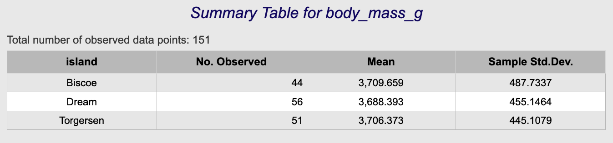
```

Rounded to the nearest gram, the sample means are 3,710 g for Biscoe, 3,688 g for Dream, and 3,706 g for Torgersen. The corresponding standard deviations are 487 g, 455 g, and 445 g. The sample means are close to one another, with a difference of only about 21 g between the largest and smallest means. In comparison, the standard deviation within each island is more than 440 g.

b\. In the Rguroo [Boxplot]{.fun} function, select [body_mass_g]{.var} as the numerical variable and [island]{.var} as the grouping variable. Include the group means in the plot by selecting the checkbox [Show Mean]{.des} in the [Boxplot]{.dialog} dialog.

@fig-adelie-boxplot shows the resulting side-by-side boxplots. The red diamonds represent the sample means.

```{r}
#| label: fig-adelie-boxplot
#| fig-cap: "Body mass of Adélie penguins by island. Red diamonds indicate sample means."
#| fig-alt: "Side-by-side boxplots of Adélie penguin body mass on Biscoe, Dream, and Torgersen islands. The distributions have similar centers and spreads, with substantial overlap. Red diamonds indicate nearly identical sample means."
#| out-width: "80%"
#| fig-align: center
#| echo: false
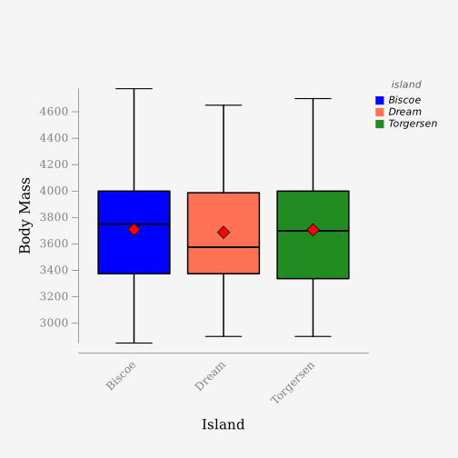
```

The distributions have similar centers. The median for Dream is slightly lower than those for Biscoe and Torgersen, while the three sample means are nearly identical; the medians differ more than the means, but ANOVA compares means. The boxes have similar heights, indicating similar variation among the middle 50% of observations. Biscoe has a slightly larger overall range. The distributions overlap substantially, and the differences among their centers appear small compared with the variation within each island.

c\. Let $\mu_1$, $\mu_2$, and $\mu_3$ denote the population mean body masses of Adélie penguins on Biscoe, Dream, and Torgersen islands, respectively. The hypotheses are

$$
\begin{cases}
H_0: \mu_1 = \mu_2 = \mu_3 \\
H_a: \text{not all population means are equal.}
\end{cases}
$$

d\. Click to expand the box below to see how to use the [ANOVA]{.fun} function in Rguroo to answer this question.

::: {#anova-adelie .callout-note appearance="simple" collapse="true" icon="none" title="{width=22px style='vertical-align:middle;'} ANOVA - Adélie Penguins example"}

1. Open the **Analytics** toolbox in Rguroo.

2. From the [Analysis]{.dpd} dropdown, select [ANOVA]{.fun}. This opens the [ANOVA]{.dialog} dialog.

3. From the [Dataset]{.dpd} dropdown, select the [palmerpenguins_Adelie]{.data} dataset.

4. From the [Response]{.dpd} dropdown, select the variable [body_mass_g]{.var}.

5. In the [One-Way]{.tab} tab, from the [Factor]{.dpd} dropdown, select the categorical variable [island]{.var}.

6. Enter [0.05]{.typein} in the [Significance Level]{.des} textbox.

7. Click the preview icon  to view the output.

8. Click the  button and save the result as [ANOVA_adelie]{.typein}.

::: {.callout-tip .inner-callout collapse="false" title="Rguroo ANOVA dialog"}

```{r}
#| fig-alt: "Rguroo ANOVA dialog configured for a one-way analysis of the palmerpenguins_Adelie dataset, with body_mass_g as the response, island as the factor, and a significance level of 0.05."
#| fig-cap: "Rguroo setup for comparing mean Adélie penguin body mass across islands."
#| out-width: "100%"
#| echo: false
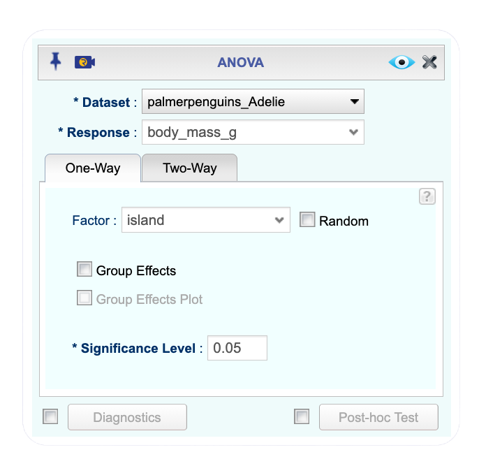
```

:::
:::

::: {.callout-tip .inner-callout collapse="true" title="Rguroo Output: Adélie Penguins ANOVA"}

<div tabindex="0" class="rg-iframe-wrapper">
  <iframe
    src="Rguroo_html_output/ANOVA/ANOVA_adelie_docx/ANOVA_adelie.html"
    class="rg-iframe"
    title="Rguroo output: ANOVA - Adélie Penguins Example">
  </iframe>
</div>

:::

@tbl-adelie-anova shows the ANOVA table from the Rguroo output.

```{r}
#| label: tbl-adelie-anova
#| tbl-cap: "ANOVA table for Adélie penguin body mass by island."
#| fig-alt: "One-way ANOVA table for Adélie penguin body mass by island. The mean square between groups is 6827.3, and the mean square within groups is 213032. The F-statistic is 0.0320482 with 2 and 148 degrees of freedom. The p-value is 0.968467."
#| out-width: "100%"
#| echo: false
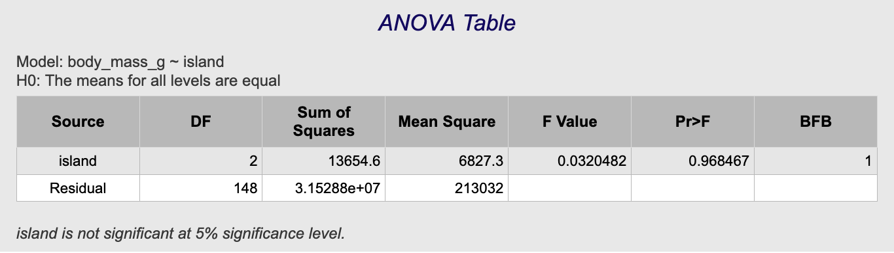
```

The mean square between groups appears in the row labeled *island* and is 6,827.3. The mean square within groups appears in the row labeled *Residual* and is 213,032. The $F$-statistic is the ratio of these two quantities:

$$
F = \frac{6{,}827.3}{213{,}032} \approx 0.032.
$$

The mean square between groups is much smaller than the mean square within groups. Recall that large values of $F$ provide evidence against $H_0$; this small value does not. In fact values of F far below 1 simply indicate chance variation. Rounded to three decimal places, the p-value is 0.968.

e\. Since the p-value of 0.968 is greater than the significance level $\alpha = 0.05$, we fail to reject $H_0$. At the 5% significance level, there is insufficient evidence that the population mean body mass of Adélie penguins differs among Biscoe, Dream, and Torgersen islands. This conclusion does not establish that the population means are equal; it means that these data do not provide sufficient evidence of a difference.

::::

The following example uses the [ChickWeight21]{.data} dataset to compare the mean weights of chicks fed fours different diets, from exploring the data to conducting a one-way ANOVA test and interpreting the results.

::: {#exm-anova-chickweight21 .callout-example}
## Comparing mean chick body weights under four protein diets

Consider the [ChickWeight21]{.data} dataset, available in the [Intro to Stats with Rguroo]{.repo} repository. This dataset contains body weights of chicks at 21 days of age from an experiment comparing four protein diets. The variables [weight]{.var} and [Diet]{.var} give each chick's body weight in grams and the diet it received. Each chick contributes one observation.

We want to investigate whether the population mean body weight at 21 days differs among the four diets.

a. Use the Rguroo [Numerical Summaries]{.fun} function to obtain the sample size, mean, and standard deviation of body weight for each diet.

b. Use the Rguroo [Boxplot]{.fun} function to create side-by-side boxplots of body weight by diet. Describe the centers and variation of the four distributions.

c. State the null and alternative hypotheses for testing whether the population mean body weight at 21 days is the same under all four diets.

d. Use the Rguroo [ANOVA]{.fun} function to perform a one-way ANOVA test at the 1% significance level. Report the mean square between groups, the mean square within groups, the $F$-statistic, and the p-value. Assume that the ANOVA assumptions hold (see @sec-anova-assumptions).

e. Based on the p-value, state your conclusion in the context of the problem.

<div tabindex="0" style="width:85%; margin:auto;">

 The dataset for this exercise is available in the Rguroo dataset repository [Intro to Stats with Rguroo]{.repo}, with the dataset name [ChickWeight21]{.data}.

**Code book for Dataset ChickWeight21 is given [here](#code-book-chickweight21).**

</div>

:::

::: {#code-book-chickweight21 .callout-tip .codebook collapse="true"}

## Code book for Dataset ChickWeight21

Dataset Name: [ChickWeight21]{.data}

This dataset contains body weights of chicks at 21 days of age from an experiment comparing four protein diets. It is a subset of the original ChickWeight dataset, which contains repeated measurements of chicks as they grew. This subset includes one observation per chick, using only measurements taken at 21 days.

The dataset includes $n = 45$ chicks: 16 received Diet 1, 10 received Diet 2, 10 received Diet 3, and 9 received Diet 4.

The variables included in this dataset are described below.

[Diet]{.var}: Protein diet received by the chick

- Diet 1
- Diet 2
- Diet 3
- Diet 4

[weight]{.var}: Body weight of the chick at 21 days of age (in grams)

Source

Adapted from the R dataset [ChickWeight](https://stat.ethz.ch/R-manual/R-devel/library/datasets/html/ChickWeight.html).

Crowder, M. J., & Hand, D. J. (1990). *Analysis of Repeated Measures*. Chapman & Hall. Example 5.3.

:::

:::: {.callout-tip .solution-callout collapse="true" icon=false}
## 🔎 Solution

Before you begin, import the [ChickWeight21]{.data} dataset from the [Intro to Stats with Rguroo]{.repo} repository.

a\. In the Rguroo [Numerical Summary]{.fun} function, select [weight]{.var} as the numerical variable and [Diet]{.var} from the [Factor]{.dpd} dropdown. Then click the [Univariate]{.tab} button and select [Mean]{.des} and [Sample Std. Dev.]{.des} to obtain summaries separately for each value of [Diet]{.var}.

@tbl-chickweight21-summary shows the resulting summaries.

```{r}
#| label: tbl-chickweight21-summary
#| tbl-cap: "Summary statistics for chick body weight at 21 days, in grams, by diet."
#| fig-alt: "Body weight summaries for 45 chicks at 21 days. Diet 1: 16 chicks, mean 177.75 grams, standard deviation 58.70 grams. Diet 2: 10 chicks, mean 214.70 grams, standard deviation 78.14 grams. Diet 3: 10 chicks, mean 270.30 grams, standard deviation 71.62 grams. Diet 4: 9 chicks, mean 238.56 grams, standard deviation 43.35 grams."
#| out-width: "100%"
#| echo: false
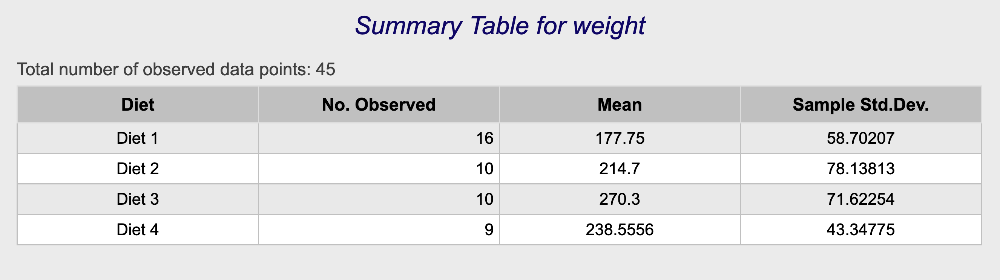
```

The dataset includes 45 chicks, with 16, 10, 10, and 9 chicks receiving Diets 1 through 4, respectively. Rounded to two decimal places, the sample mean weights are 177.75 g, 214.70 g, 270.30 g, and 238.56 g. The corresponding standard deviations are 58.70 g, 78.14 g, 71.62 g, and 43.35 g.

Diet 3 has the highest sample mean weight, and Diet 1 has the lowest. Diet 2 has the largest standard deviation, while Diet 4 has the smallest.

b\. In the Rguroo [Boxplot]{.fun} function, select [weight]{.var} as the numerical variable and [Diet]{.var} as the grouping variable. Include the group means in the plot by selecting the checkbox [Show Mean]{.des} in the [Boxplot]{.dialog} dialog.

@fig-chickweight21-boxplot shows the resulting side-by-side boxplots. The red diamonds represent the sample means.

```{r}
#| label: fig-chickweight21-boxplot
#| fig-cap: "Chick body weights at 21 days by diet. Red diamonds indicate sample means."
#| fig-alt: "Side-by-side boxplots of chick body weight at 21 days for four protein diets. Diet 3 has the highest median and mean, followed by Diet 4, Diet 2, and Diet 1. Diets 2 and 3 have longer boxes than Diets 1 and 4. Diet 4 has the smallest overall range. Red diamonds mark the sample means."
#| out-width: "80%"
#| fig-align: center
#| echo: false
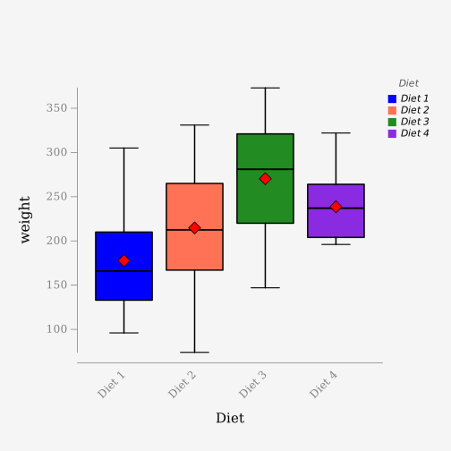
```

Both the medians and the sample means are highest for Diet 3 and lowest for Diet 1, with Diets 4 and 2 falling between them. Diets 2 and 3 have longer boxes, indicating greater variation among the middle 50% of observations. Diet 4 has the smallest overall range.

The plots show differences in centers as well as variation within each diet group. Although the distributions overlap, overlap alone does not determine whether the differences among population means are statistically significant. ANOVA evaluates the differences among sample means relative to the variation within groups.

c\. Let $\mu_1$, $\mu_2$, $\mu_3$, and $\mu_4$ denote the population mean body weights at 21 days for chicks receiving Diets 1, 2, 3, and 4, respectively. The hypotheses are

$$
\begin{cases}
H_0: \mu_1 = \mu_2 = \mu_3 = \mu_4 \\
H_a: \text{not all population means are equal.}
\end{cases}
$$

d\. Click to expand the box below to see how to use the [ANOVA]{.fun} function in Rguroo to answer this question.

::: {#anova-chickweight21 .callout-note appearance="simple" collapse="true" icon="none" title="{width=22px style='vertical-align:middle;'} ANOVA - Chick Weight example"}

1. Open the **Analytics** toolbox in Rguroo.

2. From the [Analysis]{.dpd} dropdown, select [ANOVA]{.fun}. This opens the [ANOVA]{.dialog} dialog.

3. From the [Dataset]{.dpd} dropdown, select the [ChickWeight21]{.data} dataset.

4. From the [Response]{.dpd} dropdown, select the variable [weight]{.var}.

5. In the [One-Way]{.tab} tab, from the [Factor]{.dpd} dropdown, select the categorical variable [Diet]{.var}.

6. Enter [0.01]{.typein} in the [Significance Level]{.des} textbox.

7. Click the preview icon  to view the output.

8. Click the  button and save the result as [ANOVA_ChickWeight21]{.typein}.

::: {.callout-tip .inner-callout collapse="false" title="Rguroo ANOVA dialog"}

```{r}
#| fig-alt: "Rguroo ANOVA dialog configured for a one-way analysis of the ChickWeight21 dataset, with weight as the response, Diet as the factor, and a significance level of 0.01."
#| fig-cap: "Rguroo setup for comparing mean chick body weights at 21 days across four diets."
#| out-width: "100%"
#| echo: false
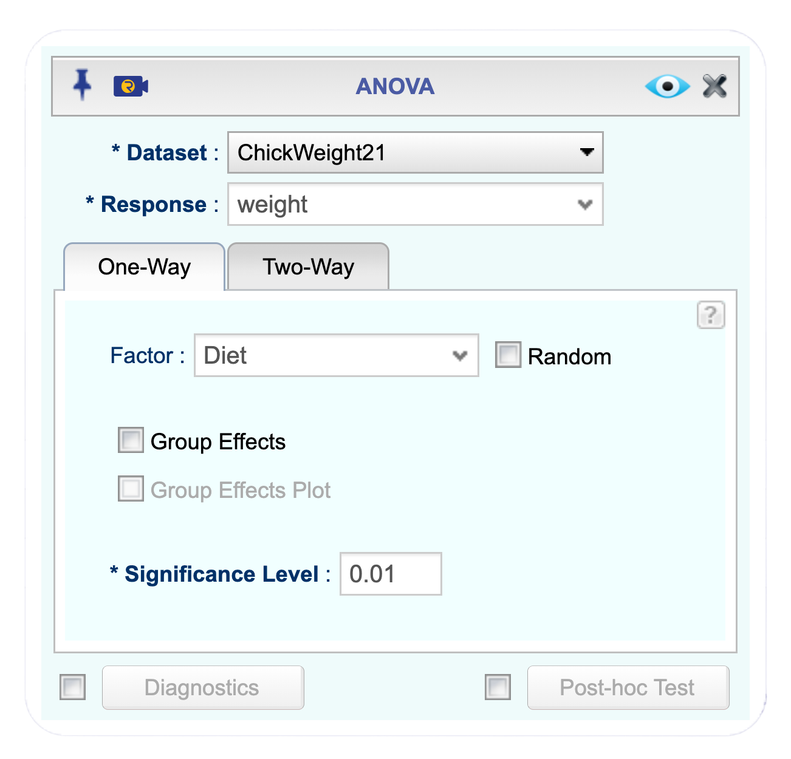
```

:::
:::

::: {.callout-tip .inner-callout collapse="true" title="Rguroo Output: Chick Weight ANOVA"}

<div tabindex="0" class="rg-iframe-wrapper">
  <iframe
    src="Rguroo_html_output/ANOVA/ANOVA_ChickWeight21_docx/ANOVA_ChickWeight21.html"
    class="rg-iframe"
    title="Rguroo output: ANOVA - Chick Weight Example">
  </iframe>
</div>

:::

@tbl-chickweight21-anova shows the ANOVA table from the Rguroo output.

```{r}
#| label: tbl-chickweight21-anova
#| tbl-cap: "ANOVA table for chick body weight at 21 days by diet."
#| fig-alt: "One-way ANOVA table for chick body weight by diet. The mean square between groups is 19054.7, and the mean square within groups is 4093.64. The F-statistic is 4.65471 with 3 and 41 degrees of freedom. The p-value is 0.00685796."
#| out-width: "100%"
#| echo: false
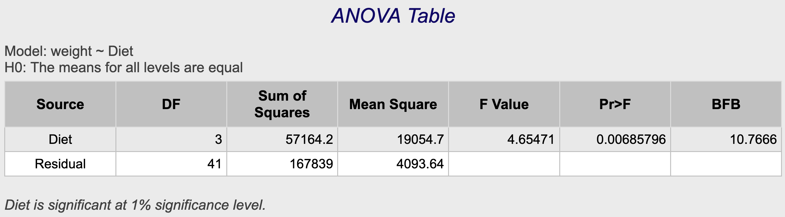
```

The mean square between groups appears in the row labeled *Diet* and is 19,054.7. The mean square within groups appears in the row labeled *Residual* and is 4,093.64. The $F$-statistic is the ratio of these two quantities:

$$
F = \frac{19{,}054.7}{4{,}093.64} \approx 4.65.
$$

The mean square between groups is about 4.65 times the mean square within groups. To determine whether this ratio is sufficiently large to reject $H_0$, we use the p-value. Rguroo reports a p-value of approximately 0.00686.

e\. Since the p-value of approximately 0.00686 is less than the significance level $\alpha = 0.01$, we reject $H_0$. At the 1% significance level, there is evidence that the population mean body weight at 21 days is not the same under all four diets. This does not mean that all four population means differ from one another; it means that at least two population means differ.

Because these data come from an experiment, if the chicks were randomly assigned to the diets, this result would support the conclusion that diet caused differences in mean body weight at 21 days. The ANOVA test does not tell us which population means differ. In @sec-multiple-comparisons, we will use multiple comparison procedures to investigate this question.

::::

### Homework for @sec-one-way-anova

```{r homework-setup}
#| include: false

# Show the first n rows of each group so that every group appears in the preview table.
head_by_group <- function(df, group, n = 2) {
  out <- do.call(rbind, lapply(split(df, df[[group]]), head, n))
  rownames(out) <- NULL
  out
}

ChickWeight21 <- read.csv("FJK_datasets/ChickWeight21.csv")
Eggs        <- read.csv("FJK_datasets/Eggs.csv")
Levi        <- read.csv("FJK_datasets/Levi.csv")
Advertising <- read.csv("FJK_datasets/Advertising.csv")
Food        <- read.csv("FJK_datasets/Food.csv")
HotDogs     <- read.csv("FJK_datasets/HotDogs.csv")
```

For each exercise below, import the specified dataset into Rguroo from the [Intro to Stats with Rguroo]{.repo} dataset repository and complete parts (a)–(e). Each exercise identifies the response variable, the grouping variable, and the significance level to use. Some exercises include an additional question.

a. Use the Rguroo [Numerical Summaries]{.fun} function to obtain the sample size, mean, and standard deviation of the response variable for each group.

b. Use the Rguroo [Boxplot]{.fun} function to create side-by-side boxplots of the response variable by group. Describe and compare the centers and variation of the distributions.

c. State the null and alternative hypotheses for testing whether the population means of the response variable are equal across all groups. Define any symbols you use.

d. Use the Rguroo [ANOVA]{.fun} function to perform a one-way ANOVA test at the significance level specified in the exercise. Report the mean square between groups, the mean square within groups, the $F$-statistic with its degrees of freedom, and the p-value.

e. Based on the p-value and the specified significance level, state whether you reject the null hypothesis and give your conclusion in the context of the problem. Then explain whether the data allow you to conclude that the grouping variable *causes* any differences in the population means.

1. **Cuckoo Egg Lengths** Cuckoo birds lay their eggs in the nests of other bird species, which then incubate and hatch the eggs. The [Eggs]{.data} dataset contains the lengths of cuckoo eggs found in the nests of six host bird species. Use [length]{.var}, measured in millimeters, as the response variable and [bird]{.var} as the grouping variable. Determine whether the data provide evidence that the population mean cuckoo egg lengths differ among the six host species. Use a 5% significance level. The first two rows for each host species are shown in @tbl-Eggs.

    In addition to parts (a)–(e), answer the following: if you compared the mean egg lengths for every pair of host species using separate two-sample tests, how many comparisons would you need to make? Why does this make a single ANOVA test useful?

```{r}
#| echo: false
#| label: tbl-Eggs
#| tbl-cap: "First two cuckoo egg lengths (mm) for each host bird species."
knitr::kable(head_by_group(Eggs, "bird"))
```

<div tabindex="0" style="width:85%; margin:auto;">

 The dataset for this exercise is available in the Rguroo dataset repository [Intro to Stats with Rguroo]{.repo}, with the dataset name [Eggs]{.data}.

**Codebook for Dataset Eggs is given [here](#code-book-eggs).**

</div>

::: {#code-book-eggs .callout-tip .codebook collapse="true"}

## Code book for Dataset Eggs

Dataset Name: [Eggs]{.data}

Cuckoo birds lay their eggs in the nests of other bird species, which then incubate and hatch the eggs. This dataset contains the lengths of `r nrow(Eggs)` cuckoo eggs found in the nests of six host bird species. The data were originally collected by O. H. Latter to study how the size of a cuckoo egg is related to the species of the host bird.

The variables included in this dataset are described below.

[length]{.var}: Length of the cuckoo egg (in mm).

[bird]{.var}: Species of the host bird whose nest contained the cuckoo egg: Meadow Pipit, Tree Pipit, Hedge Sparrow, Robin, Pied Wagtail, or Wren.

Source

Data and Story Library (DASL). [https://dasl.datadescription.com/](https://dasl.datadescription.com/).

References

Latter, O. H. (1902). The egg of *Cuculus canorus*: An enquiry into the dimensions of the cuckoo's egg and the relation of the variations to the size of the eggs of the foster-parent, with notes on coloration. *Biometrika*, 1(2), 164–176.

:::

2. **Fabric Waste at Levi Strauss & Co.** Levi Strauss & Co. monitors fabric waste at its suppliers. Each week, its quality control department records run-up: the percentage difference between the fabric waste predicted by the computer layout and the actual waste during production. Negative values indicate that the supplier arranged the pattern more efficiently than the computer. The [Levi]{.data} dataset contains `r nrow(Levi)` weekly run-up measurements from `r length(unique(Levi$plant))` suppliers. Use [run_up]{.var} as the response variable and [plant]{.var} as the grouping variable. Determine whether the data provide evidence that the population mean run-up differs among the suppliers. Use a 1% significance level. The first two rows for each supplier are shown in @tbl-Levi.

```{r}
#| echo: false
#| label: tbl-Levi
#| tbl-cap: "First two weekly fabric waste run-up measurements (%) for each supplier."
knitr::kable(head_by_group(Levi, "plant"))
```

<div tabindex="0" style="width:85%; margin:auto;">

 The dataset for this exercise is available in the Rguroo dataset repository [Intro to Stats with Rguroo]{.repo}, with the dataset name [Levi]{.data}.

**Codebook for Dataset Levi is given [here](#code-book-levi).**

</div>

::: {#code-book-levi .callout-tip .codebook collapse="true"}

## Code book for Dataset Levi

Dataset Name: [Levi]{.data}

Levi Strauss & Co. manufactures clothing. Its quality control department collects weekly measurements from its suppliers of the percentage difference between the fabric waste predicted by the computer layout and the actual waste when the clothing is made. This difference is called run-up. The dataset contains `r nrow(Levi)` measurements from `r length(unique(Levi$plant))` suppliers.

The variables included in this dataset are described below.

[run_up]{.var}: Percentage difference between the fabric waste predicted by the computer layout and the actual waste during production. Negative values indicate that the supplier arranged the pattern more efficiently than the computer.

[plant]{.var}: Supplier associated with the run-up measurement.

Source

Data and Story Library (DASL). [https://dasl.datadescription.com/](https://dasl.datadescription.com/).

:::

3. **Readability of Magazine Advertisements** Magazines were grouped into three categories based on the education level of their intended readers: high, medium, or low. Advertisements were sampled from magazines in each category, and for each advertisement the number of words with three or more syllables in its copy was recorded. The [Advertising]{.data} dataset contains `r nrow(Advertising)` advertisements. Use [number]{.var} as the response variable and [education]{.var} as the grouping variable. Determine whether the data provide evidence that the population mean number of words with three or more syllables per advertisement differs among the three education categories. Use a 5% significance level. The first two rows for each education category are shown in @tbl-Advertising.

```{r}
#| echo: false
#| label: tbl-Advertising
#| tbl-cap: "First two advertisements in each education category: number of words with three or more syllables."
knitr::kable(head_by_group(Advertising, "education"))
```

<div tabindex="0" style="width:85%; margin:auto;">

 The dataset for this exercise is available in the Rguroo dataset repository [Intro to Stats with Rguroo]{.repo}, with the dataset name [Advertising]{.data}.

**Codebook for Dataset Advertising is given [here](#code-book-advertising).**

</div>

::: {#code-book-advertising .callout-tip .codebook collapse="true"}

## Code book for Dataset Advertising

Dataset Name: [Advertising]{.data}

Magazines were grouped into three categories based on the education level of their intended readers: high, medium, or low. Several magazines were selected from each category, and several advertisements were selected from each magazine. For each advertisement, the number of words with three or more syllables in its copy was recorded. Each row of the dataset is one advertisement. Because several advertisements come from the same magazine, advertisements from the same magazine may be more similar to one another than advertisements from different magazines.

The variables included in this dataset are described below.

[number]{.var}: Number of words with three or more syllables in the advertising copy.

[education]{.var}: Education level of the intended readers of the magazine in which the advertisement appeared: high, medium, or low.

Source

Data and Story Library (DASL). [https://dasl.datadescription.com/](https://dasl.datadescription.com/).

:::

4. **Accuracy of Calorie Labels** A study examined the accuracy of calorie labeling for foods marketed as reduced calorie. Researchers measured the calorie content of each food item and calculated the percent difference between the measured and labeled calorie counts, so positive values mean that the food contained more calories than its label stated. Foods were classified as nationally advertised, regionally distributed, or locally prepared. Use the [Food]{.data} dataset with [percent_diff]{.var} as the response variable and [category]{.var} as the grouping variable. Determine whether the data provide evidence that the population mean percent difference between measured and labeled calorie counts differs among the three food categories. Use a 5% significance level. The first two rows for each food category are shown in @tbl-Food.

```{r}
#| echo: false
#| label: tbl-Food
#| tbl-cap: "First two foods in each category: percent difference between measured and labeled calorie counts."
knitr::kable(head_by_group(Food, "category"))
```

<div tabindex="0" style="width:85%; margin:auto;">

 The dataset for this exercise is available in the Rguroo dataset repository [Intro to Stats with Rguroo]{.repo}, with the dataset name [Food]{.data}.

**Codebook for Dataset Food is given [here](#code-book-food).**

</div>

::: {#code-book-food .callout-tip .codebook collapse="true"}

## Code book for Dataset Food

Dataset Name: [Food]{.data}

A study examined the accuracy of calorie labeling for foods marketed as reduced calorie. Researchers measured the calorie content of each food item and calculated the percent difference between the measured and labeled calorie counts. Foods were classified as nationally advertised, regionally distributed, or locally prepared.

The variables included in this dataset are described below.

[percent_diff]{.var}: Percent difference between the measured and labeled calorie counts, computed as
$$
\frac{\text{measured calories} - \text{labeled calories}}{\text{labeled calories}} \times 100.
$$
Positive values mean that the food contained more calories than its label stated; negative values mean that it contained fewer.

[category]{.var}: Category of food: nationally advertised, regionally distributed, or locally prepared.

Source

Data and Story Library (DASL). [https://dasl.datadescription.com/](https://dasl.datadescription.com/).

References

Allison, D. B., Heshka, S., Sepulveda, D., and Heymsfield, S. B. (1993). Counting calories—caveat emptor. *Journal of the American Medical Association*, 270(12), 1454–1456.

:::

5. **Sodium Content of Hot Dogs** The [HotDogs]{.data} dataset contains the calorie and sodium content of hot dogs classified as Beef, Meat, or Poultry. Use [sodium]{.var}, measured in milligrams per hot dog, as the response variable and [type]{.var} as the grouping variable. Determine whether the data provide evidence that the population mean sodium content differs among the three types of hot dogs. Use a 5% significance level. The first two rows for each type of hot dog are shown in @tbl-hotdogs.

```{r}
#| echo: false
#| label: tbl-hotdogs
#| tbl-cap: "First two hot dogs of each type: calories and sodium (mg) per hot dog."
knitr::kable(head_by_group(HotDogs, "type"))
```

<div tabindex="0" style="width:85%; margin:auto;">

 The dataset for this exercise is available in the Rguroo dataset repository [Intro to Stats with Rguroo]{.repo}, with the dataset name [HotDogs]{.data}.

**Codebook for Dataset HotDogs is given [here](#code-book-hotdogs).**

</div>

::: {#code-book-hotdogs .callout-tip .codebook collapse="true"}

## Code book for Dataset HotDogs

Dataset Name: [HotDogs]{.data}

This dataset contains the calorie and sodium content of `r nrow(HotDogs)` hot dog brands analyzed by Consumer Reports. The hot dogs are classified into three types: beef, meat, and poultry.

The variables included in this dataset are described below.

[type]{.var}: Type of hot dog: Beef, Meat, or Poultry. The Meat category consists mainly of pork and beef, with up to 15% poultry meat.

[calories]{.var}: Number of calories per hot dog.

[sodium]{.var}: Amount of sodium per hot dog (in mg).

Source

Data and Story Library (DASL). [https://dasl.datadescription.com/](https://dasl.datadescription.com/).

References

Moore, D. S., and McCabe, G. P. (1989). *Introduction to the Practice of Statistics*. W. H. Freeman. Original data source: *Consumer Reports*, June 1986, pp. 366–367.

:::


## Which Means Differ? Multiple Comparisons {#sec-multiple-comparisons}

In @sec-one-way-anova, we introduced the ANOVA test for assessing whether the data provide evidence that not all population means are equal. When the test is significant, we have evidence that at least two population means differ, but it does not tell us which means differ. To investigate differences between specific pairs of population means, we can use **multiple comparison procedures**.

As noted in the chapter introduction, conducting separate two-sample tests for every pair of groups without adjusting for multiple comparisons increases the chance of making at least one Type I error. Here, a Type I error means concluding that two population means differ when they are actually equal. We therefore need a procedure that accounts for all the comparisons we make.

One such method is **Tukey’s Honestly Significant Difference (HSD)** test, which compares every pair of population means while controlling the overall chance of making at least one Type I error. This overall probability is called the **family-wise error rate**, where “family” refers to the entire set of comparisons. For example, at a 5% significance level, Tukey’s method keeps the chance of incorrectly declaring one or more pairs of population means different at no more than 5%, provided the one-way ANOVA assumptions hold (see @sec-anova-assumptions).^[When the groups have different sample sizes, the procedure is sometimes called the Tukey–Kramer method. In this case, the family-wise error rate is at most the chosen significance level rather than exactly equal to it.] Tukey’s method uses these same assumptions; no additional set of assumptions is needed. The 5% limit applies to the comparisons collectively, rather than separately to each comparison. Similarly, at a 1% significance level, the overall chance of making at least one Type I error is kept at no more than 1%.

In this chapter, we use Tukey’s HSD test as a follow-up to a significant ANOVA test. When the ANOVA test is not significant, we will stop with the ANOVA conclusion because we have insufficient evidence that the population means differ. For example, in the Adélie penguin example (@exm-anova-adelie), the ANOVA test was not significant, so we would not proceed with Tukey’s HSD test. However, the ANOVA tests were significant for both [PlantGrowth]{.data} at the 5% level (@exm-anova-plant-growth) and [ChickWeight21]{.data} at the 1% level (@exm-anova-chickweight21). We will therefore use Tukey’s HSD comparisons to investigate which experimental conditions differ in population mean dried plant weight and which diets differ in population mean chick body weight at 21 days. There are three pairwise comparisons among the three plant groups and six pairwise comparisons among the four diets. Each dataset’s comparisons form a separate family.

Occasionally, the ANOVA test is significant but no pair of means is significantly different in Tukey’s procedure. This can happen because the two procedures answer slightly different questions: ANOVA asks whether the means differ overall, while Tukey’s procedure asks which specific pairs differ. When this happens, it usually means that the differences among the means are too small to attribute to any specific pair.

Rguroo provides Tukey’s HSD comparisons as part of its ANOVA analysis. The output includes the estimated differences between group means, confidence intervals, and adjusted p-values for each pairwise comparison. The adjusted p-values account for the multiple comparisons and can be compared directly with our chosen significance level. For [PlantGrowth]{.data}, we compare each adjusted p-value with 0.05. For [ChickWeight21]{.data}, we compare each adjusted p-value with 0.01. An adjusted p-value below the chosen significance level provides evidence that the corresponding population means differ.

Rguroo also produces a graph that shows the confidence intervals for the differences between population means, allowing us to assess the size and direction of the differences. We use Tukey’s 95% confidence intervals for comparisons at the 5% significance level and 99% confidence intervals for comparisons at the 1% significance level. At the corresponding significance level, a pair is significantly different if its interval does not include zero. An interval that includes zero does not provide sufficient evidence that the two population means differ. These intervals account for multiple comparisons as well.

The adjusted p-values and the confidence intervals always lead to the same conclusion. For each pair, the interval excludes zero exactly when the adjusted p-value is below the significance level. The p-value tells us whether a difference is significant, and the interval also tells us the direction of the difference and how large it might be.

The following two examples illustrate how to perform and interpret Tukey’s HSD comparisons in Rguroo, first for the [PlantGrowth]{.data} dataset at the 5% significance level and then for the [ChickWeight21]{.data} dataset at the 1% significance level.

::: {#exm-tukey-plant-growth .callout-example}
## Comparing pairs of mean dried plant weights

In @exm-anova-plant-growth, the one-way ANOVA test provided evidence at the 5% significance level that not all three experimental conditions have the same population mean dried plant weight. We now use the [PlantGrowth]{.data} dataset to investigate which population means differ.

a. Use Tukey’s HSD test in Rguroo to compare all pairs of population means at the 5% significance level. Display the multiple comparison table, including the estimated differences, 95% confidence intervals, and adjusted p-values. Identify which pairs differ significantly.

b. Display the graph of Tukey’s confidence intervals. Explain how the graph supports your conclusions and interpret the confidence interval for any statistically significant difference.

<div tabindex="0" style="width:85%; margin:auto;">

 The dataset for this exercise is available in the Rguroo dataset repository [Intro to Stats with Rguroo]{.repo}, with the dataset name [PlantGrowth]{.data}.

**Code book for Dataset PlantGrowth is given [here](#code-book-plant-growth).**

</div>

:::

:::: {.callout-tip .solution-callout collapse="true" icon=false}
## 🔎 Solution

a\. Click to expand the box below to see how to obtain Tukey’s HSD comparisons using the [ANOVA]{.fun} function in Rguroo.

::: {#tukey-plant-growth .callout-note appearance="simple" collapse="true" icon="none" title="{width=22px style='vertical-align:middle;'} Tukey’s HSD - Plant Growth example"}

Before you begin, import the [PlantGrowth]{.data} dataset from the [Intro to Stats with Rguroo]{.repo} repository. If you saved the ANOVA analysis from @exm-anova-plant-growth as [ANOVA_PlantGrowth]{.typein}, open it, keep its settings, and proceed to Step 7.

1. Open the **Analytics** toolbox in Rguroo.

2. From the [Analysis]{.dpd} dropdown, select [ANOVA]{.fun}. This opens the [ANOVA]{.dialog} dialog.

3. From the [Dataset]{.dpd} dropdown, select the [PlantGrowth]{.data} dataset.

4. From the [Response]{.dpd} dropdown, select [weight]{.var}.

5. In the [One-Way]{.tab} tab, from the [Factor]{.dpd} dropdown, select [group]{.var}.

6. Enter [0.05]{.typein} in the [Significance Level]{.des} textbox.

7. Select the checkbox next to the [Post-hoc Test]{.tab} button. Tukey’s HSD is selected by default.

8. (Optional) Click the [Post-hoc Test]{.tab} button to open the [ANOVA Post-Hoc]{.dialog} dialog and view the selected method. Leave [Tukey’s HSD]{.des} selected.

9. Click the preview icon , or press Enter, to view the output.

10. Click the  button and save the result as [HSD_PlantGrowth]{.typein}.

::: {.callout-tip .inner-callout collapse="false" title="Rguroo Tukey’s HSD dialogs"}

```{r}
#| fig-alt: "Rguroo ANOVA dialog for PlantGrowth with weight as the response, group as the factor, significance level 0.05, and the Post-hoc Test checkbox selected. The accompanying ANOVA Post-Hoc dialog shows Tukey’s HSD selected."
#| fig-cap: "Rguroo setup for Tukey’s HSD comparisons of mean dried plant weights."
#| out-width: "100%"
#| echo: false
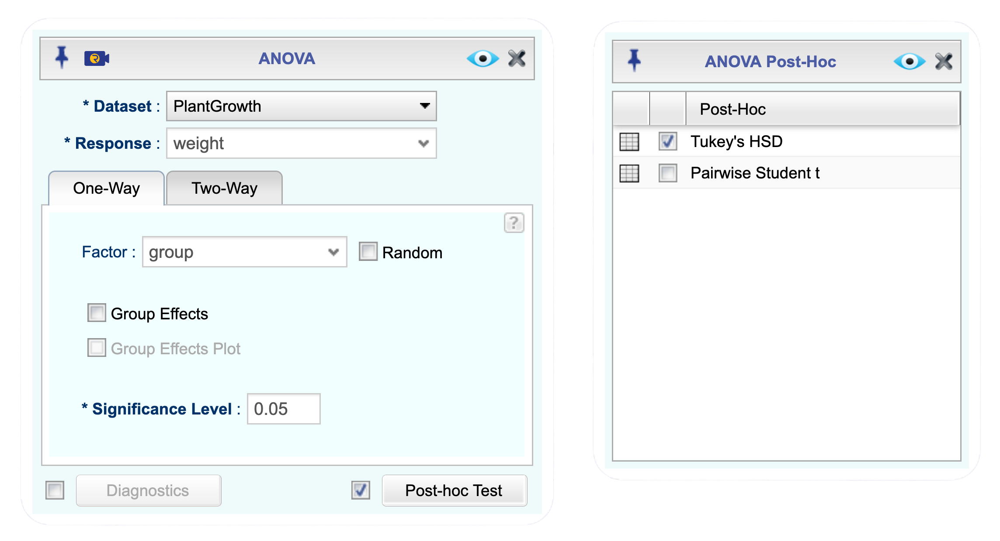
```

:::
:::

@tbl-plant-growth-tukey shows the multiple comparison table.

```{r}
#| label: tbl-plant-growth-tukey
#| tbl-cap: "Tukey’s HSD comparisons of mean dried plant weights, with 95% simultaneous confidence intervals."
#| fig-alt: "Tukey’s HSD table comparing three plant groups. Treatment 1 minus control: estimated difference -0.371, confidence interval -1.06222 to 0.320216, adjusted p-value 0.390871. Treatment 2 minus control: difference 0.494, interval -0.197216 to 1.18522, adjusted p-value 0.197996. Treatment 2 minus treatment 1: difference 0.865, interval 0.173784 to 1.55622, adjusted p-value 0.0120064."
#| out-width: "100%"
#| echo: false
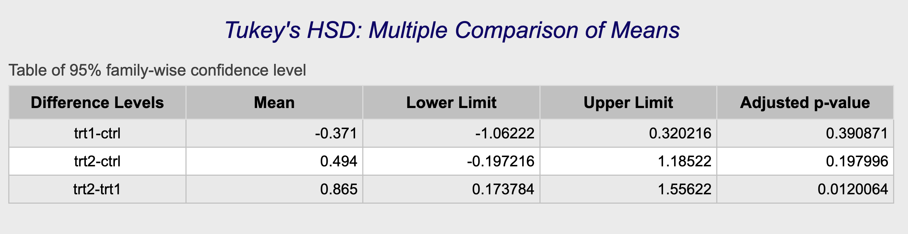
```

The labels in the *Difference Levels* column specify the order of subtraction. For example, *trt2-trt1* represents treatment 2 minus treatment 1. The *Mean* column gives the estimated difference between the two sample means, not a group mean. A positive value indicates that the first group in the label has the higher sample mean.

We compare each adjusted p-value with $\alpha = 0.05$:

- **Treatment 1 versus control:** The adjusted p-value is approximately 0.391. There is insufficient evidence that their population mean dried weights differ.
- **Treatment 2 versus control:** The adjusted p-value is approximately 0.198. There is insufficient evidence that their population mean dried weights differ.
- **Treatment 2 versus treatment 1:** The adjusted p-value is approximately 0.012, which is below 0.05. There is evidence that their population mean dried weights differ. The estimated difference is positive, indicating a higher mean dried weight under treatment 2.

Thus, treatment 2 and treatment 1 are the only pair identified as significantly different at the 5% level. The nonsignificant comparisons do not establish that either treatment has the same population mean as the control.

Notice that although the ANOVA test was significant, we do not have evidence that either treatment differs from the control. The significant ANOVA result is explained by the difference between the two treatments, whose sample means lie on opposite sides of the control mean: 4.66 for treatment 1, 5.03 for the control, and 5.53 for treatment 2.

b\. @fig-plant-growth-tukey shows the confidence intervals for the three pairwise differences.

```{r}
#| label: fig-plant-growth-tukey
#| fig-cap: "Tukey’s 95% simultaneous confidence intervals for differences in population mean dried plant weights."
#| fig-alt: "Three horizontal Tukey confidence intervals for differences in population mean dried plant weights. The intervals for treatment 1 minus control and treatment 2 minus control cross the vertical zero line. The interval for treatment 2 minus treatment 1 lies entirely to the right of zero, from approximately 0.174 to 1.556."
#| out-width: "80%"
#| fig-align: center
#| echo: false
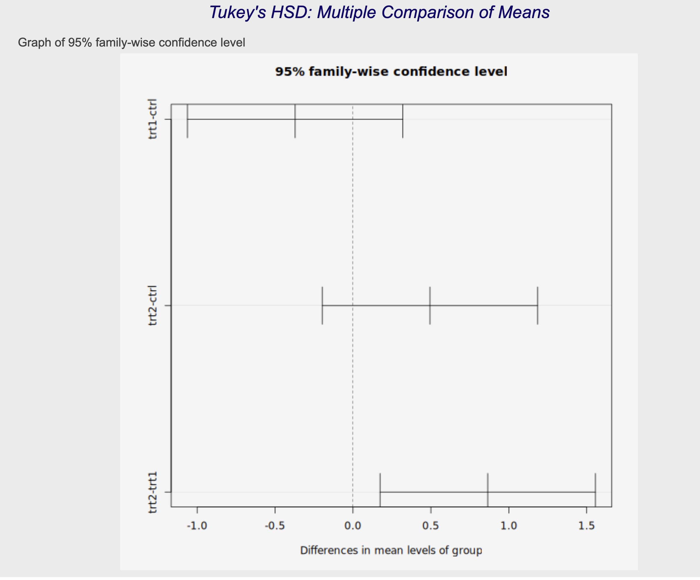
```

The dashed vertical line marks zero, which represents no difference between the two population means. The intervals for *trt1-ctrl* and *trt2-ctrl* include zero, in agreement with their nonsignificant adjusted p-values.

The interval for *trt2-trt1* lies entirely to the right of zero, in agreement with its significant adjusted p-value. The interval is approximately

$$
0.174
<
\mu_{\text{trt2}}-\mu_{\text{trt1}}
<
1.556.
$$

Using Tukey’s simultaneous confidence procedure, we estimate with 95% confidence that the population mean dried weight under treatment 2 is between 0.174 and 1.556 weight units higher than under treatment 1.

These are **simultaneous confidence intervals**: the 95% confidence level applies to the entire set of three intervals. In repeated sampling, 95% of sets constructed using this method would contain all three true population mean differences.

::::


::: {#exm-tukey-chickweight21 .callout-example}
## Comparing pairs of mean chick body weights

In @exm-anova-chickweight21, the one-way ANOVA test provided evidence at the 1% significance level that the population mean chick body weight at 21 days is not the same under all four diets. We now use the [ChickWeight21]{.data} dataset to investigate which diets differ in population mean body weight.

a. Use Tukey’s HSD test in Rguroo to compare all pairs of population means at the 1% significance level. Display the multiple comparison table, including the estimated differences, 99% confidence intervals, and adjusted p-values. Identify which pairs differ significantly.

b. Display the graph of Tukey’s confidence intervals. Explain how the graph supports your conclusions and interpret the confidence interval for any statistically significant difference.

<div tabindex="0" style="width:85%; margin:auto;">

 The dataset for this exercise is available in the Rguroo dataset repository [Intro to Stats with Rguroo]{.repo}, with the dataset name [ChickWeight21]{.data}.

**Code book for Dataset ChickWeight21 is given [here](#code-book-chickweight21).**

</div>

:::

:::: {.callout-tip .solution-callout collapse="true" icon=false}
## 🔎 Solution

a\. Click to expand the box below to see how to obtain Tukey’s HSD comparisons using the [ANOVA]{.fun} function in Rguroo.

::: {#tukey-chickweight21 .callout-note appearance="simple" collapse="true" icon="none" title="{width=22px style='vertical-align:middle;'} Tukey’s HSD - Chick Weight example"}

Before you begin, import the [ChickWeight21]{.data} dataset from the [Intro to Stats with Rguroo]{.repo} repository. If you saved the ANOVA analysis from @exm-anova-chickweight21 as [ANOVA_ChickWeight21]{.typein}, open it, keep its settings, and proceed to Step 7.

1. Open the **Analytics** toolbox in Rguroo.

2. From the [Analysis]{.dpd} dropdown, select [ANOVA]{.fun}. This opens the [ANOVA]{.dialog} dialog.

3. From the [Dataset]{.dpd} dropdown, select the [ChickWeight21]{.data} dataset.

4. From the [Response]{.dpd} dropdown, select [weight]{.var}.

5. In the [One-Way]{.tab} tab, from the [Factor]{.dpd} dropdown, select [Diet]{.var}.

6. Enter [0.01]{.typein} in the [Significance Level]{.des} textbox.

7. Select the checkbox next to the [Post-hoc Test]{.tab} button. Tukey’s HSD is selected by default.

8. (Optional) Click the [Post-hoc Test]{.tab} button to open the [ANOVA Post-Hoc]{.dialog} dialog and view the selected method. Leave [Tukey’s HSD]{.des} selected.

9. Click the preview icon , or press Enter, to view the output.

10. Click the  button and save the result as [HSD_ChickWeight21]{.typein}.

::: {.callout-tip .inner-callout collapse="false" title="Rguroo Tukey’s HSD dialogs"}

```{r}
#| fig-alt: "Rguroo ANOVA dialog for ChickWeight21 with weight as the response, Diet as the factor, significance level 0.01, and the Post-hoc Test checkbox selected. The accompanying ANOVA Post-Hoc dialog shows Tukey’s HSD selected."
#| fig-cap: "Rguroo setup for Tukey’s HSD comparisons of mean chick body weights at 21 days."
#| out-width: "100%"
#| echo: false
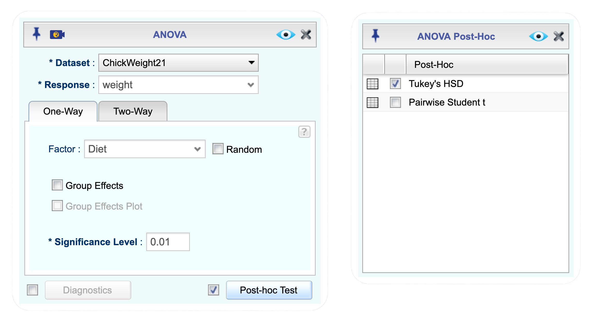
```

:::
:::

@tbl-chickweight21-tukey shows the multiple comparison table for the six pairs of diets.

```{r}
#| label: tbl-chickweight21-tukey
#| tbl-cap: "Tukey’s HSD comparisons of mean chick body weights at 21 days, with 99% simultaneous confidence intervals."
#| fig-alt: "Tukey’s HSD table for six pairwise diet comparisons. Only Diet 3 minus Diet 1 is significant at the 1% level: estimated difference 92.55 grams, confidence interval 7.05865 to 178.041 grams, and adjusted p-value 0.00469589. All other intervals include zero, and their adjusted p-values exceed 0.01."
#| out-width: "100%"
#| echo: false
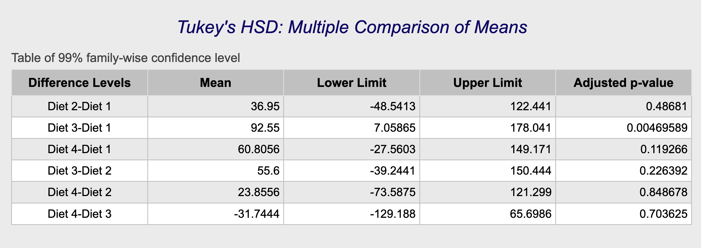
```

As in the previous example, the labels in the *Difference Levels* column specify the order of subtraction. For example, *Diet 3-Diet 1* represents Diet 3 minus Diet 1, and the *Mean* column gives the estimated difference between the two sample means.

We compare the adjusted p-values with $\alpha = 0.01$. The only adjusted p-value below 0.01 is for *Diet 3-Diet 1*, approximately 0.005. Thus, Diet 3 and Diet 1 are the only pair identified as significantly different at the 1% level.

The estimated difference is

$$
\bar{x}_{\text{Diet 3}}-\bar{x}_{\text{Diet 1}}
=270.30-177.75
=92.55\text{ g}.
$$

The positive difference indicates that chicks receiving Diet 3 have a higher sample mean body weight than those receiving Diet 1.

The other five comparisons have adjusted p-values greater than 0.01. We therefore have insufficient evidence of differences between those pairs of population means. In particular, although Diet 3 has the highest sample mean, these comparisons do not establish that its population mean is higher than those for Diets 2 and 4.

b\. @fig-chickweight21-tukey shows the confidence intervals for all six pairwise differences.

```{r}
#| label: fig-chickweight21-tukey
#| fig-cap: "Tukey’s 99% simultaneous confidence intervals for differences in population mean chick body weights at 21 days."
#| fig-alt: "Six horizontal Tukey confidence intervals for differences in population mean chick body weights. Only the interval for Diet 3 minus Diet 1 lies entirely to the right of the vertical zero line, extending from approximately 7.06 to 178.04 grams. The other five intervals cross zero."
#| out-width: "80%"
#| fig-align: center
#| echo: false
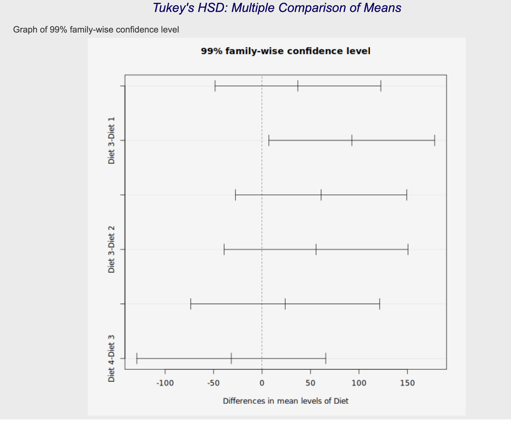
```

Only the interval for *Diet 3-Diet 1* excludes zero, in agreement with its significant adjusted p-value. The entire interval is positive, indicating a higher population mean body weight under Diet 3 than under Diet 1.

The interval is approximately

$$
7.06\text{ g}
<
\mu_{\text{Diet 3}}-\mu_{\text{Diet 1}}
<
178.04\text{ g}.
$$

Using Tukey’s simultaneous confidence procedure, we estimate with 99% confidence that the population mean body weight at 21 days is between 7.06 g and 178.04 g higher under Diet 3 than under Diet 1.

The interval is fairly wide, showing that there is considerable uncertainty about the size of the difference. Three factors contribute to this width: the high 99% confidence level, the small number of chicks in each diet group, and the large variation in body weight among chicks receiving the same diet.

The 99% confidence level applies to the complete set of six intervals. The remaining five intervals include zero, so they do not provide sufficient evidence of differences at the 1% significance level.

::::


### Homework for @sec-multiple-comparisons

The following exercises continue the analyses from the homework for @sec-one-way-anova. Use the same datasets, response variables, grouping variables, and significance levels. Use 95% simultaneous confidence intervals for exercises at the 5% significance level and 99% simultaneous confidence intervals for exercises at the 1% significance level.

For each exercise, first state the ANOVA p-value and your conclusion from the homework for @sec-one-way-anova. Following the approach used in this chapter, proceed with parts (a)–(b) only if the ANOVA test was significant at the specified level. Otherwise, explain why you would not proceed with multiple comparisons.

a. Use Tukey’s HSD test in Rguroo to compare all pairs of population means at the specified significance level. Display the multiple comparison table, including the estimated differences, simultaneous confidence intervals, and adjusted p-values. Identify which pairs differ significantly and state the direction of each significant difference in context. If no pair is significantly different, report that conclusion.

b. Display the graph of Tukey’s confidence intervals. Explain how the intervals’ positions relative to zero support your conclusions in part (a). Interpret the confidence interval for one statistically significant difference in context, including the units and the order of subtraction. If no pair is significantly different, explain what the intervals show and why this does not establish that the population means are equal.

1. **Cuckoo Egg Lengths** Cuckoo birds lay their eggs in the nests of other bird species, which then incubate and hatch the eggs. The [Eggs]{.data} dataset contains the lengths of cuckoo eggs found in the nests of six host bird species: Meadow Pipit, Tree Pipit, Hedge Sparrow, Robin, Pied Wagtail, and Wren. Continue your analysis using [length]{.var}, measured in millimeters, as the response variable and [bird]{.var} as the grouping variable. Investigate which pairs of host species differ in population mean cuckoo egg length. Use a 5% significance level.

    In the homework for @sec-one-way-anova, you found the number of pairwise comparisons needed to compare all six host species. If you proceed with Tukey’s HSD test, report how many of these comparisons are significant at the 5% level. Because the graph of six-group comparisons contains many intervals, use the multiple comparison table to check your count.

<div tabindex="0" style="width:85%; margin:auto;">

 The dataset for this exercise is available in the Rguroo dataset repository [Intro to Stats with Rguroo]{.repo}, with the dataset name [Eggs]{.data}.

**Codebook for Dataset Eggs is given [here](#code-book-eggs).**

</div>

2. **Fabric Waste at Levi Strauss & Co.** Levi Strauss & Co. monitors fabric waste at its suppliers. Each week, its quality control department records run-up: the percentage difference between the fabric waste predicted by the computer layout and the actual waste during production. Negative values indicate that the supplier arranged the pattern more efficiently than the computer. Continue your analysis of the [Levi]{.data} dataset using [run_up]{.var} as the response variable and [plant]{.var} as the grouping variable. Investigate which pairs of suppliers differ in population mean run-up. Use a 1% significance level. Express differences between mean run-up percentages in percentage points.

<div tabindex="0" style="width:85%; margin:auto;">

 The dataset for this exercise is available in the Rguroo dataset repository [Intro to Stats with Rguroo]{.repo}, with the dataset name [Levi]{.data}.

**Codebook for Dataset Levi is given [here](#code-book-levi).**

</div>

3. **Readability of Magazine Advertisements** Magazines were grouped into three categories based on the education level of their intended readers: high, medium, or low. Advertisements were sampled from magazines in each category, and the number of words with three or more syllables in each advertisement was recorded. Continue your analysis of the [Advertising]{.data} dataset using [number]{.var} as the response variable and [education]{.var} as the grouping variable. Investigate which pairs of education categories differ in the population mean number of words with three or more syllables per advertisement. Use a 5% significance level. Express differences between these population means in words per advertisement.

<div tabindex="0" style="width:85%; margin:auto;">

 The dataset for this exercise is available in the Rguroo dataset repository [Intro to Stats with Rguroo]{.repo}, with the dataset name [Advertising]{.data}.

**Codebook for Dataset Advertising is given [here](#code-book-advertising).**

</div>

4. **Accuracy of Calorie Labels** A study examined the accuracy of calorie labeling for foods marketed as reduced calorie. Researchers calculated the percent difference between measured and labeled calorie counts. Positive values indicate that a food contained more calories than its label stated. Foods were classified as nationally advertised, regionally distributed, or locally prepared. Continue your analysis of the [Food]{.data} dataset using [percent_diff]{.var} as the response variable and [category]{.var} as the grouping variable. Investigate which pairs of food categories differ in the population mean percent difference between measured and labeled calorie counts. Use a 5% significance level. Express differences between these population means in percentage points.

<div tabindex="0" style="width:85%; margin:auto;">

 The dataset for this exercise is available in the Rguroo dataset repository [Intro to Stats with Rguroo]{.repo}, with the dataset name [Food]{.data}.

**Codebook for Dataset Food is given [here](#code-book-food).**

</div>

5. **Sodium Content of Hot Dogs** The [HotDogs]{.data} dataset contains the calorie and sodium content of hot dogs classified as Beef, Meat, or Poultry. Continue your analysis using [sodium]{.var}, measured in milligrams per hot dog, as the response variable and [type]{.var} as the grouping variable. Investigate which pairs of hot dog types differ in population mean sodium content. Use a 5% significance level.

<div tabindex="0" style="width:85%; margin:auto;">

 The dataset for this exercise is available in the Rguroo dataset repository [Intro to Stats with Rguroo]{.repo}, with the dataset name [HotDogs]{.data}.

**Codebook for Dataset HotDogs is given [here](#code-book-hotdogs).**

</div>

## Checking ANOVA Assumptions (optional) {#sec-anova-assumptions}

The one-way ANOVA test and Tukey’s HSD comparisons rely on assumptions about how the observations were collected and how the response varies within groups. Checking these assumptions helps us judge whether the resulting p-values and confidence intervals are reliable. These assumptions are:

1. **Independence**: The observations are independent, both within and between groups. Knowing one observation should not provide information about another observation beyond what is explained by group membership.
2. **Normality**: The response variable is normally distributed within each population group. The groups may have different means; the assumption concerns the shape of the distribution within each group.
3. **Equal variances**: The population variance of the response variable is the same for all groups. This assumption is also called **homogeneity of variance**. In other words, the populations have the same spread, even if their means differ. The sample variances do not need to be exactly equal.

### Checking independence

We assess independence primarily by examining the study design and how the data were collected. Independence is most plausible when individuals are randomly assigned to groups in an experiment or randomly sampled from each population in an observational study.

Repeated measurements on the same individual are generally related and should not be treated as independent observations. In the original chick growth study, each chick was weighed repeatedly. In [ChickWeight21]{.data}, we use only one weight per chick, avoiding the dependence caused by treating repeated weights from the same chick as separate observations. We should still consider whether other aspects of the study design could make the observations related.

Observations that share a setting may also be related. For example, students in the same classroom or members of the same household may be more similar to one another than to individuals in other settings. Similarly, in the [Advertising]{.data} dataset from the homework, several advertisements come from the same magazine, so advertisements from the same magazine may be more similar to one another than advertisements from different magazines.

### Understanding residuals

A residual is the difference between an observed value and its group’s sample mean:

$$
\text{Residual}=\text{Observed value}-\text{Group sample mean}.
$$

A positive residual indicates an observation above its group mean, while a negative residual indicates an observation below it. Subtracting each group’s mean removes differences in group centers, so the residuals in every group are centered at zero. This allows us to examine the variation that remains within groups. Rguroo uses residuals in the plots it provides for checking the normality and equal-variance assumptions.

### Checking normality

A Q-Q plot helps us assess whether a distribution is approximately normal. If the points follow an approximately straight line, the plot is consistent with a normal distribution. Clear curves or points far from the overall pattern may indicate skewness, unusually long tails, or outliers.

Rguroo provides one Q-Q plot that includes the residuals from all groups. Because each residual measures how far an observation is from its own group mean, the differences among the group means do not affect this plot. If the points follow an approximately straight line, the normality assumption is reasonable.

The side-by-side boxplots of the response variable are also useful for checking normality within each group. A box with a median far from its center, a much longer whisker on one side, or outliers may indicate skewness or unusual observations in that group.

We should not expect a perfectly straight Q-Q plot. Small departures from normality do not automatically make ANOVA unsuitable. ANOVA often tolerates mild departures, particularly when group sample sizes are reasonably large and similar. Strong skewness and extreme outliers deserve closer attention, especially with small samples.

### Checking equal variances

Start by comparing the group standard deviations and side-by-side boxplots. Substantially different spreads suggest that the equal-variance assumption may be questionable. A common rule of thumb is that ANOVA works reasonably well when the largest group standard deviation is less than about twice the smallest:

$$
\frac{\text{largest sample standard deviation}}{\text{smallest sample standard deviation}} < 2.
$$

This rule is a guideline rather than a strict cutoff. Unequal variances are of greater concern when the group sample sizes are also unequal, especially when the smaller groups have the larger standard deviations.

Rguroo also provides one residual plot, in which the residuals are plotted against the fitted values. Each fitted value is a group’s sample mean, so the residuals for each group appear as a vertical column of points at that group’s mean. We look for a reasonably similar vertical spread of residuals in the different columns. A much wider spread in one column suggests that the population variances may differ. Rguroo adjusts the horizontal axis to the range of the fitted values, so the columns may look far apart even when the group means are very close. The horizontal distance between the columns is not what we examine; we compare the vertical spreads.

**Levene’s test** provides a formal test of equality of population variances. Its hypotheses are:

$$
\begin{cases}
H_0: \text{all population variances are equal} \\
H_a: \text{not all population variances are equal.}
\end{cases}
$$

A p-value below the chosen significance level provides evidence that the population variances differ. A larger p-value means that we have insufficient evidence of unequal variances; it does not prove that the variances are equal. We should interpret Levene’s test together with the plots and group summaries, because small samples may not reveal important differences in spread.

Rguroo provides residual plots, Q-Q plots, and Levene’s test as part of the ANOVA analysis. These tools should be considered together rather than used as a checklist that automatically approves or rejects an analysis.

We will illustrate how to check the assumptions using three datasets used earlier in the chapter: [PlantGrowth]{.data}, [ChickWeight21]{.data}, and [palmerpenguins_Adelie]{.data}.


::: {#exm-anova-assumptions-plant-growth .callout-example}
## Checking ANOVA assumptions for dried plant weights

In @exm-anova-plant-growth, we compared population mean dried plant weights under a control condition and two treatment conditions. We now examine whether the assumptions underlying that analysis are reasonable.

The [PlantGrowth]{.data} dataset contains 30 observations, with 10 observations in each group. The available documentation describes an experiment but does not explain how plants were assigned to conditions or whether their growing arrangements could have made their weights related. We therefore have limited information for assessing independence.

a. Using the description of data collection above, discuss whether independence can be established. What additional information would help?

b. Use Rguroo to obtain the response boxplots and residual Q-Q plot. Describe any features that raise concerns about normality.

c. Compare the group standard deviations and calculate the ratio of the largest to the smallest. Examine the residual-versus-fitted plot. Do these checks raise concerns about equal population variances?

d. State the hypotheses for Levene’s test. Report the test statistic and p-value, and interpret the result at the 5% significance level.

e. Considering all the available information, discuss whether the ANOVA assumptions appear reasonable. Identify any limitations.

<div tabindex="0" style="width:85%; margin:auto;">

 The dataset for this exercise is available in the Rguroo dataset repository [Intro to Stats with Rguroo]{.repo}, with the dataset name [PlantGrowth]{.data}.

**Code book for Dataset PlantGrowth is given [here](#code-book-plant-growth).**

</div>

:::

:::: {.callout-tip .solution-callout collapse="true" icon=false}
## 🔎 Solution

a\. Independence cannot be established from the information provided. Although the data come from an experiment, we do not know how the plants were assigned to conditions or whether they shared pots, trays, or other growing arrangements that could have made their weights related.

Information about the experimental units, treatment assignment, and growing arrangements would help us assess independence. We will treat independence as an assumption for this example, rather than claim that the diagnostic plots verify it.

b\. Click to expand the box below to see how to obtain the diagnostic plots and Levene’s test in Rguroo.

::: {#diagnostics-plant-growth .callout-note appearance="simple" collapse="true" icon="none" title="{width=22px style='vertical-align:middle;'} ANOVA Diagnostics - Plant Growth example"}

Before you begin, import the [PlantGrowth]{.data} dataset from the [Intro to Stats with Rguroo]{.repo} repository. If you have already opened the ANOVA analysis from @exm-anova-plant-growth, retain its settings and proceed to Step 7.

1. Open the **Analytics** toolbox in Rguroo.

2. From the [Analysis]{.dpd} dropdown, select [ANOVA]{.fun}. This opens the [ANOVA]{.dialog} dialog.

3. From the [Dataset]{.dpd} dropdown, select [PlantGrowth]{.data}.

4. From the [Response]{.dpd} dropdown, select [weight]{.var}.

5. In the [One-Way]{.tab} tab, from the [Factor]{.dpd} dropdown, select [group]{.var}.

6. Enter [0.05]{.typein} in the [Significance Level]{.des} textbox.

7. Select the checkbox next to the [Diagnostics]{.tab} button. By default, Rguroo includes the response boxplots, residual-versus-fitted plot, residual Q-Q plot, and Levene’s test.

8. Optionally, click the [Diagnostics]{.tab} button to view these selections and the other available diagnostics. Keep the default selections for this example.

9. Click the preview icon  to view the output.

10. Click the  button and save the result as [Diagnostics_PlantGrowth]{.typein}.

::: {.callout-tip .inner-callout collapse="false" title="Rguroo ANOVA diagnostics dialogs"}

```{r}
#| fig-alt: "Rguroo ANOVA dialog for PlantGrowth, with weight as the response, group as the factor, significance level 0.05, and Diagnostics selected. The accompanying ANOVA Diagnostics dialog shows Response Boxplot, Residual vs. Fit, Residual QQ-Plot, and Levene’s Test selected."
#| fig-cap: "Rguroo setup for checking the ANOVA assumptions for plant growth."
#| out-width: "100%"
#| echo: false
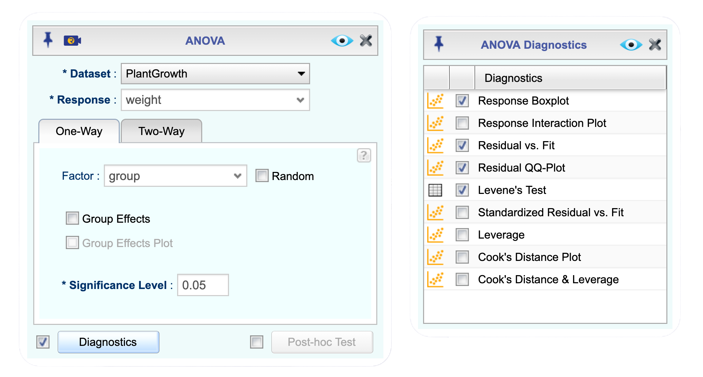
```

:::
:::

@fig-plant-growth-diagnostic-boxplot shows the response boxplots for the three groups.

```{r}
#| label: fig-plant-growth-diagnostic-boxplot
#| fig-cap: "Boxplots of dried plant weights by experimental condition."
#| fig-alt: "Boxplots of dried plant weights for control, treatment 1, and treatment 2. Treatment 1 has a longer upper whisker and one high observation marked as a potential outlier. Treatment 2 has a smaller box than the other groups."
#| out-width: "80%"
#| fig-align: center
#| echo: false
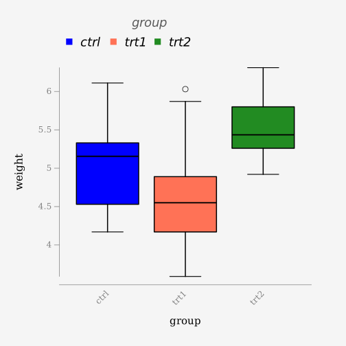
```

The treatment 1 boxplot has a longer upper whisker and one high observation marked as a potential outlier. These features suggest some asymmetry and deserve attention. An observation marked as a potential outlier is not necessarily an error; it should be investigated rather than automatically removed.

@fig-plant-growth-residual-qq shows the Q-Q plot of the residuals from all three groups.

```{r}
#| label: fig-plant-growth-residual-qq
#| fig-cap: "Normal Q-Q plot of residuals from the plant growth ANOVA."
#| fig-alt: "Normal Q-Q plot of plant growth residuals. Most points in the lower and middle portions follow the reference line reasonably closely, while several of the largest residuals lie above the line, indicating an upper-tail departure from normality."
#| out-width: "80%"
#| fig-align: center
#| echo: false
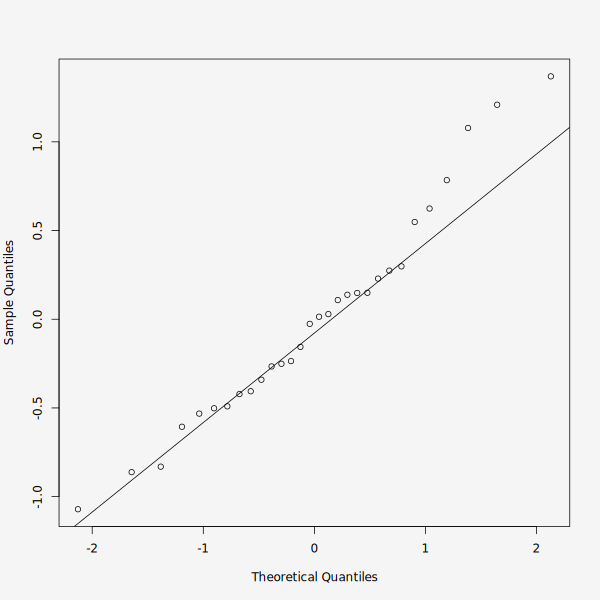
```

Most points in the lower and middle portions of the Q-Q plot follow the reference line reasonably closely. Several of the largest residuals lie above the line, suggesting a longer upper tail than expected under normality. Thus, the plots show some departure from normality, particularly among the larger observations.

With only 10 observations per group, the shapes of the population distributions are difficult to assess precisely. The plots do not establish normality, but they help identify the upper-tail behavior as a feature to consider when interpreting the analysis.

c\. The sample standard deviations for the control, treatment 1, and treatment 2 groups are approximately 0.583, 0.794, and 0.443, respectively. The ratio of the largest to the smallest is

$$
\frac{\text{largest sample standard deviation}}
{\text{smallest sample standard deviation}}
=
\frac{0.794}{0.443}
\approx 1.79.
$$

This ratio is below the guideline of 2. Although the group spreads are not identical, this check does not suggest a severe difference in population variances. The equal sample sizes also make ANOVA less sensitive to moderate differences in variances than it would be with unequal sample sizes.

@fig-plant-growth-residual-fit shows the residuals plotted against the fitted values.

```{r}
#| label: fig-plant-growth-residual-fit
#| fig-cap: "Residuals versus fitted values for the plant growth ANOVA."
#| fig-alt: "Residual-versus-fitted plot with three vertical columns at the group sample means, approximately 4.66, 5.03, and 5.53. Treatment 1, at 4.66, has the widest residual spread; treatment 2, at 5.53, has the narrowest. Residuals occur above and below zero in all three groups."
#| out-width: "80%"
#| fig-align: center
#| echo: false
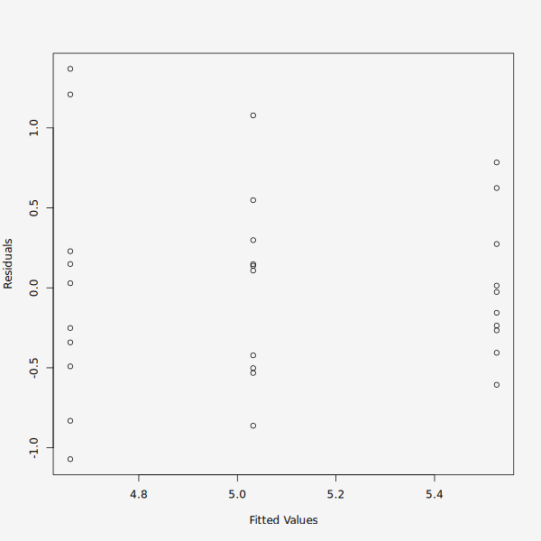
```

The three columns correspond to the three group sample means. From left to right, they represent treatment 1, control, and treatment 2. Notice that their order follows the fitted means, rather than the order of the group labels.

Treatment 1 has the widest vertical spread of residuals, while treatment 2 has the narrowest. This agrees with the ordering of the sample standard deviations. There are differences in spread, but the standard deviation ratio suggests that they are not extreme. We next consider Levene’s test as another source of evidence.

d\. The hypotheses for Levene’s test are

$$
\begin{cases}
H_0: \text{all population variances are equal} \\
H_a: \text{not all population variances are equal.}
\end{cases}
$$

@tbl-plant-growth-levene shows the Rguroo output.

```{r}
#| label: tbl-plant-growth-levene
#| tbl-cap: "Levene’s test of equality of population variances for dried plant weights."
#| fig-alt: "Levene’s test using the median as the center. The test statistic is 1.11919 with 2 and 27 degrees of freedom, and the p-value is 0.341227. The null hypothesis states that the population variances are equal."
#| out-width: "100%"
#| echo: false
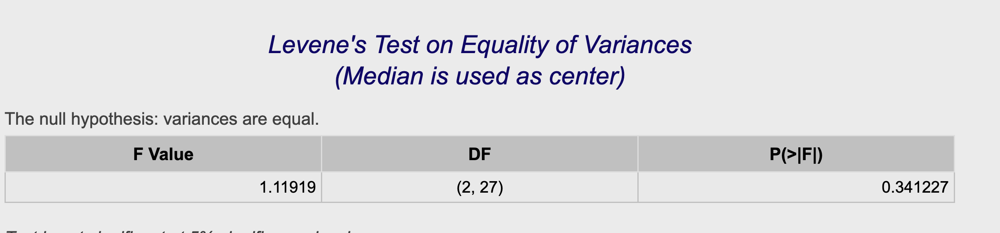
```

The test statistic is approximately 1.119, and the p-value is approximately 0.341. Since 0.341 is greater than 0.05, we fail to reject the null hypothesis. There is insufficient evidence that the population variances of dried plant weights differ among the three conditions.

This result does not prove that the variances are equal. However, considered together with the standard deviation ratio and the plots, it supports treating equal variances as a reasonable working assumption.

e\. The equal-variance assumption appears reasonable based on the combined evidence. The normality checks show some upper-tail departures and a potential outlier in treatment 1, so normality is less clear. The equal group sample sizes offer some protection against moderate departures, but they do not eliminate the need for caution.

We can proceed with the ANOVA and Tukey comparisons as an approximate analysis, while acknowledging the features seen in the normality checks. Independence remains an assumption that cannot be verified from the available study description. The diagnostic plots and Levene’s test do not resolve that limitation.

::::

::: {#exm-anova-assumptions-chickweight21 .callout-example}
## Checking ANOVA assumptions for chick body weights

In @exm-anova-chickweight21, we compared population mean chick body weights at 21 days under four protein diets. We now examine whether the assumptions underlying that analysis are reasonable.

The original chick growth experiment recorded repeated weights for each chick. The [ChickWeight21]{.data} dataset includes only the day-21 observations, so each chick contributes one measurement. There are 45 chicks: 16 received Diet 1, 10 received Diet 2, 10 received Diet 3, and 9 received Diet 4. The available documentation does not describe how the chicks were assigned to diets or whether they shared housing that could have made their weights related.

a. Using the description of data collection above, discuss whether independence can be established. What source of dependence has been avoided by using only day-21 observations, and what additional information would help?

b. Use Rguroo to obtain the response boxplots and residual Q-Q plot. Describe any features that raise concerns about normality.

c. Compare the group standard deviations and calculate the ratio of the largest to the smallest. Examine the residual-versus-fitted plot. Do these checks raise concerns about equal population variances?

d. State the hypotheses for Levene’s test. Report the test statistic and p-value, and interpret the result at the 1% significance level.

e. Considering all the available information, discuss whether the ANOVA assumptions appear reasonable. Identify any limitations.

<div tabindex="0" style="width:85%; margin:auto;">

 The dataset for this exercise is available in the Rguroo dataset repository [Intro to Stats with Rguroo]{.repo}, with the dataset name [ChickWeight21]{.data}.

**Code book for Dataset ChickWeight21 is given [here](#code-book-chickweight21).**

</div>

:::

:::: {.callout-tip .solution-callout collapse="true" icon=false}
## 🔎 Solution

a\. Using one measurement per chick avoids treating repeated weights from the same chick as independent observations. However, this does not establish independence among different chicks.

For example, chicks sharing a pen might experience similar conditions, making their weights related. Information about housing arrangements and whether diets were assigned to individual chicks or entire pens would help us assess independence. For this example, we treat independence as an assumption rather than claim that it has been verified.

b\. Click to expand the box below to see how to obtain the diagnostic plots and Levene’s test in Rguroo.

::: {#diagnostics-chickweight21 .callout-note appearance="simple" collapse="true" icon="none" title="{width=22px style='vertical-align:middle;'} ANOVA Diagnostics - Chick Weight example"}

Before you begin, import the [ChickWeight21]{.data} dataset from the [Intro to Stats with Rguroo]{.repo} repository. If you saved the ANOVA analysis from @exm-anova-chickweight21 as [ANOVA_ChickWeight21]{.typein}, open it, keep its settings, and proceed to Step 7.

1. Open the **Analytics** toolbox in Rguroo.

2. From the [Analysis]{.dpd} dropdown, select [ANOVA]{.fun}. This opens the [ANOVA]{.dialog} dialog.

3. From the [Dataset]{.dpd} dropdown, select [ChickWeight21]{.data}.

4. From the [Response]{.dpd} dropdown, select [weight]{.var}.

5. In the [One-Way]{.tab} tab, from the [Factor]{.dpd} dropdown, select [Diet]{.var}.

6. Enter [0.01]{.typein} in the [Significance Level]{.des} textbox.

7. Select the checkbox next to the [Diagnostics]{.tab} button. By default, Rguroo includes the response boxplots, residual-versus-fitted plot, residual Q-Q plot, and Levene’s test.

8. Optionally, click the [Diagnostics]{.tab} button to view these selections and the other available diagnostics. Keep the default selections for this example.

9. Click the preview icon  to view the output.

10. Click the  button and save the result as [Diagnostics_ChickWeight21]{.typein}.

::: {.callout-tip .inner-callout collapse="false" title="Rguroo ANOVA diagnostics dialogs"}

```{r}
#| fig-alt: "Rguroo ANOVA dialog for ChickWeight21, with weight as the response, Diet as the factor, significance level 0.01, and Diagnostics selected. The accompanying ANOVA Diagnostics dialog shows Response Boxplot, Residual vs. Fit, Residual QQ-Plot, and Levene’s Test selected."
#| fig-cap: "Rguroo setup for checking the ANOVA assumptions for chick body weights."
#| out-width: "100%"
#| echo: false
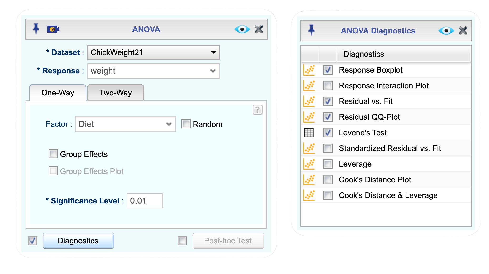
```

:::
:::

@fig-chickweight21-diagnostic-boxplot shows the response boxplots for the four diets.

```{r}
#| label: fig-chickweight21-diagnostic-boxplot
#| fig-cap: "Boxplots of chick body weights at 21 days by diet."
#| fig-alt: "Boxplots of chick body weights for four diets. No observations are marked as potential outliers. Diets 1 and 4 have long upper whiskers, and Diet 4 has a very short lower whisker. Diet 2 has a long lower whisker extending to about 74 grams. Diet 3 appears roughly symmetric. Diets 2 and 3 have taller boxes than Diets 1 and 4."
#| out-width: "80%"
#| fig-align: center
#| echo: false
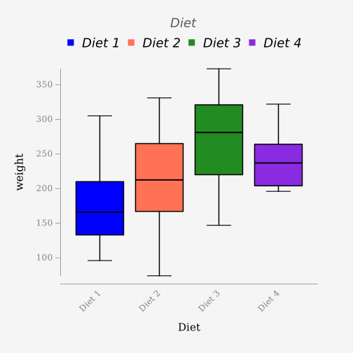
```

None of the boxplots marks observations as potential outliers. Some asymmetry is visible: Diets 1 and 4 have long upper whiskers, while Diet 2 has a long lower whisker extending to about 74 g. Diet 3 appears roughly symmetric. With 9 to 16 chicks per diet, this amount of asymmetry is not unusual, and the plots do not suggest extreme departures from normality.

@fig-chickweight21-residual-qq shows the Q-Q plot of the residuals from all four groups.

```{r}
#| label: fig-chickweight21-residual-qq
#| fig-cap: "Normal Q-Q plot of residuals from the chick body weight ANOVA."
#| fig-alt: "Normal Q-Q plot of chick weight residuals. The points follow the reference line reasonably closely overall. Several of the largest residuals lie above the line, and the two smallest residuals, about -140 and -123, lie below the line."
#| out-width: "80%"
#| fig-align: center
#| echo: false
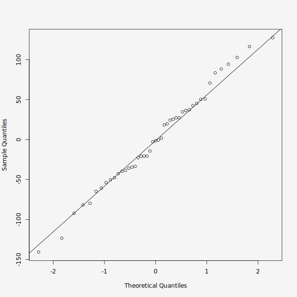
```

The points follow the reference line reasonably closely overall. The largest residuals lie somewhat above the line and the smallest lie somewhat below it, suggesting tails slightly longer than expected under normality. The smallest residual, about −140 g, belongs to the Diet 2 chick at the end of that group’s long lower whisker. These departures are mild, and there is no pronounced curvature, so normality is a reasonable working approximation.

Because the group sample sizes range from 9 to 16, the plots provide limited information about each population’s shape. They support an approximate assessment rather than establish that the populations are normal.

c\. The sample standard deviations for Diets 1 through 4 are approximately 58.70 g, 78.14 g, 71.62 g, and 43.35 g, respectively. The ratio of the largest to the smallest is

$$
\frac{\text{largest sample standard deviation}}
{\text{smallest sample standard deviation}}
=
\frac{78.14}{43.35}
\approx 1.80.
$$

This ratio is below the guideline of 2. Diets 2 and 3 have greater variation than Diet 4, but this check does not suggest an extreme difference in spread.

Because the group sample sizes are unequal, we also check whether the smaller groups have the larger standard deviations. Diets 2 and 3, with 10 chicks each, have larger standard deviations than Diet 1, with 16 chicks. However, Diet 4, the smallest group, has the smallest standard deviation. There is no strong pattern of smaller groups having larger spreads.

@fig-chickweight21-residual-fit shows the residuals plotted against the fitted values.

```{r}
#| label: fig-chickweight21-residual-fit
#| fig-cap: "Residuals versus fitted values for the chick body weight ANOVA."
#| fig-alt: "Residual-versus-fitted plot with four vertical columns at mean chick weights of approximately 177.75, 214.70, 238.56, and 270.30 grams. These correspond to Diets 1, 2, 4, and 3. Diet 2 has the widest overall residual range, from about -140 to 117, and Diet 4 has the narrowest, from about -42 to 84."
#| out-width: "80%"
#| fig-align: center
#| echo: false
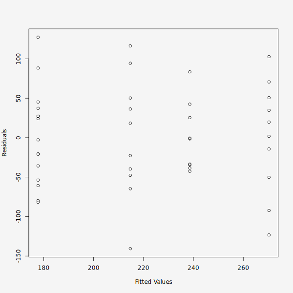
```

From left to right, the columns represent Diets 1, 2, 4, and 3 because the fitted values are the group sample means. Diet 2 has the widest overall residual range, while Diet 4 has the narrowest. This is consistent with their sample standard deviations. The spreads differ, but not by an extreme amount.

d\. The hypotheses for Levene’s test are

$$
\begin{cases}
H_0: \text{all population variances are equal} \\
H_a: \text{not all population variances are equal.}
\end{cases}
$$

@tbl-chickweight21-levene shows the Rguroo output.

```{r}
#| label: tbl-chickweight21-levene
#| tbl-cap: "Levene’s test of equality of population variances for chick body weights."
#| fig-alt: "Levene’s test using the median as the center. The test statistic is 1.15972 with 3 and 41 degrees of freedom, and the p-value is 0.336739. The test is not significant at the 1% significance level."
#| out-width: "100%"
#| echo: false
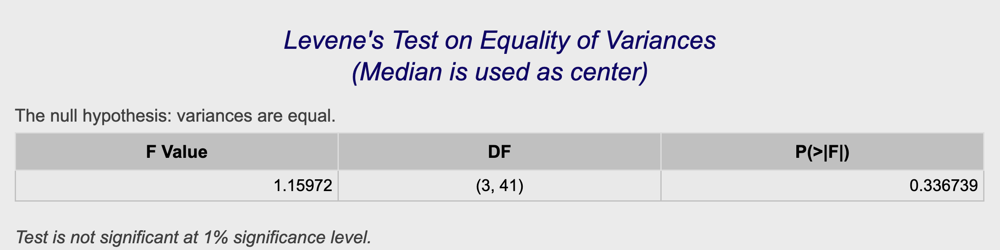
```

The test statistic is approximately 1.160, and the p-value is approximately 0.337. Since 0.337 is greater than 0.01, we fail to reject the null hypothesis. In fact, this p-value is well above any commonly used significance level, so the conclusion does not depend on our choice of 1%. There is insufficient evidence that the population variances of chick body weight differ among the four diets.

This does not prove that the population variances are equal. However, together with the standard deviation ratio and the plots, the result supports treating equal variances as a reasonable working assumption.

e\. The response boxplots and residual Q-Q plot show only mild asymmetry and slightly long tails, with no potential outliers. The group spreads differ, but the standard deviation ratio is below 2, the smaller groups do not consistently have the larger spreads, and Levene’s test does not provide evidence of unequal population variances. Thus, normality and equal variances appear reasonable as working assumptions for this analysis.

Independence remains uncertain because the available description does not explain the housing and treatment-assignment arrangements. Using one measurement per chick removes the repeated-measurement concern, but it does not resolve possible relationships among different chicks. Subject to the independence assumption, the diagnostics support using the ANOVA and Tukey comparisons.

::::

::: {#exm-anova-assumptions-adelie .callout-example}
## Checking ANOVA assumptions for Adélie penguin body mass

In @exm-anova-adelie, we compared population mean body masses of Adélie penguins on Biscoe, Dream, and Torgersen islands. We now examine whether the assumptions underlying that analysis are reasonable.

The [palmerpenguins_Adelie]{.data} dataset contains 151 penguins with recorded body masses: 44 from Biscoe, 56 from Dream, and 51 from Torgersen. In the original study, researchers selected and monitored nests on the three islands and measured both adults from sampled nests. Penguins were observed in their existing locations rather than randomly assigned to islands. Additional details are available in the [original study](https://doi.org/10.1371/journal.pone.0090081).

a. Using the description of data collection above, discuss whether independence is reasonable. Identify a possible source of dependence among observations.

b. Use Rguroo to obtain the response boxplots and residual Q-Q plot. Describe any features that raise concerns about normality.

c. Compare the group standard deviations and calculate the ratio of the largest to the smallest. Examine the residual-versus-fitted plot. Do these checks raise concerns about equal population variances?

d. State the hypotheses for Levene’s test. Report the test statistic and p-value, and interpret the result at the 5% significance level.

e. Considering all the available information, discuss whether the ANOVA assumptions appear reasonable. Identify any limitations.

<div tabindex="0" style="width:85%; margin:auto;">

 The dataset for this exercise is available in the Rguroo dataset repository [Intro to Stats with Rguroo]{.repo}, with the dataset name [palmerpenguins_Adelie]{.data}.

**Code book for Dataset palmerpenguins_Adelie is given [here](mean inference.qmd#code-book-palmerpenguins-adelie).**

</div>

:::

:::: {.callout-tip .solution-callout collapse="true" icon=false}
## 🔎 Solution

a\. Measuring both adults from the same nest creates a possible source of dependence. Penguins sharing a nest may have related body masses because of shared conditions or characteristics of breeding pairs. Thus, observations from different penguins are not automatically independent simply because each observation represents a different animal.

The study description gives us a reason to question independence, although it does not tell us the strength or direction of any relationship between the body masses of nesting partners. Additional information about the pairing of observations would help us investigate this concern. The diagnostic plots below cannot establish independence.

b\. Click to expand the box below to see how to obtain the diagnostic plots and Levene’s test in Rguroo.

::: {#diagnostics-adelie .callout-note appearance="simple" collapse="true" icon="none" title="{width=22px style='vertical-align:middle;'} ANOVA Diagnostics - Adélie Penguins example"}

Before you begin, import the [palmerpenguins_Adelie]{.data} dataset from the [Intro to Stats with Rguroo]{.repo} repository. If you saved the ANOVA analysis from @exm-anova-adelie as [ANOVA_adelie]{.typein}, open it, keep its settings, and proceed to Step 7.

1. Open the **Analytics** toolbox in Rguroo.

2. From the [Analysis]{.dpd} dropdown, select [ANOVA]{.fun}. This opens the [ANOVA]{.dialog} dialog.

3. From the [Dataset]{.dpd} dropdown, select [palmerpenguins_Adelie]{.data}.

4. From the [Response]{.dpd} dropdown, select [body_mass_g]{.var}.

5. In the [One-Way]{.tab} tab, from the [Factor]{.dpd} dropdown, select [island]{.var}.

6. Enter [0.05]{.typein} in the [Significance Level]{.des} textbox.

7. Select the checkbox next to the [Diagnostics]{.tab} button. By default, Rguroo includes the response boxplots, residual-versus-fitted plot, residual Q-Q plot, and Levene’s test.

8. Optionally, click the [Diagnostics]{.tab} button to view these selections and the other available diagnostics. Keep the default selections for this example.

9. Click the preview icon  to view the output.

10. Click the  button and save the result as [Diagnostics_Adelie]{.typein}.

::: {.callout-tip .inner-callout collapse="false" title="Rguroo ANOVA diagnostics dialogs"}

```{r}
#| fig-alt: "Rguroo ANOVA dialog for palmerpenguins_Adelie, with body_mass_g as the response, island as the factor, significance level 0.05, and Diagnostics selected. The accompanying ANOVA Diagnostics dialog shows Response Boxplot, Residual vs. Fit, Residual QQ-Plot, and Levene’s Test selected."
#| fig-cap: "Rguroo setup for checking the ANOVA assumptions for Adélie penguin body mass."
#| out-width: "100%"
#| echo: false
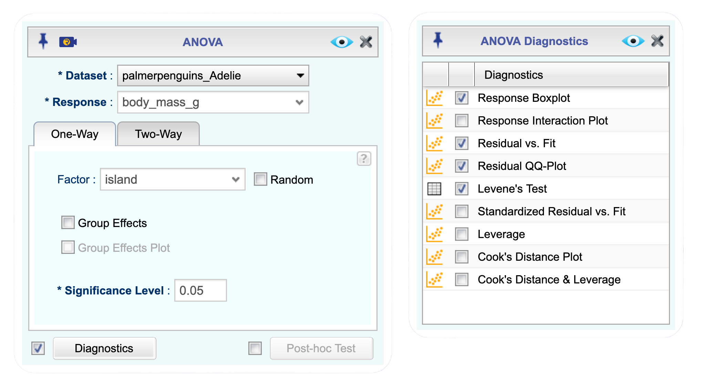
```

:::
:::

@fig-adelie-diagnostic-boxplot shows the response boxplots for the three islands.

```{r}
#| label: fig-adelie-diagnostic-boxplot
#| fig-cap: "Boxplots of Adélie penguin body mass by island."
#| fig-alt: "Boxplots of Adélie penguin body mass on Biscoe, Dream, and Torgersen islands. The boxes have similar heights, no observations are marked as potential outliers, and some asymmetry is visible, particularly for Dream, whose median is close to the lower edge of its box."
#| out-width: "80%"
#| fig-align: center
#| echo: false
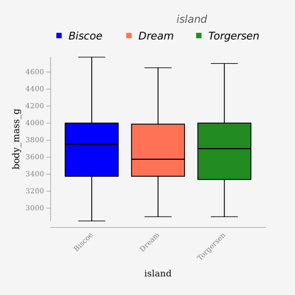
```

None of the boxplots marks observations as potential outliers. Some asymmetry is visible, particularly for Dream, where the median is closer to the lower edge of the box. However, the boxplots do not suggest extreme skewness or unusually isolated observations.

@fig-adelie-residual-qq shows the Q-Q plot of the residuals from all three groups.

```{r}
#| label: fig-adelie-residual-qq
#| fig-cap: "Normal Q-Q plot of residuals from the Adélie penguin ANOVA."
#| fig-alt: "Normal Q-Q plot of Adélie penguin body mass residuals. Most points follow the reference line closely. Departures occur near both ends, with the smallest residuals above the line and the largest residuals below it, indicating tails shorter than those of a normal distribution."
#| out-width: "80%"
#| fig-align: center
#| echo: false
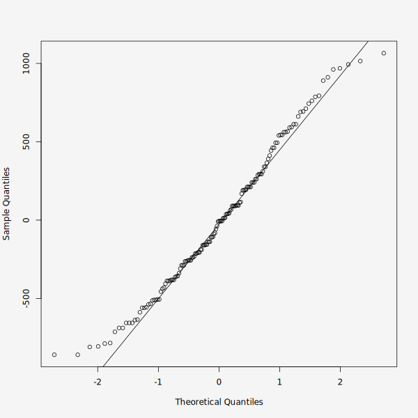
```

Most points follow the reference line closely, especially through the middle of the distribution.^[Body masses in this dataset were recorded to the nearest 25 g, so several penguins share the same body mass. This is why some points in the Q-Q plot form small flat steps and some points in the residual plot are stacked on top of one another.] At the ends, the smallest residuals lie above the line and the largest lie below it. This means the most extreme body masses are less extreme than a normal distribution would predict; in other words, the tails are shorter than normal rather than longer. One possible reason is that each island’s penguins include both males and females, and males are generally heavier. Combining two overlapping groups in this way can flatten a distribution and shorten its tails.

This kind of departure is less concerning than long tails or outliers, and with 44 to 56 penguins per island, ANOVA is not very sensitive to it. Taken together, the Q-Q plot and boxplots support treating normality as a reasonable working approximation. They do not establish that each population distribution is exactly normal.

c\. The sample standard deviations for Biscoe, Dream, and Torgersen are approximately 487.73 g, 455.15 g, and 445.11 g, respectively. The ratio of the largest to the smallest is

$$
\frac{\text{largest sample standard deviation}}
{\text{smallest sample standard deviation}}
=
\frac{487.73}{445.11}
\approx 1.10.
$$

This ratio is close to 1 and well below the guideline of 2, indicating similar sample standard deviations. The similar box heights also suggest comparable spreads among the middle 50% of observations.

@fig-adelie-residual-fit shows the residuals plotted against the fitted values.

```{r}
#| label: fig-adelie-residual-fit
#| fig-cap: "Residuals versus fitted values for the Adélie penguin ANOVA."
#| fig-alt: "Residual-versus-fitted plot with three vertical columns at mean body masses of approximately 3688, 3706, and 3710 grams. From left to right, these represent Dream, Torgersen, and Biscoe. The columns have broadly similar vertical spreads, with residuals above and below zero."
#| out-width: "80%"
#| fig-align: center
#| echo: false
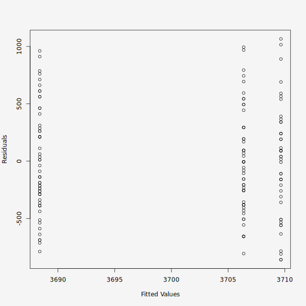
```

From left to right, the columns represent Dream, Torgersen, and Biscoe. Their fitted values are the corresponding sample mean body masses, approximately 3,688 g, 3,706 g, and 3,710 g.

The columns have broadly similar vertical spreads. Biscoe has a slightly wider overall residual range, but no column is dramatically more spread out than the others. This agrees with the similar group standard deviations and does not raise a substantial concern about unequal population variances.

Although the columns appear separated horizontally, the fitted means span only about 21 g. Rguroo adjusts the horizontal axis to this narrow range, which makes the columns look far apart. The horizontal separation reflects differences in group means; it is the vertical spread within each column that we examine when assessing equal variances.

d\. The hypotheses for Levene’s test are

$$
\begin{cases}
H_0: \text{all population variances are equal} \\
H_a: \text{not all population variances are equal.}
\end{cases}
$$

@tbl-adelie-levene shows the Rguroo output.

```{r}
#| label: tbl-adelie-levene
#| tbl-cap: "Levene’s test of equality of population variances for Adélie penguin body mass."
#| fig-alt: "Levene’s test using the median as the center. The test statistic is 0.109889 with 2 and 148 degrees of freedom, and the p-value is 0.896007. The test is not significant at the 5% significance level."
#| out-width: "100%"
#| echo: false
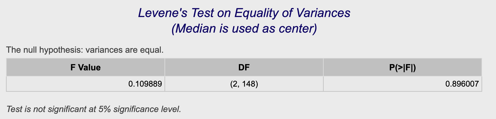
```

The test statistic is approximately 0.110, and the p-value is approximately 0.896. Since 0.896 is greater than 0.05, we fail to reject the null hypothesis. There is insufficient evidence that the population variances of Adélie penguin body mass differ among the three islands.

This does not prove that the population variances are equal. The test result is consistent with the similar spreads seen in the plots and group standard deviations.

e\. The plots support normality as a reasonable approximation, and the group summaries and residual plot show similar spreads. Levene’s test also does not indicate unequal variances, provided its own independence assumption is reasonable.

However, the nest-based sampling raises an independence concern that these diagnostics cannot resolve. Measuring both adults from sampled nests means that some observations may be related. Consequently, we should not conclude that all ANOVA assumptions have been verified simply because the plots look reasonable and Levene’s test is not significant.

The earlier ANOVA analysis treats the observations as independent, so its p-value should be interpreted with this limitation in mind. Treating related observations as independent typically makes ANOVA more likely to find differences that are not real. Because the ANOVA test was far from significant (p = 0.968), this limitation is unlikely to change our conclusion here. It would be a more serious concern if the test had been significant.

This example illustrates why information about data collection is as important as diagnostic plots and statistical tests when checking assumptions.

::::

### When the assumptions are questionable

If the checks suggest that an assumption may not hold, the ANOVA p-value and Tukey’s confidence intervals may not be reliable. What to do depends on which assumption is in question:

- If the observations are **not independent**, for example because the same individuals were measured repeatedly, the one-way ANOVA methods in this chapter are not appropriate. Methods designed for related observations are needed instead.
- If the **variances appear unequal**, a version of ANOVA called **Welch’s ANOVA** does not require equal variances.
- If the **normality assumption** is doubtful, for example because of strong skewness or extreme outliers in small samples, a method called the **Kruskal–Wallis test** compares the groups without assuming normality.
- Sometimes **transforming the response variable**, for example by taking logarithms, can make the distributions more symmetric and their spreads more similar.

These methods are beyond the scope of this chapter. When an assumption is questionable and we still report an ANOVA analysis, we should state the concern and interpret the results with caution.

### Homework for @sec-anova-assumptions

The following exercises continue the analyses from the homework for @sec-one-way-anova. Use the same datasets, response variables, and grouping variables. Except in Exercise 3, assume that the observations are independent and focus on assessing normality and equality of population variances.

For each exercise, complete parts (a)–(e). Use the significance level specified in the exercise for Levene’s test.

a. Use the Rguroo [ANOVA]{.fun} function and select the checkbox next to the [Diagnostics]{.tab} button. Display the response boxplots, residual Q-Q plot, residual-versus-fitted plot, and Levene’s test output.

b. Examine the response boxplots and residual Q-Q plot. Describe any asymmetry, potential outliers, or departures from the Q-Q reference line. Taking the group sample sizes into account, do these plots suggest that normality is a reasonable working approximation? Explain.

c. Use the sample standard deviations for each group from the homework for @sec-one-way-anova, or obtain them using the Rguroo [Numerical Summary]{.fun} function. Calculate the ratio of the largest standard deviation to the smallest. Interpret this ratio using the guideline discussed in this section. If the group sample sizes differ, check whether the smaller groups have the larger standard deviations. Then examine the residual-versus-fitted plot and the response boxplots. Do the group spreads appear reasonably similar? Support your answer using the numerical and graphical evidence.

d. State the null and alternative hypotheses for Levene’s test. Report the test statistic and p-value. Using the specified significance level, state your decision and interpret it in context. If the result is not significant, explain why this does not prove that the population variances are equal.

e. Considering the plots, group standard deviations, and Levene’s test together, assess whether normality and equal variances are reasonable working assumptions. Do not base your assessment on Levene’s test alone. Then answer the following:

    - What concerns, if any, should be mentioned when reporting the ANOVA results?
    - If an assumption appears questionable, which alternative method described in this section might be considered?
    - Do your findings affect how much confidence you have in the ANOVA and Tukey results from the earlier homework? Explain.

1. **Cuckoo Egg Lengths** Cuckoo birds lay their eggs in the nests of other bird species, which then incubate and hatch the eggs. The [Eggs]{.data} dataset contains the lengths of cuckoo eggs found in the nests of six host bird species: Meadow Pipit, Tree Pipit, Hedge Sparrow, Robin, Pied Wagtail, and Wren. Continue your analysis using [length]{.var}, measured in millimeters, as the response variable and [bird]{.var} as the grouping variable. Assess normality and equality of population variances for the comparison of mean cuckoo egg lengths among host species. Use a 5% significance level for Levene’s test.

<div tabindex="0" style="width:85%; margin:auto;">

 The dataset for this exercise is available in the Rguroo dataset repository [Intro to Stats with Rguroo]{.repo}, with the dataset name [Eggs]{.data}.

**Codebook for Dataset Eggs is given [here](#code-book-eggs).**

</div>

2. **Fabric Waste at Levi Strauss & Co.** Levi Strauss & Co. monitors fabric waste at its suppliers. Each week, its quality control department records run-up: the percentage difference between the fabric waste predicted by the computer layout and the actual waste during production. Negative values indicate that the supplier arranged the pattern more efficiently than the computer. Continue your analysis of the [Levi]{.data} dataset using [run_up]{.var} as the response variable and [plant]{.var} as the grouping variable. Assess normality and equality of population variances for the comparison of mean run-up among suppliers. Use a 1% significance level for Levene’s test.

<div tabindex="0" style="width:85%; margin:auto;">

 The dataset for this exercise is available in the Rguroo dataset repository [Intro to Stats with Rguroo]{.repo}, with the dataset name [Levi]{.data}.

**Codebook for Dataset Levi is given [here](#code-book-levi).**

</div>

3. **Readability of Magazine Advertisements** Magazines were grouped into three categories based on the education level of their intended readers: high, medium, or low. Advertisements were sampled from magazines in each category, and the number of words with three or more syllables in each advertisement was recorded. Continue your analysis of the [Advertising]{.data} dataset using [number]{.var} as the response variable and [education]{.var} as the grouping variable. Assess normality and equality of population variances for the comparison of mean numbers of words with three or more syllables per advertisement among the education categories. Use a 5% significance level for Levene’s test.

    Unlike the other exercises, do not assume independence here. Before completing parts (a)–(e), use the description of how the data were collected, including the codebook, to discuss whether the observations can reasonably be treated as independent. Identify a possible source of dependence, and explain why the diagnostic plots and Levene’s test cannot resolve this concern. In part (e), take this concern into account when assessing your confidence in the earlier ANOVA and Tukey results.

<div tabindex="0" style="width:85%; margin:auto;">

 The dataset for this exercise is available in the Rguroo dataset repository [Intro to Stats with Rguroo]{.repo}, with the dataset name [Advertising]{.data}.

**Codebook for Dataset Advertising is given [here](#code-book-advertising).**

</div>

4. **Accuracy of Calorie Labels** A study examined the accuracy of calorie labeling for foods marketed as reduced calorie. Researchers calculated the percent difference between measured and labeled calorie counts. Positive values indicate that a food contained more calories than its label stated. Foods were classified as nationally advertised, regionally distributed, or locally prepared. Continue your analysis of the [Food]{.data} dataset using [percent_diff]{.var} as the response variable and [category]{.var} as the grouping variable. Assess normality and equality of population variances for the comparison of mean percent differences among the three food categories. Use a 5% significance level for Levene’s test.

<div tabindex="0" style="width:85%; margin:auto;">

 The dataset for this exercise is available in the Rguroo dataset repository [Intro to Stats with Rguroo]{.repo}, with the dataset name [Food]{.data}.

**Codebook for Dataset Food is given [here](#code-book-food).**

</div>

5. **Sodium Content of Hot Dogs** The [HotDogs]{.data} dataset contains the calorie and sodium content of hot dogs classified as Beef, Meat, or Poultry. Continue your analysis using [sodium]{.var}, measured in milligrams per hot dog, as the response variable and [type]{.var} as the grouping variable. Assess normality and equality of population variances for the comparison of mean sodium content among the three types of hot dogs. Use a 5% significance level for Levene’s test.

<div tabindex="0" style="width:85%; margin:auto;">

 The dataset for this exercise is available in the Rguroo dataset repository [Intro to Stats with Rguroo]{.repo}, with the dataset name [HotDogs]{.data}.

**Codebook for Dataset HotDogs is given [here](#code-book-hotdogs).**

</div>