::: callout-note
## Chapter 12 Objectives

By the end of Chapter 12, you should be able to:

- Recognize situations involving categorical data in which a chi-squared test is appropriate.
- Distinguish among goodness-of-fit, independence, and homogeneity tests.
- Conduct and interpret chi-square goodness-of-fit hypothesis tests.
- Conduct and interpret chi-square test for independence hypothesis tests.
- Conduct and interpret chi-square test for homogeneity hypothesis tests.
:::

**Before you begin, review the process for importing a dataset.** Click on the box below to expand the directions for importing a dataset into your Data Toolbox.

::: {#Importing-Data-to-Rguroo-Chapter-5 .callout-note appearance="simple" collapse="true" icon="none" title="{width=22px style='vertical-align:middle;'}  Importing Data to Rguroo"}
1.  Open the **Data** toolbox in Rguroo.\
2.  From the [Data Import]{.dpd} dropdown, select [Dataset Repository]{.fun}.\
3.  In the top search box, type [kozak]{.typein}, then select the [Statistics Using Technology – Kozak]{.repo} repository.\
4.  In the middle search box, type the first few letters of the dataset, and choose your dataset that appears in the lower panel.\
5.  Click the [Import]{.button}. The dataset will be imported into your Rguroo account.\
6.  Click the [Close]{.button} to close the dialog.\
7.  To view the dataset, double-click the dataset under the **Data** toolbox list.
:::

```{r chapter-11-setup, include= FALSE, echo=FALSE, warning=FALSE}
library(mosaic)
Defects <- read.csv("https://krkozak.github.io/MAT160/defects.csv")
MaM <- read.csv("https://krkozak.github.io/MAT160/M_and_Ms.csv")
Car_pref <- read.csv("https://krkozak.github.io/MAT160/carprefs.csv")
library("MASS")
```


Many questions involving categorical data ask us to compare what we observe in a sample with what we would expect under a particular assumption. Chi-square tests are hypothesis tests designed for categorical data and provide a way to determine whether the differences between observed and expected counts are large enough to provide evidence against that assumption. In this chapter, we will study three types of chi-square tests. The chi-square goodness-of-fit test determines whether the distribution of a single categorical variable follows a specified distribution. The chi-square test of independence examines whether two categorical variables are associated within a population, while the chi-square test for homogeneity determines whether the distribution of a categorical variable is the same across two or more populations or groups. Although these tests address different questions, they share the same underlying idea: comparing observed counts with the counts we would expect if the null hypothesis were true.

As with the other hypothesis tests you have studied, the general testing process remains the same. What changes are the conditions that must be satisfied, calculating expected counts, and the test statistic used to calculate the p-value. The following summarizes the general steps used in hypothesis testing, no matter the type of test.

::: {#general-hypothesis-steps .callout-note}
## General Hypothesis Test Steps

1.  State the null and alternative hypotheses, $H_o$ and $H_a$.
2.  Select $\alpha$
3.  Use Rguroo to conduct the test using either the P-value approach or the Critical Region approach.
4.  Make a decision.
5.  State the conclusion
:::

## The Chi-Squared Distribution

The **chi-squared distribution**, denoted by $\chi^2$, is a probability distribution that plays an important role in statistical methods involving categorical data. Unlike the normal distribution, which is symmetric, the chi-squared distribution is right-skewed and can only take values greater than or equal to zero. The exact shape of the distribution depends on its degrees of freedom (df). With fewer degrees of freedom, the distribution is more strongly skewed to the right. As the degrees of freedom increase, the distribution becomes less skewed and more symmetric.

@fig-chi-square-df below shows how the shape of the chi-squared distribution changes for different degrees of freedom. Notice that each curve begins at zero or above, is skewed to the right, and becomes less skewed as the degrees of freedom increase.

```{r, echo=FALSE}
#| label: fig-chi-square-df
#| fig-cap: 'Comparison of the chi-squared distribution with various degrees of freedom'
#| fig-alt: 'Graph of chi-square distributions for 1, 2, 5, and 10 degrees of freedom. All distributions take nonnegative values and are skewed to the right. As the degrees of freedom increase, the peak shifts to the right and the distribution becomes less skewed.'
#| out-width: "80%"
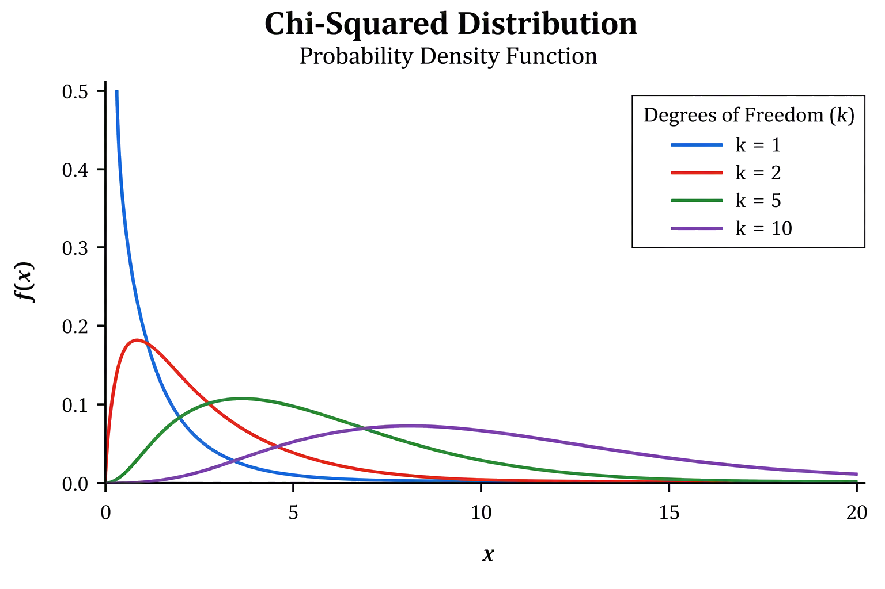
```

::: callout-note
## Summary of Chi-Square Distribution

- The chi-square distribution is denoted by $\chi^2$.
- Chi-square values are always greater than or equal to 0.
- The distribution is skewed to the right.
- The shape of the distribution depends on the degrees of freedom (dfdfdf).
- As the degrees of freedom increase, the distribution becomes less skewed.
:::

## Chi-Square Goodness of Fit Test

When working with categorical data, we are often interested in whether the distribution of a variable follows a particular pattern. For example, suppose a college claims that 40% of its students take primarily in-person courses, 35% take primarily online courses, and 25% take primarily hybrid courses. We could select a random sample of students and record each student's course modality. We could then compare the observed counts, the number of students actually found in each category, with the expected counts, the number we would expect in each category if the college's claim were true.

If the observed counts are close to the expected counts, the data are consistent with the claimed distribution. If the observed and expected counts differ substantially, however, we may have evidence that the actual distribution does not follow the claimed distribution.

The hypothesis test used to determine whether the distribution of a categorical variable follows a specified distribution is called the **Chi-Square Goodness-of-Fit Test**. The test considers the differences between the observed and expected counts across all categories to determine whether those differences are large enough to provide evidence that the specified distribution does not fit the data.

### Null and Alternative Hypotheses

As with other hypothesis tests, a chi-square goodness-of-fit test begins by stating the null and alternative hypotheses. In a goodness-of-fit test, the hypotheses describe the distribution of a categorical variable in the population. The null hypothesis states that the population follows a specified distribution. In other words, it specifies the proportion of the population expected to fall into each category.

The alternative hypothesis states that the population does not follow the specified distribution. This means that at least one of the population proportions differs from the value given in the null hypothesis.

::: {#exm-modality-gof}
## Modality Preference

Suppose a college claims that its students are distributed among course modalities as follows:

- 40% primarily take in-person courses
- 35% primarily take online courses
- 25% primarily take hybrid courses

State the null and alternative hypotheses.
:::

::: {.callout-tip .solution-callout collapse="true" icon="false"}
## 🔎 Solution

To write the null hypothesis, we state the proportions given in the distribution. The alternative will state that the population does not follow the distribution as stated.

$H_o:$ $p_\text{in-person}=0.40$, $p_\text{online}=0.35$, $p_\text{hybrid}=0.25$

$H_a:$ The population does not follow the stated distribution.

Notice that the alternative hypothesis does not specify which proportion is different. It simply states that the population distribution is not the distribution specified in the null hypothesis.
:::

::: {#exm-study-gof}
## Study Location Preference

A university believes that students are equally likely to prefer each of four locations for studying: the library, home, a coffee shop, or a campus study lounge. A researcher selects a random sample of university students and asks each student which of these locations they prefer for studying. State the null and alternative hypotheses.
:::

::: {.callout-tip .solution-callout collapse="true" icon="false"}
## 🔎 Solution

Since the university states that all locations are *equally likely*, the null hypothesis will state that the proportion for each location is equal. Since there are four locations, the proportion for all will be $\frac{1}{4}$. The alternative will be similar to the last example where we do not specify which location is different, only that at least one of locations differ.

$H_o:$ $p_\text{library}=p_\text{home}=p_\text{coffee shop}=p_\text{campus} = \frac{1}{4}$

$H_a:$ The population does not follow the stated distribution.
:::

### Observed and Expected Counts

Chi-squared tests involve comparing what we actually observe in the data with what we would expect to observe if the null hypothesis were true. The observed counts are the actual frequencies recorded for each category in the sample, while the expected counts represent the frequencies we would anticipate under the null hypothesis. The chi-squared test evaluates how much the observed counts differ from the expected counts. Larger differences provide stronger evidence that the observed pattern is not consistent with what we would expect under the null hypothesis.

For a goodness-of-fit test, the expected count is the number of observations we would expect to fall into each category if the null hypothesis were true. To calculate an expected count, multiply the total sample size by the proportion expected for that category:

$$E= (n)(p)$$ where:

$E$ = expected count for the category

$n$ = total sample size

$p$ = expected proportion for the category.

::: {#exm-modality-exp-counts}
## Expected Counts for Modality

Let's revisit the problem where a college claims that its students are distributed among course modalities as follows:

- 40% primarily take in-person courses
- 35% primarily take online courses
- 25% primarily take hybrid courses.

The college surveys 120 students and records the modality. The observed counts are below.

| Course Modality | Observed Count |
|-----------------|----------------|
| In-Person       | 52             |
| Online          | 51             |
| Hybrid          | 17             |

: Modality

Calculate the expected counts for each modality.
:::

::: {.callout-tip .solution-callout collapse="true" icon="false"}
## 🔎 Solution

To find the expected counts, we use each expected proportion stated by the college and the sample size, $n=120$.

In-person: $E=(120)(0.40)=48$

Online: $E=(120)(0.35)=42$

Hybrid: $E=(120)(0.25)=30$

We can organize this into a table as follows.

| Course Modality | Claimed Proportion | Observed Count | Expected Count |
|-----------------|--------------------|----------------|----------------|
| In-Person       | 0.40               | 52             | 48             |
| Online          | 0.35               | 51             | 42             |
| Hybrid          | 0.25               | 17             | 30             |

: Modality Summary
:::

### The Chi-Squared Test Statistic

Before conducting a chi-square goodness-of-fit test, we need to make sure the conditions for the test are satisfied:

1.  Categorical data: The variable being analyzed is categorical, and the data are counts of observations within the categories.
2.  Randomness: The data should come from a random sample or a randomized process.
3.  Independence: The observations should be independent. When sampling without replacement from a finite population, the sample should generally be no more than 10% of the population.
4.  Expected counts: The expected counts must be sufficiently large for the chi-square distribution to provide a reasonable approximation. A commonly used guideline is that each expected count should be at least 5.

Once these conditions are satisfied, we can calculate the chi-square test statistic and p-value and use them to make a decision about the null hypothesis.

**Test Statistic**

The question now becomes: Are the differences between the observed and expected counts small enough to be explained by random sampling variability, or are they large enough to provide evidence that the population does not follow the specified distribution?

To answer this question, we calculate a chi-square test statistic. For each category, we compare the observed count, $O$, with the expected count, $E$:

$$\chi^2=\sum\frac{(O-E)^2}{E}$$ where,

$O$ are the observed counts and $E$ are the expected counts.

The quantity

$$\frac{(O-E)^2}{E}$$

measures how much a particular category contributes to the overall chi-square statistic. Categories in which the observed and expected counts are close together contribute relatively little, while categories with larger differences contribute more.

Because the differences are squared, the chi-square statistic is always nonnegative. In general, a small value of $\chi^2$ indicates that the observed counts are reasonably close to the expected counts, while a large value of $\chi^2$ indicates greater disagreement between what was observed and what was expected under the null hypothesis.

The chi-square distribution used for a goodness-of-fit test depends on the number of categories. If there are $k$ categories, the degrees of freedom are

$$df=k−1$$

The chi-square test statistic and the degrees of freedom are then used to find the p-value. Similar to previous tests, the p-value represents the probability, assuming the null hypothesis is true, of obtaining a chi-square statistic at least as large as the one calculated from the sample.

Although the formula above shows how the chi-squared test statistic is calculated, we will not calculate the test statistic by hand. Instead, we will use Rguroo to obtain both the chi-squared test statistic and the corresponding p-value. Understanding the formula, however, helps us see how the observed and expected frequencies contribute to the test statistic.

### P-value Approach

We can use the p-value approach to determine whether the observed counts differ significantly from what would be expected under the null hypothesis. The chi-squared test statistic measures the overall discrepancy between the observed and expected counts, while the p-value tells us how unusual that discrepancy would be if the null hypothesis were true. Just as in previous tests, we compare the p-value to the significance level, $\alpha$, to make our decision about the null hypothesis. In this text, Rguroo will be used to obtain the chi-squared test statistic and p-value.

::: callout-note
## Hypothesis Test Decision Using P-value Approach

If the p-value is less than $\alpha$, we reject the null hypothesis; otherwise, we fail to reject the null hypothesis.
:::

::: {#exm-modality-gof-test-pvalue}
## GOF Test for Modality - Using P-value Approach

We will revisit @exm-modality-exp-counts. A college states that 40% of its students prefer in-person courses, 35% prefer online courses, and 25% prefer hybrid courses. A random sample of 120 students was asked to identify their preferred course modality. The results are shown below.

| Course Modality | Claimed Proportion | Observed Count |
|-----------------|--------------------|----------------|
| In-Person       | 0.40               | 52             |
| Online          | 0.35               | 51             |
| Hybrid          | 0.25               | 17             |

Is there sufficient evidence to conclude that students' preferences for course modality differ from the distribution stated by the college at the $\alpha=0.05$ significance level? 
:::

::: {#gof-modality-pvalue-solution .callout-tip .solution-callout collapse="true" icon="false"}
## 🔎 Solution

To determine if there is sufficient evidence that the preferences for course modality differs from the stated distribution, we need to conduct a full hypothesis test. This is a goodness-of-fit test since we are determining if a categorical variable matches a specific distribution. 

Before we begin the test, we need to make sure the conditions for a GOF test are satisfied.

*Categorical Data:* We have categorical data since the college recorded modality.

*Randomness:* The college used a random sample.

*Independence:* The sample is independent since the modality preference of one student does not affect another student.

*Expected Counts:* The college did not report the expected counts, so we can compute them.

Recall: expected counts are $n \times p$ for each category.

In-Person: $(120)(0.40)= 48$

Online: $(120)(0.35)=42$

Hybrid $(120)(.25)=30$

All expected counts are greater than 5.

Now that we know the conditions for a GOF test are satisfied, we will follow the [General Hypothesis Test Steps](#general-hypothesis-steps) to complete the test.

**State the null and alternative**

From [Example 15.1](#exm-modality-gof), to write the null hypothesis, we state the proportions given in the distribution. The alternative will state that the population does not follow the distribution as stated.

$H_o:$ $p_\text{in-person}=0.40$, $p_\text{online}=0.35$, $p_\text{hybrid}=0.25$

$H_a:$ The population does not follow the stated distribution.

**Select $\alpha$**

In this example, the $\alpha$ was given. So, $\alpha = 0.05$

**P-value Approach to find test-statistic and p-value**

To test the hypothesis using the p-value approach, we will use Rguroo to find the test statistic and p-value.

Click to expand the box below see how to find the test statistic and p-value for a GOF Test.

:::: {#GOF-P-Value_Approach-in-Rguroo .callout-note appearance="simple" collapse="true" icon="none" title="{width=22px style='vertical-align:middle;'} Finding the Test Statistic and P-value for GOF Test in Rguroo"}


1.  Open the **Analytics** toolbox in Rguroo.\
2.  Open the [Analysis]{.dpd} dropdown, and select [Goodness of Fit]{.fun}. This opens the [Goodness of Fit Test]{.fun} dialog box.
3.  In the [Goodness of Fit Test]{.fun} dialog box, there are two options. You can choose an existing dataset, or you can type the data in manually.  For this example, we will type the data in manually.
    - We have three modalities, so we will need three rows. Click the plus icon  button three times. This will give us space to enter the three modalities.
    - Enter the modality names in both the *Level* and *Label* columns.
    - Enter the observed counts in the *Obs Count* column and the expected percentages in the *Null Probability* column.
4.  Select *Chi-Square* in the Test of Hypothesis box. 
5.  Leave the $\alpha=0.05$ in the *Significance Level* box, since we are using this value.
6.  Click the preview icon  to see the information for the test.
7. Remember to save your output in case you need to refer to it later.

::: {.callout-tip .inner-callout appearance="simple" collapse="true" icon="none" title="Click here to see the Rguroo dialog"}
{width="500px"}
:::

::::

```{r, echo=FALSE}
#| label: fig-gof-modality-pvalue
#| fig-cap: 'Rguroo output for GOF Test for Modality Example)'
#| fig-alt: 'Rguroo output for GOF Test for Modality Example, showing graph, p-value = 0.01930 and test statistic of 7.89524 '
#| out-width: "70%"
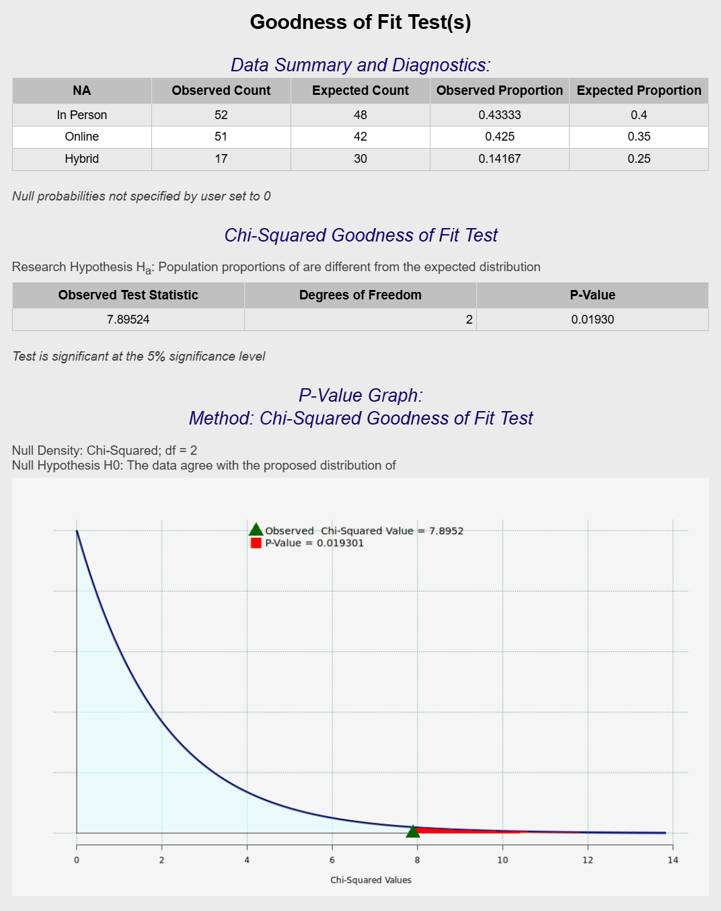
```

The P-value graph displays the chi-squared distribution under the null hypothesis. The observed test statistic, $\chi^2=7.89524$, is marked by the green triangle. The red shaded area to the right of the test statistic represents the p-value, $\text{p-value} =0.01930$.

**Make a Decision**

Since the p-value $< \alpha$, $0.01930<0.05$, we reject the null hypothesis.

**State the Conclusion**

There is sufficient evidence to support the claim that the population does not follow the stated modality distribution of 40% in-person, 35% online, and 25% hybrid.
:::

::: {#exm-car-preference} 
## GOF Test for Car Preference - Using P-value Approach

A project conducted by the Australian Federal Office of Road Safety randomly surveyed 300 people and asked them many questions about their cars. One question was the reason that a person chooses a given car, and that data is in @tbl-Car_table ("Car preferences," 2013). Do the data show that the frequencies observed substantiate the claim that the reasons for choosing a car are equally likely? Test at the $\alpha=0.05$ level of significance. 

```{r, echo=FALSE}
#| tbl-alt: "Reason for Choosing a Car"
#| label: tbl-Car_table
#| tbl-cap: "Reason for Choosing a Car"
Car_table <- tally(~Reason, data = Car_pref)
knitr::kable(Car_table)
```


 The dataset for this example is available in the Rguroo dataset repository [Kozak]{.repo}, with the dataset name [carprefs]{.data}. @tbl-Car_table shows the variables and the first 6 rows of the data set. A complete description of the variables is provided in the [dataset code book](#code-book-carpref) that follows.

:::

::: {#code-book-carpref .callout-tip .codebook collapse="true"}
## Code book for Carprefs Dataset

**Description** The dataset gives survey results from a project conducted by the Australian Federal Office of Road Safety.

Format

This dataset contains the following columns:

[ID]{.var}: Identification number for the respondent
<br><br>
[Age]{.var}: Age of the respondent
<br><br>
[Sex]{.var}: Sex of the respondent
<br><br>
[LicYr]{.var}: Number of years the respondent has held a driver's license
<br><br>
[LicMth]{.var}: Additional number of months the respondent has held a driver's license
<br><br>
[ActCar]{.var}: Type of car the respondent currently drives
<br><br>
[Kids5]{.var}: Number of children age 5 or younger
<br><br>
[Kids6]{.var}: Number of children age 6 or older
<br><br>
[PreferCar]{.var}: Type of car the respondent would prefer to own
<br><br>
[Carsmall_new5K]{.var}: Car preference related to a small new car
<br><br>
[Reason]{.var}: Main reason for the respondent's car preference
<br><br>
[Cost]{.var}: Importance of cost when choosing a car
<br><br>
[Reliable]{.var}: Importance of reliability when choosing a car
<br><br>
[Perform]{.var}: Importance of performance when choosing a car
<br><br>
[Fuel]{.var}: Importance of fuel economy when choosing a car
<br><br>
[Safety]{.var}: Importance of safety when choosing a car
<br><br>
[AC.PS]{.var}: Importance of air conditioning and power steering when choosing a car
<br><br>
[Park]{.var}: Importance of ease of parking when choosing a car
<br><br>
[Room]{.var}: Importance of interior room when choosing a car
<br><br>
[Doors]{.var}: Importance of the number of doors when choosing a car
<br><br>
[Prestige]{.var}: Importance of prestige when choosing a car
<br><br>
[Colour]{.var}: Importance of car color when choosing a car

:::

::: {#gof-carpref-pvalue-solution .callout-tip .solution-callout collapse="true" icon="false"}
## 🔎 Solution

To determine if the reasons for choosing a car are equally likely, we need to conduct a full hypothesis test. This is a goodness-of-fit test since we are determining if a categorical variable matches a specific distribution; in this case each reason has the same proportion

Before we begin the test, we need to make sure the conditions for a GOF test are satisfied.

*Categorical Data:* We have categorical data since the store recorded payment method.

*Randomness:* Australian Federal Office of Road Safety used a random sample.

*Independence:* The sample is independent since reason for choosing a car is independent from one person to the next.

*Expected Counts:* Australian Federal Office of Road Safety did not report expected counts; however, there are 6 reasons listed for choosing a car so each reason should have a probability of $\frac{1}{6}$ if the reasons are equally likely. This means that the expected counts for each reason would be $(300)(\frac{1}{6}) = 50$. The expected counts are all greater than 5.

Now that we know the conditions for a GOF test are satisfied, we will follow the [General Hypothesis Test Steps](#general-hypothesis-steps) to complete the test.

**State the null and alternative**

To write the null hypothesis, we state the proportions given in the distribution. As stated before, since we are testing whether the reasons are equally likely, all proportions will be $\frac{1}{6}$The alternative will state that the population does not follow the store's distribution as stated (not equally likely).

$H_o:$ $p_\text{comfort}= p_\text{cost}=p_\text{looks}=p_\text{performance}=p_\text{reliability}=p_\text{safety}=\frac{1}{6}$

$H_a:$ The reasons for choosing a car are not equally likely.

**Select $\alpha$**

In this example, the $\alpha$ was given. So, $\alpha = 0.05$

**P-value Approach to find test-statistic and p-value**

To conduct a hypothesis using the p-value approach, we will use Rguroo to find the test statistic and p-value. For this example, we could input the categories and observed counts that are shown in the @tbl-Car_table. However, entering these manually is time consuming and this dataset is in Rguroo. We will use the existing dataset and Rguroo will populate the categories for us.

Click to expand the box below see how to find the test statistic and p-value for a GOF Test using raw data.

:::: {#GOF-P-Value_Approach-in-Rguroo .callout-note appearance="simple" collapse="true" icon="none" title="{width=22px style='vertical-align:middle;'} Finding the Test Statistic and P-value for GOF Test in Rguroo Using Raw Data"}


1.  Open the **Analytics** toolbox in Rguroo.\
2.  Open the [Analysis]{.dpd} dropdown, and select [Goodness of Fit]{.fun}. This opens the [Goodness of Fit Test]{.fun} dialog box.
3.  In the [Goodness of Fit Test]{.fun} dialog box, there are two options. You can choose an existing dataset, or you can type the data in manually.  For this example, we will select the dataset.
    - From the [Select a Dataset]{.dpd} menu, select the [carpref]{.data} dataset.
    - From the [Factor]{.dpd} select the variable [Reason]{.var}
    - In the Null Probability column, we can leave this blank since Rguroo defaults to equally likely. You can also enter $\frac{1}{6}$, in each, but it is not needed.
    Notice that the table provided above automatically populates.
4.  Select *Chi-Square* in the Test of Hypothesis box. 
5.  Leave the $\alpha=0.05$ in the *Significance Level* box, since we are using this value.
6.  Click the preview icon  to see the information for the test.
7. Remember to save your output in case you need to refer to it later.

::: {.callout-tip .inner-callout appearance="simple" collapse="true" icon="none" title="Click here to see the Rguroo dialog"}
{width="500px"}
:::
::::

```{r, echo=FALSE}
#| label: fig-gof-carpref-pvalue
#| fig-cap: 'Rguroo output for GOF Test for Reason for Choosing Car Example'
#| fig-alt: 'Rguroo output for GOF Test for Reason for Choosing Car Example, showing graph, p-value = 0.0000 and test statistic of 42.2'
#| out-width: "70%"
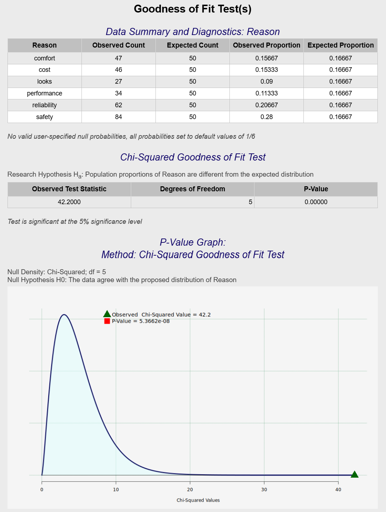
```

Notice in the Rguroo output that the expected proportions automatically filled in as the decimal form of $\frac{1}{6}$.

The P-value graph displays the chi-squared distribution under the null hypothesis. The observed test statistic, $\chi^2=42.2000$, is marked by the green triangle. The red shaded area to the right of the test statistic is so small, it is barely visible. The $\text{p-value} =0.0000$.

**Make a Decision**

Since the p-value is $< \alpha$, $0.0000$ is $<0.05$, we reject the null hypothesis.

**State the Conclusion**

There is sufficient evidence to support the claim that the reasons for choosing a car are not equally likely.

:::

::: {#exm-payment-gof-test-pvalue}
## GOF Test for Method of Payment - Using P-value Approach

A retail company reports that customers typically use the following methods of payment: 50% use a credit or debit card, 30% use a mobile payment method, 20% use cash.

A random sample of 200 customers at one of the company's stores produced the following results:

| Payment Method    | Observed Count |
|-------------------|----------------|
| Credit/Debit Card | 112            |
| Mobile Payment    | 48             |
| Cash              | 40             |

The store manager wants to determine whether the distribution of payment methods at this store differs from the company's reported distribution. Use a significance level of $\alpha = 0.05$.
:::

::: {.callout-tip .solution-callout collapse="true" icon="false"}
## 🔎 Solution

To determine if the payment methods at this store differs from the company's reported distribution, we need to conduct a full hypothesis test. This is a goodness-of-fit test since we are determining if a categorical variable matches a specific distribution. 

Before we begin the test, we need to make sure the conditions for a GOF test are satisfied.

*Categorical Data:* We have categorical data since the store recorded payment method.

*Randomness:* The store used a random sample.

*Independence:* The sample is independent since the payment method of one person does not affect another.

*Expected Counts:* The store did not report the expected counts, so we will compute them.

Credit/Debit: $(200)(0.50)= 100$

Mobile: $(200)(0.30)=60$

Cash; $(200)(.20)=40$

These expected counts are all greater than 5.

Now that we know the conditions for a GOF test are satisfied, we will follow the [General Hypothesis Test Steps](#general-hypothesis-steps) to complete the test.

**State the null and alternative**

To write the null hypothesis, we state the proportions given in the distribution. The alternative will state that the population does not follow the store's distribution as stated.

$H_o:$ $p_\text{credit/debit}=0.50$, $p_\text{mobile}=0.30$, $p_\text{cash}=0.20$

$H_a:$ The population does not follow the stated distribution.

**Select $\alpha$**

In this example, the $\alpha$ was given. So, $\alpha = 0.05$

**P-value Approach to find test-statistic and p-value**

To test the hypothesis using the p-value approach, we will use Rguroo to find the test statistic and p-value.

Click to expand the box below see how to find the test statistic and p-value for a GOF Test.

:::: {#GOF-P-Value_Approach-in-Rguroo .callout-note appearance="simple" collapse="true" icon="none" title="{width=22px style='vertical-align:middle;'} Finding the Test Statistic and P-value for GOF Test in Rguroo"}


1.  Open the **Analytics** toolbox in Rguroo.\
2.  Open the [Analysis]{.dpd} dropdown, and select [Goodness of Fit]{.fun}. This opens the [Goodness of Fit Test]{.fun} dialog box.
3.  In the [Goodness of Fit Test]{.fun} dialog box, there are two options. You can choose an existing dataset, or you can type the data in manually.  For this example, we will type the data in manually.
    - We have three payment methods, so we will need three rows. Click the plus icon  button three times. This will give us space to enter the payment methods.
    - Enter the payment method names in both the *Level* and *Label* columns.
    - Enter the observed counts in the *Obs Count* column and the expected percentages in the *Null Probability* column.
4.  Select *Chi-Square* in the Test of Hypothesis box. 
5.  Leave the $\alpha=0.05$ in the *Significance Level* box, since we are using this value.
6.  Click the preview icon  to see the information for the test.
7. Remember to save your output in case you need to refer to it later.

::: {.callout-tip .inner-callout appearance="simple" collapse="true" icon="none" title="Click here to see the Rguroo dialog"}
{width="500px"}
:::
::::

```{r, echo=FALSE}
#| label: fig-gof-payment-pvalue
#| fig-cap: 'Rguroo output for GOF Test for Payment Method Example'
#| fig-alt: 'Rguroo output for GOF Test for Payment Method Example, showing graph, p-value = 0.14661 and test statistic of 3.840'
#| out-width: "70%"
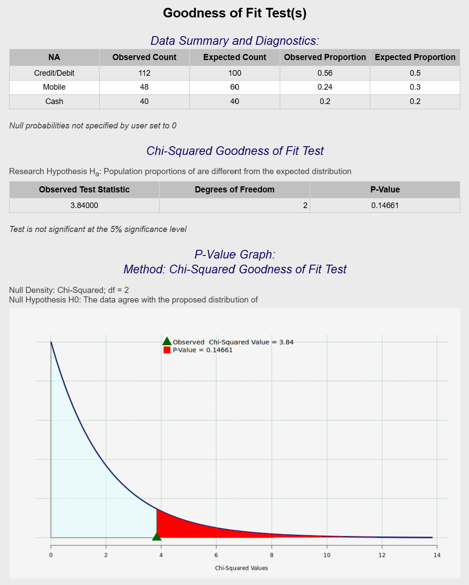
```

The P-value graph displays the chi-squared distribution under the null hypothesis. The observed test statistic, $\chi^2=3.840$, is marked by the green triangle. The red shaded area to the right of the test statistic represents the p-value, $\text{p-value} =0.14661$.

**Make a Decision**

Since the p-value is not $< \alpha$, $0.14661$ is not $<0.05$, we do not reject the null hypothesis.

**State the Conclusion**

There is not sufficient evidence to support the claim that this specific store's population does not follow the stated payment method distribution of 50% credit/debit, 30% mobile, 20% cash. So, this means the specific store follows the overall company's payment method distribution.
:::

### Critical Region Approach

An alternative to the p-value approach is the critical region approach. Instead of comparing the p-value to the significance level, $\alpha$, this approach compares the chi-square test statistic to a critical value determined by $\alpha$ and the degrees of freedom. The critical value marks the boundary between values that are reasonably likely under the null hypothesis and values that provide sufficient evidence to reject it. Because chi-square tests are right-tailed, the critical region is located in the right tail of the chi-square distribution. If the test statistic falls in the critical region, we reject the null hypothesis; otherwise, we fail to reject the null hypothesis.

```{r, echo=FALSE}
#| label: fig-chi-square-dist
#| fig-cap: 'Critical region for chi-squared test'
#| fig-alt: 'Right-skewed chi-square distribution with a critical value marking the beginning of the critical region. The area to the right of the critical value is shaded and represents alpha. The null hypothesis is rejected when the chi-square test statistic is greater than the critical value.'
#| out-width: "80%"
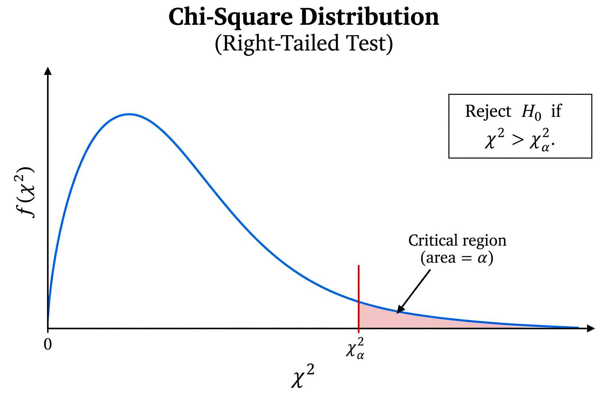
```

@fig-chi-square-dist shows the critical value, $\chi^2_\alpha$, that separates the chi-square distribution into the noncritical region and the critical region. The critical region, shown in the right tail (shaded), has an area equal to $\alpha$. If the chi-square test statistic is greater than the critical value, we reject the null hypothesis.

::: {#exm-modality-gof-test-critical-region}
## GOF Test for Modality - Using Critical Region Approach

We will revisit @exm-modality-gof-test-pvalue and show how to conduct the same hypothesis test using the critical region approach. A college states that 40% of its students prefer in-person courses, 35% prefer online courses, and 25% prefer hybrid courses. A random sample of 120 students was asked to identify their preferred course modality. The results are shown below.

| Course Modality | Claimed Proportion | Observed Count |
|-----------------|--------------------|----------------|
| In-Person       | 0.40               | 52             |
| Online          | 0.35               | 51             |
| Hybrid          | 0.25               | 17             |

Is there sufficient evidence to conclude that students' preferences for course modality differ from the distribution stated by the college at the $\alpha=0.05$ significance level? 
:::

::: {.callout-tip .solution-callout collapse="true" icon="false"}
## 🔎 Solution

Since we are testing the same claim, we will use some of our work in @exm-modality-gof-test-pvalue.  In that example, we already checked that the conditions for a chi-squared test were met, we stated the null and alternative hypotheses, and we stated $\alpha$.  Let's write down the previous steps for a hypothesis and then continue on.

**State the null and alternative**

$H_o:$ $p_\text{in-person}=0.40$, $p_\text{online}=0.35$, $p_\text{hybrid}=0.25$

$H_a:$ The population does not follow the stated distribution.

**Select $\alpha$**

$\alpha = 0.05$

**Critical Region Approach to find Critical Value and Test Statistic**

To obtain critical regions in Rguroo, we use the same Rguroo steps as shown in the [solution](#gof-modality-pvalue-solution) of @exm-modality-gof-test-pvalue. Scroll down to the last image on the Rguroo output and you will see the $\chi^2$ test statistic (same as before) and the critical value.

```{r, echo=FALSE}
#| label: fig-gof-modality-critical-region
#| fig-cap: 'Rguroo output for GOF Test for Modality Example - Critical Region Approach)'
#| fig-alt: 'Rguroo output for GOF Test for Modality Example - Critical Region Approach, showing graph, critical value = 5.9915 and test statistic of 7.89524 '
#| out-width: "70%"
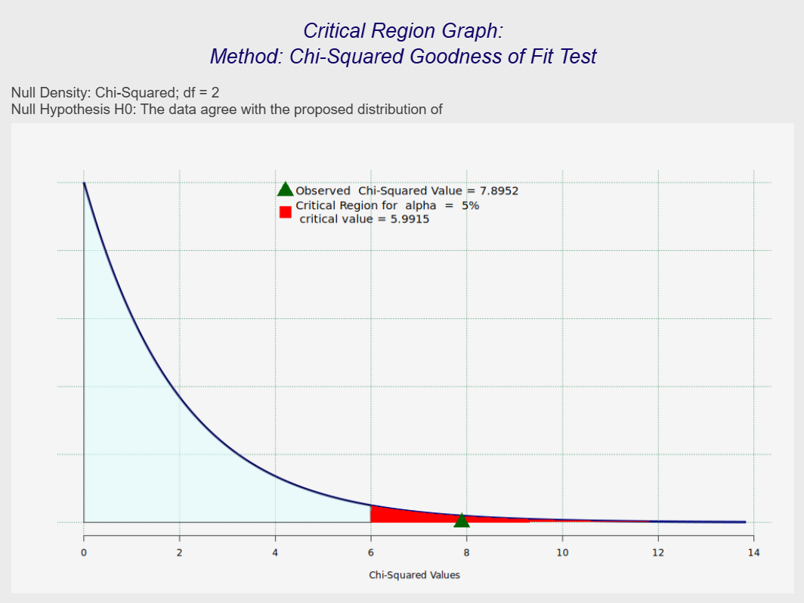
```

The critical region graph displays the chi-squared distribution. The red shaded region represents the critical region for a $\alpha=0.05$ significance level and begins at the critical value of $\chi^2=5.9915$. The green triangle marks the observed chi-squared test statistic of $\chi^2=7.8952$. 

**Make a Decision**

Because the observed test statistic, $\chi^2=7.8952$, falls within the red critical region (values greater than $\chi^2=5.9915$), the null hypothesis is rejected.

**State the Conclusion**

There is sufficient evidence to support the claim that the population does not follow the stated modality distribution of 40% in-person, 35% online, and 25% hybrid.

Notice that the test results, no matter the approach, will yield the same decision and conclusion.

:::

::: {#exm-car-preference-critical-region} 
## GOF Test for Car Preference - Using Critical Region Approach

We will revisit @exm-car-preference and show how to conduct the same hypothesis test using the critical region approach. A project conducted by the Australian Federal Office of Road Safety randomly surveyed 300 people and asked them many questions about their cars. One question was the reason that a person chooses a given car, and that data is in @tbl-Car_table ("Car preferences," 2013). Do the data show that the frequencies observed substantiate the claim that the reasons for choosing a car are equally likely? Test at the $\alpha=0.05$ level of significance.

@tbl-Car_table shows the tabulated data. A complete description of the variables is provided in the [dataset code book](#code-book-carpref).

:::

::: {.callout-tip .solution-callout collapse="true" icon="false"}
## 🔎 Solution

Since we are testing the same claim, we will use some of our work in @exm-car-preference.  In that example, we already checked that the conditions for a chi-squared test were met, we stated the null and alternative hypotheses, and we stated $\alpha$.  Let's write down the previous steps for a hypothesis and then continue on.

**State the null and alternative**

$H_o:$ $p_\text{comfort}= p_\text{cost}=p_\text{looks}=p_\text{performance}=p_\text{reliability}=p_\text{safety}=\frac{1}{6}$

$H_a:$ The reasons for choosing a car are not equally likely.

**Select $\alpha$**

$\alpha = 0.05$

**Critical Region Approach to find Critical Value and Test Statistic**

To obtain critical regions in Rguroo, we use the same Rguroo steps as shown in the [solution](#gof-carpref-pvalue-solution) of @exm-car-preference. Scroll down to the last image on the Rguroo output and you will see the $\chi^2$ test statistic (same as before) and the critical value.

```{r, echo=FALSE}
#| label: fig-gof-carpref-critical-region
#| fig-cap: 'Rguroo output for GOF Test for Reason for Choosing Car Example - Critical Region Approach'
#| fig-alt: 'Rguroo output for GOF Test for Reason for Choosing Car Example - Critical Region Approach, showing graph, critical value of 11.07 and test statistic of 42.2'
#| out-width: "70%"
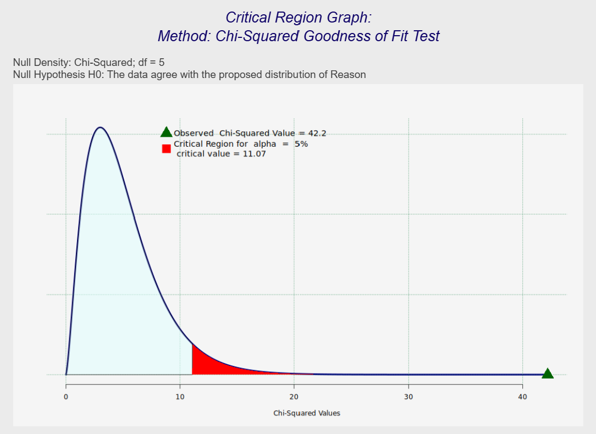
```

The critical region graph displays the chi-squared distribution. The red shaded region represents the critical region for a $\alpha=0.05$ significance level and begins at the critical value of $\chi^2=11.07$. The green triangle marks the observed chi-squared test statistic of $\chi^2=42.2$. 

**Make a Decision**

Because the observed test statistic, $\chi^2=42.2$, falls within the red critical region (values greater than $\chi^2=11.07$), the null hypothesis is rejected.

**State the Conclusion**

There is sufficient evidence to support the claim that the reasons for choosing a car are not equally likely.

Again, notice that this is the same decision and conclusion as with the p-value method.
:::

::: {#exm-transportation-gof-test-critical-region}
## GOF Test for Transportation Methods - Using Critical Region Approach

A college reports that students typically use the following methods to travel to campus: 50% drive, 20% carpool, 15% use public transportation, and 15% walk or bike.

A random sample of 160 students is selected. The students report their primary method of transportation to campus as follows:

| Transportation Method | Observed Count |
|-----------------------|----------------|
| Drive                 | 91|
| Carpool               | 25|
| Public Transportation  | 20|
|Walk or Bike           | 24|

At the $\alpha = 0.01$ significance level, is there enough evidence to conclude that the distribution of transportation methods differs from the reported distribution? 
:::

::: {.callout-tip .solution-callout collapse="true" icon="false"}
## 🔎 Solution

For this example, we will follow the same procedure and steps as in the last example. Since we have not checked that the chi-squared conditions have been met, we will do that as well.

*Categorical Data:* We have categorical data since the college reported method of transportation.

*Randomness:* The college used a random sample.

*Independence:* The sample is independent since we will assume one person's method of transportation does not affect another person's method of transportation.

*Expected Counts:* The college did not report the expected counts, so we will compute them.

Drive: $(160)(0.50)=80$

Carpool: $(160)(0.20)=32$

Public Transportation: $(160)(0.15)=24$

Walk or Bike: $(160)(0.15)=24$

**State the null and alternative**

$H_o:$ $p_\text{drive}=0.50$, $p_\text{carpool}=0.20$, $p_\text{public}=0.15$, $p_\text{walk/bike}=0.15$

$H_a:$ The population does not follow the stated distribution.

**Select $\alpha$**

$\alpha = 0.01$

**Critical Region Approach to find Critical Value and Test Statistic**

To obtain critical regions in Rguroo, we use the same Rguroo steps as shown in the [solution](#gof-modality-pvalue-solution) of @exm-modality-gof-test-pvalue. 

In this case, we have 4 modes of transportation so we will need to click the plus icon  button four times. We also have $\alpha=0.01$, so type [0.01]{.typein} in the *Significance Level* box. Once you have entered the information, click the preview icon  to see the information for the test.

```{r, echo=FALSE}
#| label: fig-gof-transportation-dialog
#| fig-cap: 'Dialog for Transportation Method'
#| fig-alt: 'Dialog for Transportation Method'
#| out-width: "70%"
knitr::include_graphics(
  "Rguroo_dialogs/Chi_Squared/dialog-gof-transportation.png"
)
```

Scroll down to the last image on the Rguroo output and you will see the $\chi^2$ test statistic and the critical value.

```{r, echo=FALSE}
#| label: fig-gof-transprtation-critical-region
#| fig-cap: 'Rguroo output for GOF Test for Transportation Example - Critical Region Approach'
#| fig-alt: 'Rguroo output for GOF Test for Transportation Example - Critical Region Approach, showing graph, critical value = 5.9915 and test statistic of 7.89524 '
#| out-width: "70%"
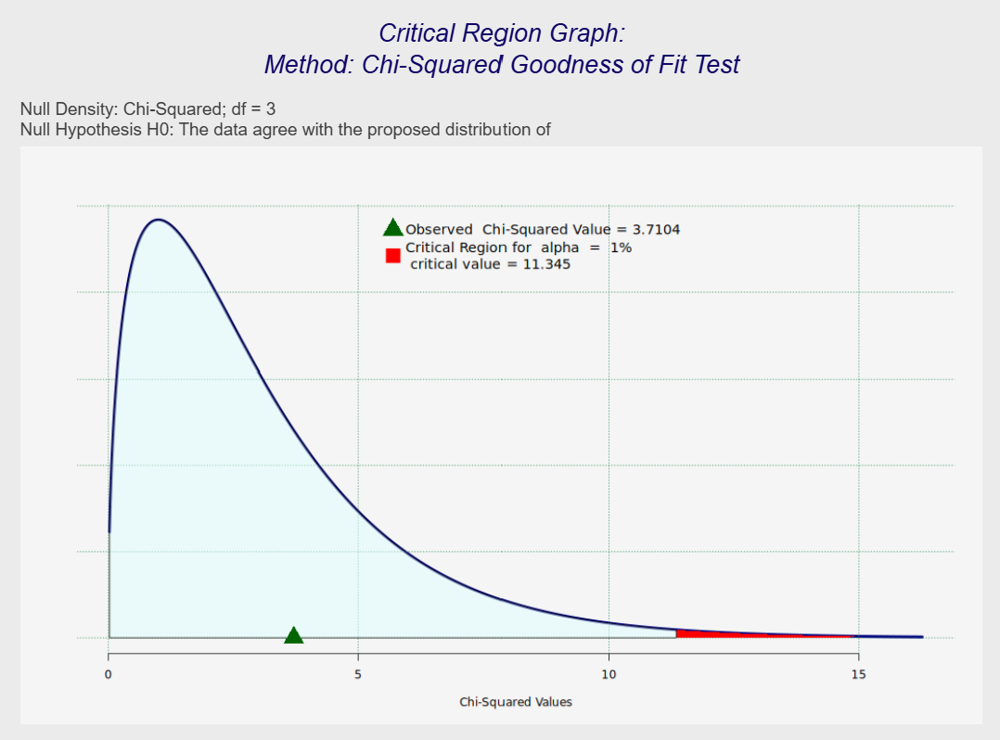
```

The critical region graph displays the chi-squared distribution. The red shaded region represents the critical region for a $\alpha=0.01$ significance level and begins at the critical value of $\chi^2=11.345$. The green triangle marks the observed chi-squared test statistic of $\chi^2=3.7104$. 

**Make a Decision**

Because the observed test statistic, $\chi^2=3.7104$, does not fall within the red critical region (values greater than $\chi^2=11.345$), the null hypothesis is not rejected.

**State the Conclusion**

There is not sufficient evidence to support the claim that the population does not follow the stated transportation distribution of 50% drive, 20% carpool, and 15% public transportation, 15% walk or bike. So college students follow the transportation method percentages as stated.

:::

### Homework for Section 12.1

1.  According to the M&M candy company, the expected proportion can be found in @tbl-MandM. In addition, the table contains the number of M&M's of each color that were found in a case of candy (Madison, 2013). At the $\alpha = 0.05$ level of significance, do the observed frequencies support the claim of M&M?

```{r, echo=FALSE}
#| tbl-alt: "M&M Observed and Expected"
#| label: tbl-MandM
#| tbl-cap: "M&M Observed and Expected"
MandM <- data.frame(
  Color = c("Blue", "Brown", "Green", "Orange", "Red", "Yellow"),
  Observed = c(78, 87, 87, 76, 85, 87),
  Expected = c(0.24, 0.13, 0.16, 0.20, 0.13, 0.14)
)
knitr::kable(MandM)
```

2.  Eyeglassomatic manufactures eyeglasses for different retailers. The data frame is in @tbl-Defects. They test to see how many defective lenses they made the time period of January 1 to March 31. @tbl-Defect_table gives the defect and the number of defects.

    The codebook for the [defects]{.data} dataset can be found below @tbl-Defects.

```{r, echo=FALSE}
#| tbl-alt: "Number of Defective Lenses"
#| label: tbl-Defect_table
#| tbl-cap: "Number of Defective Lenses"
Defect_table <- tally(~type, data = Defects)
knitr::kable(Defect_table)
```

Do the data support the notion that each defect type occurs in the same proportion? Test at the $\alpha = 0.05$ level of significance.

3.  On occasion, medical studies need to model the proportion of the population that has a disease and compare that to observed frequencies of the disease actually occurring. Suppose the end-stage renal failure in south-west Wales was collected for different age groups. Do the data in @tbl-Renal show that the observed frequencies are in agreement with proportion of people in each age group (Boyle, Flowerdew & Williams, 1997)? Test at the $\alpha = 0.01$ level of significance.


    ```{r, echo=FALSE}
    #| tbl-alt: "Renal Failure Frequencies"
    #| label: tbl-Renal
    #| tbl-cap: "Renal Failure Frequencies"
    Renal <- data.frame(
      Age_group = c("16-29", "30-44", "45-59", "60-75", "75+"),
      Observed = c(32, 66, 132, 218, 91),
      Expected = c(0.23, 0.25, 0.22, 0.21, 0.09)
    )
    knitr::kable(Renal)
    ```

4.  In Africa in 2011, the number of deaths of a female from cardiovascular disease for different age groups are in @tbl-Deaths ("Global health observatory," 2013). In addition, the proportion of deaths of females from all causes for the same age groups are also in table Deaths of Females for Different Age Groups. Do the data show that the death from cardiovascular disease are in the same proportion as all deaths for the different age groups? Test at the $\alpha = 0.05$ level of significance.

    ```{r females, echo=FALSE}
    #| tbl-alt: "Deaths of Females for Different Age Groups"
    #| label: tbl-Deaths
    #| tbl-cap: "Deaths of Females for Different Age Groups"
    Deaths <- data.frame(
      Age = c("5-14", "14-29", "30-49", "50-69"),
      Observed = c(8, 16, 56, 433),
      Expected = c(0.10, 0.12, 0.226, 0.52)
    )
    knitr::kable(Deaths)
    ```

<!-- -->

5.  In Australia in 1995, there was a question of whether indigenous people are more likely to die in prison than non-indigenous people. To figure out, the data in @tbl-Prisoners was collected. ("Aboriginal deaths in," 2013). Do the data show that indigenous people die in the same proportion as non-indigenous people? Test at the $\alpha = 0.02$ level of significance.

    ```{r Prisoners, echo=FALSE}
    #| tbl-alt: "Death of Indigenous Prisoners"
    #| label: tbl-Prisoners
    #| tbl-cap: "Death of Indigenous Prisoners"
    Prisoners <- data.frame(
      Died = c("Yes", "No"),
      Observed = c(17, 3890),
      Expected = c(0.003, 0.997))
    knitr::kable(Prisoners)
    ```


## Chi-Square Test for Independence

A **chi-squared test of independence** is used to determine whether there is an association between two categorical variables. In other words, the test helps us decide whether knowing the value of one variable provides information about the value of the other variable. For example, a college may want to investigate whether a student's class year is associated with their preferred study location. Similarly, a researcher may be interested in determining whether exercise habits are related to stress level.

The data are organized in a contingency table, with the categories of one variable represented by the rows and the categories of the other variable represented by the columns. The test compares the observed counts with the expected counts that would occur if the two variables were independent. If the observed counts differ significantly from the expected counts, there is evidence that the two variables are associated. If the differences are not significant, there is not sufficient evidence to conclude that the variables are associated.

Just as we had with the goodness-of-fit test, we must satisfy the conditions for a chi-squared test.

1.  Categorical data: The variable being analyzed is categorical, and the data are counts of observations within the categories.
2.  Randomness: The data should come from a random sample or a randomized process.
3.  Independence: The observations should be independent. When sampling without replacement from a finite population, the sample should generally be no more than 10% of the population.
4.  Expected counts: The expected counts must be sufficiently large for the chi-square distribution to provide a reasonable approximation. A commonly used guideline is that each expected count should be at least 5.

::: callout-note
## Goodness-of-Fit versus Test of Independence

Both the goodness-of-fit test and a test of independence use a chi-squared test, but they answer different questions. A goodness-of-fit test determines whether the distribution of *one categorical variable matches a specified distribution*. A test of independence determines whether there is an *association between two categorical variables*.
:::

### Null and Alternative Hypotheses

For a chi-squared test of independence, the hypotheses address whether there is an association between two categorical variables. The null hypothesis states that the two variables are independent, meaning there is no association between the variables. The alternative hypothesis states that the two variables are not independent, meaning there is an association between the variables.


$$ \begin{aligned}
H_0 &: \text{The two categorical variables are independent.} \\
H_a &: \text{The two categorical variables are associated.}
\end{aligned} $$

::: callout-note
## Hypotheses for Test of Independence

The hypotheses should be written in the context of the problem. Be specific and list the variables in the hypotheses.

:::

::: {#exm-year-study-location-independence}
## Modality Preference

A college wants to determine whether a student's class year is associated with the student's preferred study location. A random sample of 200 students is surveyed and each student is classified by class year (Freshman, Sophomore, Junior, or Senior) and preferred study location (Home, Library, or Coffee Shop).


| Class Year | Home | Library | Coffee Shop | Total |
|:-----------|-----:|--------:|------------:|------:|
| Freshman | 18 | 25 | 12 | 55 |
| Sophomore | 24 | 18 | 10 | 52 |
| Junior | 27 | 14 | 7 | 48 |
| Senior | 31 | 11 | 3 | 45 |
| Total | 100** | 68 | 32 | 200 | 

<br>

State the null and alternative hypotheses if a hypothesis test was performed to determine whether class year and preferred study location are associated.
:::

::: {.callout-tip .solution-callout collapse="true" icon="false"}
## 🔎 Solution

To state the null and alternative, we need to be specific about the variables we are comparing, and where the null is independent and the alternative is associated.  In this case, our two variables are [class year]{.var} and [preferred study location]{.var.}. Usually, we can use the wording of the question to help write the alternative hypothesis, "a hypothesis test was performed to determine whether *class year and preferred study location are associated*."

$H_o:$ Class year and preferred study location are independent.

$H_a:$ Class year and preferred study location are associated.
:::

:::{#exm-exercise-sleep-independence}

A researcher wants to determine whether exercise frequency is associated with sleep quality. A random sample of 180 adults was asked to classify exercise frequency as Rarely, Sometimes, or Often and sleep quality as Poor, Fair, or Good.


| Exercise Frequency | Poor | Fair | Good | Total |
|:-------------------|-----:|-----:|-----:|------:|
| Rarely | 30 | 22 | 13 | 65 |
| Sometimes | 17 | 28 | 17 | 62 |
| Often | 8 | 17 | 28 | 53 |
| Total | 55 | 67 | 58 | 180 |

<br>

State the null and alternative hypotheses if a hypothesis test was performed to determine whether exercise frequency and sleep quality are related.

:::

::: {.callout-tip .solution-callout collapse="true" icon="false"}
## 🔎 Solution

Similarly, in this example, we can use the question to help us determine the alternative hypothesis and then change the wording for the null to be "independent."  In this example, the question states, "a hypothesis test was performed to determine whether *exercise frequency and sleep quality are related*."  Even though the wording did not say "associated," "related" means the same thing. We will use the specific wording of the problem for our alternative hypothesis.

$H_o:$ Exercise frequency and sleep quality are independent.

$H_a:$ Exercise frequency and sleep quality are related.

:::

### Expected Counts

Just as with a chi-squared goodness-of-fit test, a chi-squared test of independence compares observed counts with expected counts. In both tests, the expected counts represent what we would expect to observe if the null hypothesis were true.

For a goodness-of-fit test, the expected counts are determined from the expected proportions specified in the null hypothesis:

$$E=n\times p$$

where $n$ is the sample size and $p$ is the expected proportion for a category.

For a test of independence, there are no specified expected proportions. Instead, the expected count for each cell is calculated from the row and column totals of the two-way table:

$$E=\frac{(\text{Row Total})(\text{Column Total})}{\text{Grand Total}}$$

::: {.callout-note appearance="simple"}
## Key Connection

In both chi-squared tests, expected counts describe what we would expect to observe if $H_0$ were true. The difference is how the expected counts are determined: GOF uses specified proportions, while a test of independence uses the row and column totals of a two-way table.
:::

:::{#exm-exercise-sleep-independence-exp-counts}

Let's revisit @exm-exercise-sleep-independence. A researcher wants to determine whether exercise frequency is associated with sleep quality. A random sample of adults is asked to classify exercise frequency as Rarely, Sometimes, or Often and sleep quality as Poor, Fair, or Good.

A random sample of 180 adults is surveyed to determine whether exercise frequency and sleep quality are associated.

| Exercise Frequency | Poor | Fair | Good | Total |
|:-------------------|-----:|-----:|-----:|------:|
| Rarely | 30 | 22 | 13 | 65 |
| Sometimes | 17 | 28 | 17 | 62 |
| Often | 8 | 17 | 28 | 53 |
| Total | 55 | 67 | 58 | 180 |

<br>

Calculate the expected counts.

:::

::: {.callout-tip .solution-callout collapse="true" icon="false"}
## 🔎 Solution
Recall that the expected counts for a test of independence use the formula:

$$E=\frac{(\text{Row Total})(\text{Column Total})}{\text{Grand Total}}$$

In this example, we need to calculate the expected counts for **each observed count** in the contingency table. Since there are 9 observed counts, we will need to calculate 9 expected counts.  We will organize them in a table for ease. Since we need the row and column totals, we can put them in parentheses by the label.  For example, for Poor sleep quality, that column total is 55, so we will put Poor (55) to remind us of the column total. The grand total is always 180.

| Exercise Frequency | Poor (55)| Fair (67) | Good (58)| 
|:-------------------|-------------:|-------------:|-------------:|
| Rarely (65)| $\frac{(65)(55)}{180}=19.86$ | $\frac{(65)(67)}{180}=24.19$ | $\frac{(65)(58)}{180}=20.94$ |
| Sometimes (62)| $\frac{(62)(55)}{180}=18.94$ | $\frac{(62)(67)}{180}=23.08$ | $\frac{(62)(58)}{180}=19.98$ | 
| Often (53)| $\frac{(53)(55)}{180}=16.19$ | $\frac{(53)(67)}{180}=19.73$ | $\frac{(53)(58)}{180}=17.08$ | 

:::

Understanding how expected counts are calculated helps explain how the chi-squared test works. Although we demonstrate the calculation by hand, you will not be required to calculate expected counts by hand in practice. Rguroo will calculate the expected counts for you. 

### Test Statistic

The chi-squared test statistic for a test of independence is calculated using the same formula as the chi-squared goodness-of-fit test:


$$\chi^2=\sum\frac{(O-E)^2}{E}$$

where, $O$ are the observed counts and $E$ are the expected counts.

The test statistic has

$$\text{df}= (r-1)(c-1)$$
degrees of freedom, where $r$ is the number of rows in the two-way table, and $c$ is the number of columns in the two-way table.

Since the data is organized in a two-way table, the summation in the test statistic indicates that the calculation is performed for **every cell** in the two-way table and then added together.

Although it is important to understand how the chi-square test statistic is calculated, we will use Rguroo to perform the calculations. Rguroo computes the expected counts, calculates the test statistic, and determines the corresponding p-value (p-value approach) or critical value (critical region approach).

### P-value Approach

The p-value approach for a test of independence follows the same process used for a chi-square goodness-of-fit test. After calculating the chi-square test statistic, we determine the probability of obtaining a value at least as extreme as the one observed, assuming the null hypothesis is true.
 
The p-value is then compared to the significance level, $\alpha$. If the p-value is less than $\alpha$, we reject the null hypothesis. Otherwise, we fail to reject the null hypothesis.

::: {#exm-year-study-location-independence-p-value}
## Study Location Preference by Class Year - P-value Approach

Let's revisit @exm-year-study-location-independence. A college wants to determine whether a student's class year is associated with the student's preferred study location. A random sample of 200 students is surveyed and each student is classified by class year (Freshman, Sophomore, Junior, or Senior) and preferred study location (Home, Library, or Coffee Shop).


| Class Year | Home | Library | Coffee Shop | Total |
|:-----------|-----:|--------:|------------:|------:|
| Freshman | 18 | 25 | 12 | 55 |
| Sophomore | 24 | 18 | 10 | 52 |
| Junior | 27 | 14 | 7 | 48 |
| Senior | 31 | 11 | 3 | 45 |
| Total | 100 | 68 | 32 | 200 | 

<br>

Determine whether class year and preferred study location are associated at the $\alpha=0.05$ level of significance.
:::

::: {#study-location-p-value-solution .callout-tip .solution-callout collapse="true" icon="false"}
## 🔎 Solution

To determine whether class year and preferred study location are associated, we need to conduct a full hypothesis test.  Since we see the wording of *associated*, we know this is a test of independence.

Before we begin the test, take a quick check that we have satisfied the four conditions for performing a chi-square test. Since the expected counts are tedious to calculate, we will perform the hypothesis test and take a quick check in the Rguroo output that all expected counts are greater than 5. Let's proceed with the test. 

**State null and alternative**

$H_o:$ Class year and preferred study location are independent.

$H_a:$ Class year and preferred study location are associated.

**Select $\alpha$**

$\alpha=0.05$

**P-value approach to find test statistic and p-value**

To test the hypothesis using the p-value approach, we will use Rguroo to find the test statistic and p-value. Because this dataset is a summary and not raw data, first create a contingency table and save your dataset to Rguroo. Let's save the dataset as [class year_study location]{.data}.

[Click here](#create-tables) to review how to create a two-way table (from Chapter 0).  An image of the saved table is shown below.

```{r, echo=FALSE}
#| label: fig-class-year-location-table
#| fig-cap: 'Class year_study location dataset'
#| fig-alt: 'Class year_study location dataset'
#| out-width: "70%"
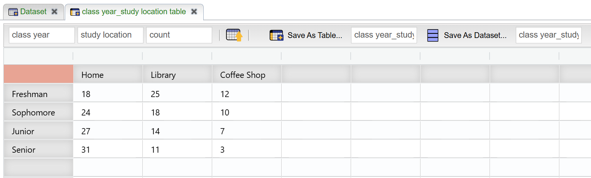
```

Click to expand the box below see how to find the test statistic and p-value for a GOF Test.

:::: {#GOF-P-Value_Approach-in-Rguroo .callout-note appearance="simple" collapse="true" icon="none" title="{width=22px style='vertical-align:middle;'} Finding the Test Statistic and P-value for GOF Test in Rguroo"}


1.  Open the **Analytics** toolbox in Rguroo.\
2.  Open the [Analysis]{.dpd} dropdown, and select [Contingency Table]{.fun}. This opens the [Analysis of Two-Way Contingency Table]{.fun} dialog box.
3.  In the [Analysis of Two-Way Contingency Table]{.fun} dialog box, select the dataset name that you saved, [class year_study location]{.data}.
4.  Select the row variable, [class year]{.var}, in the [Factor 1]{.dpd}. Select the column variable, [study location]{.var}, in the [Factor 2]{.dpd}. Last, select *counts* in the [Frequency]{.dpd} since that is what I labeled the frequencies as (select whatever you labeled that).
5.  Select the Chi-square test box.
6.  Leave the $\alpha=0.05$ in the *Significance Level* box, since we are using this value.
7.  Click the preview icon  to see the information for the test.
8. Remember to save your output in case you need to refer to it later.

::: {.callout-tip .inner-callout appearance="simple" collapse="true" icon="none" title="Click here to see the Rguroo dialog"}
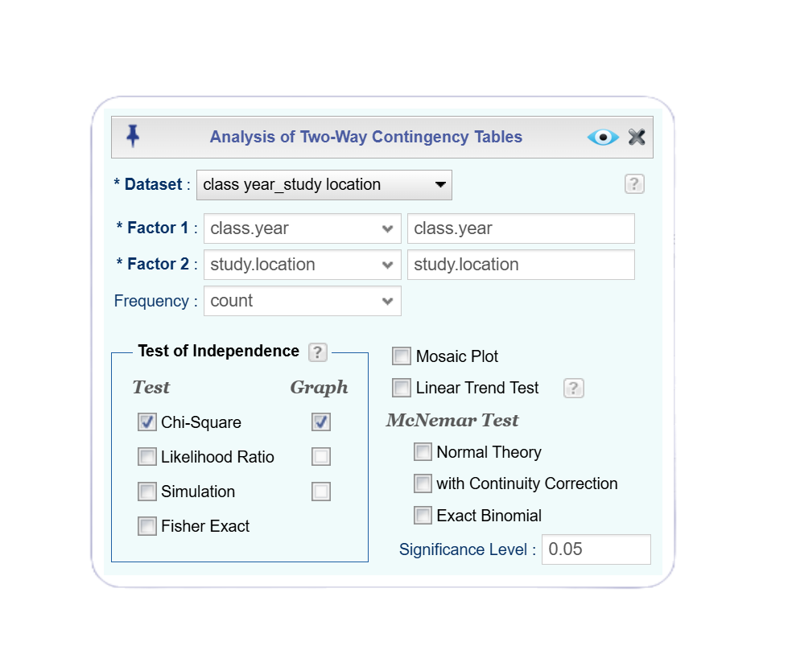{width="500px"}
:::
::::

Before we dive too far into the test, we need to remember to verify that all expected counts are greater than 5.  To see the expected counts in the Rguroo output, scroll all the way down to the bottom. You will see a table with the expected counts.

```{r, echo=FALSE}
#| label: fig-expected-counts-class-location
#| fig-cap: 'Expected Counts for Class Year and Study Location Example'
#| fig-alt: 'Expected Counts for Class Year and Study Location Example'
#| out-width: "70%"
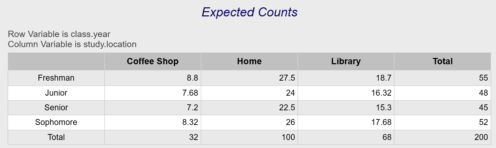
```


```{r, echo=FALSE}
#| label: fig-class-location-output-p-value
#| fig-cap: 'Rguroo output for Test of Independence for Class Year and Study Location Method Example'
#| fig-alt: 'Rguroo output for Test of Independence for Class Year and Study Location Method Example, showing graph, p-value = 0.02271 and test statistic of 14.7014'
#| out-width: "70%"
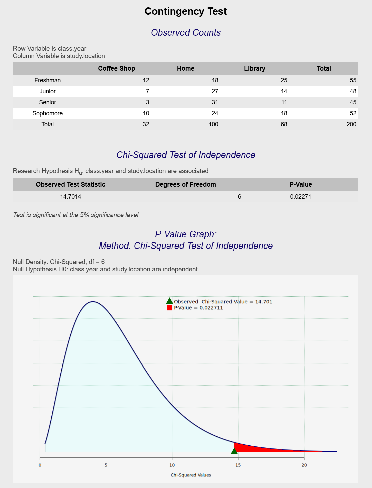
```

The P-value graph displays the chi-squared distribution under the null hypothesis. The observed test statistic, $\chi^2=14.7014$, is marked by the green triangle. The red shaded area to the right of the test statistic represents the p-value, $\text{p-value} =0.02271$.

**Decision**

Since the p-value is $< \alpha$, $0.02271$ is $<0.05$, we reject the null hypothesis.

**Conclusion**

There is sufficient evidence to support the claim that class year and preferred study location are associated.

:::

:::{#exm-sleep-study-test-independence-p-value}
## Stress and Depression - P-value Approach

A sleep study collected information from college students about their sleep habits, academic experiences, and overall well-being. Variables include sleep and wake times, average amount of sleep, class schedules, GPA, classes missed, and measures related to cognition, stress, anxiety, depression, and happiness. Do the data indicate that stress and depression status are associated at the $\alpha=0.01$ level of significance? If the level of significance was different, would that affect the outcome of the test? Explain. 

 The dataset is available in the Rguroo dataset repository, with the dataset name [SleepStudy]{.data}. @tbl-sleep shows the variables and the first 6 rows of the data set. A complete description of the variables is provided in the [dataset code book](#code-book-sleep) that follows. 

:::


```{r,echo=FALSE}
#| tbl-alt: "Table showing first 6 rows of SleepStudy"
#| label: tbl-sleep
#| tbl-cap: "Sleep Study"
SleepStudy <- read.csv("https://krkozak.github.io/MAT160/SleepStudy.csv")
knitr::kable(head(SleepStudy))
```

::: {#code-book-sleep .callout-tip .codebook collapse="true"}
## Code book for SleepStudy Dataset

**Description** The dataset gives survey results from a sleep study conducted.

Format

This dataset contains the following columns:

[Gender]{.var}: Gender category reported by the student (0 represents male, 1 represents female).

[ClassYear]{.var}: Student's year in college

[LarkOwl]{.var}: Student's preference for being more active or alert in the morning or evening

[NumEarlyClass]{.var}: Number of early classes the student has

[EarlyClass]{.var}: Indicates whether the student has an early class (0 represents no, 1 represents yes)

[GPA]{.var}: Student's grade point average

[ClassesMissed]{.var}: Number of classes the student has missed

[CognitionZscore]{.var}: Standardized score measuring cognitive performance

[PoorSleepQuality]{.var}: Measure of poor sleep quality

[DepressionScore]{.var}: Score measuring symptoms associated with depression

[AnxietyScore]{.var}: Score measuring symptoms associated with anxiety

[StressScore]{.var}: Score measuring stress-related symptoms

[DepressionStatus]{.var}: Categorical classification based on the student's depression score

[AnxietyStatus]{.var}: Categorical classification based on the student's anxiety score

[Stress]{.var}: Categorical classification of the student's stress level

[DASScore]{.var}: Combined score related to depression, anxiety, and stress

[Happiness]{.var}: Score measuring the student's reported level of happiness

[AlcoholUse]{.var}: Measure or category describing the student's alcohol use

[Drinks]{.var}: Number of alcoholic drinks reported

[WeekdayBed]{.var}: Typical bedtime on weekdays

[WeekdayRise]{.var}: Typical wake-up time on weekdays

[WeekdaySleep]{.var}: Amount of sleep obtained on weekdays

[WeekendBed]{.var}: Typical bedtime on weekends

[WeekendRise]{.var}: Typical wake-up time on weekends

[WeekendSleep]{.var}: Amount of sleep obtained on weekends

[AverageSleep]{.var}: Average amount of sleep obtained

[AllNighter]{.var}: Indicates whether the student has stayed awake all night (0 represents no, 1 represents yes)
:::

::: {#stress-depression-solution .callout-tip .solution-callout collapse="true" icon="false"}
## 🔎 Solution

As we did before in the last example, take a quick check that we have satisfied the four conditions for performing a chi-square test. Since the expected counts are tedious to calculate, we will perform the hypothesis test and check in the Rguroo output that all expected counts are greater than 5. Let’s proceed with the test.

**State null and alternative**

This question asks "do the data indicate that stress and depression status are associated?" Remember that the null states that the two variables are independent and the alternative states that they are associated. 

$H_o:$ Stress and depression status are independent.

$H_a:$ Stress and depression status are associated.

**Select $\alpha$**
$\alpha=0.01$

**P-value approach to find test statistic and p-value**

Since the dataset is already in Rguroo, import the [SleepStudy]{.data}. Then follow the steps in the [solution](#study-location-p-value-solution) to @exm-year-study-location-independence-p-value. We are testing whether stress and depression status are associated, so we will select [stress]{.var} for [Factor 1]{.fun} and [DepressionStatus]{.var} for [Factor 2]{.fun}. Enter [0.01]{.typein} for the significance level.  The dialog box is shown below.

```{r, echo=FALSE}
#| label: fig-dialog-sleep
#| fig-cap: 'Dialog box for Stress and Depression Status Example'
#| fig-alt: 'Dialog box for Stress and Depression Status Example'
#| out-width: "70%"
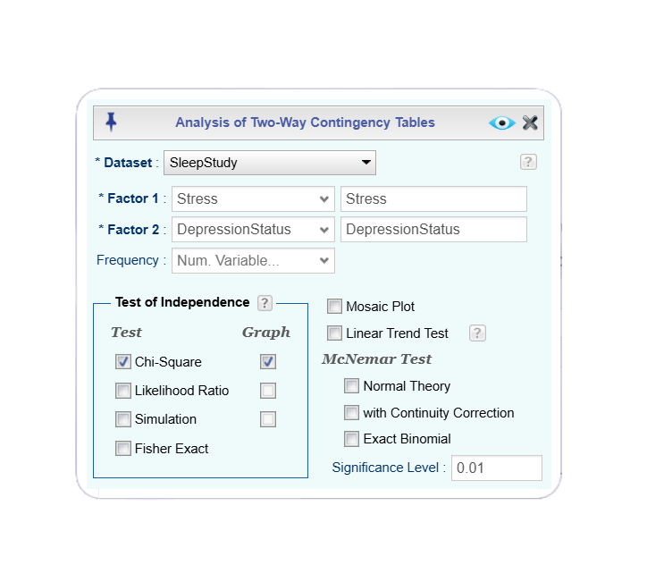
```

Before looking at the test statistic and p-value, let's check the Rguroo output and verify that the expected counts are all greater than 5.

```{r, echo=FALSE}
#| label: fig-expected-counts-sleep
#| fig-cap: 'Expected Counts for Stress and Depression Status Example'
#| fig-alt: 'Expected Counts for Stress and Depression Status Example'
#| out-width: "70%"
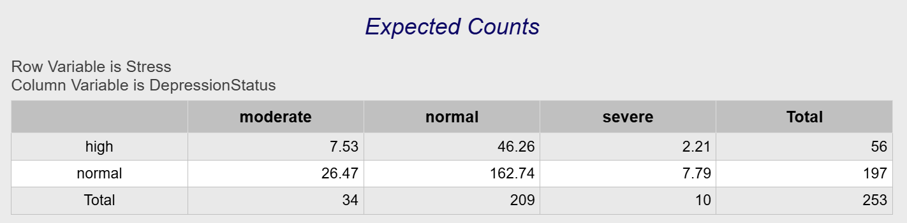
```

Although one expected count (2.21) is less than 5, only 1 of the 6 expected counts falls below 5 and none are below 1. Therefore, even though the expected count condition is not fully satissfied, we can say that the expected count condition is reasonably satisfied, and the chi-square test of independence may be used. Note that the chi-square approximation may be less accurate when expected counts are small and the results should be interpreted with caution.

```{r, echo=FALSE}
#| label: fig-sleep-output-p-value
#| fig-cap: 'Rguroo output for Test of Independence for Stress and Depression Status Example'
#| fig-alt: 'Rguroo output for Test of Independence for Stress and Depression Status Example, showing graph, p-value = 0.0000 and test statistic of 58.4482'
#| out-width: "70%"
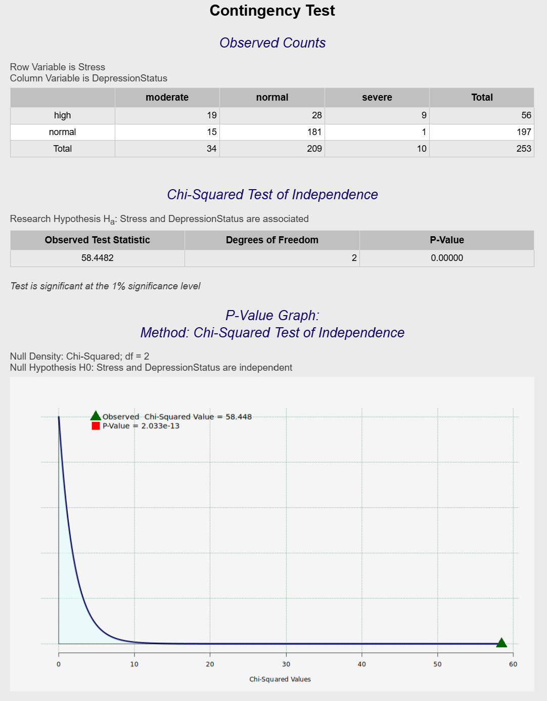
```


The P-value graph displays the chi-squared distribution under the null hypothesis. The observed test statistic, $\chi^2 =58.4482$, is marked by the green triangle. The red shaded area to the right of the test statistic represents the p-value, p-value =0.0000.

**Decision**

Since the p-value is $< \alpha$, $0.02271$ is $<0.01$, we reject the null hypothesis.

**Conclusion**

There is sufficient evidence to support the claim that stress and depression level are associated.

:::

::: {#exm-study-time-major-p-value}
## Test of Independence for Study Time and Academic Major - P-value Approach
 
A college administrator is interested in determining whether the amount of time students spend studying each week is associated with their academic major. A random sample of 240 students is selected and each student is classified according to their academic major and weekly study time.

The results are summarized in the following table.

| Academic Major | Less than 10 Hours | 10 to 19 Hours | 20 or More Hours | Total |
|----------------|------------------|------------|-----------------|------|
| STEM | 28 | 45 | 39 | 112 |
| Business | 31 | 27 | 14 | 72 |
| Humanities | 17 | 24 | 15 | 56 |
| Total | 76 | 96 | 68 | 240 |

Do the data provide sufficient evidence to conclude that academic major and weekly study time are associated? Use a significance level of $\alpha=0.05$.
:::

::: {.callout-tip .solution-callout collapse="true" icon="false"}
## 🔎 Solution

**State null and alternative**

$H_o:$ Major and weekly study time are independent.

$H_a:$ Major and weekly study time are associated.

**Select $\alpha$**

$\alpha=0.05$

**P-value approach to find test statistic and p-value**

This data is presented in a summary table, not raw data. Create a table in Rguroo, letting the row variable be the [major]{.var} and the column variable be the [weekly study time]{.var}. 

[Click here](#create-tables) to review how to create a two-way table (from Chapter 0).  An image of the saved table is shown below.

```{r, echo=FALSE}
#| label: fig-major-study-time-table
#| fig-cap: 'Major and Weekly Study Time dataset'
#| fig-alt: 'Major and Weekly Study Time dataset'
#| out-width: "70%"
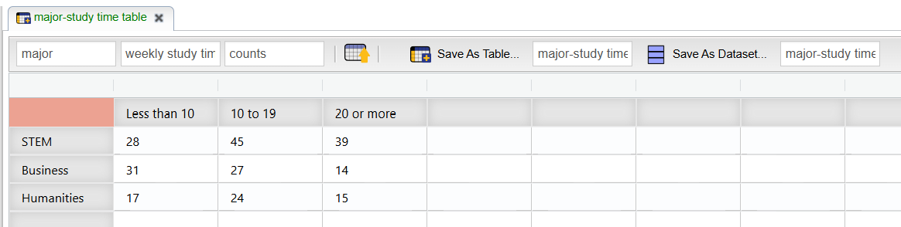
```

Then, follow the steps in the [solution](#study-location-p-value-solution) to @exm-year-study-location-independence-p-value. In this example, we are testing whether academic major and weekly study time are associated, so we will select [major]{.var} for [Factor 1]{.fun} and [weekly.study.time]{.var} for [Factor 2]{.fun}. Leave the level of significance as $\alpha=0.05$. The dialog box is shown below.

```{r, echo=FALSE}
#| label: fig-dialog-major-study
#| fig-cap: 'Dialog box for Major and Weekly Study Time Example'
#| fig-alt: 'Dialog box for Major and Weekly Study Time Example'
#| out-width: "70%"
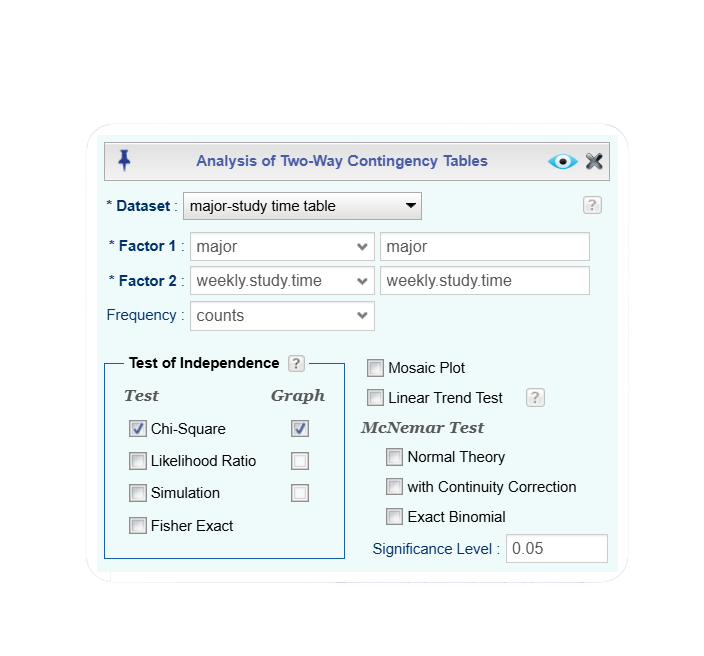
```

Before looking at the test statistic and p-value, let's check the Rguroo output and verify that the expected counts are all greater than 5.

```{r, echo=FALSE}
#| label: fig-expected-counts-major-study
#| fig-cap: 'Expected Counts for Major and Weekly Study Time Example'
#| fig-alt: 'Expected Counts for Major and Weekly Study Time Example'
#| out-width: "70%"
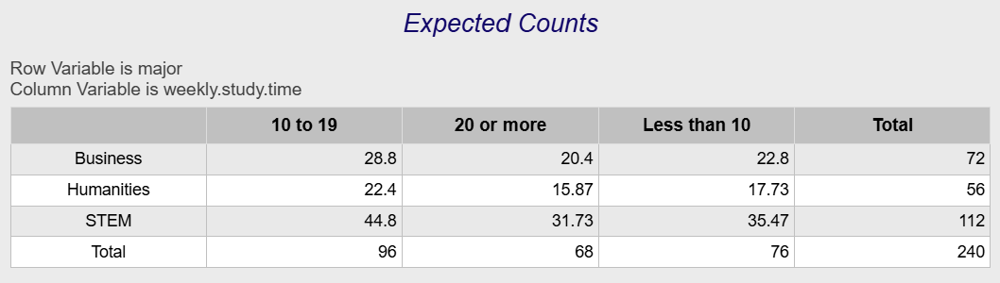
```

 In this example, all expected counts are greater than 5, so the expected counts condition is satisfied.

```{r, echo=FALSE}
#| label: fig-major-study-output-p-value
#| fig-cap: 'Rguroo output for Test of Independence for Major and Weekly Study Time Example'
#| fig-alt: 'Rguroo output for Test of Independence for Major and Weekly Study Time Example, showing graph, p-value = 0.07494 and test statistic of 8.49824'
#| out-width: "70%"
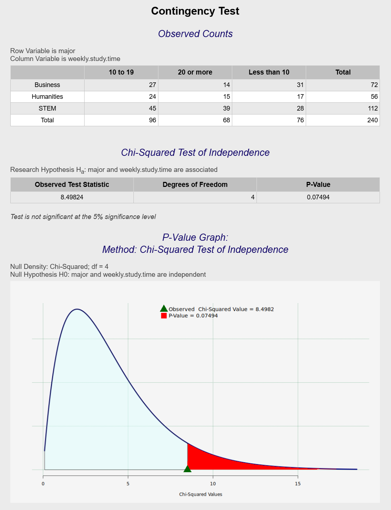
```


The P-value graph displays the chi-squared distribution under the null hypothesis. The observed test statistic, $\chi^2 =8.49824$, is marked by the green triangle. The red shaded area to the right of the test statistic represents the p-value, p-value =0.07494.


**Decision**

Since the p-value is not $< \alpha$, $0.07494$ is not $<0.05$, we do not reject the null hypothesis.

**Conclusion**

There is not sufficient evidence that major and weekly study time are associated.

To answer the last part of the question, we will need to examine the p-value to determine if a different significance level would change the outcome of the test.  The decision of a hypothesis test depends on the significance level, $\alpha$, chosen for the test. In this test, $\alpha = 0.05$, and the p-value is greater than $\alpha$ (0.07494>0.050.07494), so we fail to reject the null hypothesis. However, if a larger significance level were used, such as $\alpha = 0.10$, the p-value would be less than $\alpha$ (0.07494<0.100.07494), and we would reject the null hypothesis. This illustrates that the conclusion of a hypothesis test depends on the level of significance selected *before* conducting the test.

Remember, the choice of $\alpha$ is directly related to the probability of making a Type I error, which occurs when a true null hypothesis is incorrectly rejected. A larger significance level, such as $\alpha = 0.10$, means that less evidence is required before rejecting the null hypothesis. As a result, the null hypothesis is more likely to be rejected, but the risk of making a Type I error also increases. Conversely, a smaller significance level, such as $\alpha = 0.01$, requires stronger evidence against the null hypothesis before it can be rejected, reducing the risk of a Type I error. Since the p-value of 0.07494 falls between 0.05 and 0.10, the decision depends on the chosen significance level and the amount of Type I error risk the researcher is willing to accept.

:::

### Critical Region Approach

The critical region approach for a test of independence is also very similar to the approach used for a chi-square goodness-of-fit test. Rather than using the p-value, we compare the observed test statistic to a critical value obtained from the chi-square distribution.
 
If the test statistic falls within the critical region, we reject the null hypothesis. Otherwise, we fail to reject the null hypothesis.

::: {#exm-year-study-location-independence-critical-region}
## Modality Preference - Critical Region Approach

Let's revisit @exm-year-study-location-independence-p-value but use the critical region approach. A college wants to determine whether a student's class year is associated with the student's preferred study location. A random sample of 200 students is surveyed and each student is classified by class year (Freshman, Sophomore, Junior, or Senior) and preferred study location (Home, Library, or Coffee Shop).


| Class Year | Home | Library | Coffee Shop | Total |
|:-----------|-----:|--------:|------------:|------:|
| Freshman | 18 | 25 | 12 | 55 |
| Sophomore | 24 | 18 | 10 | 52 |
| Junior | 27 | 14 | 7 | 48 |
| Senior | 31 | 11 | 3 | 45 |
| Total | 100 | 68 | 32 | 200 | 

<br>

Determine whether class year and preferred study location are associated at the $\alpha=0.05$ level of significance. 
:::

::: {.callout-tip .solution-callout collapse="true" icon="false"}
## 🔎 Solution

Since we are testing the same claim, we will use some of our work in @exm-year-study-location-independence-p-value.  In that example, we already checked that the conditions for a chi-squared test were met, we stated the null and alternative hypotheses, and we stated $\alpha$.  Let's write down the previous steps for a hypothesis and then continue on.

**State null and alternative**

$H_o:$ Class year and preferred study location are independent.

$H_a:$ Class year and preferred study location are associated.

**Select $\alpha$**

$\alpha=0.05$

**Critical region approach to find test statistic and critical value**

To obtain critical regions in Rguroo, we use the same Rguroo steps as shown in the [solution](#study-location-p-value-solution) to @exm-year-study-location-independence-p-value. Scroll down on the Rguroo output and you will see the $\chi^2$ test statistic (same as before) and the critical value.

```{r, echo=FALSE}
#| label: fig-year-location-output-critical-region
#| fig-cap: 'Rguroo critical region output for Test of Independence for Class Year and Study Location Example'
#| fig-alt: 'Rguroo critical region output for Test of Independence for Class Year and Study Location Example, showing graph, critical value = 12.592 and test statistic of 14.701'
#| out-width: "70%"
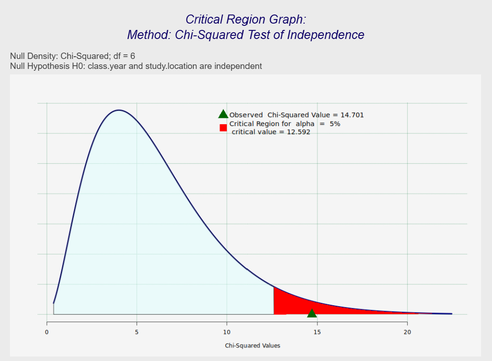
```

**Decision**

Because the observed test statistic, $\chi^2 =14.701$, does fall within the red critical region (values greater than $\chi^2 =12.592), the null hypothesis is rejected.

**Conclusion**

There is sufficient evidence to support the claim that class year and preferred study location are associated.

Again, notice that the test results, no matter the approach, will yield the same decision and conclusion.

:::

:::{#exm-sleep-study-test-independence-critical-region}
## Stress and Depression - Critical Region Approach

Let's revisit @exm-sleep-study-test-independence-p-value but use the critical region approach. A sleep study collected information from college students about their sleep habits, academic experiences, and overall well-being. Variables include sleep and wake times, average amount of sleep, class schedules, GPA, classes missed, and measures related to cognition, stress, anxiety, depression, and happiness. Do the data indicate that stress and depression level are associated at the $\alpha=0.01$ level of significance? 

A complete description of the variables is provided in the [dataset code book](#code-book-sleep). 

:::


::: {.callout-tip .solution-callout collapse="true" icon="false"}
## 🔎 Solution

**State null and alternative**

We can use the hypotheses from @exm-sleep-study-test-independence-p-value since it is testing the same claim.

$H_o:$ Stress and depression status are independent.

$H_a:$ Stress and depression status are associated.

**Select $\alpha$**

$\alpha = 0.01$

**Critical region approach to find test statistic and critical value**

To obtain critical regions in Rguroo, we use the same Rguroo steps as shown in the [solution](#stress-depression-solution) using the p-value approach. Scroll down on the Rguroo output and you will see the $\chi^2$ test statistic (same as before) and the critical value.

```{r, echo=FALSE}
#| label: fig-output-stress-depression-critical-region
#| fig-cap: 'Rguroo output for Test of Independence for Stress and Depression Status Example - Critical Region Approach'
#| fig-alt: 'Rguroo output for Test of Independence for Stress and Depression Status Example - Critical Region Approach, showing graph, critical value = 9.1203 and test statistic of 58.4482'
#| out-width: "70%"
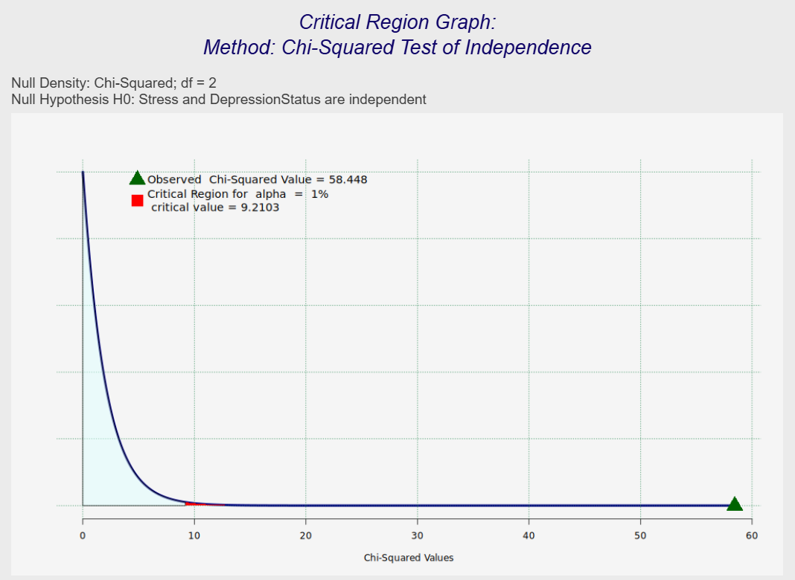
```

The critical region graph displays the chi-squared distribution. The red shaded region represents the critical region for a $\alpha=0.01$ significance level and begins at the critical value of $\chi^2=9.1203$. The green triangle marks the observed chi-squared test statistic of $\chi^2=58.4482$. 
**Decision**

Since the test statistic, $\chi^2=58.4482$ falls above the critical value $9.1203$ (in the rejection region), we reject the null hypothesis.

**Conclusion**

There is sufficient evidence to support the claim that stress and depression status are associated.

:::

::: {#exm-exercise-program-gender-critical-region}
## Test of Independence for Exercise Program and Class Standing - Critical Region Approach

A fitness center at a college would like to determine whether participation in an exercise program is associated with a student's class standing. A random sample of 250 students is selected and each student is classified according to class standing and whether they regularly participate in the college's exercise program.
 
The results are summarized in the table below.

| Class Standing | Participates | Does Not Participate | Total |
|:---------------|-------------:|---------------------:|------:|
| Freshman | 38 | 42 | 80 |
| Sophomore | 45 | 25 | 70 |
| Junior | 31 | 29 | 60 |
| Senior | 19 | 21 | 40 |
| Total | 133 | 117 | 250 |

Do the data provide sufficient evidence to conclude that participation in the exercise program is associated with class standing? Use a significance level of $\alpha = 0.05$.
:::

::: {.callout-tip .solution-callout collapse="true" icon="false"}
## 🔎 Solution

Since this is testing a new scenario, before we begin the test, take a quick check that we have satisfied the four conditions for performing a chi-square test. As before, since the expected counts are tedious to calculate, we will perform the hypothesis test and take a quick check in the Rguroo output that all expected counts are greater than 5. Let's proceed with the test. 

**State null and alternative**

$H_o:$ Participation in the exercise prigram and class standing are independent.

$H_a:$ Participation in the exercise prigram and class standing are associated.

**Select $\alpha$**

$\alpha=0.05$

**Critical region approach to find test statistic and critical value**

To test the hypothesis using the critical region approach, we will use Rguroo to find the test statistic and critical value. Because this dataset is a summary and not raw data, first create a contingency table and save your dataset to Rguroo. Let's save the dataset as [exercise_class_standing]{.data}.

[Click here](#create-tables) to review how to create a two-way table (from Chapter 0).  An image of the saved table is shown below.

```{r, echo=FALSE}
#| label: fig-exercise-standing-table
#| fig-cap: 'Exercise_class_standing dataset'
#| fig-alt: 'Exercise_class_standing dataset'
#| out-width: "70%"
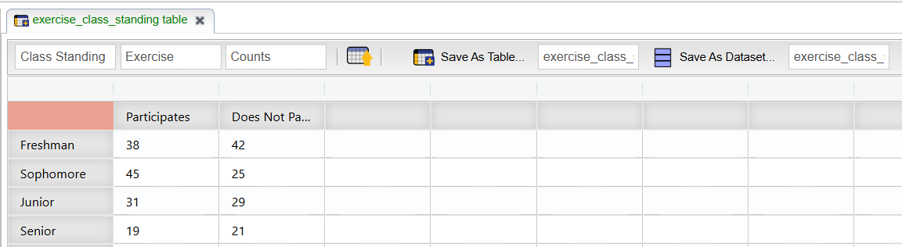
```

To obtain the expected counts, test statistic, and critical region in Rguroo, we use the same Rguroo steps as shown in the [solution](#study-location-p-value-solution) using the p-value approach. Scroll down on the Rguroo output and you will see the $\chi^2$ test statistic, the critical value, and expected counts. The dialog box for the [Analysis of Two Way Contingency Tables]{.fun} test is shown below

```{r, echo=FALSE}
#| label: fig-independence-exercise-class-dialog
#| fig-cap: 'Dialog for Participation in Exercise Program and Class Standing Example'
#| fig-alt: 'Dialog for Participation in Exercise Program and Class Standing Example'
#| out-width: "70%"
knitr::include_graphics(
  "Rguroo_dialogs/Chi_Squared/dialog-independence-exercise-class.png"
)
```

Before we complete the test, let's look at the expected counts.

```{r, echo=FALSE}
#| label: fig-expected-counts-exercise-class
#| fig-cap: 'Expected Counts for Participation in Exercise Program and Class Standing'
#| fig-alt: 'Expected Counts for Participation in Exercise Program and Class Standing'
#| out-width: "70%"
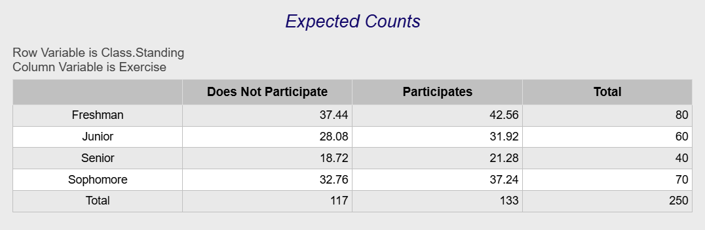
```

Looking at the expected counts generated by Rguroo, we can verify that all expected counts are greater than 5.  We can now proceed with fiding the critical value and test statistic.

Scroll down to the last image on the Rguroo output and you will see the $\chi^2$ test statistic and the critical value.

```{r, echo=FALSE}
#| label: fig-exercise-class-critical-region
#| fig-cap: 'Rguroo output for Test of Independence for Participation in Exercise Program and Class Standing - Critical Region Approach'
#| fig-alt: 'Rguroo output for Test of Independence for Participation in Exercise Program and Class Standing - Critical Region Approach, showing graph, critical value = 7.8147 and test statistic of 5.0778'
#| out-width: "70%"
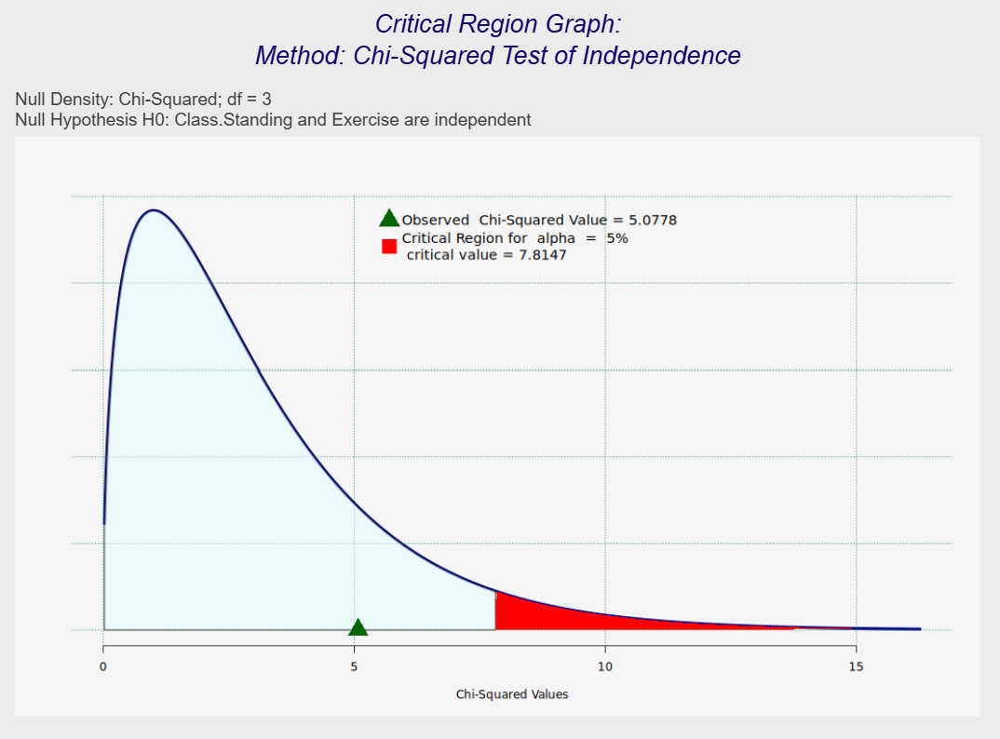
```

The critical region graph displays the chi-squared distribution. The red shaded region represents the critical region for a $\alpha=0.05$ significance level and begins at the critical value of $\chi^2=7.8147$. The green triangle marks the observed chi-squared test statistic of $\chi^2=5.0778$. 

**Decision**

Since the test statistic, $\chi^2=5.0778$ does not fall above the critical value $7.8147$ (in the rejection region), we do not reject the null hypothesis.

**Conclusion**

There is not sufficient evidence to conclude that participation in the exercise program is associated with class stading.

:::

### Homework for Section 12.2

**In each problem show all steps of the hypothesis test. If some of the conditions are not met, note that the results of the test may not be correct and then continue the process of the hypothesis test.**

1.  The number of people who survived the Titanic based on class and sex is in @tbl-Titanic_table ("Encyclopedia Titanica," 2013). Is there enough evidence to show that the class and the sex of a person who survived the Titanic are independent? Test at the 5% level.

```{r problem-11-1-table, echo=FALSE}
#| tbl-alt: "Head of Surviving the Titanic"
#| label: tbl-Titanic_table
#| tbl-cap: "Surviving the Titanic"
Titanic <- read.csv("https://krkozak.github.io/MAT160/Titanic.csv")
Titanic_table <- tally(~ class + sex, data = Titanic)
knitr::kable(Titanic_table)
```

2.  Researchers watched groups of dolphins off the coast of Ireland in 1998 to determine what activities the dolphins partake in at certain times of the day ("Activities of dolphin," 2013). The numbers in @tbl-Dolphin_table represent the number of groups of dolphins that were partaking in an activity at certain times of days. Is there enough evidence to show that the activity and the time period are independent for dolphins? Test at the 1% level.

```{r, echo=FALSE}
#| tbl-alt: "Head of Dolphin Activity"
#| label: tbl-Dolphin_table
#| tbl-cap: "Dolphin Activity"
Dolphin <- read.csv("https://krkozak.github.io/MAT160/dolphins.csv")
Dolphin_table <- tally(~ activity + period, data = Dolphin)
knitr::kable(Dolphin_table)
```

3.  Is there a relationship between autism and what an infant is fed? To determine if there is, a researcher asked mothers of autistic and non-autistic children to say what they fed their infant. The data is in @tbl-Feeding_table (Schultz, Klonoff-Cohen, Wingard, Askhoomoff, Macera, Ji & Bacher, 2006). Do the data provide enough evidence to show that that what an infant is fed and autism are independent? Breast-feeding (BF), Formula with DHA/ARA (For with), and Formula without DHA/ARA (Form without)Test at the 1% level.

```{r, echo=FALSE}
#| tbl-alt: "Autism Versus Breastfeeding"
#| label: tbl-Feeding_table
#| tbl-cap: "Autism Versus Breastfeeding"
Feeding <- read.csv("https://krkozak.github.io/MAT160/Mothers.csv")
Feeding_table <- tally(~ autism + feeding, data = Feeding)
knitr::kable(Feeding_table)
```

4.  Students at multiple grade schools were asked what their personal goal (get good grades, be popular, be good at sports) was and how important good grades were to them (1 very important and 4 least important). The data is in @tbl-Goal_Grades_table ("Popular kids datafile," 2013). Do the data provide enough evidence to show that goal attainment and importance of grades are independent? Test at the 5% level.

```{r Goal_grades, echo=FALSE}
#| tbl-alt: "Personal Goal and Importance of Grades"
#| label: tbl-Goal_Grades_table
#| tbl-cap: "Personal Goal and Importance of Grades"
Goal <- read.csv("https://krkozak.github.io/MAT160/Popular_Kids_clean.csv")
Goal_Grades_table <- tally(~ Goals + Grades, data = Goal)
knitr::kable(Goal_Grades_table)
```

5.  Students at multiple grade schools were asked what their personal goal (get good grades, be popular, be good at sports) was and how important being good at sports were to them (1 very important and 4 least important). The data is in @tbl-Goal_Sports_table ("Popular kids datafile," 2013). Do the data provide enough evidence to show that goal attainment and importance of sports are independent? Test at the 5% level.

```{r Goal_sports, echo=FALSE}
#| tbl-alt: "Personal Goal and Importance of Sports"
#| label: tbl-Goal_Sports_table
#| tbl-cap: "Personal Goal and Importance of Sports"
Goal <- read.csv("https://krkozak.github.io/MAT160/Popular_Kids_clean.csv")
Goal_Sports_table <- tally(~ Goals + Sports, data = Goal)
knitr::kable(Goal_Sports_table)
```

6.  Students at multiple grade schools were asked what their personal goal (get good grades, be popular, be good at sports) was and how important having good looks were to them (1 very important and 4 least important). The data is in @tbl-Goal_Looks_table ("Popular kids datafile," 2013). Do the data provide enough evidence to show that goal attainment and importance of looks are independent? Test at the 5% level.

```{r Goal_looks, echo=FALSE}
#| tbl-alt: "Personal Goal and Importance of Looks"
#| label: tbl-Goal_Looks_table
#| tbl-cap: "Personal Goal and Importance of Looks"
Goal <- read.csv("https://krkozak.github.io/MAT160/Popular_Kids_clean.csv")
Goal_Looks_table <- tally(~ Goals + Looks, data = Goal)
knitr::kable(Goal_Looks_table)
```

7.  Students at multiple grade schools were asked what their personal goal (get good grades, be popular, be good at sports) was and how important having money were to them (1 very important and 4 least important). The data is in @tbl-Goal_Money_table ("Popular kids datafile," 2013). Do the data provide enough evidence to show that goal attainment and importance of money are independent? Test at the 5% level.

```{r Goal_money, echo=FALSE}
#| tbl-alt: "Personal Goal and Importance of Money"
#| label: tbl-Goal_Money_table
#| tbl-cap: "Personal Goal and Importance of Money"
Goal <- read.csv("https://krkozak.github.io/MAT160/Popular_Kids_clean.csv")
Goal_Money_table <- tally(~ Goals + Money, data = Goal)
knitr::kable(Goal_Money_table)
```


## Chi-Square Test for Homogeneity

Sometimes researchers want to compare the distribution of a categorical variable across two or more populations or groups. A chi-square test for homogeneity is used to determine whether the distribution of a categorical variable is the same for all populations being compared. For example, a college may want to determine whether preferred learning format (in-person, online, or hybrid) differs among students from different class years. Similarly, a company may wish to compare customer satisfaction ratings across several store locations.

Although the data are typically summarized in a two-way table, the goal differs from a test for independence. In a test for independence, we examine whether two categorical variables are associated within a single population. In a test for homogeneity, we compare the distribution of one categorical variable across multiple populations or groups.

As with the chi-square goodness-of-fit test and the chi-square test for independence, the chi-square test for homogeneity compares observed counts to expected counts. Large differences between the observed and expected counts provide evidence that the distributions are not the same across the populations.

::: {.callout-note appearance="simple"}
## Conditions for Test of Homogeneity

The conditions for a chi-square test for homogeneity are nearly identical to those for a chi-square test for independence. The primary difference is the first condition. In a test for homogeneity, the data come from two or more populations or groups being compared, whereas in a test for independence, the data come from a single population and involve two categorical variables measured on each individual. The conditions are listed below.

1.  Categorical data: The response variable is categorical, and the data consist of counts for each category within two or more populations or groups.
2.  Randomness: The data should come from a random sample or a randomized process.
3.  Independence: The observations should be independent. When sampling without replacement from a finite population, the sample should generally be no more than 10% of the population.
4.  Expected counts: The expected counts must be sufficiently large for the chi-square distribution to provide a reasonable approximation. A commonly used guideline is that each expected count should be at least 5.

:::

### Null and Alternative Hypotheses

Before conducting a chi-square test for homogeneity, we must state the null and alternative hypotheses. These hypotheses address whether the distribution of the categorical variable is the same across the populations or groups being compared.

The null hypothesis states that the population distributions are identical across all groups. In other words, the proportions in each category are the same for every population. The alternative hypothesis states that the distributions are not all the same, meaning that at least one population has different category proportions.

Because the hypotheses compare distributions across populations, they are typically stated in words rather than mathematical notation.

$$ \begin{aligned}
H_0 &: \text{The distribution of the categorical variable is the same for all populations (or groups).} \\
H_a &: \text{The distribution of the categorical variable is not the same for all populations (or groups).}
\end{aligned} $$

::: callout-note
## Hypotheses for Test of Homogeneity

The hypotheses should be written in the context of the problem. Be specific about the populations and the categorical variable being compared.

:::

::: {#exm-customer-satisfaction}
## Customer Satisfaction

A company operates three retail store locations and wants to compare customer satisfaction among the stores. A random sample of customers is selected from each location and asked to rate their overall experience as satisfied, neutral, or dissatisfied. The results are summarized in the table below.

| Satisfaction Rating | Store A | Store B | Store C | Total |
|---------------------|--------:|--------:|--------:|------:|
| Satisfied | 75 | 65 | 55 | 195 |
| Neutral | 30 | 35 | 40 | 105 |
| Dissatisfied | 15 | 20 | 30 | 65 |
| Total | 120 | 120 | 125 | 365 |

State the null and alternative hypotheses if the store wanted to determine whether the distribution of customer satisfaction ratings is the same across the three store locations.

:::

::: {.callout-tip .solution-callout collapse="true" icon="false"}
## 🔎 Solution

Just as we have done in past examples, we can take the wording of the problem to help us write the null and alternative hypotheses. In this question, it asks *"determine whether the distribution of customer satisfaction ratings is the same across the three store locations."* Notice the wording of **same** in the question. This is a hint that we will be conducting a test for homogeneity. Remember that the null is that the variable is the same for all populations and the alternative states the variable is not the same for all populations. Using the specific variable and populations for this question, we have:

$H_o:$ The distribution of customer satisfaction ratings is the same across all three stores (Store A, Store B, and Store C)

$H_a:$ The distribution of customer satisfaction ratings is not the same across all three store locations (that is, at least one store has a different distribution of satisfaction ratings).

We can also write the null using probability notation as we did with the goodess-of-fit test.  The hypothesis would be:

$H_o: P_\text{Store A}=P_\text{Store B}=P_\text{Store C}$

where,

- $P_\text{Store A}$ = distribution of customer satisfaction ratings for Store A
- $P_\text{Store B}$ = distribution of customer satisfaction ratings for Store B
- $P_\text{Store C}$ = distribution of customer satisfaction ratings for Store C

$H_a:$ At least one distribution of customer satisfaction is different.

Notice that in either case, writing the hypotheses in words or using probability notation, we do not specify which distribution is different. Therefore, when we conduct the hypothesis test, if the null hypothesis is rejected, we can conclude that at least one store's distribution of customer satisfaction ratings differs from the others. However, the test does not identify which store or stores are different. Additional analyses would be needed to determine where the differences occur.

:::

::: {#exm-exercise-age}
## Exercise by Age Group

Researchers are interested in whether exercise habits differ among age groups. Random samples of young adults, middle-aged adults, and older adults are surveyed and classified according to how often they exercise: never, occasionally, or regularly. The results are summarized in the table below.

| Exercise Frequency | Young Adults | Middle-Aged Adults | Older Adults | Total |
|-------------------|-------------:|-------------------:|-------------:|------:|
| Never | 18 | 25 | 40 | 83 |
| Occasionally | 40 | 45 | 38 | 123 |
| Regularly | 62 | 50 | 42 | 154 |
| Total | 120 | 120 | 120 | 360 |

State the null and alternative hypotheses if the researchers wanted to determine whether the distribution of exercise frequency is the same across the three age groups.

:::

::: {.callout-tip .solution-callout collapse="true" icon="false"}
## 🔎 Solution

In this question, the researcher wants to *determine whether the distribution of exercise frequency is the same across the three age groups."* We can see that key word **same** indicating that this would be a test for homogeneity.

The hypotheses in words are:

$H_o:$ The distribution of exercise frequency is the same across all three age groups (Young adults, middle-aged adults, older adults)

$H_a:$ The distribution of exercise frequency is not the same across all three age groups (at least one age group has a different distribution of exercise frequency).


The hypotheses using probability notation are: 

$H_o: P_\text{Y}=P_\text{M}=P_\text{O}$

where,

- $P_\text{Y}$​ = distribution of exercise frequency for young adults
- $P_\text{M}$​ = distribution of exercise frequency for middle-aged adults
- $P_\text{O}$= distribution of exercise frequency for older adults

$H_a:$ At least one distribution of exercise frequency is different

:::

### Expected Counts

The calculation of expected counts for a chi-square test for homogeneity is identical to that of a chi-square test for independence. For each cell in the table, the expected count is calculated by multiplying the row total by the column total and dividing by the grand total:

$$E=\frac{(\text{Row Total})(\text{Column Total})}{\text{Grand Total}}$$

As before, expected counts represent the counts we would expect to observe if the null hypothesis were true. In a test for homogeneity, this means we assume that the distribution of the categorical variable is the same across all populations or groups.

### Test Statistic

As with other chi-square tests, the test of homogeneity compares observed counts to expected counts using the same chi-square test statistic:

$$\chi^2=\sum \frac{(O-E)^2}{E}$$

The expected counts are also still calculated using the row totals and column totals of the contingency table, and the degrees of freedom are

$$df=(r−1)(c−1)$$
where $r$ is the number of rows and $c$ is the number of columns.

Although the context differs, the calculations and hypotheses for a test of homogeneity are very similar to those used in a test of independence. The primary difference is that a test of homogeneity uses data collected from multiple populations, whereas a test of independence uses data collected from a single population on two categorical variables.

### P-value Approach

The p-value approach for a chi-square test for homogeneity is identical to the approach used in previous hypothesis tests. After computing the chi-square test statistic and degrees of freedom, obtain the p-value and compare it to the significance level, $\alpha$. 

- If the p-value $\leq \alpha$, reject $H_0$.
- If the p-value $> \alpha$, fail to reject $H_0$.

Rejecting the null hypothesis provides evidence that the distribution of the categorical variable differs among the populations or groups being compared. Failing to reject the null hypothesis indicates that there is insufficient evidence to conclude that the distributions differ.

The p-value approach for the chi-square test of homogeneity follows the same hypothesis testing process as the chi-square test of independence. As before, the p-value and test statistic will be found using Rguroo. 

To prepare for the following examples, review the following:

- [General Hypothesis Test Steps](#general-hypothesis-steps)
- [Calculate the p-value and test statistic in Rguroo](#GOF-P-Value_Approach-in-Rguroo)
- [Create a Two-Way Table in Rguroo](#create-tables)

::: {#exm-customer-satisfaction-p-value}
## Customer Satisfaction - P-value Approach

A company operates three retail store locations and wants to compare customer satisfaction among the stores. A random sample of customers is selected from each location and asked to rate their overall experience as satisfied, neutral, or dissatisfied. The results are summarized in the table below.

| Satisfaction Rating | Store A | Store B | Store C | Total |
|:---------------------|--------:|--------:|--------:|------:|
| Satisfied | 75 | 65 | 55 | 195 |
| Neutral | 30 | 35 | 40 | 105 |
| Dissatisfied | 15 | 20 | 30 | 65 |
| Total | 120 | 120 | 125 | 365 |


Help the store determine whether the distribution of customer satisfaction ratings is the same across the three store locations at the $\alpha=0.05$ level of significance. 

:::

::: {.callout-tip .solution-callout collapse="true" icon="false"}
## 🔎 Solution

As we did before with previous $\chi^2$ tests, take a quick check that we have satisfied the four conditions. We will perform the hypothesis test and check in the Rguroo output that all expected counts are greater than 5. Let’s proceed with the test.

**State null and alternative**

$H_o: P_\text{Store A}=P_\text{Store B}=P_\text{Store C}$

where,

- $P_\text{Store A}$ = distribution of customer satisfaction ratings for Store A
- $P_\text{Store B}$ = distribution of customer satisfaction ratings for Store B
- $P_\text{Store C}$ = distribution of customer satisfaction ratings for Store C

$H_a:$ At least one distribution of customer satisfaction is different.

**Select $\alpha$**

$\alpha=0.05$

**P-value approach to find test statistic and p-value**

To conduct the test and check the expected counts, create a two-way table in Rguroo. @fig-satistfaction shows an image of the table in Rguroo.

```{r, echo=FALSE}
#| label: fig-satisfaction
#| fig-cap: 'Rguroo Table for Customer Satisfaction by Store'
#| fig-alt: 'Rguroo Table for Customer Satisfaction by Store'
#| out-width: "70%"
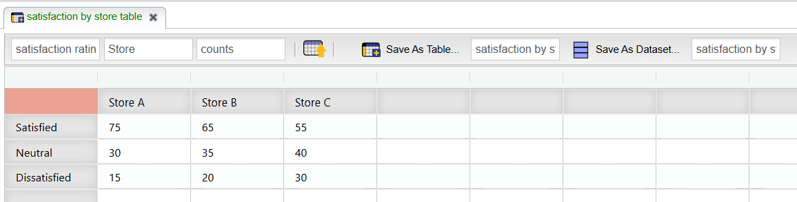
```


Then, select [satisfaction rating]{.var} for [Factor 1]{.fun} and [Store]{.var} for [Factor 2]{.fun}. Leave 0.05 for the significance level.  The dialog box is shown below.

```{r, echo=FALSE}
#| label: fig-dialog-satisfaction
#| fig-cap: 'Dialog box for Customer Satisfaction by Store Example'
#| fig-alt: 'Dialog box for Customer Satisfaction by Store Example'
#| out-width: "70%"
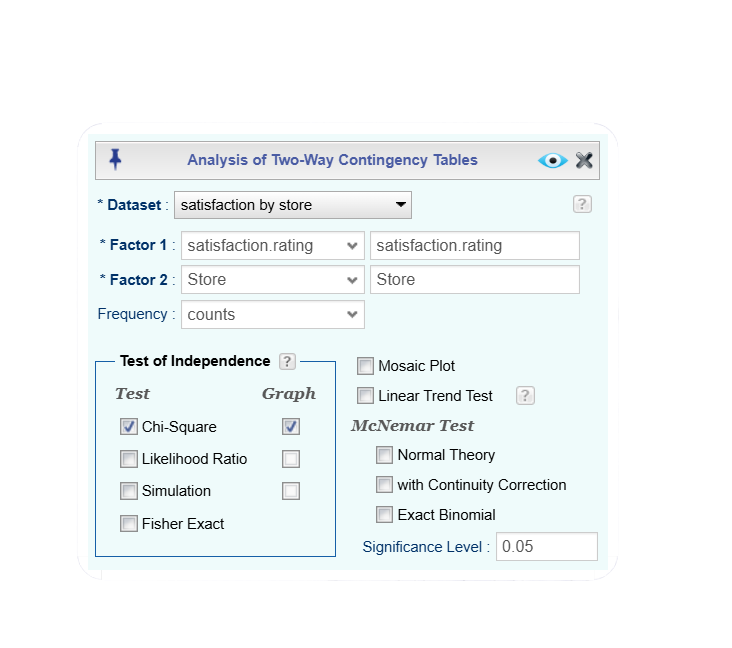
```


Before looking at the test statistic and p-value, let's check the Rguroo output and verify that the expected counts are all greater than 5.

```{r, echo=FALSE}
#| label: fig-expected-counts-satisfaction
#| fig-cap: 'Expected Counts for Customer Satisfaction by Store Example'
#| fig-alt: 'Expected Counts for Customer Satisfaction by Store Example'
#| out-width: "70%"
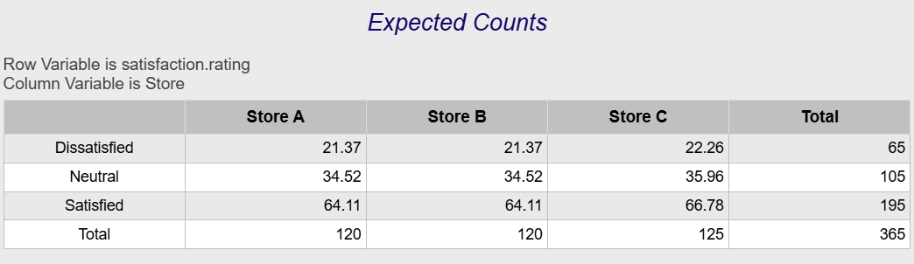
```

After inspecting the expected counts, we can verify that all expected counts are greater than 5 and the conditions are met. Let's proceed with looking at the output for the p-value and test statistic.

```{r, echo=FALSE}
#| label: fig-satisfaction-output-p-value
#| fig-cap: 'Rguroo output for Test of Homogeneity for Customer Satisfaction by Store Example'
#| fig-alt: 'Rguroo output for Test of Homogeneity for Customer Satisfaction by Store Example, showing graph, p-value = 0.04635 and test statistic of 9.67094'
#| out-width: "70%"
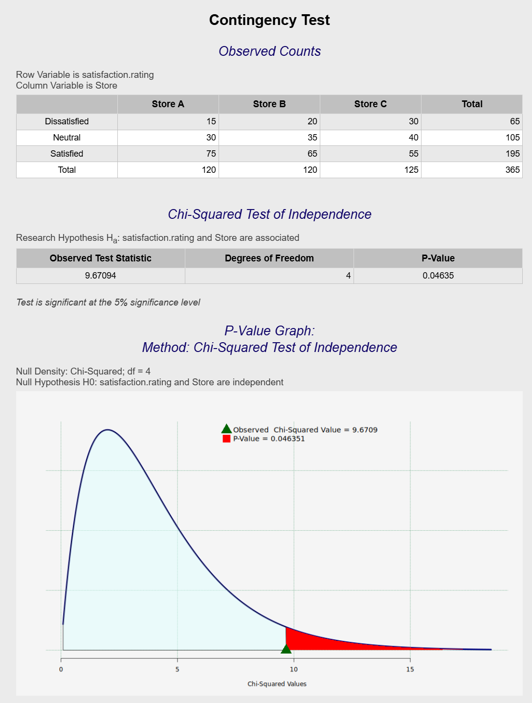
```

The P-value graph displays the chi-squared distribution under the null hypothesis. The observed test statistic, $\chi^2 =9.67094$, is marked by the green triangle. The red shaded area to the right of the test statistic represents the p-value, p-value =0.04635.

**Decision**

Since the p-value is $< \alpha$, $0.04635$ is $<0.05$, we reject the null hypothesis.

**Conclusion**

There is sufficient evidence to support the claim that at least one distribution of customer satisfaction is different. This means that there is evidence that the stores do not have the same satisfaction ratings among all three stores.

:::

:::{#exm-sleep-study-homogeneity-p-value}
## Alcohol Use by Gender - P-value Approach

Let's revisit @exm-sleep-study-test-independence-p-value. A sleep study collected information from college students about their sleep habits, academic experiences, and overall well-being. Variables include sleep and wake times, average amount of sleep, class schedules, GPA, classes missed, and measures related to cognition, stress, anxiety, alcohol use, depression, and happiness. Do the data indicate that alcohol use is the same for males and females at the $\alpha=0.02$ level of significance? 

A complete description of the variables is provided in the [dataset code book](#code-book-sleep). 

:::

::: {.callout-tip .solution-callout collapse="true" icon="false"}
## 🔎 Solution

As we did before with previous $\chi^2$ tests, take a quick check that we have satisfied the four conditions. We will perform the hypothesis test and check in the Rguroo output that all expected counts are greater than 5. Let’s proceed with the test.

**State null and alternative**

$H_o: P_\text{Males}=P_\text{Females}$

where,

- $P_\text{Males}$ = distribution of alcohol use for males
- $P_\text{Females}$ = distribution of alcohol use for females

$H_a:$ At least one distribution of alcohol use is different.

**Select $\alpha$**

$\alpha=0.02$

**P-value approach to find test statistic and p-value**

To conduct the test and check the expected counts, use Rguroo's [Contingency Table]{.fun} function. Since this dataset is in the dataset repository, we do not need to create a table.

Select [Gender]{.var} for [Factor 1]{.fun} and [AlcoholUse]{.var} for [Factor 2]{.fun}. Enter [0.02]{.typein} for the significance level.  The dialog box is shown below.

```{r, echo=FALSE}
#| label: fig-dialog-alcohol-gender
#| fig-cap: 'Dialog box for Gender and Alcohol Use Example'
#| fig-alt: 'Dialog box for Gender and Alcohol Use Example'
#| out-width: "70%"
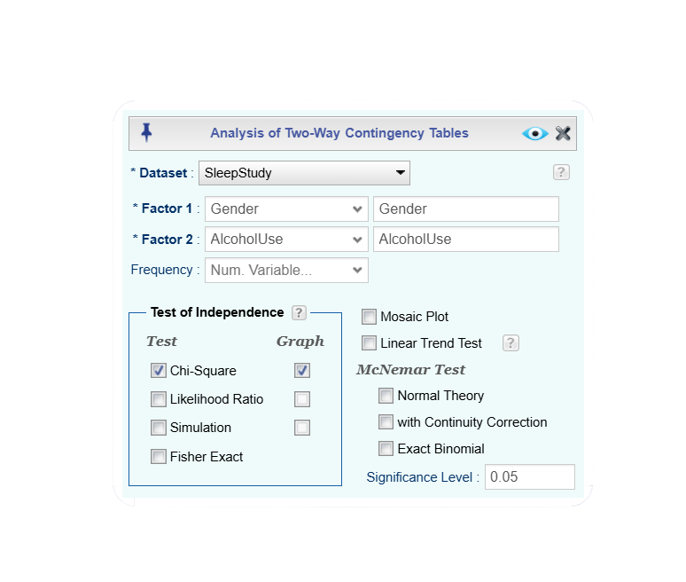
```


Before looking at the test statistic and p-value, let's check the Rguroo output and verify that the expected counts are all greater than 5.

```{r, echo=FALSE}
#| label: fig-expected-counts-gender-alcohol
#| fig-cap: 'Expected Counts for Gender and Alcohol Use Example'
#| fig-alt: 'Expected Counts for Gender and Alcohol Use Example'
#| out-width: "70%"
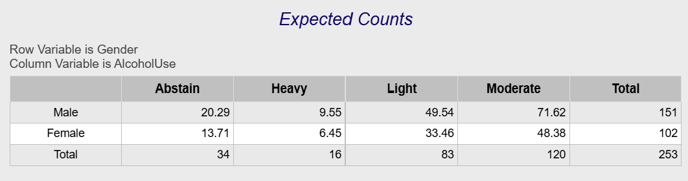
```

After inspecting the expected counts, we can verify that all expected counts are greater than 5 and the conditions are met. Let's proceed with looking at the output for the p-value and test statistic.

```{r, echo=FALSE}
#| label: fig-gender-alcohol-output-p-value
#| fig-cap: 'Rguroo output for Test of Homogeneity for Gender and Alcohol Use Example'
#| fig-alt: 'Rguroo output for Test of Homogeneity for Gender and Alcohol Use Example, showing graph, p-value = 0.00752 and test statistic of 11.9614'
#| out-width: "70%"
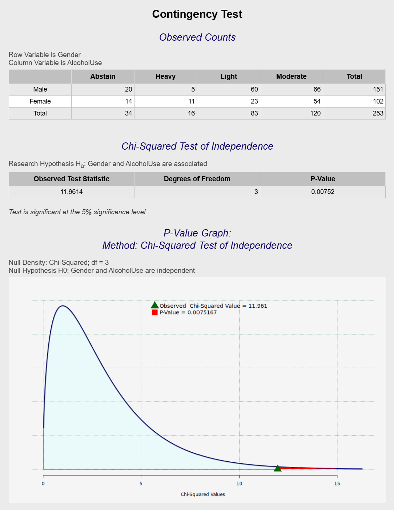
```

The P-value graph displays the chi-squared distribution under the null hypothesis. The observed test statistic, $\chi^2 =11.9614$, is marked by the green triangle. The red shaded area to the right of the test statistic represents the p-value, p-value =0.00752.

**Decision**

Since the p-value is $< \alpha$, $0.00752$ is $<0.02$, we reject the null hypothesis.

**Conclusion**

There is sufficient evidence to support the claim that at least one distribution of alcohol use is different. This means that there is evidence that genders do not have the same alcohol use.


:::

### Critical Region Approach

The critical region approach for a chi-square test for homogeneity is identical to the approach used for the chi-square goodness-of-fit test and the chi-square test for independence. Determine the critical value using the significance level, $\alpha$, and the appropriate degrees of freedom, then compare the test statistic to the critical value.
 
- If the test statistic is greater than or equal to the critical value, reject $H_0$.
- If the test statistic is less than the critical value, fail to reject $H_0$.

Just as with the p-value approach, rejecting the null hypothesis provides evidence that the distribution of the categorical variable differs among the populations or groups being compared and failing to reject the null hypothesis indicates that there is insufficient evidence to conclude that the distributions differ.

:::{#exm-customer-satisfaction-critical-region}
## Customer Satisfaction - Critical Region Approach

Let's revisit @exm-customer-satisfaction-p-value, but use the critical region approach. A company operates three retail store locations and wants to compare customer satisfaction among the stores. A random sample of customers is selected from each location and asked to rate their overall experience as satisfied, neutral, or dissatisfied. The results are summarized in the table below.

| Satisfaction Rating | Store A | Store B | Store C | Total |
|---------------------|--------:|--------:|--------:|------:|
| Satisfied | 75 | 65 | 55 | 195 |
| Neutral | 30 | 35 | 40 | 105 |
| Dissatisfied | 15 | 20 | 30 | 65 |
| Total | 120 | 120 | 125 | 365 |


Help the store determine whether the distribution of customer satisfaction ratings is the same across the three store locations at the $\alpha=0.05$ level of significance. 

:::

::: {.callout-tip .solution-callout collapse="true" icon="false"}
## 🔎 Solution

Since we are testing the same claim as @exm-customer-satisfaction-p-value, we will use our work from that example and use the critical region output from Rguroo.  In that example, we already checked that the conditions for a chi-squared test were met.

**State null and alternative**

$H_o: P_\text{Store A}=P_\text{Store B}=P_\text{Store C}$

where,

- $P_\text{Store A}$ = distribution of customer satisfaction ratings for Store A
- $P_\text{Store B}$ = distribution of customer satisfaction ratings for Store B
- $P_\text{Store C}$ = distribution of customer satisfaction ratings for Store C

$H_a:$ At least one distribution of customer satisfaction is different.

**Select $\alpha$**

$\alpha=0.05$

**Critical region approach to find test statistic and critical value**

Use the same process as in @exm-customer-satisfaction-p-value, but scroll down to the critical region output in Rguroo.  The output is shown below.

```{r, echo=FALSE}
#| label: fig-satisfaction-output-critical-region
#| fig-cap: 'Rguroo critical region output for Test of Homogeneity for Customer Satisfaction by Store Example'
#| fig-alt: 'Rguroo critical region output for Test of Homogeneity for Customer Satisfaction by Store Example, showing graph, critical value = 9.4877 and test statistic of 9.6709'
#| out-width: "70%"
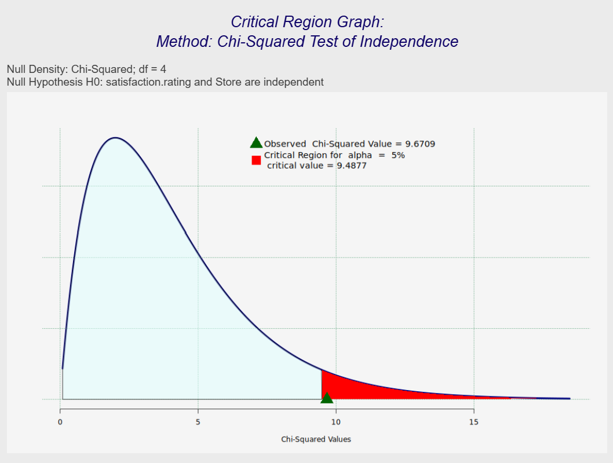
```

The critical region graph displays the chi-squared distribution. The red shaded region represents the critical region for a $\alpha=0.05$ significance level and begins at the critical value of $\chi^2=9.4877$. The green triangle marks the observed chi-squared test statistic of $\chi^2=9.6709$. 

**Decision**

Because the observed test statistic, $\chi^2 =9.6709$, does fall within the red critical region (values greater than $\chi^2 =9.4877$), the null hypothesis is rejected.

**Conclusion**

There is sufficient evidence to support the claim that at least one distribution of customer satisfaction is different. This means that there is evidence that the stores do not have the same satisfaction ratings among all three stores.

:::

:::{#exm-survival-gender-critical-region}

Researchers studying patients diagnosed with malignant melanoma in Denmark want to determine whether the distribution of survival outcomes is the same for male and female patients. The patients are classified according to their survival status: died from melanoma, alive at follow-up, or died from other causes. Is the distribution of survival status the same for male and female melanoma patients at the $\alpha=0.01$ level of significance?

::: {tabindex="0" style="width:85%; margin:auto;"}
 The dataset for this exercise is available in the Rguroo dataset repository [MASS]{.repo}, with the dataset name [Melanoma]{.data}. The codebook is below.
:::


```{r, echo=FALSE}
#| tbl-alt: "Table showing first 6 rows of sample from Melanoma dataset"
#| label: tbl-farms
#| tbl-cap: "Head of Melanoma Dataset"

knitr::kable(head(Melanoma))
```

:::

::: {#code-book-melanoma .callout-tip .codebook collapse="true"}
## Code book for Melanoma Dataset

**Description** The Melanoma dataset has data on 205 patients in Denmark with malignant melanoma.

Format

This data frame contains the following columns:

[time]{.var}: Survival time in days, possibly censored.

[status]{.var}: 1 died from melanoma, 2 alive, 3 dead from other causes.

[sex]{.var}: 1 = male, 0 = female.

[age]{.var}: Age in years.

[year]{.var}: Year of operation.

[thickness]{.var}: Tumour thickness in mm.

[ulcer]{.var}: 1 = presence, 0 = absence.

Source
P. K. Andersen, O. Borgan, R. D. Gill and N. Keiding (1993) Statistical Models based on Counting Processes. Springer.

:::

::: {.callout-tip .solution-callout collapse="true" icon="false"}
## 🔎 Solution

As we did before with previous $\chi^2$ tests, take a quick check that we have satisfied the four conditions. We will perform the hypothesis test and check in the Rguroo output that all expected counts are greater than 5. Let’s proceed with the test.

**State null and alternative**

We will again use the language of the question to help us with the hypotheses. The question is *"Is the distribution of survival status the same for male and female melanoma patients?"* So, we have

$H_o: P_\text{Males}=P_\text{Females}$

where,

- $P_\text{Males}$ = distribution of survival status for males
- $P_\text{Females}$ = distribution of survival status for females

$H_a:$ At least one distribution of survival status is different.

**Select $\alpha$**

$\alpha=0.01$

**Critical region approach to find test statistic and critical value**

This dataset is in the dataset repository; however, [status]{.var} and [sex]{.var} are recorded as numbers.  In order to us these variables in a test for homogeneity, we need to reclassify these as categorical variables and add labels. In this example, we want to label the levels defined in the codebook. [Click here](#reclassifying-variables) to review how to reclassify variables. Teh dialog boxes are shown below.

```{r, echo=FALSE}
#| label: fig-dialog-variable-editor-status
#| fig-cap: 'Dialog box for Variable Editor (Status)'
#| fig-alt: 'Dialog box for Variable Editor (Status)'
#| out-width: "70%"
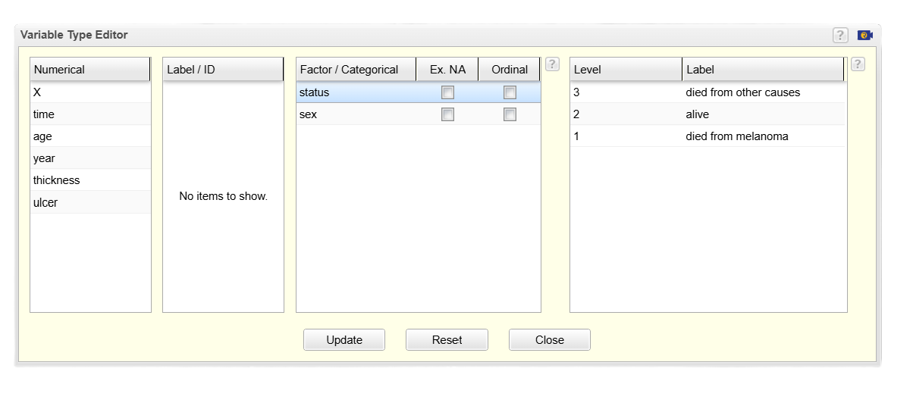
```

```{r, echo=FALSE}
#| label: fig-dialog-variable-editor-sex
#| fig-cap: 'Dialog box for Variable Editor (Sex)'
#| fig-alt: 'Dialog box for Variable Editor (Sex)'
#| out-width: "70%"
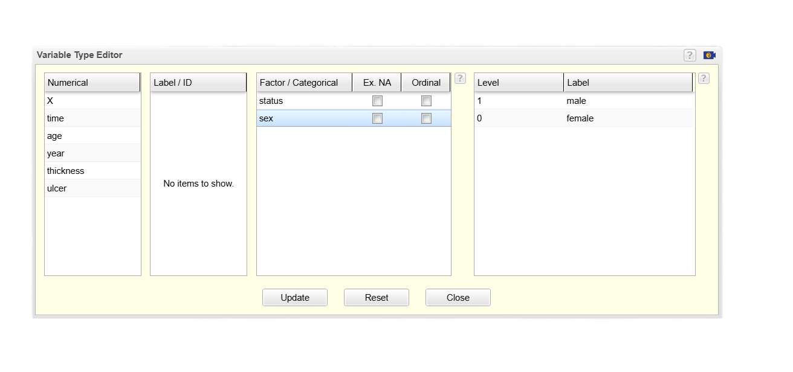
```

Use the [Contingency Table]{.fun} test, and select [Melanoma]{.data} dataset. Select [status]{.var} for [Factor 1]{.fun} and [sex]{.var} for [Factor 2]{.fun}. Enter [0.01]{.typein} for the significance level.  The dialog box is shown below.

```{r, echo=FALSE}
#| label: fig-dialog-status-sex
#| fig-cap: 'Dialog box for Status and Sex Example'
#| fig-alt: 'Dialog box for Status and Sex Example'
#| out-width: "70%"
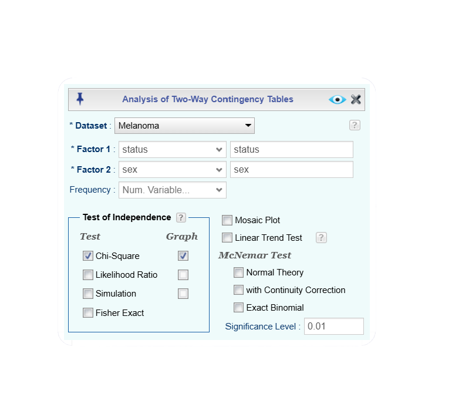
```


Before looking at the test statistic and p-value, let's check the Rguroo output and verify that the expected counts are all greater than 5.

```{r, echo=FALSE}
#| label: fig-expected-counts-status-sex
#| fig-cap: 'Expected Counts for Status and Sex Example'
#| fig-alt: 'Expected Counts for Status and Sex Example'
#| out-width: "70%"
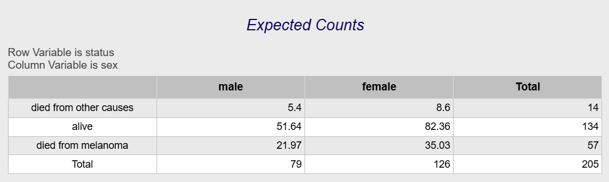
```

After inspecting the expected counts, we can verify that all expected counts are greater than 5 and the conditions are met. Let's proceed with looking at the output for the p-value and test statistic.

```{r, echo=FALSE}
#| label: fig-status-sex-critical-region
#| fig-cap: 'Rguroo output for Test of Homogeneity for Status and Sex Example'
#| fig-alt: 'Rguroo output for Test of Homogeneity for Status and Sex Example, showing graph, critical value = 9.2103 and test statistic of 6.793'
#| out-width: "70%"
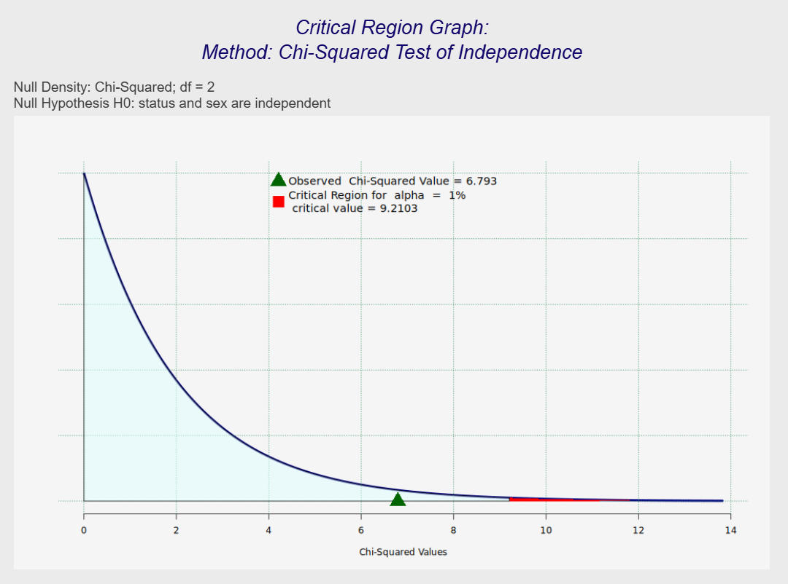
```

The critical region graph displays the chi-squared distribution. The red shaded region represents the critical region for a $\alpha=0.05$ significance level and begins at the critical value of $\chi^2=9.2103$. The green triangle marks the observed chi-squared test statistic of $\chi^2=6.793$. 

**Decision**

Because the observed test statistic, $\chi^2 =6.793$, does not fall within the red critical region (values greater than $\chi^2 =9.2013$), the null hypothesis is not rejected.

**Conclusion**

There is not sufficient evidence to support the claim that at least one distribution of survival status is different. This means that the evidence shows that survival status from melanoma is the same among males and females.

:::

### Homework for Section 12.3

**In each problem show all steps of the hypothesis test. If some of the conditions are not met, note that the results of the test may not be correct and then continue the process of the hypothesis test.**

1. Researchers surveyed college students about their average nightly sleep duration. The students were separated into two groups based on alcohol use. Is there sufficient evidence to conclude that the distribution of sleep duration differs between students who consume alcohol and students who do not consume alcohol? Test at the $\alpha= 0.05$ significance level.

| Sleep Duration | Alcohol Use | No Alcohol Use |
|---------------|------------:|---------------:|
| Less than 6 hours | 42 | 31 |
| 6–8 hours | 98 | 127 |
| More than 8 hours | 20 | 42 |

<br>

2. A college surveyed freshmen and seniors regarding their preferred learning method. Is there sufficient evidence to conclude that the distribution of preferred learning methods differs between freshmen and seniors? Test at the $\alpha= 0.1$ significance level.

| Learning Method | Freshmen | Seniors |
|----------------|---------:|--------:|
| In-Person | 86 | 63 |
| Hybrid | 74 | 92 |
| Online | 40 | 65 |
 
<br>
 
3. A health researcher collected data on weekly exercise frequency for men and women. Is there sufficient evidence to conclude that the distribution of exercise frequency differs between men and women? Test at the $\alpha= 0.01$ significance level.

| Weekly Exercise Frequency | Men | Women |
|--------------------------|----:|------:|
| 0–1 Days | 38 | 52 |
| 2–4 Days | 94 | 109 |
| 5+ Days | 68 | 49 |
 
<br>
 
4. Researchers surveyed two age groups regarding their most-used social media platform. Is there sufficient evidence to conclude that the distribution of social media preferences differs between younger and older adults? Test at the $\alpha= 0.05$ significance level.

| Platform | Ages 18–29 | Ages 30+ |
|----------|-----------:|---------:|
| Instagram | 74 | 35 |
| TikTok | 68 | 22 |
| Facebook | 29 | 81 |
| Other | 19 | 37 |
 
<br>
 
5. Residents from an urban community and a rural community were asked how they typically commute to work. Is there sufficient evidence to conclude that the distribution of transportation methods differs between urban and rural communities? Test at the $\alpha= 0.02$ significance level.

| Transportation Method | Urban | Rural |
|----------------------|------:|------:|
| Personal Vehicle | 103 | 126 |
| Public Transit | 71 | 12 |
| Bicycle/Walk | 34 | 18 |
| Other | 12 | 9 |
 
<br>
 
6. A college compared study habits of students enrolled in STEM programs and non-STEM programs. Is there sufficient evidence to conclude that the distribution of weekly study time differs between STEM and non-STEM students? Test at the $\alpha= 0.05$ significance level.

| Weekly Study Time | STEM | Non-STEM |
|------------------|-----:|---------:|
| Less than 5 Hours | 26 | 47 |
| 5–10 Hours | 61 | 84 |
| More than 10 Hours | 73 | 54 |
 
<br>
 
7. Students from two colleges were surveyed regarding their satisfaction with online learning. Is there sufficient evidence to conclude that the distribution of satisfaction levels differs between the two colleges? Test at the $\alpha= 0.01$ significance level.

| Satisfaction Level | College A | College B |
|-------------------|----------:|----------:|
| Very Satisfied | 54 | 71 |
| Satisfied | 88 | 79 |
| Dissatisfied | 31 | 42 |
| Very Dissatisfied | 17 | 28 |
 
<br>
 
8. A researcher surveyed male and female students who reported consuming alcohol and recorded their average sleep duration. Is there sufficient evidence to conclude that the distribution of sleep duration is the same for males and females who consume alcohol? Test at the $\alpha= 0.05$ significance level.

| Sleep Duration | Male | Female |
|---------------|-----:|-------:|
| Less than 6 hours | 47 | 33 |
| 6–8 hours | 105 | 118 |
| More than 8 hours | 28 | 49 |

## Comparing Chi-Square Tests

Throughout this chapter, we have examined three different chi-square tests: the chi-square goodness-of-fit test, the chi-square test of independence, and the chi-square test of homogeneity. Although these tests address different research questions, they all use the same chi-square test statistic and compare observed counts to expected counts. The primary difference among the tests is the type of question being investigated and the structure of the data. The table below summarizes the purpose of each test and can help you determine which chi-square procedure is appropriate in a given situation.

::: {.callout-note}
## Summary of Chi-Square Tests

| Test | Purpose | Variables | Research Question |
|--------|--------|--------|--------|
| Goodness-of-Fit | Compare data to a claimed distribution | One categorical variable | Does the observed distribution match a specified distribution? |
| Independence | Determine whether two categorical variables are related | Two categorical variables from one population | Are the variables associated? |
| Homogeneity | Compare distributions across populations or groups | One categorical variable measured in multiple populations | Are the distributions the same across groups? |

:::

:::{#exm-determine-type-of-chi-squared-test}
## Determine the Appropriate Chi-squared Test

For each scenario below, determine whether a chi-square goodness-of-fit test, test of independence, or test of homogeneity should be used. Explain your choice.

a\. A researcher wants to know whether blood types in a city follow the nationally reported distribution.

b\. A survey records both a person's employment status and education level to determine whether the variables are related.

c\. A political scientist compares the distribution of party affiliation among voters from three different states.

d\. A restaurant owner compares the observed counts of menu items sold to expected percentages based on historical sales.

e\. A health researcher records smoking status and exercise habits for a random sample of adults and wants to determine whether the variables are associated.

:::

::: {.callout-tip .solution-callout collapse="true" icon="false"}
## 🔎 Solution

a\. Chi-Square Goodness-of-Fit Test; The researcher is comparing the observed blood type counts in one population (the city) to an expected distribution (the national blood type percentages). A goodness-of-fit test is used to determine whether the observed distribution matches an expected distribution.

b\. Chi-Square Test of Independence; Two categorical variables are measured from the same sample of individuals: employment status and education level. The goal is to determine whether the variables are *associated*, so a test of independence is appropriate.

c\. Chi-Square Test of Homogeneity; The researcher is comparing the distribution of a categorical variable (party affiliation) across multiple populations (voters from three different states). A test of homogeneity is used to determine whether the distributions are the *same* across the populations.

d\. Chi-Square Goodness-of-Fit Test; The restaurant owner is comparing observed sales counts to an expected distribution based on historical percentages. Since there is one categorical variable and a known expected distribution, a goodness-of-fit test should be used.

e\. Chi-Square Test of Independence; Two categorical variables (smoking status and exercise habits) are measured for the same individuals. The goal is to determine whether there is an *association* between the variables, making a test of independence appropriate.

:::

:::{#exm-chi-square-summary1}
## Patient Satisfaction

Researchers randomly select patients from three different hospitals. Each patient rates their overall satisfaction with their care as dissatisfied, neutral, or satisfied. The researchers conduct a hypothesis test to determine if the distribution of patient satisfaction is the same across the three hospitals at the $\alpha=0.05$ level of significance.

a\. Identify the appropriate chi-square test.

b\. State the null and alternative hypotheses.

c\. If the p-value is found to be $0.12$, state the decision.

d\. Write the conclusion of the test.

:::

::: {.callout-tip .solution-callout collapse="true" icon="false"}
## 🔎 Solution

a\. Appropriate Test: Chi-Square Test for Homogeneity

b\. Hypotheses

$H_0: P_1 = P_2 = P_3$

$H_a:$ At least one distribution of patient satisfaction is different.

where:

- $P_1$ = distribution of patient satisfaction ratings at Hospital 1
- $P_2$ = distribution of patient satisfaction ratings at Hospital 2
- $P_3$ = distribution of patient satisfaction ratings at Hospital 3

c\. Decision: Since the p-value (0.12) is not less than $\alpha$ (0.05), we do not reject the null hypothesis.

d\. Conclusion: There is not sufficient evidence to support the claim that at least one distribution of patient satisfaction is different. Therefore, patient satisfaction is the same among all three hospitals.

:::

:::{#exm-chi-square-summary2}
## Movie Popcorn

A movie theater manager believes that customers prefer popcorn sizes in the following proportions:
 
- Small: 25%
- Medium: 40%
- Large: 35%
 
A random sample of customers is observed, and the size purchased by each customer is recorded. The movie theater manager conducts a hypothesis test to determine if the observed customer preferences match the claimed distribution of drink sizes at the $\alpha=0.01$ level of significance.

a\. Identify the appropriate chi-square test.

b\. State the null and alternative hypotheses.

c\. If the critical value is $9.210$ and the test statistic is $\chi^2=11.961$, state the decision.

d\. Write the conclusion of the test.

:::

::: {.callout-tip .solution-callout collapse="true" icon="false"}
## 🔎 Solution

a\. Appropriate Test: Chi-Square Goodness-of-Fit Test

b\. Hypotheses

$H_o: P_\text{small}=0.25, P_\text{medium}=0.40, P_\text{large}=0.35$

$H_a:$ he population does not follow the stated distribution

c\. Decision: Since the $\chi^2$ test statistic (11.961) does fall in the rejection region (above the critical value $\chi^2=9.210$), we reject the null hypothesis.

d\. Conclusion: There is sufficient evidence to support the claim that popcorn sizes do not follow the stated distribution of 25% small, 40% medium, and 35% large.
:::

:::{#exm-chi-square-summary3}
## Class Standing and Course Modality

A university surveys a random sample of students and records each student's class standing (freshman, sophomore, junior, or senior) and preferred course delivery method (in-person, hybrid, or online). The university research team conducts a hypothesis test to determine if course delivery preference is associated with class standing at the $\alpha=0.1$ level of significance.

a\. Identify the appropriate chi-square test.

b\. State the null and alternative hypotheses.

c\. If the p-value is found ot be $0.0375$, state the decision.

d\. Write the conclusion of the test.

:::

::: {.callout-tip .solution-callout collapse="true" icon="false"}
## 🔎 Solution

a\. Appropriate Test: Chi-Square Test for Independence

b\. Hypotheses

$H_0:$ Course delivery preference and class stading are associated

$H_a:$ Course delivery preference and class stading are independent


c\. Decision: Since the p-value (0.0375) is less than $\alpha$ (0.1), we reject the null hypothesis.

d\. Conclusion: There is sufficient evidence to support the claim that course delivery preference and class stading are independent.


:::

### Homework for Section 12.4

1. For each situation, identify whether a chi-square goodness-of-fit test, chi-square test of independence, or chi-square test of homogeneity should be used.

a\. A researcher wants to determine whether the distribution of pet ownership in a city matches national percentages.

b\. A survey records both marital status and home ownership status for a random sample of adults.

c\. Researchers compare the distribution of preferred social media platform among teenagers, adults, and senior citizens.

d\. A movie theater compares observed concession sales to expected percentages based on historical data.

e\. A health researcher records smoking status and exercise frequency for a random sample of adults.

f\. Researchers compare the distribution of transportation methods among residents from three different cities.


2. True or False: Determine whether each statement is true or false. If false, explain why.

a\. A chi-square goodness-of-fit test uses one categorical variable.

b\. A chi-square test of homogeneity compares distributions across multiple populations or groups.

c\. A chi-square test of independence is used to compare an observed distribution to an expected distribution.

d\. Rejecting the null hypothesis in a chi-square test of homogeneity tells us exactly which population differs.

e\. A chi-square test of independence investigates whether two categorical variables are associated.

**For questions 3-9, answer parts a-d below. Be sure to justify your answers using the definitions of the chi-square goodness-of-fit test, chi-square test of independence, and chi-square test of homogeneity.**

a\. Identify the appropriate chi-square test.

b\. Explain why the selected test is appropriate.

c\. State the null and alternative hypotheses.

d\. If a p-value, critical value, or test statistic is provided, state the decision and write the conclusion of the test.

3. A beverage company claims that customers prefer its four flavors in the following proportions:

- Cola: 40%
- Lemon-Lime: 25%
- Orange: 20%
- Root Beer: 15%
 
A random sample of customers is surveyed to determine whether the observed flavor preferences match the claimed distribution.
 
4. Researchers collect data from a random sample of adults and record each person's employment status (employed, unemployed, retired) and typical sleep category (less than 6 hours, 6–8 hours, more than 8 hours). Is there sufficient evidence to conclude that employment status and sleep habits are associated?

5. A university wants to determine whether the distribution of majors differs among students at three campuses. A random sample of students is selected from each campus and classified according to major (STEM, Business, Arts and Humanities, Other).
 
6. Customers from four retail stores rate their shopping experience as dissatisfied, neutral, or satisfied. The company wants to determine whether customer satisfaction is distributed similarly across all four stores. The p-value for the hypothesis test is 0.083. Use a significance level of $\alpha = 0.05$.

7. A college surveys students and records both class standing (freshman, sophomore, junior, senior) and preferred course modality (in-person, hybrid, online). Is there sufficient evidence to conclude that class standing and preferred course modality are associated? The p-value for the analysis is 0.012. Use a significance level of $\alpha = 0.05$.

8. Researchers wish to determine whether blood types in a particular city follow the national distribution:

- Type A: 42%
- Type B: 10%
- Type AB: 4%
- Type O: 44%

The test statistic is $\chi^2 = 6.41$. The critical value is 7.815. 

9. Researchers compare exercise habits among young adults, middle-aged adults, and older adults. Survey participants are classified as exercising never, occasionally, or regularly. Is there sufficient evidence to conclude that the distribution of exercise frequency differs among the three age groups? The p-value is 0.018. Use $\alpha = 0.01$.

10. Reflection: For each chi-square procedure, provide:

a\. The purpose of the test.

b\. The number of categorical variables involved.

c\. A real-world example where the test would be appropriate.

- Chi-Square Goodness-of-Fit Test
- Chi-Square Test of Independence
- Chi-Square Test of Homogeneity