# Getting Started with Rguroo {.unnumbered}

## 0.1 What is Rguroo?

Rguroo is a statistical software program designed to help students explore data and perform statistical analyses. Throughout this text, Rguroo will be used to carry out calculations, create graphs, and conduct statistical inferences. Using Rguroo allows us to focus on understanding statistical concepts and interpreting results rather than spending excessive time on complicated calculations. As new statistical methods are introduced, you will learn how to use the corresponding tools in Rguroo to perform the analysis and interpret the output.

[Click Here](https://www.youtube.com/watch?v=vla0uFydqW8) to watch a video overview of Rguroo.

## 0.2 Creating a Student Account

To use Rguroo, you will first need to create a student account.

**Step 1: Registration Page**

Go to the [Rguroo website](https://www.rguroo.com) and select **Register** in the upper-right corner of the page.

```{r, echo=FALSE}
#| label: fig-rguroo-home
#| fig-cap: 'Rguroo home screen with Register button in upper right-hand corner'
#| fig-alt: 'Rguroo home screen with Register button in upper right-hand corner'
#| out-width: "80%"

```

On the registration page, select **Student**.

```{r, echo=FALSE}
#| label: fig-rguroo-student
#| fig-cap: 'Registration page'
#| fig-alt: 'Registration page showing options of student, faculty, and non-academic'
#| out-width: "80%"
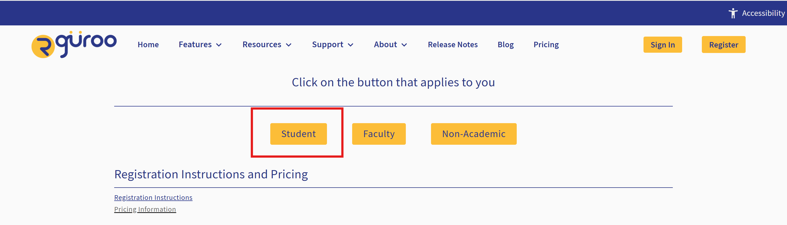
```

**Step 2: Select Account Type and Verify Email**

Select the type of account needed. Students can choose from the following account types.

- *Create a free trial account*: Try Rguroo for free for ten days. Only one trial account per individual is allowed.
- *Create a new account*: Don’t have an Rguroo account? Select this option to register for a new account.
- *Renew your account*: Extend the subscription for your existing Rguroo account.
- *Extend your trial account*: Is your trial account is about to expire, or is expired? Purchase an Rguroo subscription

Next, select the type of subscription needed. The following options are available.

- *Purchase Premium Support*: Premium Support is optional and can be added by checking this box. All accounts come with standard support.
- *Have Access Key*: If you have an Access Key, select this option. Note: This is not a group code.
- If you don’t have an Access Key, select one of the two subscription lengths: 6 Months or 12 Months (check with your instructor on the length you need).

Now, type and retype your student email address in the next two boxes. Your email address will be your Rguroo username. Then, click the **Submit** button.

After clicking submit, check your email. A verification code will be sent to the email address you provided in the registration page.

::: {.callout-note appearance="simple" icon="false"}
**Don’t see the email in your Inbox?** If you don’t see the verification email in your Inbox within a few minutes, check your Spam or Junk Mail folder.
:::

Open the email and follow the directions by typing or copy/paste the **Email Verification Code** in the form. Then, click the submit button.

```{r, echo=FALSE}
#| label: fig-email-verification
#| fig-cap: 'Email Verification Page'
#| fig-alt: 'Email verification page showing email and box for verification code.'
#| out-width: "60%"
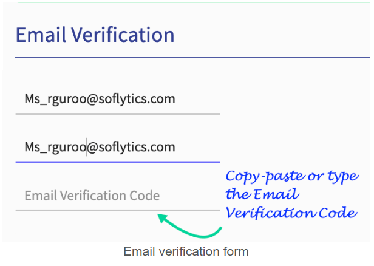
```

**Step 3: Enter Your Information**

If you are creating a new account, fill out the information in the **Your Information** page. You will enter:

- First and last name
- Select U.S. or International
- Your institution/college name.

::: {.callout-note appearance="simple" icon="false"}
**Tips on finding U.S. institution’s names**

Type in the first few letters of your university or college, and you should see the full name in the list. If your university or college has an acronym, type out the first few words. For example, instead of UCLA, type “University of California” and select the campus that you attend.
:::

If you have an Access Key, type it in the space provided, read and check the box for the *Terms of Service*, and click the Submit button. Then, proceed to Step 5.

**Step 4: Billing Information**

If you do not have an access key and need to purchase an Rguroo subscription, enter your credit card number and billing information. Click Submit and go to Step 5.

**Step 5: Sign-in to Rguroo**

If your registration is complete, you should have received an email with a temporary password. You can now log into Rguroo by following the steps below.

- Open the email, and copy your temporary password.
- Go to the link [https://www.rguroo.com](https://rguroo.com).
- Click the Sign in button.
- Type in your Username. Your username is your email address.
- You will be asked for the temporary password that was emailed to you. Type or paste it into the Temporary Password box.
- Type-in a new password, and retype your new password.
- Click the **LOGIN** button.

**Congratulations! Your Rguroo account is ready to use. Have an enjoyable and productive journey with Rguroo!**

::: {.callout-note appearance="simple" icon="false"}
**Always login to Rguroo through Rguroo’s main website**

To sign-in to Rguroo, use the sign in button button on Rguroo’s main website [https://www.rguroo.com](https://rguroo.com). This ensures that you get the latest version of Rguroo, and the Rguroo application gets loaded into your browser correctly.
:::

## 0.3 Rguroo Dashboard and Icons

Before you begin using Rguroo, take a few minutes to explore the dashboard and become familiar with its main features. You do not need to learn every feature at once. As you work through the examples in this book, you will be directed to the appropriate menus and tools. The numbered items below highlight the main areas of the dashboard that you will use. @fig-dashboard illustrates the main areas of the Rguroo dashboard. More detail of each follows.

```{r, echo=FALSE}
#| label: fig-dashboard
#| fig-cap: 'Rguroo Dashboard'
#| fig-alt: 'Rguroo dashboard with ten numbered annotations identifying key areas of the interface. The left side contains menus for Data, Plots, Analytics, Prediction-Classification, Probability-Simulation, and Applets-Calculators. The top contains navigation and account tools. The center displays the dataset workspace with variables arranged in columns and observations in rows, and the right side contains the Columns and Filters panel.'
#| out-width: "100%"
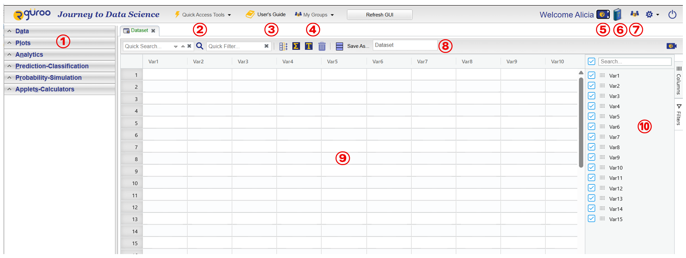
```

[1]{.circle-number} **Toolbox Menu**

The menu on the left organizes Rguroo's statistical tools into categories. Expand Data, Plots, Analytics, Prediction-Classification, Probability-Simulation, or Applets-Calculators to access the tools available within each category.

[2]{.circle-number} **Quick Access Tools**

Provides shortcuts to commonly used Rguroo features, including importing datasets and RGR files, opening the Scientific Calculator, viewing shortcut keys, accessing the Dataset Repository, and opening Jupyter Lite.

[3]{.circle-number} **User's Guide**

Opens the web-based Rguroo User Guide, where you can find instructions and additional help for using Rguroo’s features and tools.

[4]{.circle-number} **My Groups**

Provides access to groups associated with your Rguroo account, such as groups created for your class or course.

[5]{.circle-number} **Tutorial Videos**

Provides access to instructional videos that demonstrate how to use Rguroo’s features and statistical tools.

[6]{.circle-number} **Documentation**

Opens a PDF Rguroo User Guide, where you can find instructions and additional help for using Rguroo’s features and tools.

[7]{.circle-number} **Faculty Dashboard**

Provides instructors with access to course and group management tools and other faculty resources.

[8]{.circle-number} **Save As**

Allows you to name and save the current dataset, plot, or output for later use. Saved tabs will appear in the Data Toolbox.

[9]{.circle-number} **Data Workspace**

Displays a dataset template in a spreadsheet-style format, with variables in columns and observations in rows.

[10]{.circle-number} **Columns and Filters Panel**

Allows you to control which variables are displayed and filter the dataset to focus on selected observations.

[Click Here](https://www.youtube.com/watch?v=gD-V-Jy8i-4) to watch a video walkthrough of the Rguroo dashboard.

::: {.callout-note appearance="simple" icon="false"}
**Common Rguroo Icons**

The following icons are used in Rguroo and throughout the text.

 Preview Icon - Preview your graph or output

 Camera - A video is available

 Folder - The dataset in in a Rguroo repository

:::

## 0.4 Creating and Importing Datasets

Before you can analyze data in Rguroo, the data must first be entered or imported into the program. Rguroo provides several ways to create and work with datasets, depending on how your data are organized and where they are located. In this section, you will learn how to create a dataset containing one variable, enter data organized as a contingency (two-way) table, copy and paste data from an external source, and import an existing dataset into Rguroo. These skills will allow you to prepare your data for the statistical analyses and graphical displays introduced throughout this book.

### 0.4.1 Creating Datasets in One Variable

You can create a dataset directly in Rguroo by entering your observations into the Dataset Editor. For a dataset containing one variable, each value is entered in a separate row of a single column. Follow the steps below to create a dataset in one variable.

1.  Open the **Data** toolbox on the left side of the Rguroo window.
2.  Click the [Data Import]{.dpd} drop-down menu and select [Create New Dataset]{.fun}.
3.  In the [Create New Dataset]{.fun} window:
    - Enter the number of observations in the Rows field.
    - Enter [1]{.typein} for the number of columns.

```{r, echo=FALSE}
#| label: fig-dataset-row-column
#| fig-cap: 'Dialog for Entering Number of Rows and Columns (default set to 200 rows, 15 columns)'
#| fig-alt: 'Dialog for Entering Number of Rows and Columns'
#| out-width: "70%"
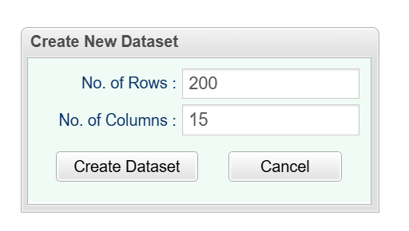
```

4.  Click Create Dataset. A dataset containing one column will open in the Dataset Editor. The variable is initially named Var1. You can rename the variable with a meaningful name that describes the data, such as Height, ExamScore, or StudyHours. To rename the variable, select the three horizontal bars 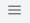 to the right of Var1. Then click *Rename*.
5.  Enter the data values in the column, placing one observation in each row.
6.  In the Save As box, enter a descriptive name for the dataset and save it. The dataset will now show in your **Data** toolbox.

[Click Here](https://www.youtube.com/watch?v=ps://www.youtube.com/watch?v=Is819ogn7sU) to watch a video of how to create a dataset.

[Walkthrough Example: Creating a Dataset in One Variable]{style="color: blue; font-weight: bold;"}

Suppose a student surveys five students in their class and record the number of hours they study per week. The data is recorded in the table below. Enter the data into Rguroo and save as *Study Hours*.

| Study Hours |
|-------------|
| 6           |
| 10          |
| 8           |
| 5           |
| 12          |

::: {style="height: 1rem;"}
:::

**Let's Create the Dataset:** For this dataset, we will need 5 rows and 1 column, so enter [5]{.typein} for No. of Rows and [1]{.typein} for No. of Columns. 

```{r, echo=FALSE}
#| label: fig-example-row-column
#| fig-cap: 'Dialog for Entering Number of Rows and Columns (5 rows, 1 column)'
#| fig-alt: 'Dialog for Entering Number of Rows and Columns (5 rows, 1 column)'
#| out-width: "50%"
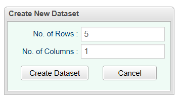
```

Once you have opened the workspace for 5 rows and 1 column, click on the first row to enter your data. Use the *Tab* key on your keyboard to move to the next entry. Once you are finished entering your data, rename your Var1 to "Hours" and save the dataset as *Study Hours*.

Below is an image of the completed and saved dataset.

```{r, echo=FALSE}
#| label: fig-dataset-one
#| fig-cap: 'Study Hours Dataset'
#| fig-alt: 'Study hours dataset entered into Rguroo and saved'
#| out-width: "95%"
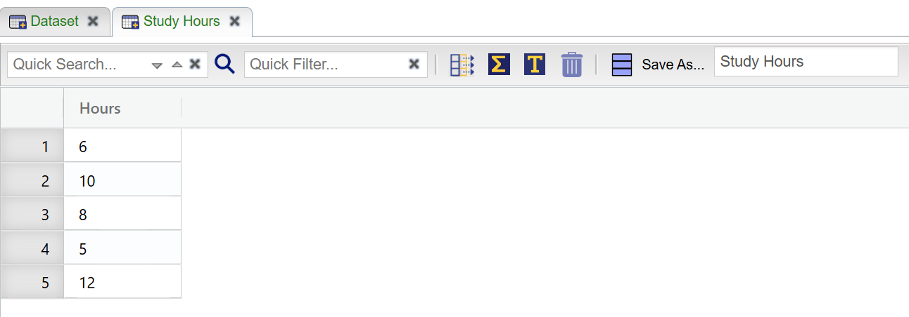
```

Now that you have saved your dataset, it will appear in your **Data** toolbox.

```{r, echo=FALSE}
#| label: fig-data-toolbox
#| fig-cap: 'Data toolbox showing Study Hours dataset'
#| fig-alt: 'Data toolbox showing Study Hours dataset'
#| out-width: "95%"
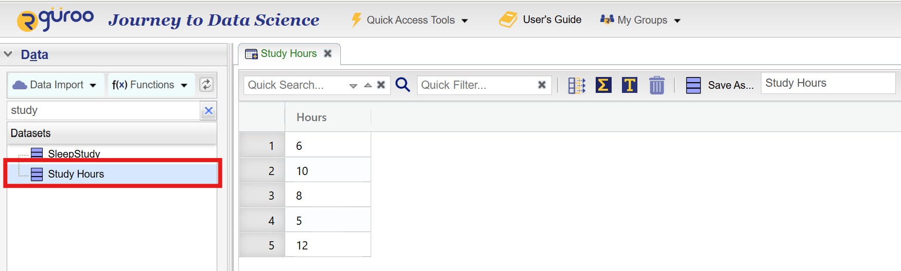
```

*Note: If you have many datasets, you can type the first few letters of the dataset name in the search bar which will narrow the list.*

### 0.4.2 Creating Tables

The Table Editor in Rguroo lets you easily create one-way or two-way frequency tables directly within the application. Follow the steps below to create a table.

1.  Open the **Data** toolbox located on the left-hand side of the Rguroo application window.
2.  Click on the [Data Import]{.dpd} dropdown and select the [Create New Table]{.fun} option.
3.  In the three textboxes at the top left of the Table Editor window, enter a row variable name (*Row Variable*), a column variable name (*Col. Variable*), and a name for the frequency or a numerical variable (*Frequency*).
4.  In the cells with gray backgrounds in the first row of the grid, enter the levels for the column variable.
5.  In the cells with gray backgrounds in the first column, enter the levels for the row variable.
6.  In the white-background cells (i.e., the body of the table), enter values corresponding to the specified row and column levels.
7.  To save your table as a table, enter a name for your table in the Save As Table textbox on the top, and click the Save as table button.
8.  To save your table as a dataset (with variables in columns) enter a name for your dataset in the Save As Dataset textbox on the top, and click the Save as button button to save your dataset. To see your dataset as a table click the View dataset icon.

[Click Here](https://www.youtube.com/watch?v=t8JmZJyUQRc) to watch a video of how to create a table.

[Walkthrough Example: Creating a One-Way Table]{style="color: blue; font-weight: bold;"}

Suppose a pet store records the number of pets of each type currently available for adoption. The data are summarized in the frequency table below. Enter the table into Rguroo and save as *PetStore*

| Pet    | Frequency |
|--------|-----------|
| Dog    | 8         |
| Cat    | 6         |
| Fish   | 4         |
| Bird   | 3         |
| Rabbit | 2         |

::: {style="height: 1rem;"}
:::

**Let's Create the Table:** This table only has one variable, Pet, and the corresponding frequencies of each pet type, so we make a one-way table. Open the table workspace and enter *Pet* for the Row Variable and *Frequency* in the Frequency box. We do not have a column variable, so we will leave that blank. Next, enter the frequencies. Once you have completed entering the frequencies, your table should look like @fig-one-way-table.

```{r, echo=FALSE}
#| label: fig-one-way-table
#| fig-cap: 'Workspace showing table and saved names for Pet Store'
#| fig-alt: 'Workspace showing table and saved names for pet store example'
#| out-width: "95%"
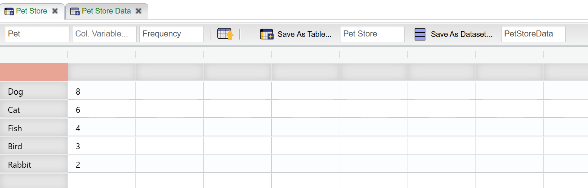
```

For tables, you can save in two ways; a table and/or a dataset. It is recommended that you save as both, so you have both forms available to you for future analysis. For this example, the table is saved as *Pet Store* and it is also saved as a dataset, named *Pet Store Dataset*. Saving the table as a dataset allows you to make charts, graphs, and perform analysis later on.

Once you have saved your table as both a table and dataset, look at your **Data** toolbox. You will see both versions which you can use later. @fig-data-toolbox-pet shows the dataset first and the table saved directly below.

```{r, echo=FALSE}
#| label: fig-data-toolbox-pet
#| fig-cap: 'Data toolbox showing table saved as a table and dataset'
#| fig-alt: 'Data toolbox showing table saved as a table and dataset'
#| out-width: "50%"
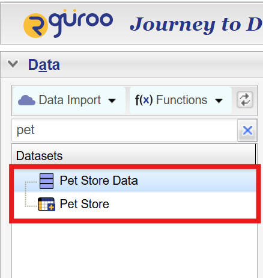
```

[Walkthrough Example: Creating a Two-Way Table]{style="color: blue; font-weight: bold;"}

Suppose students are asked about their preferred type of exercise and whether they prefer to exercise indoors or outdoors. The results are summarized below. Enter the table into Rguroo and save as *Exercise*.

| Type of Exercise | Indoors | Outdoors |
|------------------|---------|----------|
| Walking          | 3       | 8        |
| Running          | 4       | 7        |
| Cycling          | 5       | 9        |

::: {style="height: 1rem;"}
:::

**Let's Create the Table:** This table has two variables, Type of Exercise and Location, so we will create a two-way table. Similar to the example for a one-way table, open the table workspace. For this table, we will enter *Type of Exercise* as the row variable, *Location* for the column variable, and *Counts* as the frequency. Next, enter the counts as shown in the table. When you are finished entering the table, it should look like @fig-two-way.

```{r, echo=FALSE}
#| label: fig-two-way
#| fig-cap: 'Workspace showing table and saved names for Exercise'
#| fig-alt: 'Workspace showing table and saved names for Exercise'
#| out-width: "95%"
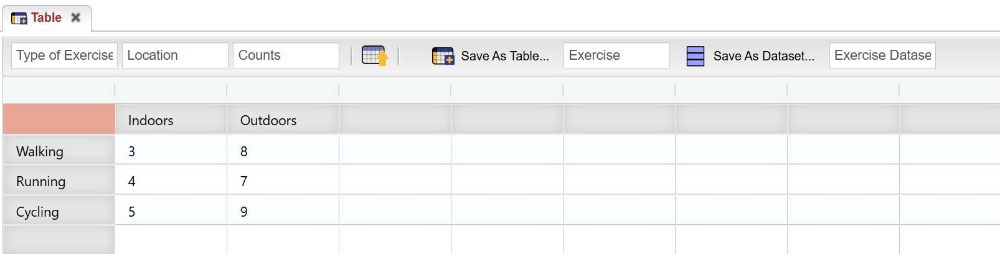
```

As before, we will save the table both as a table and dataset. In this example, the table is named *Exercise* and the dataset is named *Exercise Dataset*.

*Note*: If a table is not saved, the tab in the workspace will show as red. Once saved, the tab will change to green. @fig-not-saved shows the red tab and @fig-saved shows the tab green after saving.

```{r, echo=FALSE}
#| label: fig-not-saved
#| fig-cap: 'Table showing red tab, not saved'
#| fig-alt: 'Table showing red tab, not saved'
#| out-width: "95%"
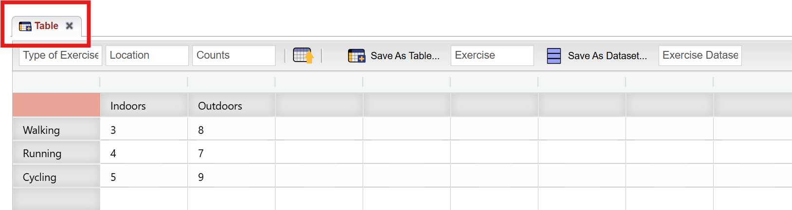
```

```{r, echo=FALSE}
#| label: fig-saved
#| fig-cap: 'Table showing green tab, saved'
#| fig-alt: 'Table showing green tab, saved'
#| out-width: "95%"
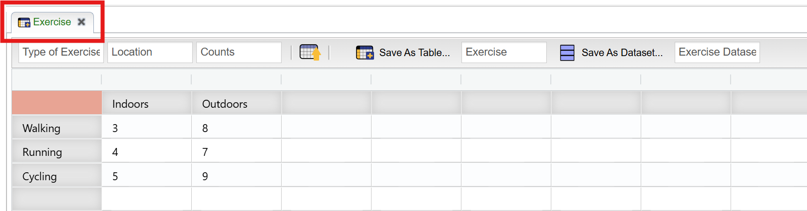
```

As before, once saved, your tables and datasets appear in your **Data** toolbox.

### 0.4.3 Copy and Paste Data from External Sources

Sometimes the data you need may already be available from an external source, such as MyOpenMath, a spreadsheet, or another course resource. Rather than entering each value individually, you can copy and paste the data directly into Rguroo. This is a quick and efficient way to transfer datasets while reducing the chance of errors that can occur when entering data manually.Follow the steps below to copy and paste from an external source.

1.  Open both the program with your external data source (such as MyOpenMath) and Rguroo. Note that Rguroo automatically opens a dataset editor when you login. You can use this workspace to paste your data into.
2.  Go to the external data source and highlight data. Copy the data by pressing Control + C (PC) or Command + C (Mac) on your keyboard.
3.  Go to your dataset workspace in Rguroo and click on the first cell in the dataset editor. Then paste your data by pressing Control + V (PC) or Command + V (Mac) on your keyboard. This will paste the data exactly as shown from the external dataset.
4.  If your dataset is one variable but is showing as multiple variables in Rguroo, cut and paste the columns into one column. To cut the column, highlight the column and press Control + X (PC) or Command + X (Mac) on your keyboard. Then go to the next available space in Var1, click on that empty space and paste using the keyboard commands as above. Continue this until all of your data is in the Var1 column.
5.  Save your data so you can use it for analysis later.

[Click Here](https://www.youtube.com/watch?v=hS-TdldDhB4) to watch a video of how to copy and paste a large dataset from MyOpenMath.

### 0.4.4 Importing Datasets

Rguroo provides several options for importing existing data, making it easy to begin working with a dataset without entering the values manually. You can import a dataset from an external file, select a dataset from the Rguroo Repository, or access datasets that have been shared with you through My Groups. Once imported, the dataset is available in your Data toolbox, where you can view, organize, and analyze the data.

**Rguroo Repository**

The Rguroo Repository provides access to public datasets that are already available within Rguroo. Rather than creating a dataset from scratch or importing one from an external source, you can browse the repository, select a dataset, and add it to your Data Workspace. This is a convenient way to explore existing datasets and quickly begin working with data for statistical analysis. Faculty can create their own private dataset repository to share data with students. For more information on creating your private dataset repository see <span style="background-color: yellow;">Need to link to instructor dashboard section when sections are done</span>. Follow the steps below to import a dataset from the Rguroo repository.

1.  Open the **Data** toolbox located on the left-hand side of the Rguroo application window.
2.  Click on the [Data Import]{.dpd} dropdown and select the [Dataset Repository]{.fun} option. This will open the [Rguroo Dataset Repository]{.fun} dialog box.

```{r, echo=FALSE}
#| label: fig-dataset-import
#| fig-cap: 'Data toolbox showing Rguroo Repository'
#| fig-alt: 'Data toolbox showing Rguroo Repository'
#| out-width: "50%"
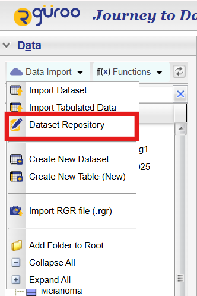
```

3.  If you know the file name, enter the name (or first few letters) in the *Quick Filter* search box. This will narrow the files listed and you can select your dataset.

```{r, echo=FALSE}
#| label: fig-import-quick-filter
#| fig-cap: 'Dataset Repository showing Quick Filter'
#| fig-alt: 'Dataset Repository showing Quick Filter'
#| out-width: "50%"
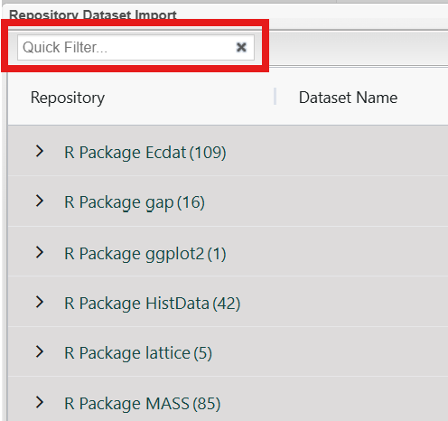
```

4.  Select your dataset, and click import. Your dataset will now be saved in your Data toolbox.

If you are not searching for a specific dataset, feel free to browse the dataset repository. You can still enter key words in the *Quick Filter* search box to narrow down your search.

<span style="background-color: yellow;">Need video</span>

**Computer or External File**

If your dataset is saved on your computer or another storage location, you can import the file directly into Rguroo. You can import files in various formats such as Excel, CSV, text, SPSS, SAS, etc. Once imported, the dataset is added to your Data toolbox, where you can view the data and begin your statistical analysis. Follow the steps below to import a dataset from your computer or external file.

1.  Open the **Data** toolbox located on the left-hand side of the Rguroo application window.
2.  Click on the [Data Import]{.dpd} dropdown and select the [Import Dataset]{.fun} option. This will open the [File Import]{.fun} dialog box.

```{r, echo=FALSE}
#| label: fig-import
#| fig-cap: 'Dataset toolbox showing Import Dataset'
#| fig-alt: 'Dataset toolbox showing Import Dataset'
#| out-width: "50%"
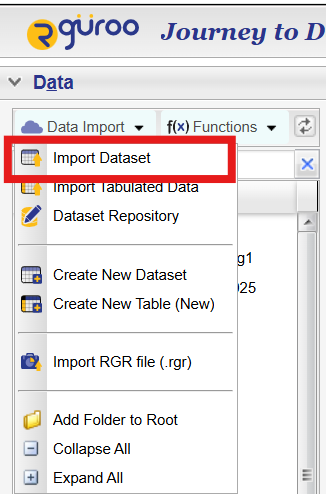
```

3.  If the file is saved on your computer or external drive (such as USB), select *Choose Folder* and select the folder. If the file is from a URL, select *URL* and type or paste the URL in the space provided.

```{r, echo=FALSE}
#| label: fig-import-file
#| fig-cap: 'File Import Dialog'
#| fig-alt: 'File Import Dialog'
#| out-width: "75%"
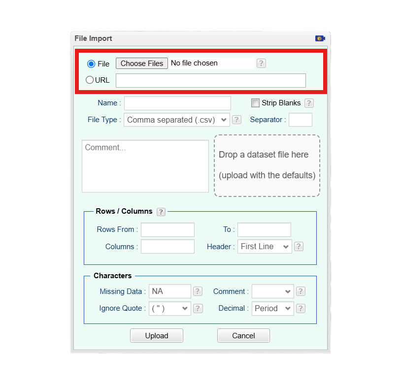
```

4.  Click *Upload* and your dataset will now be available in your Data toolbox.

<span style="background-color: yellow;">Need video</span>

**My Groups**

The My Groups area in Rguroo provides access to datasets that have been shared within a group, such as those provided by your instructor for a course or assignment. You can select a shared dataset and import it into your Data toolbox, where it is ready to view, explore, and analyze. In order to import a dataset from My Groups, your instructor must provide you with the group code where you can join the group. Follow the steps below to join a group and then import a dataset from your group.

1.  To import a dataset from a shared group, you will first need to join the group. To do this, click *My Groups* and select *Join a Group*.

```{r, echo=FALSE}
#| label: fig-join-group
#| fig-cap: 'My Groups Showing Option to Join Group'
#| fig-alt: 'My Groups Showing Option to Join Group'
#| out-width: "75%"
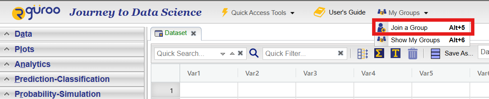
```

2.  Enter the join code provided by your instructor (or group leader) and click *Join Group*.

```{r, echo=FALSE}
#| label: fig-join-group-dialog
#| fig-cap: 'Join Group Dialog with Box to Enter Group Code'
#| fig-alt: 'Join Group Dialog with Box to Enter Group Code'
#| out-width: "75%"
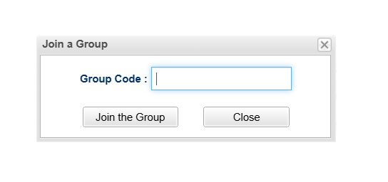
```

3.  Now that you have successfully joined a group, you will have access to import the datasets within that group. To access and import the group datasets, click back on *My Groups*, but now select *Show My Groups*. This will open the [Dataset/Archive repository]{.fun} dialog box.

```{r, echo=FALSE}
#| label: fig-show-groups
#| fig-cap: 'My Groups Showing Option to Show My Groups'
#| fig-alt: 'My Groups Showing Option to Show My Groups'
#| out-width: "75%"
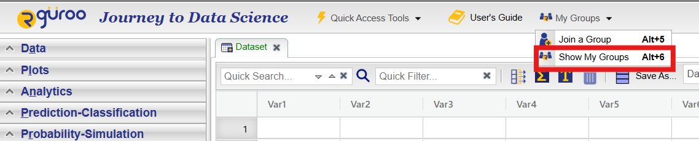
```

4.  In the Dataset/Archive repository dialog box, click on your group and it will show the accessible repositories. Click on the repository you want, and it will display the datasets. Click on a dataset and click *Import Selected Datasets*. You can select mulitple datasets and import them at once by clicking on a dataset, press and hold Control (PC) or Command (Mac) while selecting additional datasets.

```{r, echo=FALSE}
#| label: fig-show-group-dialog
#| fig-cap: 'Dataset/Archive repository dialog'
#| fig-alt: 'Dataset/Archive repository dialog'
#| out-width: "75%"
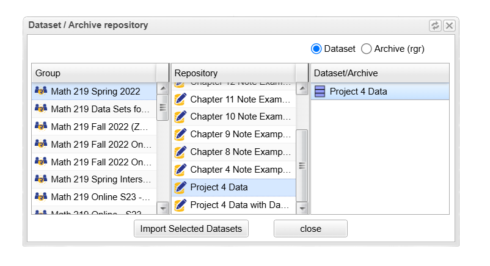
```

<span style="background-color: yellow;">Need video</span>

### 0.4.5 Practice: Try It Yourself

The following practice problems provide an opportunity to become familiar with creating and importing datasets in Rguroo. Use them to build confidence working with different methods of entering and importing data before completing graded assignments.

{width=45px} **Try It: Create a Dataset in One Variable**


A fitness instructor recorded the number of minutes 5 participants exercised during a morning workout session. Create a one-variable dataset in Rguroo using the data below. Name the variable Exercise Time. Save the dataset with an appropriate name.

| Exercise Time |
|---------------|
| 32            |
| 45            |
| 28            |
| 40            |
| 35            |

<br>

{width=45px} **Try It: Create a One-Way Table**

A group of students was asked to identify their preferred way to study for an exam. Their responses are summarized in the table below. Create a one-way table in Rguroo using the data below. Use Study Method as the row variable and enter the corresponding frequencies. Save the table and dataset with appropriate names.

| Study Method      | Frequency |
|-------------------|-----------|
| Practice Problems | 12        |
| Flashcards        | 8         |
| Study Groups      | 6         |
| Reviewing Notes   | 10        |
| Videos            | 4         |

<br>

{width=45px} **Try It: Create a Two-Way Table**

A local animal shelter recorded the type of pet adopted and whether the adoption occurred on a weekday or weekend. Create a two-way table in Rguroo using the data below. Use Adoption Day as the row variable and Type of Pet as the column variable. Save the table and dataset with appropriate names.

| Adoption Day | Dog | Cat | Other |
|--------------|-----|-----|-------|
| Weekday      | 18  | 14  | 6     |
| Weekend      | 22  | 17  | 8     |

<br>

{width=45px} **Try It: Copy and Paste a Large Dataset from External Source**

A coffee shop recorded the number of customers who visited during the first hour after opening on 25 different days. The results are shown below. Create a one-variable dataset in Rguroo by copying and pasting the values into Rguroo. Then, move the data into one column in Rguroo. Name the variable Customers. Save your dataset with an appropriate name.

|     |     |     |     |     |
|----:|----:|----:|----:|----:|
|  24 |  31 |  28 |  35 |  27 |
|  33 |  29 |  38 |  26 |  32 |
|  30 |  36 |  25 |  34 |  29 |
|  37 |  28 |  31 |  40 |  33 |
|  26 |  35 |  30 |  32 |  34 |

<br>

{width=45px} **Try It: Import a Dataset from Rguroo Repository**

Data was collected for two semesters in a statistics class on students’ transportation, demographics, living expenses, preferences, and academic majors. Import the dataset from the Rguroo dataset repository. Remember, you can type in the first part of the dataset name to filter and narrow the list.

 The dataset is available in the Rguroo dataset repository, with the dataset name [class_survey1]{.data}. @tbl-class-survey shows the variables and the first 6 rows of the data set. A complete description of the variables is provided in the [dataset code book](#code-book-class) that follows. 


```{r class-data1-table,echo=FALSE}
#| tbl-alt: "Table showing first 6 rows of statistics class survey dataset"
#| label: tbl-class-survey
#| tbl-cap: "Class Survey"
Class <- read.csv("https://krkozak.github.io/MAT160/class_survey.csv")
knitr::kable(head(Class))
```

::: {#code-book-class .callout-tip .codebook collapse="true"}
## Code book for Class Survey1 Dataset

**Description** The dataset gives survey results from two semesters of statistics classes at Coconino Community College in the years 2018-2019.

Format

This dataset contains the following columns:

[vehicle]{.var}: Type of car a student drives

[gender]{.var}: Self-declared gender of a student

[distance_campus]{.var}: How far a student lives from the Lone Tree Campus of Coconino Community College (miles)

[ice_cream]{.var}: Favorite ice cream flavor

[rent]{.var}: How much a student pays in rent

[major]{.var}: Students declared major

[height]{.var}: Height of the student (inches)

[winter]{.var}: Student's opinion of winter (Love it, Like it, Don't like, No opinion)

Source

Kozak K (2019). Survey results form surveys collected in statistics class at Coconino Community College.

References

Kozak, 2019
:::

## 0.5 Dataset Editor

The Dataset Editor in Rguroo provides tools for viewing and editing an existing dataset. As you work with data, you may need to make changes such as adding or removing observations, renaming variables, or correcting values. The Dataset Editor allows you to make these changes directly within Rguroo so that your data are organized and ready for analysis.

### 0.5.1 Dataset Summary

Once you have imported a dataset into the Data toolbox, you can inspect the data using the Dataset Summary. The Dataset Summary in Rguroo provides an overview of the variables and observations contained in a dataset. It allows you to quickly review the structure and characteristics of the data before beginning an analysis. Examining the dataset summary can help you become familiar with the data and verify that the dataset contains the information you expect. Follow the steps below to inspect the dataset summary.

1. Import your dataset.
2. Go to the **Data** toolbox and right click on the dataset you would like to inspect. Select *Dataset Summary*.

```{r, echo=FALSE}
#| label: fig-dataset-summary-toolbox
#| fig-cap: 'Data toolbox showing Dataset Summary'
#| fig-alt: 'Data toolbox showing Dataset Summary'
#| out-width: "50%"
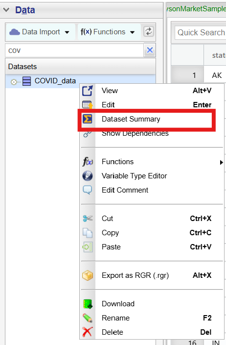
```

3. The dataset summary will now show in your workspace.

```{r, echo=FALSE}
#| label: fig-dataset-summary
#| fig-cap: 'Dataset summary for COVID_data dataset'
#| fig-alt: 'Dataset summary for COVID_data dataset'
#| out-width: "85%"
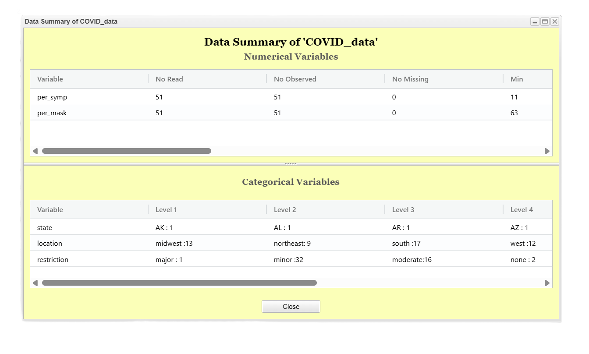
```

[Walkthrough Example: Inspecting Data Using the Dataset Summary]{style="color: blue; font-weight: bold;"}

A sleep study collected information from college students about their sleep habits, academic experiences, and overall well-being. Variables include sleep and wake times, average amount of sleep, class schedules, GPA, classes missed, and measures related to cognition, stress, anxiety, depression, and happiness. Import and inspect the data.

 The dataset is available in the Rguroo dataset repository, with the dataset name [SleepStudy]{.data}. @tbl-sleep shows the variables and the first 6 rows of the data set. A complete description of the variables is provided in the [dataset code book](#code-book-sleep) that follows. 


```{r,echo=FALSE}
#| tbl-alt: "Table showing first 6 rows of SleepStudy"
#| label: tbl-sleep
#| tbl-cap: "Sleep Study"
SleepStudy <- read.csv("https://krkozak.github.io/MAT160/SleepStudy.csv")
knitr::kable(head(SleepStudy))
```

::: {#code-book-sleep .callout-tip .codebook collapse="true"}
## Code book for SleepStudy Dataset

**Description** The dataset gives survey results from a sleep study conducted.

Format

This dataset contains the following columns:

[Gender]{.var}: Gender category reported by the student (0 represents male, 1 represents female).

[ClassYear]{.var}: Student's year in college

[LarkOwl]{.var}: Student's preference for being more active or alert in the morning or evening

[NumEarlyClass]{.var}: Number of early classes the student has

[EarlyClass]{.var}: Indicates whether the student has an early class (0 represents no, 1 represents yes)

[GPA]{.var}: Student's grade point average

[ClassesMissed]{.var}: Number of classes the student has missed

[CognitionZscore]{.var}: Standardized score measuring cognitive performance

[PoorSleepQuality]{.var}: Measure of poor sleep quality

[DepressionScore]{.var}: Score measuring symptoms associated with depression

[AnxietyScore]{.var}: Score measuring symptoms associated with anxiety

[StressScore]{.var}: Score measuring stress-related symptoms

[DepressionStatus]{.var}: Categorical classification based on the student's depression score

[AnxietyStatus]{.var}: Categorical classification based on the student's anxiety score

[Stress]{.var}: Categorical classification of the student's stress level

[DASScore]{.var}: Combined score related to depression, anxiety, and stress

[Happiness]{.var}: Score measuring the student's reported level of happiness

[AlcoholUse]{.var}: Measure or category describing the student's alcohol use

[Drinks]{.var}: Number of alcoholic drinks reported

[WeekdayBed]{.var}: Typical bedtime on weekdays

[WeekdayRise]{.var}: Typical wake-up time on weekdays

[WeekdaySleep]{.var}: Amount of sleep obtained on weekdays

[WeekendBed]{.var}: Typical bedtime on weekends

[WeekendRise]{.var}: Typical wake-up time on weekends

[WeekendSleep]{.var}: Amount of sleep obtained on weekends

[AverageSleep]{.var}: Average amount of sleep obtained

[AllNighter]{.var}: Indicates whether the student has stayed awake all night (0 represents no, 1 represents yes)
:::

**Let's Inspect the Dataset:** First we need to import the dataset. Go to the dataset repository and type in [SleepStudy]{.typein} to the *Quick Filter* search box. Notice that there are a few datasets with a similar name. Select the one that has 253 rows and 27 columns, then click Import.  

```{r, echo=FALSE}
#| label: fig-repository-sleep
#| fig-cap: 'Repository Dataset Import showing SleepStudy data'
#| fig-alt: 'Repository Dataset Import showing SleepStudy data'
#| out-width: "70%"
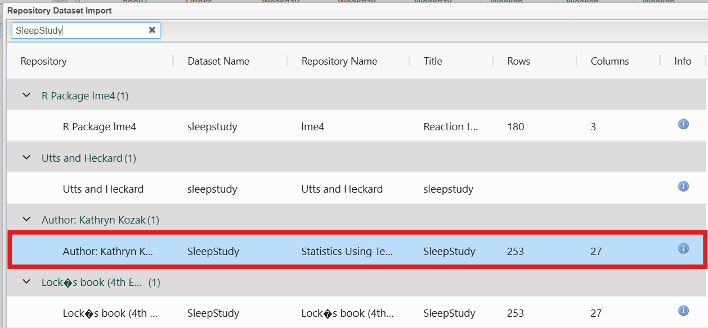
```

The dataset will now show in your Data toolbox. Right-click on the dataset and select [Dataset Summary]{.fun}.

```{r, echo=FALSE}
#| label: fig-summary-select
#| fig-cap: 'Dataset Summary Option after right-clicking SleepStudy dataset'
#| fig-alt: 'Dataset Summary Option after right-clicking SleepStudy dataset'
#| out-width: "40%"
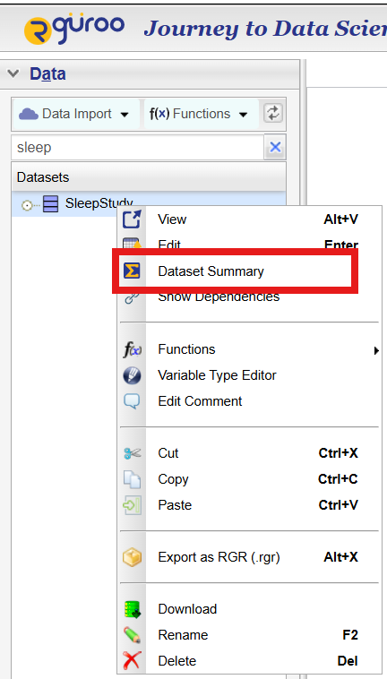
```

You should now see the dataset summary for the [SleepStudy]{.data} data.

```{r, echo=FALSE}
#| label: fig-summary-output-sleep
#| fig-cap: 'Dataset Summary for SleepStudy dataset'
#| fig-alt: 'Dataset Summary for SleepStudy dataset'
#| out-width: "80%"
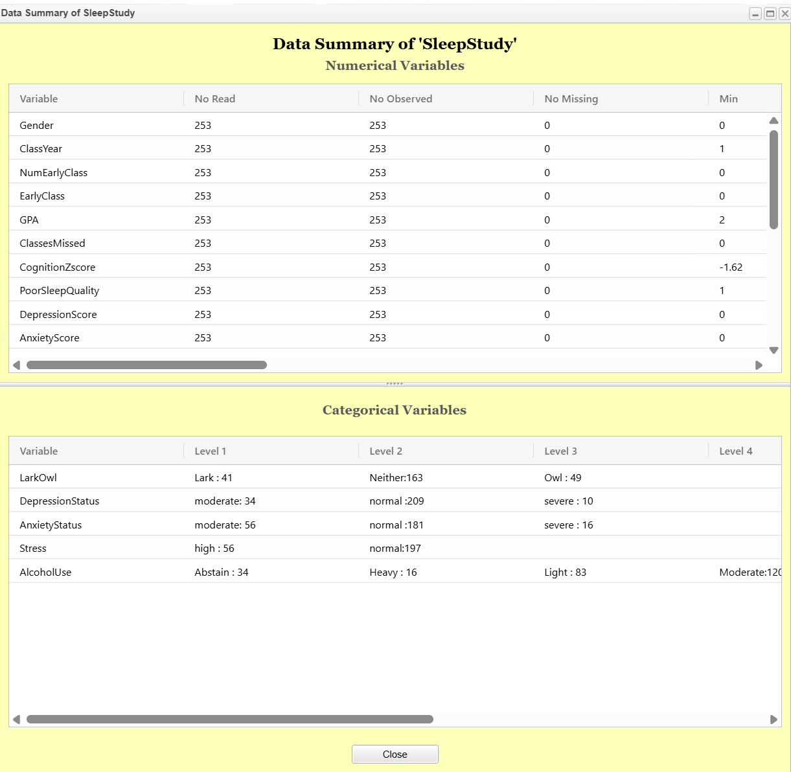
```

The Data Summary of [SleepStudy]{.data} window provides an overview of the numerical and categorical variables in the dataset. The Numerical Variables section shows the number of values read, observed, and missing for each variable. Scroll to the right within this section to view additional summary statistics for each numerical variable, including the minimum, maximum, mean, median, and standard deviation. The Categorical Variables section lists the levels for each categorical variable and the number of observations in each level. For example, LarkOwl contains 41 Larks, 163 Neither, and 49 Owls.

Also notice that gender was categorized as a numerical variable since it was either a 0 for male or 1 for female. We will work on reclassifying categorical variables recorded as numbers in the next subsection.

### 0.5.2 Reclassifying Variables

As we saw with the [SleepStudy]{.data} data, sometimes, numbers in a dataset are used to represent categories rather than numerical values. For example, in the SleepStudy data 0 represented male and a 1 represented female. In Rguroo, reclassifying a variable allows you to identify these values as categories so that the variable is treated appropriately during statistical analysis. Follow the steps below to reclassify a variable.

1. Right click on the dataset and select [Variable Type Editor]{.fun}. This will open the [Variable Type Editor]{.fun} dialog box.

```{r, echo=FALSE}
#| label: fig-data-editor0
#| fig-cap: 'Variable Type Editor from Right-Clicking Dataset'
#| fig-alt: 'Variable Type Editor from Right-Clicking Dataset'
#| out-width: "30%"
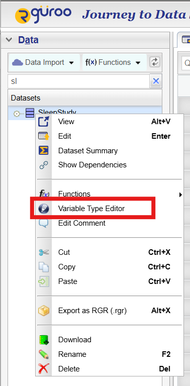
```

2. Click and hold the variable that needs to be reclassified. Drag the variable into the Factor/Categorical Box. 
3. Click Update and your variable will now be reclassified as a categorical variable.
4. If you would like to assign labels to the numbers recorded, click on the variable in the Factor/Categorical box. Notice that the rightmost box is now populated.
5. Click under the Label heading and type in a label name for the number. Repeat for all numbers.
6. Click Update.

[Click Here](https://www.youtube.com/watch?v=iOdHHDHOaAA) to watch a video of how to reclassify a variable.

[Walkthrough Example: Reclassifying a Variable]{style="color: blue; font-weight: bold;"}

We will work with the [SleepStudy]{.data} data since we already noticed that gender was recorded as a number when we know it is a categorical variable.

**Let's Reclassify the Variable:** You should have imported the SleepStudy data if you followed the last Walkthrough example. If not, import the dataset now.

To access the [Dataset Variable Editor]{.fun}, right click on the [SleepStudy]{.data} dataset in your **Data** toolbox. Select [Variable Type Editor]{.fun}. You should now see the dialog box on your screen.

```{r, echo=FALSE}
#| label: fig-data-editor1
#| fig-cap: 'Variable Type Editor from Right-Clicking Dataset'
#| fig-alt: 'Variable Type Editor from Right-Clicking Dataset'
#| out-width: "30%"

```

Click and drag the variable [Gender]{.var} into the Factor/Categorical Box. Click update to save.  

```{r, echo=FALSE}
#| label: fig-data-editor2
#| fig-cap: 'Moving Gender to Factor/Categorical Box for SleepStudy Dataset'
#| fig-alt: 'Moving Gender to Factor/Categorical Box for SleepStudy Dataset'
#| out-width: "80%"
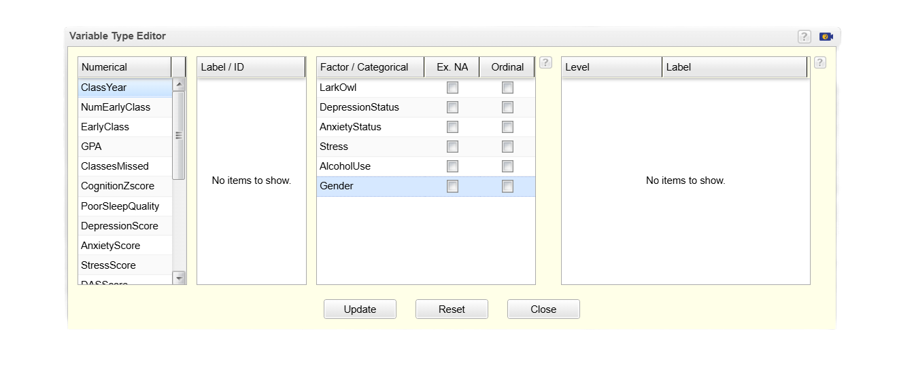
```

Since we were told in the code book that 0 represents male and 1 represents female, let's go one extra step and assign a label to each number. Click on the variable [Gender]{.var} and the Label box will populate. Double-click on the label space next to 0 and enter [Male]{.typein}. Repeat this process and enter [Female]{.typein} for 1. Click update to save.

```{r, echo=FALSE}
#| label: fig-data-editor3
#| fig-cap: 'Labeling 0 as Male and 1 as Female'
#| fig-alt: 'Labeling 0 as Male and 1 as Female'
#| out-width: "90%"
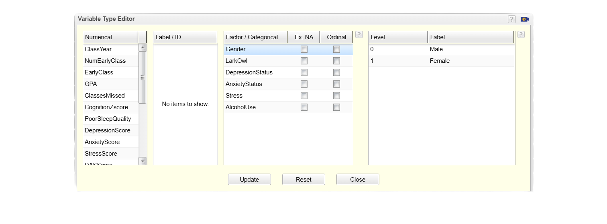
```


### 0.5.3 Search and Replace

The Search and Replace feature in Rguroo allows you to quickly locate specific values in a dataset and replace them with new values. This is especially useful for correcting data-entry errors, updating values, or making consistent changes throughout a dataset without editing each observation individually. Follow the steps below to search for entries or search and replace.

1. Open a dataset you wish to inspect.
2. To quickly locate a data entry, type the text into the *Quick Search* box. Click the down-arrow to search forward (down the column) or click the up-arrow to search backward (up the column) from your cursor location. The first instance of your search will be highlighted in green, while all instances will be highlighted in yellow, shown in @fig-quick-search-output.

```{r, echo=FALSE}
#| label: fig-quick-search
#| fig-cap: 'Rgruoo Dashboard Showing Quick Search'
#| fig-alt: 'Rgruoo Dashboard Showing Quick Search'
#| out-width: "90%"
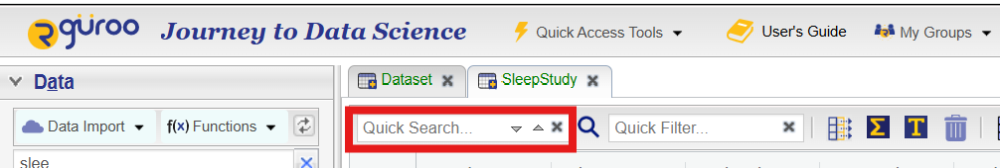
```

```{r, echo=FALSE}
#| label: fig-quick-search-output
#| fig-cap: 'Data Search for "Lark" Output'
#| fig-alt: 'Data Search for "Lark" Output'
#| out-width: "50%"
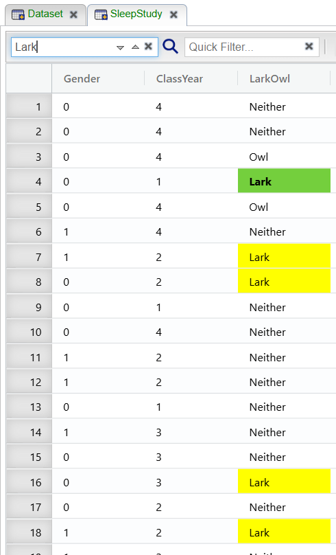
```

3. To perform a refined search or search and replace, click the *Search and Replace* icon ⌕. This will open the [Search and Replace]{.fun} dialog.

```{r, echo=FALSE}
#| label: fig-advanced-search
#| fig-cap: 'Rgruoo Dashboard Showing Advanced Search'
#| fig-alt: 'Rgruoo Dashboard Showing Advanced Search'
#| out-width: "90%"
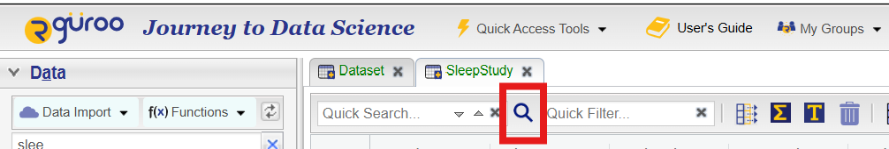
```

```{r, echo=FALSE}
#| label: fig-advanced-search-dialog
#| fig-cap: 'Dialog Box for Advanced Search'
#| fig-alt: 'Dialog Box for Advanced Search'
#| out-width: "60%"
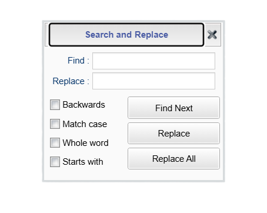
```

4. In the *Find* textbox, type the text or value you want to search. You can also refine your search by selecting one of the following options: Match case, Whole word, or Starts with.
5. Click the *Find Next* button and the first instance of the searched text will be highlighted in green. All other instances will be highlighted in yellow. Note: the output will be the same format as using the *Quick Search*
6. To move to the next occurrence, click the *Find Next* button. Alternatively, if you want to move backwards, check the *Backwards* box and then click the *Find Next* button.
7. Once you search for text and are sure you want to replace, you can enter the replacement and click *Replace* or *Replace All*.

::: {.callout-note appearance="simple" icon="false"}
⚠️ You cannot undo cells that you replace using the [Search and Replace]{.fun} dialog.
:::

<span style="background-color: yellow;">Need video</span>

[Walkthrough Example: Search a Dataset]{style="color: blue; font-weight: bold;"}

Use the [SleepStudy]{.data} dataset to search for severe anxiety.

**Let's Search the Dataset:** To search the dataset for severe anxiety, first we need to open the dataset.  Once open, we can either use the *Quick Search* or *Advanced Search* by clicking the eyeglass.  Since we are simply searching, let's use the *Quick Search*.

Begin by typing "severe" into the *Quick Search* textbox. Then click on the down-arrow. Your data should now be highlighted wherever it has "severe" as an entry. All occurrences are highlighted in yellow and the occurrence where the cursor is located is highlighted in green.

```{r, echo=FALSE}
#| label: fig-output-sleep-search
#| fig-cap: 'Dataset with "severe" Highlighted'
#| fig-alt: 'Dataset with "severe" Highlighted'
#| out-width: "60%"
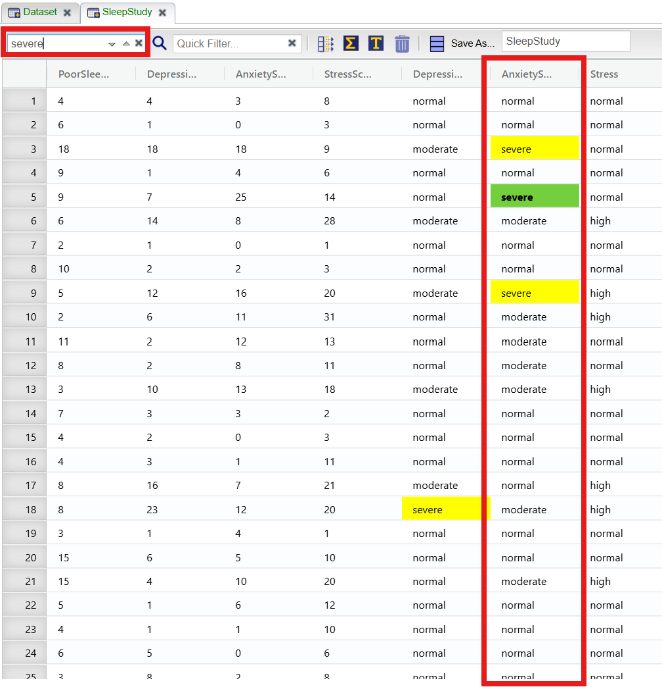
```

Notice that "severe" is also highlighted in the [DepressionScore]{.var} column since that was a label used for that variable as well. Since we are only interested in severe cases of the variable [AnxietyScore]{.var}, we will focus on that column only. If you scroll down the dataset, we can see that "severe" is not an overwhelming occurence, since most of the column is not highlighted as "severe."

### 0.5.4 Sorting and Filtering Data

Sorting and filtering in Rguroo can help you organize a dataset and focus on the observations that are most relevant to your analysis. Sorting rearranges the rows based on the values of one or more variables, making it easier to identify patterns, compare values, or locate specific observations. Filtering temporarily limits the displayed data to observations that meet specified conditions, allowing you to examine a particular group or subset without changing the original data. 

**Sorting**
When you click on a variable name (column label) for the first time, the values in that column get sorted in ascending order, and an up-arrow appears next to the variable name. If you click on the variable name for a second time, the values in the column will be sorted in descending order, and a down-arrow appears next to the variable name. Clicking on the variable name for a third time will return the values of the variable to their original order.

You can repeat this process by clicking on the variable name again to toggle the sorting between original, ascending, and descending orders. Each click on the variable name will cycle through these three orders.

```{r, echo=FALSE}
#| label: fig-sorting
#| fig-cap: 'Rguroo Sorting Options'
#| fig-alt: 'Rguroo Sorting Options: (a) unsorted, (b) sorted in ascending order, (c) sorted in descending order'
#| out-width: "90%"
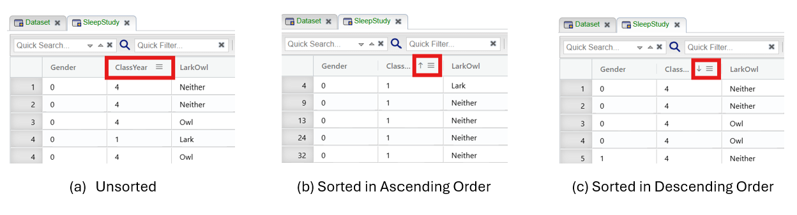
```

**Filtering**

To open and close the Filters Sidebar menu, click on the Filters tab. Variable names are listed in this tab. When you click on a variable name, you will see all of its unique values. You can filter the values of a selected variable by deselecting them. Note that when you filter a value from a variable, all rows containing that value will be removed from the dataset. To restore a filtered value, simply select the value again.

```{r, echo=FALSE}
#| label: fig-filter-tab
#| fig-cap: 'Filter Tab Showing Class Year Expanded'
#| fig-alt: 'Filter Tab Showing Class Year Expanded'
#| out-width: "90%"
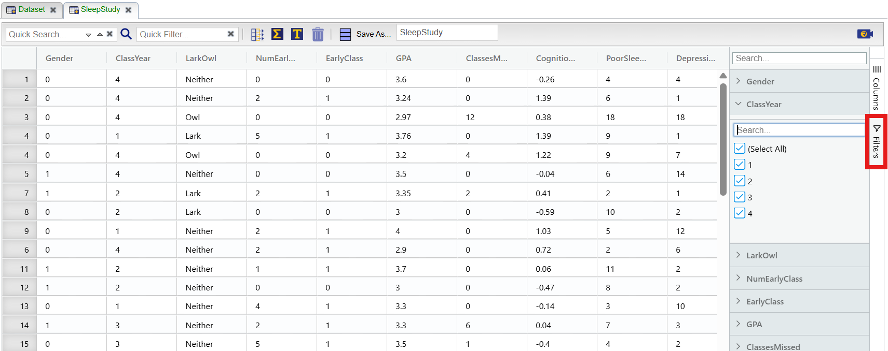
```

[Walkthrough Example: Sort and Filter a Dataset]{style="color: blue; font-weight: bold;"}

Use the [SleepStudy]{.data} dataset to sort [GPA]{.var} in descending order. Then filter to show only females.

**Let's Sort and Filter:** Open the [SleepStudy]{.data} dataset. To sort [GPA]{.var} in descending order, click on [GPA]{.var} twice. Now that we have sorted the variable, we want to filter to show only females.  Remember that the [SleepStudy Code Book] (#code-book-sleep) defined 0 as male and 1 as female. To only show females (1), click the filter menu on the left of the dataset workspace. Then click [Gender]{.var}. This will open the options of what is visible. Click 0 to unselect males. The dataset should now be sorted by [GPA]{.var} and only include females.

```{r, echo=FALSE}
#| label: fig-sort-filter
#| fig-cap: 'SleepStudy with GPA Sorted in Descending Order and Filtered to Show Females'
#| fig-alt: 'SleepStudy with GPA Sorted in Descending Order and Filtered to Show Females'
#| out-width: "90%"
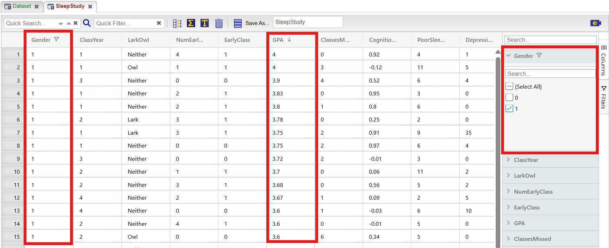
```


### 0.5.5 Practice: Try It Yourself

The following practice problems provide an opportunity to become familiar with inspecting, reclassifying, and sorting datasets in Rguroo. Use them to build confidence working with different methods of entering and importing data before completing graded assignments.

{width=45px} **Try It: Inspect Data Using the Dataset Summary**

Import the [Tuition_4_year]{.data} dataset. Open the Dataset Summaries box and make observations about the variables. Remember to scroll right to see summary statistics for numerical variables. 

{width=45px} **Try It: Reclassify a Variable**

Use the [SleepStudy]{.data} to reclassify the variable [AllNighter]{.var} to a categorical variable. Review the [SleepStudy Code Book] (#code-book-sleep) to determine the definitions of 0 and 1.

{width=45px} **Try It: Sort and Filter Data**

Use the [Tuition_4_year]{.data} dataset to sort [INSTATE_TUITION]{.var} in ascending order. Then filter to include only colleges in California (CA).

## 0.6 Saving and Exporting Your Work {#sec-save-export}

Rguroo is a cloud-based program, which means everything you save is stored in your Rguroo account rather than on your computer. When you log back in, from any computer with internet access, your saved datasets, graphs, and analyses will be exactly where you left them. Work that is **not** saved, however, is lost when you close the tab or log out. In this section, you will learn how to save datasets and outputs, where saved items appear, and how to export your work so you can submit it, share it, or keep a copy on your own computer.

### 0.6.1 Saving Datasets {#sec-save-data}

Any time you create, edit, or change a dataset, you need to save it before it can be used in other Rguroo tools. Rguroo saves datasets using a **Save As** textbox, which appears at the top of the Dataset Editor, the Table Editor, and the data preview window that opens after you use a data function such as [Subset]{.fun} or [Transform]{.fun}. Follow the steps below to save a dataset.

1.  Type a descriptive name for the dataset in the **Save As** textbox at the top of the workspace.
2.  Click the 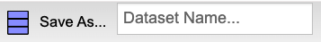 button. The dataset will now appear in your **Data** toolbox.
3.  Check the tab at the top of the workspace. A red tab means the dataset has unsaved changes, and a green tab means all changes have been saved.

A few things to keep in mind when saving datasets:

-   **Saving with the same name replaces the dataset.** If you save again using the same name, the old version is overwritten. If you want to keep the original, save the edited version with a new name.
-   **Choose names you will recognize later.** A name such as *cats_no_max* or *StudyHours_Week2* is much easier to find than *Dataset1*. Variable names cannot contain spaces, so Rguroo will replace any spaces in a variable name with a period.
-   **Save results from data functions.** When you subset, sort, or transform a dataset, the result opens in a preview window. The result is not kept unless you save it using the **Save As** textbox in that preview window.
-   **Save Parameters.** Some data functions, such as [Transform]{.fun}, include a [Save Parameters]{.des} checkbox. When it is checked, Rguroo saves your dialog box settings along with the new dataset so you can reopen and edit them later. Leave this box checked if you think you may need to make changes after you log out.

::: {.callout-note appearance="simple" icon="false"}
**Save early and often.** Rguroo does not automatically save new or edited datasets. If you close the tab or log out before clicking [Save As]{.button}, your changes will be lost.
:::

[Walkthrough Example: Saving an Edited Dataset Under a New Name]{style="color: blue; font-weight: bold;"}

In Section 0.4.1, you created and saved the [Study Hours]{.data} dataset. Suppose a sixth student reports studying 9 hours per week. Add this value to the dataset and save the updated version as [Study Hours 6]{.data} so the original dataset is not changed.

**Let's Save the Dataset:** In the **Data** toolbox, right-click on [Study Hours]{.data} and select *Edit* to open it in the Dataset Editor (@fig-open-edit). 

```{r, echo=FALSE}
#| label: fig-open-edit
#| fig-cap: "Right-Click Menu for Study Hours with Edit Selectede"
#| fig-alt: "Rguroo Data toolbox with the Study Hours dataset right-clicked. A menu lists View, Edit, Dataset Summary, Show Dependencies, Functions, Variable Type Editor, Edit Comment, Cut, Copy, Paste, Export as RGR, Download, Rename, and Delete. The Edit option is circled in red."
#| out-width: "40%"
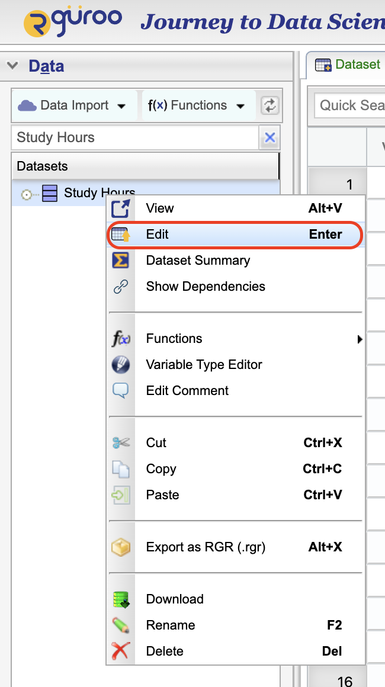
```

Click the Variable Properties, Add Rows/Variables button to add a new row (@fig-add-rows-button). 

```{r, echo=FALSE}
#| label: fig-add-rows-button
#| fig-cap: 'Variable Properties, Add Rows/Variables Icon in the Dataset Editor'
#| fig-alt: 'Study Hours dataset open in the Dataset Editor with five values in the Hours column: 6, 10, 8, 5, and 12. The first icon in the toolbar is circled in red, and a tooltip below it reads Variable Properties, Add Rows/Variables.'
#| out-width: "90%"
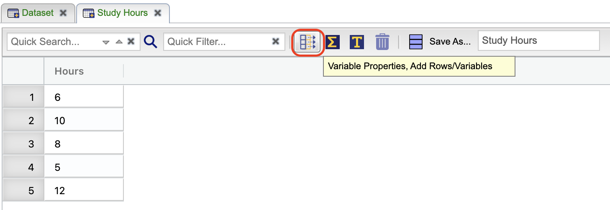
```

In the [Variable and Row Management]{.dialog} dialog, enter [1]{.typein} in the # of Rows box, select End radio button for Position, and click Add Rows (@fig-add-rows-dialog). 

```{r, echo = FALSE}
#| label: fig-add-rows-dialog
#| fig-cap: 'Add Rows in the Variable and Row Management Dialog'
#| fig-alt: 'Variable and Row Management dialog with Add Rows selected in the left panel. The right panel shows the number of rows set to 1 and the Position option set to End, with an Add Rows button below.'
#| out-width: "60%"
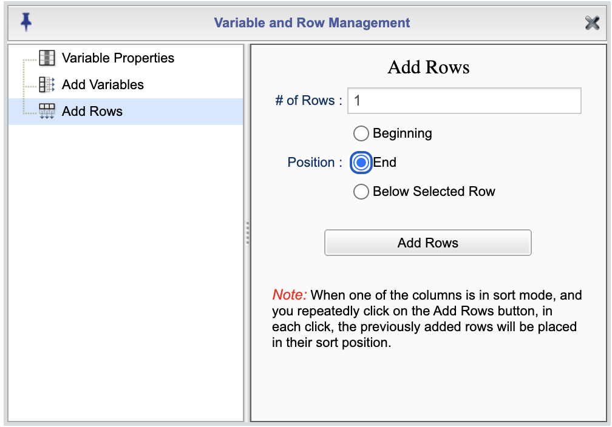
```

Enter [9]{.typein} in the [Hours]{.var} column. Notice that the tab at the top of the workspace turns red because the dataset has unsaved changes. In the **Save As** textbox, type [Study Hours 6]{.typein} and click [Save As]{.button}. The tab turns green, and your **Data** toolbox now lists both [Study Hours]{.data} (5 values) and [Study Hours 6]{.data} (6 values) (@fig-save-study-hours6).

```{r, echo = FALSE}
#| label: fig-save-study-hours6
#| fig-cap: 'Study Hours with a Sixth Value Added and Saved as Study Hours 6'
#| fig-alt: 'Dataset Editor showing the Hours column with six values: 6, 10, 8, 5, 12, and the new value 9 in row 6. The Save As textbox in the toolbar contains the name Study Hours 6.'
#| out-width: "90%"
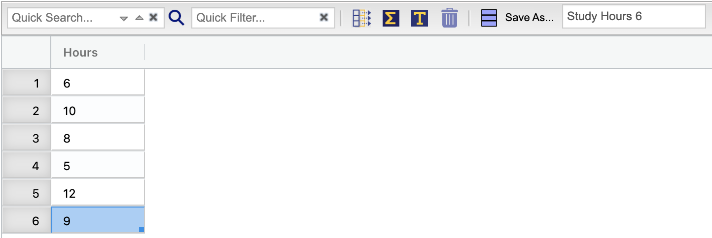
```

### 0.6.2 Saving Outputs {#sec-save-output}

Graphs, analyses, and simulations can be saved just like datasets. When you save an output, Rguroo stores both the result and every setting you chose in the dialog box. Later, you can reopen the saved output and it will appear exactly as you left it, ready for you to review or make changes. This makes your work **reproducible**, meaning you or your instructor can see exactly how a result was produced. Follow the steps below to save an output.

1.  Fill in the dialog box (for example, a [Boxplot]{.fun} or [Summary Statistic]{.fun} dialog) and click the preview icon  to check your output.
2.  Type a descriptive name in the **Save As** textbox at the top of the dialog box.
3.  Click the [Save As]{.button} button . The saved output now appears in the toolbox where it was created.

[Walkthrough Example: Saving a Graph]{style="color: blue; font-weight: bold;"}

Create a boxplot of the [Hours]{.var} variable in the [Study Hours 6]{.data} dataset and save it as *Study Hours Boxplot*.

**Let's Save the Graph:** Open the **Plots** toolbox, click the [Create Plot]{.dpd} dropdown, and select [Boxplot]{.fun}. From the [Dataset]{.dpd} dropdown, select *Study Hours 6*, and move [Hours]{.var} to the Selected column. Click the preview icon  to see the boxplot (@fig-boxplot-dialog-study). In the **Save As** textbox at the top of the dialog, type [Study Hours Boxplot]{.typein} and click [Save As]{.button}. The boxplot now appears in your **Plots** toolbox, and [Study Hours 6]{.data} appears in green bold text in your **Data** toolbox (@fig-saved-boxplot).

```{r,echo=FALSE}
#| label: fig-boxplot-dialog-study
#| fig-cap: 'Boxplot Dialog for the Study Hours 6 Dataset'
#| fig-alt: 'Rguroo Boxplot dialog with Study Hours 6 selected in the Dataset dropdown. In the Numerical Variables section, Hours has been moved to the Selected column. The Factor Variables section has no variables selected. The Notched, Horizontal, and Show Mean checkboxes are unchecked, the Title, X-Axis, and Y-Axis label boxes are empty, and the Preview eye icon appears in the upper right corner.'
#| out-width: "70%"
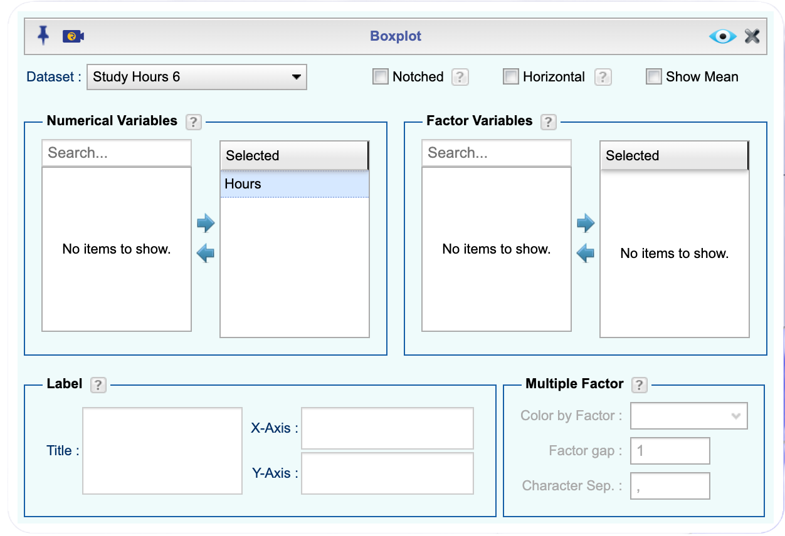
```

```{r, echo = FALSE}
#| label: fig-saved-boxplot
#| fig-cap: 'Saved Study Hours Boxplot in the Plots Toolbox'
#| fig-alt: 'Rguroo window with the Plots toolbox open on the left, where the search box contains study and the list shows the saved plot study hours boxplot. On the right, the boxplot tab shows the Basics, Details, and Level Editor buttons, a row of export icons, and the Save As textbox containing study hours boxplot. Below is a vertical boxplot of Hours with the lower whisker at 5, the box from 6 to 10, the median line at 8.5, and the upper whisker at 12.'
#| out-width: "90%"
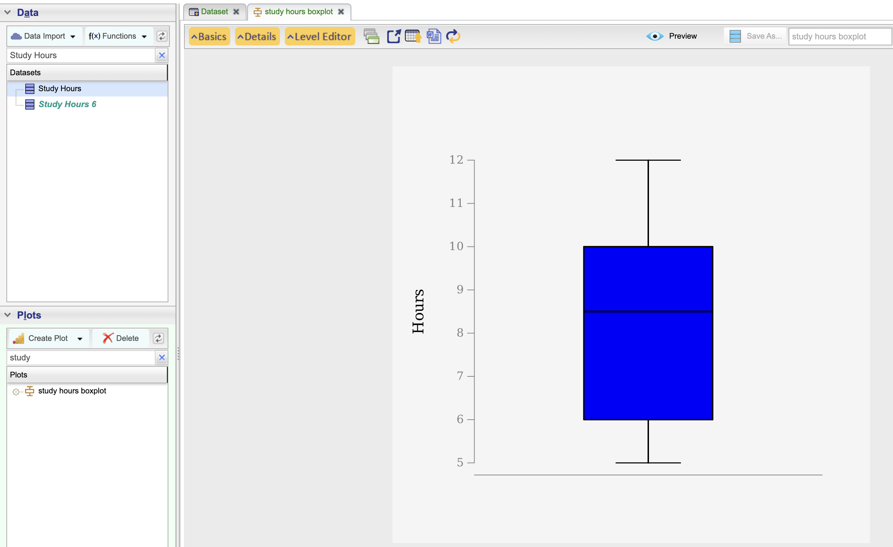
```

::: {.callout-note appearance="simple" icon="false"}
**Datasets used by saved outputs are protected.** Once you save a graph or analysis, the dataset it uses is shown in **green bold text** in the **Data** toolbox. Rguroo will not let you delete that dataset until you first delete the saved output that depends on it.
:::

### 0.6.3 Where to Find Saved Datasets and Outputs {#sec-find-data}

Each saved item appears in the toolbox where it was created:

| What you saved | Where it appears |
|------------------------------------|------------------------------------|
| Datasets and tables | **Data** toolbox |
| Graphs (boxplots, histograms, barplots, etc.) | **Plots** toolbox |
| Statistical analyses (confidence intervals, hypothesis tests, regression, etc.) | **Analytics** toolbox |
| Simulations and probability calculations | **Probability-Simulation** toolbox |

: Where saved items appear in Rguroo {#tbl-saved-locations tbl-alt="Table listing the type of item saved in Rguroo and the toolbox where it appears: datasets and tables in the Data toolbox, graphs in the Plots toolbox, analyses in the Analytics toolbox, and simulations in the Probability-Simulation toolbox."}

Because you will use the **Data** toolbox most often, it is worth learning how to keep it organized. The other toolboxes work the same way.

**Finding a dataset.** Type the first few letters of a dataset name in the search box at the top of the **Data** toolbox to narrow the list. Hovering your mouse over a dataset name shows its comment (if one was added), the number of rows, and the number of variables.

**Organizing with folders.** As the semester goes on, your list of datasets will grow. Folders can help you keep things organized, for example by creating one folder per chapter (@fig-data-folders).

1.  Click the [Data Import]{.dpd} dropdown and select [Add Folder to Root]{.fun}. You can also right-click on an empty area of the **Data** toolbox list and select [Add Folder to Root]{.fun}.
2.  Type a name for the folder, such as *Chapter 3*.
3.  Drag and drop datasets into the folder.

Right-clicking on a folder gives you the options [New Folder]{.des} (to create a folder inside it), [Export as RGR (.rgr)]{.des}, [Rename]{.des}, and [Delete]{.des}. A folder can only be deleted when it is empty.

```{r, echo = FALSE}
#| label: fig-data-folders
#| fig-cap: 'Datasets Organized in a Chapter 3 Folder in the Data Toolbox'
#| fig-alt: 'Rguroo Data toolbox with Study Ho typed in the search box. The Datasets list shows an expanded folder named Chapter 3 containing two datasets: Study Hours, and Study Hours 6 shown in green bold italic text.'
#| out-width: "40%"
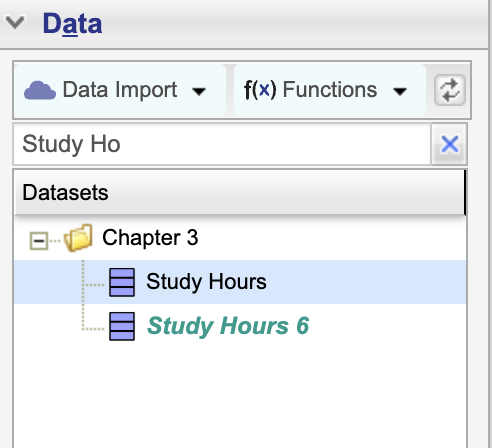
```

**Right-click options for a dataset.** Right-clicking on a dataset name opens a menu of options. Several of these were introduced in Section 0.5, and the rest are summarized below.

| Option | What it does |
|-----------------------|-------------------------------------------------|
| View | Opens the dataset in the data viewer (double-clicking the name does the same thing) |
| Edit | Opens the dataset in the Dataset Editor so you can change values, rows, or variables |
| Dataset Summary | Shows the dataset summary described in Section 0.5.1 |
| Variable Type Editor | Reclassifies variables, as described in Section 0.5.2 |
| Functions | Opens a list of data functions, such as [Summary Statistic]{.fun}, [Subset]{.fun}, and [Transform]{.fun}, with this dataset already selected |
| Rename | Changes the name of the dataset |
| Edit Comment | Adds or edits a short description that appears when you hover over the dataset name |
| Download | Saves a copy of the dataset to your computer as a CSV file (see [Section 0.6.4](#sec-export)) |
| Delete | Permanently removes the dataset from your account |

: Right-click options for a dataset in the Data toolbox {#tbl-right-click tbl-alt="Table listing right-click options for a dataset in the Rguroo Data toolbox, including View, Edit, Dataset Summary, Variable Type Editor, Functions, Rename, Edit Comment, Download, and Delete, along with what each option does."}

::: {.callout-note appearance="simple" icon="false"}
⚠️ Deleting a dataset cannot be undone. If you might need a dataset later, move it into a folder instead of deleting it.
:::

### 0.6.4 Exporting  {#sec-export}

Saving keeps your work inside your Rguroo account. **Exporting** creates a file outside of Rguroo, which you can submit to your instructor, upload to your course website, add to a report, or keep as a backup. Rguroo provides three main ways to export.

**Downloading a dataset as a CSV file**

A CSV (comma-separated values) file can be opened in Excel, Google Sheets, or almost any other program.

1.  In the **Data** toolbox, right-click on the dataset name (@fig-download-dataset).
2.  Select [Download]{.des}.
3.  Click [Download]{.button} in the window that appears. Depending on your browser settings, the file will either save to your Downloads folder or you will be asked where to save it.

You can also download a dataset while viewing it, or from the preview window after using a data function, by clicking the download icon in the top-left corner of the data viewer.

```{r,echo = FALSE}
#| label: fig-download-dataset
#| fig-cap: 'Downloading the Study Hours 6 Dataset as a CSV File'
#| fig-alt: 'Rguroo Data toolbox with Study Ho typed in the search box, listing two datasets: Study Hours, and Study Hours 6 shown in green bold italic text. Study Hours 6 has been right-clicked, opening a menu with View, Edit, Dataset Summary, Show Dependencies, Functions, Variable Type Editor, Edit Comment, Cut, Copy, Paste, Export as RGR, Download, Rename, and Delete. The Download option is highlighted.'
#| out-width: "45%"
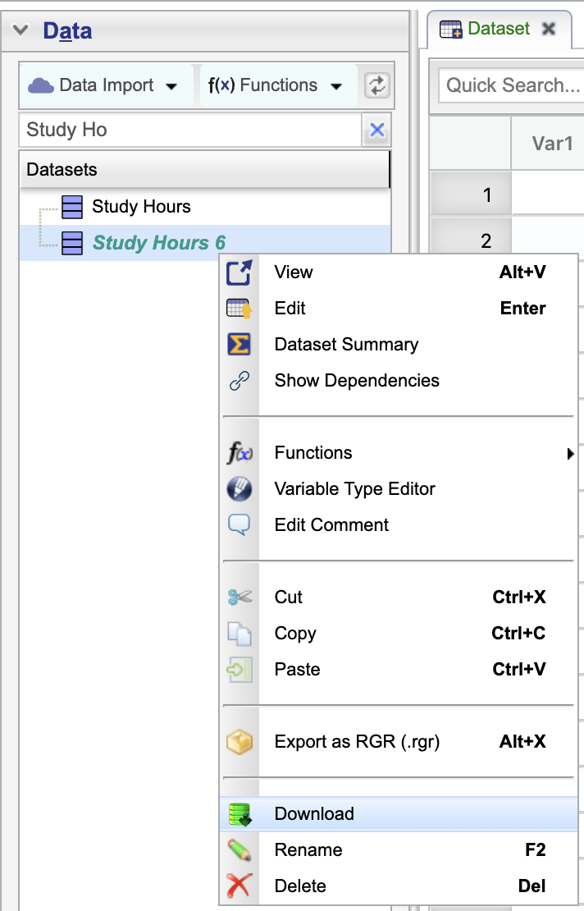
```

**Saving a graph as an image**

When you only need a single graph, such as a boxplot for a discussion post or lab report, you can save the graph itself as an image file.

1.  Open the saved graph, or click the preview icon  to display it.
2.  Right-click on the graph and select *Save image as* (@fig-save-image-as).
3.  Choose a location on your computer and click *Save*.

Rguroo saves graphs as **SVG** files. An SVG image stays sharp at any size, so it looks clear when it is enlarged or printed. The desktop version of Microsoft Word and most web browsers can open SVG files. Some programs, including Google Docs, cannot. If you need to use your graph in one of those programs, take a screenshot of the graph instead: press *Windows + Shift + S* on a PC or *Command + Shift + 4* on a Mac, then drag a box around the graph.

```{r, echo=FALSE}
#| label: fig-save-image-as
#| fig-cap: 'Saving the Study Hours Boxplot as an Image'
#| fig-alt: 'Rguroo output tab for the saved study hours boxplot, showing a vertical boxplot of Hours with whiskers from 5 to 12, a box from 6 to 10, and a median line at 8.5. The graph has been right-clicked, opening a browser menu with Open Image in New Tab, Save Image As, Copy Image, Copy Image Address, Create QR Code for this Image, Search This Image with Google Lens, and Inspect. Save Image As is highlighted.'
#| out-width: "90%"
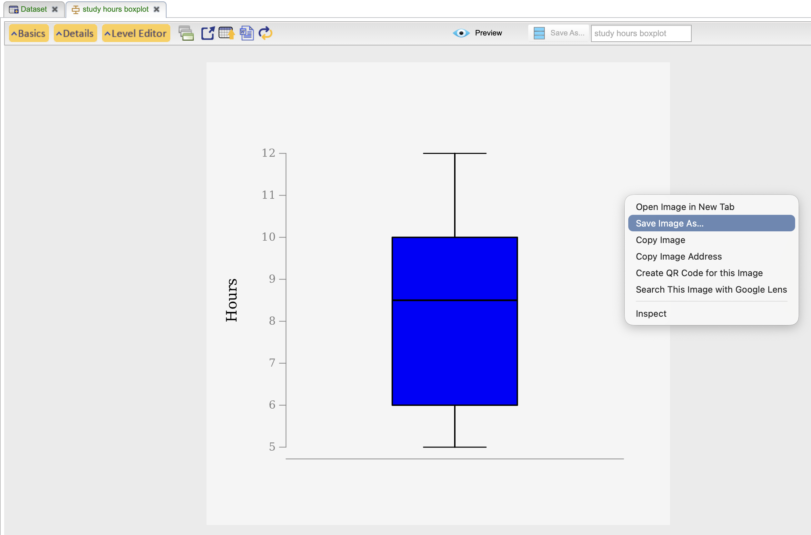
```

**Exporting a report**

Analyses in Rguroo produce a **report**: a set of tables, graphs, and written explanations in one output tab. Instead of saving each piece separately, you can download the entire report at once. Rguroo downloads the report as a zipped (compressed) folder that contains the report in two formats: a Word document (.docx) and an HTML file (a web page that opens in any browser), along with the graph image files.

1.  Run the analysis and click the preview icon  to display the report.
2.  In the toolbar at the top of the output tab, click the Word icon. When you hover over it, it reads *Download docx, html included* (@fig-download-docx-html).
3.  Save the zipped folder to your computer.
4.  Extract (unzip) the folder before opening any of the files:
    -   **Windows:** Right-click the zipped folder, select *Extract All*, and click *Extract*.
    -   **Mac:** Double-click the zipped folder. A regular folder with the same name appears next to it.
5.  Open the extracted folder to find the Word file, the HTML file, and the graph images.

```{r, echo = FALSE}
#| label: fig-download-docx-html
#| fig-cap: 'Download Docx, HTML is Included Button in the Output Toolbar'
#| fig-alt: 'Rguroo output toolbar with the Basics, Details, Level Editor, and Report Layout buttons on the left, followed by a row of icons. The Word document icon is circled in red, and a tooltip below it reads Download Docx, HTML is included.'
#| out-width: "90%"
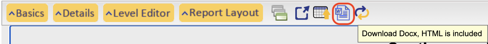
```


::: {.callout-note appearance="simple" icon="false"}
**Why unzip first?** Windows lets you open files inside a zipped folder without extracting them. If you open the HTML file this way, the graphs will not appear, because the browser cannot find the image files. Always extract the folder first.
:::

Each format in the download works best for a different purpose:

| Format | Best for | Things to know |
|------------|----------------------|-----------------------------------------|
| HTML | Viewing or printing the complete report, including all graphs | The graphs are saved as separate image files. Keep them in the same folder as the HTML file, or the graphs will not appear. Each graph includes a written description for screen readers. |
| Word | Copying tables and results into a lab report or project | Open the file in the desktop version of Microsoft Word. The file may appear blank in Google Docs, Word Online, or other programs. Graphs are not included, so add them separately using *Save Image As...*. |

: Comparing report export formats {#tbl-export-formats tbl-alt="Table comparing the two Rguroo report export formats. HTML is best for viewing or printing the complete report with graphs, which are saved as separate image files that must stay in the same folder and include screen reader descriptions. Word is best for copying tables and results into a lab report, must be opened in desktop Microsoft Word because it may appear blank in Google Docs or Word Online, and does not include the graphs."}

[Walkthrough Example: Exporting a Report]{style="color: blue; font-weight: bold;"}

Use the **Mean Inference** function to create a report for the [Hours]{.var} variable in the [Study Hours 6]{.data} dataset. Then download the report.

**Let's Export the Report:** Open the **Analytics** toolbox. Click the [Analysis]{.dpd} dropdown, select [Mean Inference]{.fun}, and then select [One Population]{.fun} (@fig-analysis-menu). This opens the [One Population Mean Inference]{.dialog} dialog.

```{r, echo=FALSE}
#| label: fig-analysis-menu
#| fig-cap: 'Selecting One Population Mean Inference from the Analysis Dropdown'
#| fig-alt: 'Rguroo Analytics toolbox with the Analysis dropdown open. The menu lists Proportion Inference, Mean Inference, Median Inference, Linear Regression, Variance Inference, Goodness of Fit, Contingency Table, ANOVA, Non-Parametric ANOVA, Time Series, Tabulation, and Numerical Summaries. Mean Inference is highlighted, and its submenu shows One Population, which is highlighted, and One and Two Population.'
#| out-width: "50%"
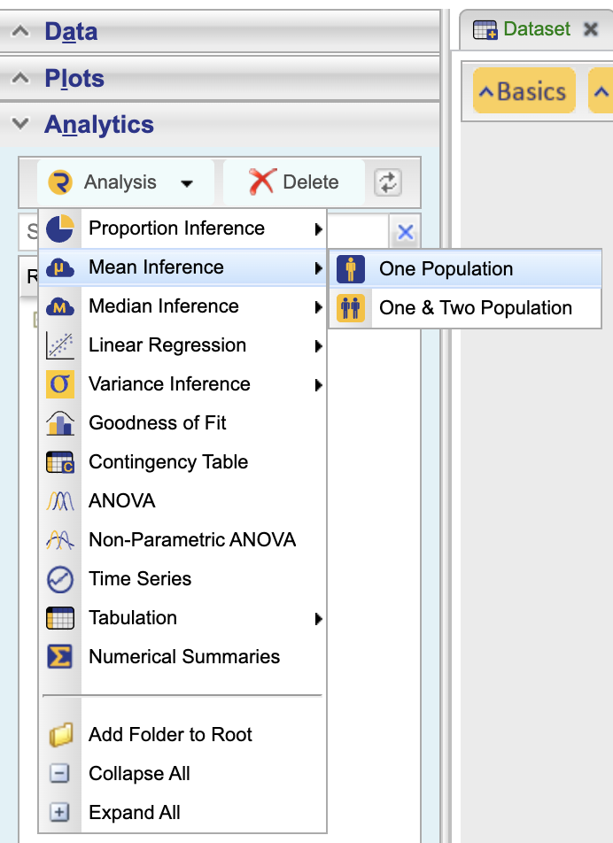
```

From the [Dataset]{.dpd} dropdown, select [Study Hours 6]{.data}, and from the [Variable]{.dpd} dropdown, select [Hours]{.var}. Rguroo automatically fills in the sample mean, sample standard deviation, and sample size (@fig-mean-inference-dialog). Leave all of the other options at their default settings and click the preview icon .

```{r, echo=FALSE}
#| label: fig-mean-inference-dialog
#| fig-cap: 'One Population Mean Inference Dialog for Study Hours 6'
#| fig-alt: 'Rguroo One Population Mean Inference dialog with Study Hours 6 selected in the Dataset dropdown and Hours selected in the Variable dropdown. The dialog shows a sample mean of 8.33333, a sample standard deviation of 2.58198, and a sample size of 6, with the Pop. S.d. box empty. Below, the Confidence Interval tab is open with a confidence level of 0.95, and all Method checkboxes are unchecked.'
#| out-width: "70%"
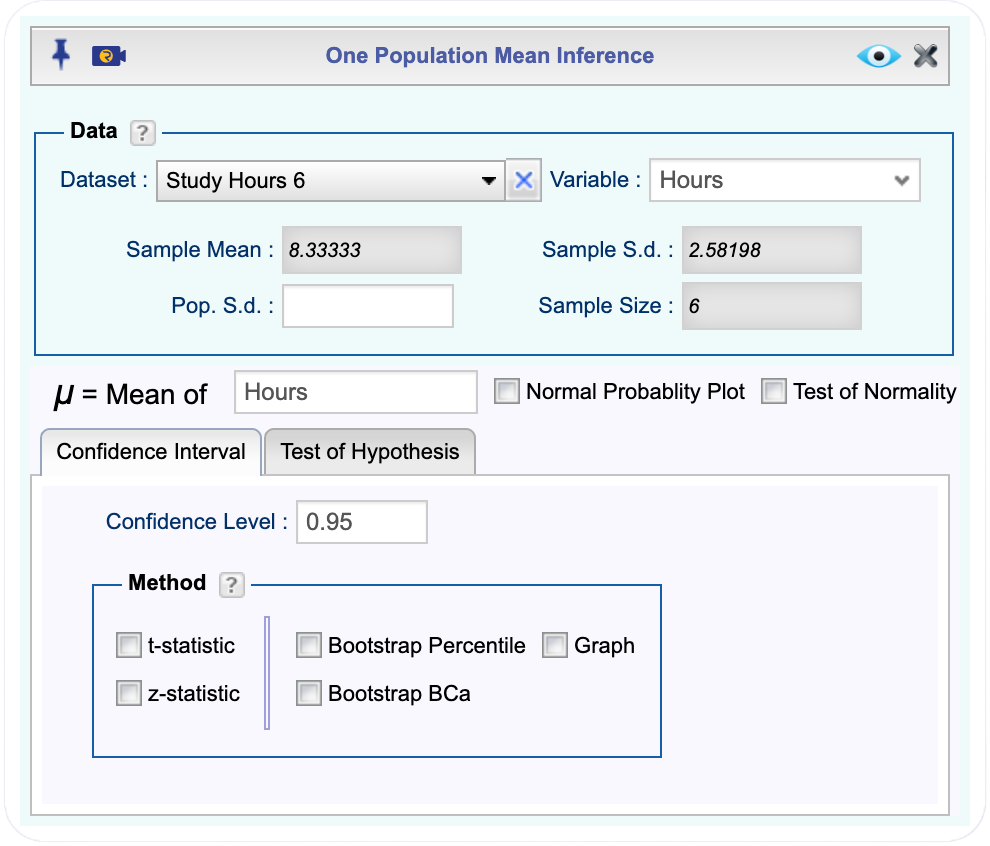
```

The report opens in a new tab with a **Data Summary** table showing a sample size of 6, a mean of 8.33333 hours, and a sample standard deviation of 2.58199 hours (@fig-mean-inference-output). Notice the Word icon in the toolbar at the top of the report.

```{r, echo=FALSE}
#| label: fig-mean-inference-output
#| fig-cap: 'One Population Mean Inference Report for Study Hours 6'
#| fig-alt: 'Rguroo output tab with the Basics, Details, and Report Layout buttons, a row of icons including the Word icon, the Preview button, and the Save As textbox containing MeanInferenceOnePop_3. Below, the report titled One Population Mean Inference shows a Data Summary table listing the variable Hours with a sample size of 6, a mean of 8.33333, and a sample standard deviation of 2.58199.'
#| out-width: "90%"

```

Next, click the Word icon (*Download Docx, HTML is included*) in the toolbar. Rguroo saves a zipped folder named *MeanInferenceOnePop* followed by a number to your Downloads folder (@fig-download-zip). Extract the folder (@fig-extracted-folder). Inside, you will find a Word file and an HTML file with the same name.

```{r, echo=FALSE}
#| label: fig-download-zip
#| fig-cap: 'Zipped Report Folder and Extracted Folder in Downloads'
#| fig-alt: 'Mac Finder window showing the Downloads folder with two items: MeanInferenceOnePop_3_docx.zip, a 10 KB ZIP archive, and MeanInferenceOnePop_3_docx, the extracted folder, which is highlighted.'
#| out-width: "70%"

```

```{r, echo=FALSE}
#| label: fig-extracted-folder
#| fig-cap: 'Contents of the Extracted Report Folder'
#| fig-alt: 'Mac Finder window showing the contents of the MeanInferenceOnePop_3_docx folder: a Word file named MeanInferenceOnePop_3.docx and an HTML file named MeanInferenceOnePop_3.html.'
#| out-width: "60%"

```

Open the Word file in Microsoft Word (@fig-report-word). The Data Summary table is ready to copy into a lab report or project. Then open the HTML file in your web browser (@fig-report-html) to see the report exactly as it appears in Rguroo.

```{r, echo=FALSE}
#| label: fig-report-word
#| fig-cap: 'Mean Inference Report Opened in Microsoft Word'
#| fig-alt: 'Microsoft Word document titled One Population Mean Inference, opened in Compatibility Mode. Below the title, a Data Summary table lists the variable Hours with a sample size of 6, a mean of 8.33333, and a sample standard deviation of 2.58199.'
#| out-width: "90%"

```

```{r, echo=FALSE}
#| label: fig-report-html
#| fig-cap: 'Mean Inference Report Opened in a Web Browser'
#| fig-alt: 'HTML report in a web browser with the title One Population Mean Inference and a Data Summary table listing the variable Hours with a sample size of 6, a mean of 8.33333, and a sample standard deviation of 2.58199.'
#| out-width: "90%"

```

Saving the analysis with [Save As]{.button} before you export is a good habit. If you need to change something later, you can reopen the saved analysis, make the change, and export again.


::: {.callout-note appearance="simple" icon="false"}
**Pop-up blockers.** If nothing happens when you click a download or export button, your browser may be blocking pop-ups. Allow pop-ups for rguroo.com and try again.
:::

**Exporting and importing RGR files**

An **RGR file** (a file ending in .rgr) is Rguroo's own file type. It packages a saved graph, analysis, or dataset together with all of its dialog box settings and the datasets it uses. When someone imports your RGR file into their own Rguroo account, they see your work exactly as you saved it. Instructors often use RGR files to share class examples, and students can use them to submit Rguroo work for homework, projects, and exams.

To export an RGR file:

1.  Place the items you want to export in a folder in the appropriate toolbox (see Section 0.6.3).
2.  Right-click on the folder and select [Export as RGR (.rgr)]{.des}.
3.  Save the .rgr file to your computer.

To import an RGR file that someone has shared with you:

1.  Open the **Data** toolbox.
2.  Click the [Data Import]{.dpd} dropdown and select [RGR (.rgr)]{.fun}. You can also use the import option in the Quick Access Tools (see Section 0.7.1).
3.  Choose the .rgr file and click [Upload]{.button}.

Rguroo places the imported items in a new folder named *Imported* followed by the date and time, inside each toolbox the items belong to. For example, an RGR file containing a boxplot will add a folder with the dataset to the **Data** toolbox and a folder with the boxplot to the **Plots** toolbox. You can then rename or move these items as you like.

[Walkthrough Example: Exporting Your Work as an RGR File]{style="color: blue; font-weight: bold;"}

Your instructor asks you to submit the boxplot you created in Section 0.6.2 as an RGR file.

**Let's Export the Work:** Open the **Plots** toolbox and create a folder named *Week 1 Submission*. Drag *Study Hours Boxplot* into the folder. Right-click on Week 1 Submission and select [Export as RGR (.rgr)]{.des} (@fig-export-rgr), then save the file to your computer. Because the RGR file includes the dataset the boxplot uses, your instructor will see both the boxplot and the [Study Hours 6]{.data} data when they import it. Upload the .rgr file wherever your instructor has asked you to submit it.

```{r, echo = FALSE}
#| label: fig-export-rgr
#| fig-cap: 'Exporting the Week 1 Submission Folder as an RGR File'
#| fig-alt: 'Rguroo Plots toolbox with study typed in the search box. The Plots list shows an expanded folder named Week 1 Submission containing the saved plot study hours boxplot. The folder has been right-clicked, opening a menu with New Folder, Export as RGR (.rgr), Cut, Paste, Rename, and Delete. Export as RGR (.rgr) is highlighted.'
#| out-width: "50%"

```

{width=45px} **Try It: Save, Organize, and Export**

Use the [Exercise Time]{.data} dataset you created in Section 0.4.5.

a.  Create a folder in your **Data** toolbox named *Getting Started* and move [Exercise Time]{.data} into it.
b.  Download [Exercise Time]{.data} as a CSV file and open it on your computer to confirm the five values are there.
c.  Create a boxplot of the exercise times and save it with an appropriate name. Check that it appears in your **Plots** toolbox and that [Exercise Time]{.data} now appears in green bold text in your **Data** toolbox.
d.  Place the boxplot in a folder in the **Plots** toolbox and export the folder as an RGR file.

## 0.7 Resources in Rguroo {#sec-resources}

You do not need to memorize every Rguroo feature. Rguroo includes several built-in resources you can turn to when you are unsure how to do something. This section describes where to find them.

### 0.7.1 Quick Access Tools {#sec-quick-access}

The **Quick Access Tools** dropdown at the top of the Rguroo window (item [2]{.circle-number} in @fig-dashboard) provides shortcuts to features you will use often. Click [Quick Access Tools]{.dpd} to open the menu (@fig-quick-access).

```{r, echo=FALSE}
#| label: fig-quick-access
#| fig-cap: 'Quick Access Tools Dropdown Menu'
#| fig-alt: 'Top of the Rguroo window with the Quick Access Tools dropdown open. The menu lists Import Dataset with shortcut Alt+1, Import RGR file (.rgr) with Alt+2, Scientific Calculator with Alt+3, Shortcut Keys with Alt+4, Dataset Repository with Alt+8, and Open Jupyter Light with Ctrl+Alt+R. The User Guide and My Groups buttons appear to the right, and the Data, Plots, Analytics, Prediction-Classification, Probability-Simulation, and Applets-Calculators toolboxes are listed on the left.'
#| out-width: "90%"

```

| Tool | What it does |
|--------------------|----------------------------------------------------|
| Import | Imports a dataset from your computer or a URL, or imports an RGR file (see Sections 0.4.4 and [0.6.4](#sec-export)) |
| Scientific Calculator | Opens a Desmos scientific calculator, useful for quick calculations such as factorials, combinations, and permutations |
| Shortcut Keys | Lists keyboard shortcuts for working in Rguroo |
| Dataset Repository | Opens the Rguroo Dataset Repository so you can import a dataset (see Section 0.4.4) |
| Jupyter Lite | Opens a browser-based coding notebook. This is an optional tool for users who want to write code and is not needed for this course |

: Rguroo Quick Access Tools {#tbl-quick-access tbl-alt="Table listing the Rguroo Quick Access Tools: Import, Scientific Calculator, Shortcut Keys, Dataset Repository, and Jupyter Lite, along with a description of what each tool does."}

::: {.callout-note appearance="simple" icon="false"}
**Tip:** Hover your mouse over any icon in Rguroo to see its name.
:::

### 0.7.2 User Guide {#sec-user-guide}

Rguroo provides written guides at three levels of detail. All of them can be opened from the **User's Guide** and **Documentation** buttons at the top of the Rguroo window (items [3]{.circle-number} and [6]{.circle-number} in @fig-dashboard) or from the *Resources* menu on the [Rguroo website](https://www.rguroo.com).

-   **[Quick User's Guide](http://files.rguroo.com/guides/quick_userguide.html)** (web-based). This is the best place to start. It is organized by topic, from the Dataset Editor and data functions to plots, inference, probability, and simulation. Each topic gives short step-by-step instructions with examples that use datasets from the Rguroo repository, so you can follow along in your own account. A camera icon  next to a topic links to a video for that topic.
-   **[Full User's Guide](http://files.rguroo.com/guides/latest_userguide.pdf)** (PDF). A longer reference with more technical detail about every dialog box option and the statistical methods Rguroo uses.
-   **[Dashboard Quick Guide](http://files.rguroo.com/guides/quick_userguide_dashboard.html)** (web-based). Instructions for the instructor Dashboard, covered in Section 0.9.

Help is also available inside each dialog box. Next to the name of each section of a dialog box is a small question mark icon . Click the question mark to open a **Help** window that explains the options in that section (@fig-dialog-help). For example, clicking the question mark next to **Numerical Variables** in the [Boxplot]{.dialog} dialog explains how to select variables and how to create side-by-side boxplots. Close the Help window by clicking the **X** in its upper-right corner. The question mark is often the fastest way to find out what a particular checkbox or dropdown does.

```{r, echo=FALSE}
#| label: fig-dialog-help
#| fig-cap: 'Opening Help for the Numerical Variables Section of the Boxplot Dialog'
#| fig-alt: 'Rguroo Boxplot dialog with Study Hours 6 selected and Hours in the Selected column. The question mark icon next to the Numerical Variables heading is circled in red, with a red arrow pointing from it to a Help window titled Help: Boxplot, Variable Selection. The Help window explains how to create boxplots for one or more numerical variables, how to select variables using the arrow buttons or drag and drop, and how to create side-by-side boxplots stratified by factor variables.'
#| out-width: "90%"

```

[Walkthrough Example: Using the Quick User's Guide]{style="color: blue; font-weight: bold;"}

Suppose you want to learn how to create a histogram, a graph you will use in Chapter 2.

**Let's Find It in the Guide:** Open the [Quick User's Guide](http://files.rguroo.com/guides/quick_userguide.html). In the table of contents on the left, find the topic *Plots for Numerical Data* and select *Histogram*. Alternatively, you can type *Histogram* in the search bar that can be accessed by clicking the magnifying glass icon. The page shows which toolbox and menu to use, describes the options in the Histogram dialog, and works through an example with a dataset you can import from the repository. If you prefer to watch, click the camera icon to open the video for that topic.

### 0.7.3 Video Tutorials {#sec-video-tutorials}

Short "how-to" videos are available for most Rguroo features. You can find them in three places:

-   **Inside Rguroo.** Click the **Tutorial Videos** button at the top of the Rguroo window (item [5]{.circle-number} in @fig-dashboard).
-   **On the Rguroo website.** Visit the [Rguroo Video Tutorials](https://rguroo.com/video-tutorials) page.
-   **On YouTube.** Visit the [Rguroo YouTube channel](https://www.youtube.com/channel/UCaY4gT66_NgYUqJRxvGI8QQ).

Throughout this text, a camera icon  followed by **Click Here** means a video is available for the skill being described.

## 0.8 How Rguroo is Used in the Text {#sec-rguroo-in-text}

This text uses Rguroo in every chapter. To help you find the instructions you need quickly, Rguroo steps, dialog boxes, and outputs are always presented in the same way. This section explains what to look for.

### 0.8.1 Identify Instructions for Solutions {#sec-instructions-solutions}

Each worked example in this text is set up the same way:

1.  The **example** states the problem. If the example uses a dataset, a line with the dataset repository logo  tells you the name of the dataset and the repository it is in. A collapsible **code book** describes each variable.
2.  The **🔎 Solution** box is collapsed so you can try the problem on your own first. Click it to expand the full solution.
3.  Inside the solution, Rguroo steps appear in their own collapsible box marked with the Rguroo logo {width=22px style='vertical-align:middle;'}. Click the box to see numbered, step-by-step instructions.
4.  Many Rguroo boxes include a nested box labeled **Click here to see the Rguroo dialog**, which shows a screenshot of the completed dialog box so you can compare it with yours.

When a set of Rguroo steps is used again later in a chapter, the text links back to the first full set of instructions (for example, "as shown [here](#)") rather than repeating them. Many Rguroo boxes also begin with a **Before you begin** note reminding you to import the dataset first.

Within Rguroo steps, different parts of the Rguroo window are formatted differently so you can tell at a glance what you are looking for on the screen.

| Formatting in the text | What it refers to | Example |
|--------------------|----------------------------|----------------------|
| **Bold** | A toolbox on the left side of the Rguroo window | **Data**, **Plots**, **Analytics** |
| [Dropdown]{.dpd} | A dropdown menu or button you click to see a list | [Functions]{.dpd}, [Dataset]{.dpd} |
| [Function]{.fun} | A function or menu item you select | [Summary Statistic]{.fun}, [Boxplot]{.fun} |
| [Dialog]{.dialog} | The name of a dialog box | [Basic Summary Statistic]{.dialog} |
| [Option]{.des} | A field, checkbox, or option inside a dialog box | [Mean]{.des}, [Sample Size]{.des} |
| [Type this]{.typein} | Text you type exactly as shown | [kozak]{.typein} |
| [Button]{.button} | A button you click | [Import]{.button}, [Save As]{.button} |
| [dataset]{.data} | The name of a dataset | [cats]{.data} |
| [variable]{.var} | The name of a variable in a dataset | [Bwt]{.var} |
| [Repository]{.repo} | The name of a dataset repository | [Kozak]{.repo} |

: Text formatting used for Rguroo instructions {#tbl-rguroo-formatting tbl-alt="Table explaining the text formatting used for Rguroo instructions in this book. Bold text is a toolbox, and styled text is used for dropdowns, functions, dialog box names, dialog options, text to type, buttons, dataset names, variable names, and repository names, each with an example."}

[Walkthrough Example: Following a Solution with Rguroo Steps]{style="color: blue; font-weight: bold;"}

The example below is set up exactly like the examples you will see in later chapters. Try it now using the [Study Hours]{.data} dataset you created in Section 0.4.1.

::: {#exm-study-hours-mean}
## Finding the Mean Study Time

Find the mean number of hours per week that the five students in the [Study Hours]{.data} dataset study.
:::

::::{.callout-tip .solution-callout collapse="true" icon=false}
## 🔎 Solution

Variable: $x$ = number of hours a student studies per week

Click to expand the box below to see how to calculate the mean in Rguroo.

:::: {.callout-note appearance="simple" collapse="true" icon="none" title="{width=22px style='vertical-align:middle;'} Calculating the Mean Study Time"}
**Before you begin:** Make sure the [Study Hours]{.data} dataset is saved in your **Data** toolbox, as shown in Section 0.4.1.

1.  Open the **Data** toolbox.
2.  Click on the [Functions]{.dpd} dropdown, and select [Summary Statistic]{.fun}. This opens the [Basic Summary Statistic]{.dialog} dialog.
3.  From the [Dataset]{.dpd} dropdown, select the [Study Hours]{.data} dataset.
4.  From the [Numerical]{.dpd} dropdown, select the [Hours]{.var} variable.
5.  In the **Statistics** section of the dialog, select the checkbox for [Mean]{.des}.
6.  Click the preview icon  to see the result.

::: {.callout-note appearance="simple" collapse="true" icon="none" title="Click here to see the Rguroo dialog"}

```{r, echo=FALSE}
#| label: fig-study-hours-mean-dialog
#| fig-cap: 'Basic Summary Statistic Dialog for the Study Hours Dataset'
#| fig-alt: 'Rguroo Basic Summary Statistic dialog with Study Hours selected in the Dataset dropdown and Hours selected in the Numerical dropdown. The Frequency, Factor 1, and Factor 2 boxes are empty, and Include Interaction is unchecked. In the Statistics section, only the Mean checkbox is checked.'
#| out-width: "70%"

```

:::
::::

```{r, echo=FALSE}
#| label: fig-study-hours-mean
#| fig-cap: 'Mean Study Time for the Study Hours Dataset'
#| fig-alt: 'Rguroo Summary Statistic output table with the columns Level and Mean. Under the heading All Observations, one row lists All Observations with a mean of 8.2.'
#| out-width: "40%"

```

The mean study time is 8.2 hours per week (@fig-study-hours-mean).

::::

### 0.8.2 Dialog Boxes {#sec-dialog-boxes}


A **dialog box** is the window where you tell Rguroo what you want to do. You choose the dataset and variables, select options, and then click the preview icon  to see the result. Most dialog boxes are organized from top to bottom in the order you fill them in: first the dataset, then the variables, then the options.

**How tabs work.** Each time you open a dataset or select a function, such as [Boxplot]{.fun} or [Mean Inference]{.fun}, Rguroo opens a new **tab** in the workspace. The tab holds everything for that task: the dialog box appears as a window on top of the tab, and when you click the preview icon, the output appears in the same tab behind it. Because each task has its own tab, you can switch between a dataset, a graph, and an analysis without closing any of them. After you save, the tab takes the name you entered in the **Save As** textbox.

**Reopening the dialog box.** The toolbar at the top of each tab has yellow buttons such as **Basics** and **Details**. Click **Basics** to reopen the dialog box with the most common options (@fig-tab-dialog-output), or **Details** for additional options. Your earlier selections are still there, so you can change one setting and preview again without starting over. Graph tabs also have a **Level Editor** button for changing the order, labels, and colors of categories. Analytics tabs have a **Report Layout** button for choosing what appears in the report. 

```{r, echo = FALSE}
#| label: fig-tab-dialog-output
#| fig-cap: 'Boxplot Dialog Box Open Over the Output in the Study Hours Boxplot Tab'
#| fig-alt: 'Rguroo workspace with two tabs, Dataset and study hours boxplot. The study hours boxplot tab is selected, and its toolbar shows the Basics button, highlighted and open, followed by the Details and Level Editor buttons, a row of icons, the Preview button, and the Save As textbox containing study hours boxplot. The Boxplot dialog box floats over the tab with Study Hours 6 selected as the dataset and Hours in the Selected column, and part of the blue boxplot output is visible behind it on the right.'
#| out-width: "90%"

```

Screenshots of completed dialog boxes appear in the boxes labeled **Click here to see the Rguroo dialog**, or as figures with captions such as "Basic Summary Statistic Dialog for the Study Hours Dataset." Use these screenshots to check your work. If your result does not match the text, compare your dialog box with the screenshot to find which selection is different.

A few tips for working with dialog boxes:

-   **Icons in the title bar.** The title bar of each dialog box has a pin icon on the left, which keeps the dialog box open while you work, and a camera icon that opens a video about that dialog box. On the right are the preview icon  and an **X** to close the dialog box. Closing the dialog box does not close the tab or delete your output.
-   **Help is built in.** Click the question mark icon next to any section name in a dialog box to see an explanation of its options (see Section 0.7.2).
-   **Your screen may look slightly different.** Rguroo is updated regularly, so the layout or colors on your screen may differ a little from the screenshots. The names of menus, options, and buttons will be the same.


### 0.8.3 Rguroo Outputs {#sec-rguroo-outputs} 

When you click the preview icon , Rguroo displays the result in the same tab as the dialog box. Depending on the function, the output may be a graph, a table of results, or a full report with tables, graphs, and a written explanation of how to interpret the results. If you change a selection in the dialog box and click the preview icon again, the output updates in place.

In this text, Rguroo outputs appear in two ways:

-   **Screenshots** of the output, shown as figures with a caption (for example, "Mean and Median Weight of Cats"). These show the key numbers you should see when you complete the steps.
-   **Interactive outputs**, shown in a scrollable window inside the page. These are the actual Rguroo output, so you can scroll through the full report, and graphs can be explored the same way they would be in Rguroo. If you are using a keyboard, press *Tab* to move into the output window and use the arrow keys to scroll.

When you compare your output to the text, focus on the values the question asks for. Results based on **simulation** or **random sampling** (introduced in Chapter 4) will be slightly different every time they are run, so your numbers will be close to, but not exactly the same as, the numbers in the text.

::: {.callout-note appearance="simple" icon="false"}
**Accessibility.** Rguroo works with standard screen readers and provides written descriptions of its graphs. Every screenshot in this text also includes alternative text describing what the image shows.
:::

### 0.8.4 Rguroo Icons {#sec-rguroo-icons}

The following icons appear in Rguroo and throughout this text. Some were introduced in Section 0.3. They are collected here so you have one place to look them up.

| Icon | Name | Where you see it | What it means |
|:----:|------------|----------------------|--------------------------------|
|  | Preview | Rguroo dialog boxes and this text | Runs the dialog box and shows the graph, table, or output |
|  | Save As | Rguroo data and outputs | Saves the dataset or output with the name typed in the **Save As** textbox |
|  | Dataset repository | This text | The dataset for an example or exercise is available in an Rguroo dataset repository |
| {width=22px} | Rguroo logo | This text | A collapsible box with step-by-step Rguroo instructions |
|  | Add | Rguroo dialog boxes | Adds a new row, such as a new logical expression or a new variable |
|  | Filters | Rguroo Dataset Editor | Opens the Filters panel so you can hide rows with certain values |
|  | Camera | This text and the Rguroo User's Guide | A video is available for this skill |
| {width=30px} | Try It | This text | A practice problem to try on your own |

: Common Rguroo icons {#tbl-rguroo-icons tbl-alt="Table of common icons used in Rguroo and in this text. Each row shows the icon, its name, where it appears, and its meaning. The icons are Preview, Save As, Folder, Dataset repository, Rguroo logo, Add, Filters, Camera, and Try It."}

{width=45px} **Try It: Find the Icons**

Open the [Summary Statistic]{.fun} dialog in Rguroo and locate the Preview icon and the **Save As** textbox. Then open the [Subset]{.fun} dialog and find the green Add icon . Hover over each icon to confirm its name.

## 0.9 Instructor Dashboard {#sec-instructor-dashboard}

The Rguroo **Dashboard** is a set of tools for instructors. From the Dashboard, you can create groups for your classes, build your own dataset repositories, share those repositories with your students, monitor student login activity, and email your students. Students do not have access to the Dashboard, but they benefit from the repositories and emails you share with them through it.

::: {.callout-note appearance="simple" icon="false"}
**Students:** This section is written for instructors. You only need Section 0.4.4 (*My Groups*) to join your instructor's group and import datasets from it.
:::

### 0.9.1 Creating Instructor Account {#sec-create-instructor-acct}

Faculty accounts in Rguroo are **free**. To register, you must use your **institution-issued email address** (for example, an address ending in .edu). The Rguroo team reviews each faculty registration manually before approving it, and accounts registered with a personal email address, such as Gmail or Yahoo, will not be approved.

Instructors register in much the same way as students (see Section 0.2), with one difference: on the registration page, select **Faculty** instead of **Student** (see @fig-rguroo-student).

1.  Go to the [Rguroo website](https://www.rguroo.com) and click **Register** in the upper-right corner.
2.  Select **Faculty**.
3.  Enter your institutional email address and complete the email verification, as described in Section 0.2 (@fig-faculty-register).
4.  Complete the **Your Information** page, including your institution's name.
5.  Click **Submit**, then check your email and complete the verification, as described in Section 0.2. Because faculty accounts are reviewed manually, approval is not immediate. You will receive an email when your account has been approved.

```{r, echo=FALSE}
#| label: fig-faculty-register
#| fig-cap: 'Rguroo Faculty Registration Page'
#| fig-alt: 'Rguroo Faculty Registration web page. Under the heading Register Faculty, the Your Role dropdown is set to Instructor, followed by Email and Verify Email text boxes. A note below reads: In order for your account to be approved, you must use your institution-issued email address. A yellow Submit button appears at the bottom.'
#| out-width: "80%"

```

::: {.callout-note appearance="simple" icon="false"}
**Plan ahead.** Because faculty accounts are reviewed manually, register well before the start of the term so your account is ready in time to create your class groups and repositories.
:::

Once your faculty account is active, a **Dashboard** button appears at the top right of the Rguroo window (item [7]{.circle-number} in @fig-dashboard).

::: {.callout-note appearance="simple" icon="false"}
**Already have a student or trial account?** Your faculty account must be registered with your institutional email address. If you previously created an account with a different email, register again as faculty using your institutional email.
:::

Rguroo also offers free workshops and one-on-one training for faculty. To schedule a session, visit the [Request Training](https://rguroo.com/request-training/) page.

### 0.9.2 Navigating Instructor Dashboard {#sec-navigate-dashboard}	 

To open the Dashboard, log in to Rguroo and click the **Dashboard** button at the top right of the Rguroo window. The Dashboard opens in a new browser tab.

The left side of the Dashboard has two main icons:

-   **Groups** opens the **Manage Groups** page, where you create groups, add and remove members, share repositories, monitor activity, and send emails (@fig-dashboard-groups).
-   **Repositories** opens the **Manage Repositories** page, where you create dataset repositories and add datasets to them.

On a small screen, click the three horizontal lines at the top right of the Dashboard window to see these icons.

On both pages, the left pane is a **directory** that works like the folders in your Rguroo toolboxes. You can create items in the main (root) directory or organize them in folders. For example, you might create a folder for each semester, or a folder for each course you teach. To create a folder, click the **FOLDER** button at the top of the directory pane, type a name, and click [Apply]{.button}.

```{r, echo = FALSE}
#| label: fig-dashboard-groups
#| fig-cap: 'Rguroo Dashboard Showing the Manage Groups Page'
#| fig-alt: 'Rguroo Dashboard with Welcome Instructor at the top right. The left side has two icons, Groups, which is selected, and Repositories. Next to them are the FOLDER and GROUP buttons, and below them is a folder named My Classes with a trash icon and an add group icon on its right. The main area is titled Manage Groups.'
#| out-width: "90%"

```

::: {.callout-note appearance="simple" icon="false"}
**Suggested order for setting up a new class:** (1) create a repository and add your datasets ([Section 0.9.3](#sec-create-repository)), (2) create a group for the class ([Section 0.9.4(#sec-create-groups)]), (3) share the repository with the group ([Section 0.9.5](#sec-link-repository)), and (4) give students the Group Code.
:::

### 0.9.3 Creating Repositories {#sec-create-repository}

A **dataset repository** is a collection of datasets that users can import into their own Rguroo accounts with a few clicks. The Kozak repository used throughout this text is one example. Creating your own repository lets you give students exactly the datasets they need for a lab, project, or exam.

**Creating a repository**

1.  In the Dashboard, select the **Repositories** icon to open the **Manage Repositories** page.
2.  Click the REPOSITORY button at the top of the directory pane (@fig-create-repository). To create the repository inside a folder, click the plus sign next to the folder name instead.
3.  In the **Create Repository** dialog, enter a unique **Name** and, optionally, a **Description** and click CREATE.

```{r, echo = FALSE}
#| fig-cap: 'Create Repository Dialog in the Rguroo Dashboard'
#| label: fig-create-repository
#| fig-alt: 'Rguroo Dashboard with Welcome Instructor at the top right and Repositories selected on the left. Next to it are the FOLDER and REPOSITORY buttons and a folder named My Repositories. The Create Repository dialog is open in the center with an empty Name box, an empty Description box, and a CREATE button.'
#| out-width: "90%"

```

**Adding datasets to a repository**

Select the repository name to open its **Manage Repository** page (@fig-manage-repository). In the **Datasets** section, the icons on the right let you add datasets in three ways:

```{r, echo=FALSE}
#| label: fig-manage-repository
#| fig-cap: 'Manage Repository Page for a New, Empty Repository'
#| fig-alt: 'Rguroo Dashboard page titled Manage Repository: New Repository. Below the title, the repository name New Repository and the note Created: a few seconds ago appear, followed by a count of 0 Datasets with a pencil edit icon and a trash icon on the right. The Datasets section below shows 0 Records found and a row of icons on the right: a download arrow, a shaded plus, a plus sign with three lines, a plain plus sign, and an up arrow to collapse the section. The empty table has columns for Name, Title, File Type, Comment, Columns, and Rows.'
#| out-width: "90%"

```

-   **Upload a CSV or Excel file from your computer.** Click the plain plus sign (fourth icon) and select the file. Then enter:
    -   **Name**: the dataset name students will see in their **Data** toolbox after importing.
    -   **Title**: the title shown in the repository list.
    -   **Comment** (optional): a short description students see when hovering over the dataset name.
    -   **Documentation** (optional): a full description of the dataset, typed in the text editor or uploaded as a text (.txt) or HTML file. Students can open it from the information icon in the repository list. This is a good place to paste the dataset's code book.
-   **Import datasets from your own Rguroo account.** Click the plus sign with three lines (third icon), check the datasets you want from your **Data** toolbox, and click [Import]{.button}.
-   **Import datasets from a repository another instructor has shared with you.** Click the shaded plus (second icon), choose the shared repository, select the datasets, and click the import button.

| Icon | What it does |
|------|--------------|
| Down arrow (first icon) | Downloads selected datasets to your computer |
| Shaded plus (second icon) | Imports datasets from a repository another instructor shared with you |
| Plus with three lines (third icon) | Imports datasets from your own Rguroo account |
| Plain plus (fourth icon) | Uploads a CSV or Excel file from your computer |

: Icons in the Datasets section of the Manage Repository page {#tbl-repository-icons tbl-alt="Table describing the four icons in the Datasets section of the Rguroo Manage Repository page: the down arrow downloads selected datasets, the shaded plus imports datasets from a repository shared by another instructor, the plus with three lines imports datasets from your own Rguroo account, and the plain plus uploads a CSV or Excel file from your computer."}


**Managing datasets in a repository**

Each dataset in the list has a download icon and an eye icon for previewing it. Hover over a dataset name to see the eye icon (preview) and the down-arrow icon (download). To delete or update a dataset, check the box next to its name. A bar appears at the bottom of the page with the buttons **DELETE SELECTED DATASET** and **UPDATE DATASET DETAILS** (@fig-manage-datasets). Use **UPDATE DATASET DETAILS** to change a dataset’s name, title, comment, or documentation. To rename a repository or change its description, click the pencil icon next to the dataset count. To delete a repository, click the trash icon next to it.

```{r, echo = FALSE}
#| label: fig-manage-datasets
#| fig-cap: 'Managing a Dataset in a Repository'
#| fig-alt: 'Rguroo Dashboard Manage Repository page for New Repository, which is highlighted in the left sidebar below a folder named My Repositories. The Datasets section lists one dataset, Study Hours, a csv file with 1 column and 5 rows. Its checkbox is checked, and download and eye preview icons appear next to it. A bar at the bottom of the page reads 1 selected, with the buttons DELETE SELECTED DATASET and UPDATE DATASET DETAILS.'
#| out-width: "90%"

```

### 0.9.4 Creating Groups {#sec-create-groups}

A **group** is a set of Rguroo users, usually the students in one of your classes. Groups are how you share repositories with students, monitor their activity, and send them emails.

**Creating a group**

1.  In the Dashboard, select the **Groups** icon to open the **Manage Groups** page.
2.  Click the **GROUP** button at the top of the directory pane (@fig-create-group), or click the add-group icon next to a folder name to create the group inside that folder. You can also duplicate an existing group using the duplicate button.
3.  In the **Create Group** dialog, enter:
    -   **Name**: for example, *STAT C1000 Section 12345 Fall 2026*.
    -   **Group Code**: the code students will type to join. Type your own alphanumeric code or click [Generate]{.button} for a random one. Rguroo will ask for a different code if yours is already in use.
    -   **Description** (optional).
    -   **Expiration Date**: the date the group expires. The default is six months after the group is created. After the group expires, members can no longer access the repositories shared with the group, although any datasets they already imported stay in their accounts.
and click **CREATE**

```{r, echo = FALSE}
#| label: fig-create-group
#| fig-cap: 'Create Group Dialog in the Rguroo Dashboard'
#| fig-alt: 'Rguroo Dashboard with Welcome Instructor at the top right and Groups selected on the left. Next to it are the FOLDER and GROUP buttons and a folder named My Classes with a trash icon and an add group icon. The Create Group dialog is open in the center with an empty Name box, a Group Code box with a GENERATE button, an empty Description box, an Expiration Date box showing 2027/04/13, and a CREATE button.'
#| out-width: "90%"

```

::: {.callout-note appearance="simple" icon="false"}
⚠️ The Group Code cannot be changed after the group is created. You can change the group's name, description, and expiration date at any time by selecting the group and clicking the edit icon.
:::

**Adding students to a group**

There are two ways to add members:

-   **Students join with the Group Code.** Give students the Group Code (for example, in your syllabus or course website). Students join by clicking *My Groups* at the top of the Rguroo window, selecting *Join a Group*, entering the code, and clicking *Join Group*, as described in Section 0.4.4.
-   **You invite students by email.** Select the group, then in the **Members** section click the plus sign, enter the student's Rguroo username (email), and click [Add]{.button}. To invite a whole class at once, click the plus-sign-with-three-lines button, download the CSV or Excel template, fill in your students' email addresses, and import the completed file. Each student receives an email with the Group Code and instructions for joining.


### 0.9.5 Linking Repositories to Groups {#sec-link-repository}

Creating a repository does not automatically give students access to it. You need to **share** (link) the repository with a group.

1.  In the Dashboard, select the **Groups** icon and click the name of the group.
2.  At the bottom of the page, find the section labeled **Share My Repositories** and click the down arrow to see the repositories you have created.
3.  In the **Action** column, click the share button in the row for the repository you want to share.

```{r, echo = FALSE}
#| label: fig-share-repo-group
#| fig-cap: 'Sharing a Repository with a Group'
#| fig-alt: 'Rguroo Dashboard Manage Group page for New Group, which is highlighted in the left sidebar below a folder named My Classes. The page shows the group code, an expiration date of in 6 months, 0 members, and 1 Shared out of 1 Repositories. Below an empty Members section, the Share My Repositories section lists New Repository with a green SHARED status and an UNSHARE button in the Actions column.'
#| out-width: "90%"

```

The **Status** column changes to show that the repository is shared, and the share button changes to an unshare button. To stop sharing the repository with that group, click the unshare button. You can share the same repository with several groups, which is useful when you teach more than one section of the same course.

Students can then import the shared datasets in either of two ways:

-   Click *My Groups* and select *Show My Groups*, then select the group and repository (see Section 0.4.4).
-   In the **Data** toolbox, select [Data Import]{.dpd} then [Dataset Repository]{.fun}, choose the **My Repositories** option, and select the repository.

**Sharing a repository with another instructor**

Repositories can also be shared directly with other faculty, even if they are not in one of your groups. This is a convenient way for a department to share a common set of datasets. In the **Repositories** page, hover over the repository and click the share icon. In the **Share Repository** dialog (@fig-share-repo-dialog), type the instructor’s Rguroo username (email) in the Email of user to add box, click the plus icon, and then click **SHARE**. To stop sharing, click the trash icon next to their name. Students can only be given access to repositories through groups.

```{r, echo = FALSE}
#| label: fig-share-repo-faculty
#| fig-cap: 'Share Icon for a Repository in the Repositories Sidebar'
#| fig-alt: 'Rguroo Dashboard Repositories sidebar showing a folder named My Repositories and a repository named New Repository. The mouse is over New Repository, revealing a share icon and a copy icon on the right, with a tooltip reading Share New Repository.'
#| out-width: "50%"

```

```{r, echo = FALSE}
#| label: fig-share-repo-dialog
#| fig-cap: 'Share Repository Dialog for Sharing with Another Instructor'
#| fig-alt: 'Rguroo Share Repository dialog with a text box labeled Email of user to add and a plus icon, the message This repository is not shared with anyone, and a SHARE button.'
#| out-width: "60%"

```

### 0.9.6 Student Activity Log {#sec-student-activity}

The Dashboard lets you see when, and for how long, each group member has been logged in to Rguroo. This can help you check whether students are getting started with Rguroo early in the term, or follow up with a student who has not logged in.

1.  In the Dashboard, select the **Groups** icon and click the name of the group. A list of group members appears.
2.  Move your mouse over a student's name and click the activity monitor icon.
3.  A time plot opens showing the dates the student logged in along the horizontal axis and how long they were logged in each time.

```{r, echo=FALSE}
#| label: fig-group-members
#| fig-cap: 'Group Members with Activity and Login History Icons'
#| fig-alt: 'Rguroo Dashboard Manage Group page for New Group showing the group code, an expiration date of in 4 months, 2 members, and 1 Shared out of 1 Repositories. The Members section lists Student One and Student Two with their email addresses. The mouse is over Student One, revealing a bar chart icon and a clock history icon to the left of the name.'
#| out-width: "90%"

```

```{r, echo=FALSE}
#| label: fig-login-history
#| fig-cap: 'Login History for a Group Member'
#| fig-alt: 'Rguroo Login History table listing seven sessions for one student. Each row shows the session duration, ranging from 37 minutes to about 1.5 hours, the login and logout dates and times between February 4 and March 11, 2027, and a session end reason of Expired.'
#| out-width: "90%"

```

```{r, echo = FALSE}
#| label: fig-activity-graph
#| fig-cap: 'Login Activity Graph for a Group Member'
#| fig-alt: 'Rguroo login activity time plot for one student. The horizontal axis shows dates from February 4 to March 28, 2027, and the vertical axis shows session length from 0 to 1 hour 40 minutes. Seven points connected by a shaded curve show sessions ranging from about 37 minutes to about 1.5 hours. A tooltip on the first point reads Feb 04, 2027, Duration 1H 29M, Login Time 10:15.'
#| out-width: "90%"

```

The member list also provides two other tools:

-   **Emailing students.** Check the box next to the **Name** header to select everyone, or check individual students. Click the send-mail button at the bottom of the page, enter a subject and message, and click send. Emails come from a no-reply address, so ask students to contact you through your usual channels rather than replying.
-   **Removing students.** Select the students' names and click the remove-members button at the bottom of the list. Removed students immediately lose access to the repositories shared with the group.

::: {.callout-note appearance="simple" icon="false"}
The activity log shows **login activity** only. It does not show which datasets a student opened or which analyses they ran. To see a student's actual Rguroo work, ask them to submit an RGR file (see Section 0.6.4).
:::

### 0.9.7 Applets and Calculators {#sec-applets-calculators}

The **Applets-Calculators** toolbox on the left side of the Rguroo window contains interactive tools that are useful for in-class demonstrations and for students exploring probability and inference concepts on their own. All Rguroo users, not just instructors, have access to this toolbox.

To open an applet, click **Applets-Calculators** on the left side of the Rguroo window, expand a folder by clicking the plus sign next to it, and double-click the applet you want. You can also type part of an applet's name in the **Search Applet** box to narrow the list (@fig-applets).

```{r, echo=FALSE}
#| label: fig-applets
#| fig-cap: 'Applets-Calculators Toolbox'
#| fig-alt: 'Rguroo Applets-Calculators toolbox expanded below the Data, Plots, Analytics, Prediction-Classification, and Probability-Simulation toolboxes. A Search Applet box appears above an Applets list containing three folders. The Art of Stat folder contains Exploratory Data Analysis, Association and Correlation, Distributions, Central Limit Theorem, two Confidence Intervals folders, and Inference for Comparing groups. The Rossman/Chance folder contains Sampling Distribution, Data Analysis, Probability, and Statistical Inference. The Calculators (Desmos) folder contains Scientific Calculator, Four Function Calculator, and Graphical Calculator.'
#| out-width: "40%"

```

The toolbox is organized into three folders:

-   **Art of Stat.** Applets that accompany the *Statistics: The Art and Science of Learning from Data* textbook, organized by topic: Exploratory Data Analysis; Association and Correlation; Distributions; the Central Limit Theorem; Confidence Intervals and Significance Tests; and Inference for Comparing Groups.
-   **Rossman/Chance.** Well-known teaching applets organized into four areas: Sampling Distribution, Data Analysis, Probability, and Statistical Inference. They are especially useful for simulation-based demonstrations, such as showing how a sampling distribution builds up as more samples are drawn.
-   **Calculators (Desmos).** Three Desmos calculators: a **Scientific Calculator**, a **Four Function Calculator**, and a **Graphical Calculator**. The Scientific Calculator can also be opened from the Quick Access Tools menu (see Section 0.7.1). Chapter 4 uses its [func]{.dpd} menu to compute factorials, permutations ($_nP_r$), and combinations ($_nC_r$).

[Walkthrough Example: Using the Desmos Scientific Calculator]{style="color: blue; font-weight: bold;"}

A class of 30 students needs to choose a 3-person committee. Use the Desmos Scientific Calculator in Rguroo to find the number of possible committees.

**Let's Use the Calculator:** Open the **Applets-Calculators** toolbox, expand the **Calculators (Desmos)** folder, and double-click **Scientific Calculator**. Click the [func]{.dpd} button and select **nCr**. Type [30, 3]{.typein} and the calculator displays **4,060** (@fig-desmos-ncr). There are 4,060 possible committees. You will learn why this is a combination, and when to use one, in Chapter 4.

```{r, echo=FALSE}
#| label: fig-desmos-ncr
#| fig-cap: 'Computing a Combination with the Desmos Scientific Calculator in Rguroo'
#| fig-alt: 'Desmos Scientific Calculator open in a Rguroo tab named Scientific Calculator. The input line reads nCr(30,3) with the answer equals 4060 on the right. Below the input line, the func tab is selected, showing buttons for sin, cos, tan, their inverses, mean, stdev, stdevp, nPr, nCr, and factorial, along with exponent, square root, absolute value, round, natural log, log, e, and pi buttons.'
#| out-width: "70%"

```

{width=45px} **Try It: Use the Desmos Scientific Calculator**

Open the Desmos Scientific Calculator in Rguroo and use the [func]{.dpd} tab to complete each calculation.

a.  A coffee shop offers 8 pastries. Find $8!$, the number of ways to arrange all 8 pastries in a display case, using the **!** button.
b.  A club with 10 members needs to choose a president, vice president, secretary, and treasurer. Find the number of ways to fill these four positions using **nPr** with $n = 10$ and $r = 4$.
c.  Recall the six values in the *Study Hours 6* dataset: 6, 10, 8, 5, 12, 9. Use **mean** and **stdev** to find the mean and sample standard deviation, separating the values with commas. Compare your answers with the Rguroo report you created in Section 0.6.4.